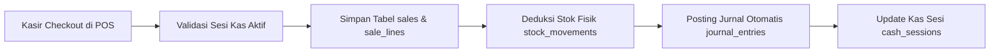
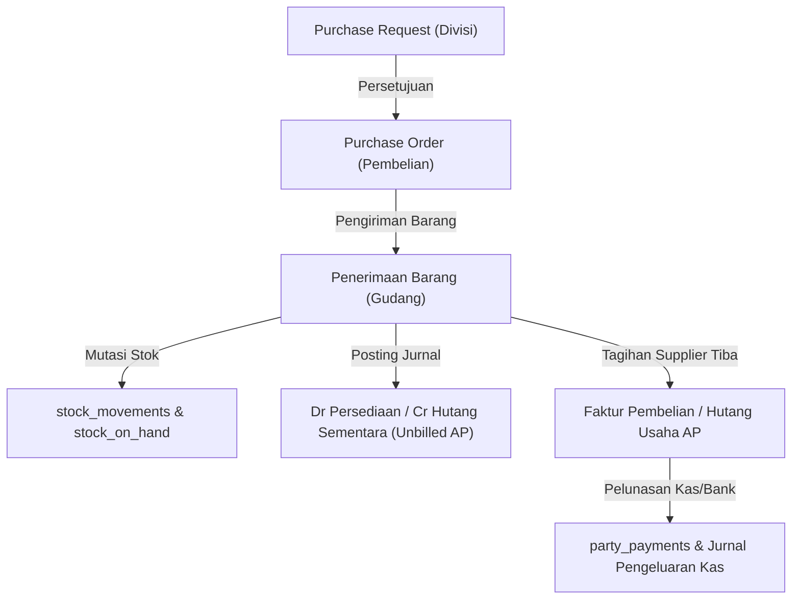
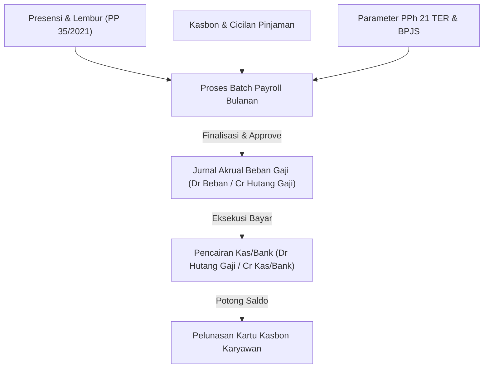

# 04. Peta Data, Kepemilikan (System of Record) & Matriks Konflik

Dokumen ini memetakan kepemilikan entitas data tunggal (*Single Source of Truth*), mendokumentasikan tempat-tempat yang menulis data tersebut, memetakan transaksi lintas modul, dan menghasilkan **Matriks Konflik Antar-Modul**.

---

## 1. Peta Kepemilikan Data (System of Record)

| Entitas Master | Tabel Utama | System of Record (Pemilik Sah) | Modul Lain yang Menulis / Mengubah | Kategori Risiko |
| :--- | :--- | :--- | :--- | :---: |
| **Produk & SKU** | `products`, `product_packagings` | **Gudang (Inventory)** | Pengaturan (Group Pricing), Impor Spreadsheet (`/api/import`) | **SEDANG** |
| **Pemasok (Supplier)** | `suppliers` | **Gudang (Inventory)** | Impor Spreadsheet (`/api/import`) | **RENDAH** |
| **Pelanggan (Customer)** | `customers` | **AMBIGU** (Gudang vs POS) | Gudang (`pihak.ts`), POS (`pos.ts: quickAddCustomer`), Impor | **TINGGI** |
| **Karyawan (Employee)** | `employees` | **HR & Payroll** | - | **TINGGI** (Decoupled dari `users`) |
| **Pengguna Sistem (User)**| `user`, `members` | **Pengaturan (RBAC)** | Better-Auth API | **TINGGI** (Decoupled dari `employees`) |
| **Bagan Akun (COA)** | `accounts`, `account_mappings` | **Akuntansi** | Pengaturan (Pemetaan Akun), Migrasi COA | **SEDANG** |
| **Stok Fisik & Kartu Stok**| `stock_on_hand`, `stock_movements` | **Gudang (Inventory)** | POS (Checkout, Void, Retur), Penyesuaian, Transfer, Opname | **TINGGI** |
| **Harga & Diskon** | `products.price`, `customer_group_discounts` | **Gudang & Pengaturan** | POS Cashier (Manual Discount) | **SEDANG** |
| **Gudang & Cabang** | `warehouses`, `branches` | **Pengaturan** | - | **RENDAH** |

---

## 2. Matriks Konflik Antar-Modul (Conflict Matrix)

| ID Konflik | Entitas Master | Modul Penulis A | Modul Penulis B | Field yang Berkonflik | Akibat / Dampak Bisnis | Bukti Kode (File:Baris) |
| :---: | :--- | :--- | :--- | :--- | :--- | :--- |
| **CONF-01** | **Pelanggan (`customers`)** | **POS** (`quickAddCustomerAction`) | **Gudang** (`saveCustomerAction`) | `creditLimit`, `groupId`, `phone`, `address`, `npwp` | Transaksi kasir POS membuat pelanggan dengan `creditLimit = 0` dan `groupId = null` tanpa validasi duplikasi nomor telepon. Data menjadi tidak lengkap dan terpecah dari master pelanggan gudang. | `src/server/actions/pos.ts:25-50` vs `src/server/actions/inventory/pihak.ts:135-180` |
| **CONF-02** | **Izin Akses Pelanggan** | **Gudang** (`/app/gudang/pemasok`) | **Sistem Izin** (`permissions.ts`) | Permission key `pos.sell` vs `inventory.manage` | Staf gudang yang membuka menu Pemasok & Pelanggan di Gudang ditolak saat mengedit Pelanggan karena server action menuntut `pos.sell` padahal modulnya adalah `gudang`. Jika POS dimatikan, pelanggan tidak bisa diedit dari gudang. | `src/server/actions/inventory/pihak.ts:137` |
| **CONF-03** | **Karyawan vs Akun Login** | **HR** (`employees`) | **Pengaturan** (`users`) | `status` (aktif / nonaktif / resign) | Terminasi karyawan di HR (`terminateEmployeeAction`) **tidak menonaktifkan** akun login di `users`/Better-Auth. Mantan karyawan yang dipecat/keluar masih bisa login, melihat data, dan bertransaksi di POS/Gudang. | `src/server/actions/hr/karyawan.ts:20-60` vs `src/server/actions/users.ts:80-120` |
| **CONF-04** | **Konfigurasi Stok Negatif** | **Gudang** (Logika Ledger) | **Pengaturan** (UI Identitas & Pajak) | `allowNegativeStock` | Pengaturan krusial perilaku stok gudang diletakkan di tab profil perusahaan & pajak (`identitas-pajak.tsx`), bukan di Gudang atau Pengaturan Lokasi. Operator gudang tidak menemukan kontrol ini saat terjadi selisih fisik. | `src/components/pengaturan/forms/identitas-pajak.tsx:346` |
| **CONF-05** | **Harga Jual Produk** | **Katalog Gudang** (`products.price`) | **Kelompok Harga** (`customer_group_discounts`) | `price` vs `overridePrice` | Jika harga master diubah oleh staf gudang, matriks diskon harga grup tidak otomatis terupdate jika memakai override nominal tetap, menimbulkan disparitas harga antara kasir POS dan faktur penjualan. | `src/server/actions/settings/kelompok-harga.ts:40-70` vs `src/server/actions/inventory/produk.ts:80-110` |
| **CONF-06** | **Pemetaan Akun Biaya Bank** | **Pengaturan** (`payment_methods.accountId`) | **POS Checkout** (`sales-persist.ts`) | `map.bank_fee` | Jika metode bayar EDC/QRIS disetel memiliki fee transaksi (MDR), namun akun `bank_fee` di Pemetaan Akun kosong, kasir mengalami *hard crash* saat checkout tanpa peringatan awal saat setting metode dibuat. | `src/server/pos/sales-persist.ts:299-304` |
| **CONF-07** | **Master Beban Operasional** | **Jurnal Umum Akuntansi** | **Form Beban Mandiri (Legacy)** | `expenses` vs `journal_entries` | Terdapat rute orphan `/app/akuntansi/beban` yang dapat mencatat pengeluaran kas tanpa melalui alur verifikasi jurnal standar, menghasilkan inkonsistensi nomor bukti transaksi. | `src/app/app/akuntansi/(akuntansi)/beban/page.tsx` |

---

## 3. Pemetaan Transaksi Lintas Modul & Titik Kegagalan (Failure Scenarios)

### Skenario A: Penjualan Kasir POS (POS → Gudang → Akuntansi)

- **Atomisitas**: Dijamin oleh blok transaksi tunggal `withCompany(..., async (tx) => { ... })`.
- **Titik Rawan Kegagalan**:
  1. Jika salah satu akun COA pemetaan sistem (`cogs`, `inventory`, `revenue`, `tax_output`, `bank_fee`) hilang atau belum dipetakan, seluruh transaksi kasir gagal total (kasir terblokir melayani antrean pelanggan).
  2. Jika `allowNegativeStock = false` dan stok fisik di sistem kurang dari keranjang belanja kasir (misal barang ada di rak fisik tapi penerimaan barang belum diinput oleh staf gudang), kasir ditolak menjual barang tersebut.

### Skenario B: Pembelian & Penerimaan Barang (PR → PO → Penerimaan Gudang → Tagihan AP → Jurnal)

- **Atomisitas**: Penerimaan barang (`receiveStockAction`) berjalan atomik antara update status PO, batch delta, kartu stok, dan jurnal akuntansi.
- **Titik Rawan Kegagalan**:
  1. Penerimaan parsial barang (*partial delivery*): jika kuantiti diterima melebihi PO (*over-receipt*), sistem menolak tanpa opsi toleransi kelebihan penerimaan dari pemasok.
  2. Pemotongan Uang Muka Pembelian: Uang muka yang sudah dicatat harus dialokasikan manual saat faktur terbit; jika terjadi pembatalan penerimaan (*void receipt*), pengembalian alokasi uang muka rentan mengalami desinkronisasi saldo uang muka terbuka.

### Skenario C: Penggajian Bulanan (Presensi/Lembur/Kasbon → Payroll Batch → Jurnal Beban → Kas/Bank)

- **Atomisitas**: Perhitungan draft payroll terpisah dari posting jurnal. Posting jurnal baru dieksekusi saat tombol "Bayar Payroll" ditekan.
- **Titik Rawan Kegagalan**:
  1. Jika karyawan memiliki kasbon terbuka tetapi kasbon tersebut di-void setelah batch payroll di-generate dalam status draft, take-home pay pada batch draft menjadi usang dan salah bayar.
  2. Data mantan karyawan yang berstatus `inactive` harus dipastikan terfilter keluar dari batch penggajian bulan berikutnya agar tidak terjadi kebocoran dana gaji.
