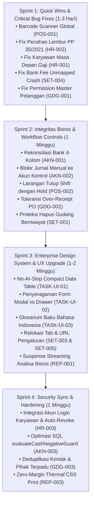

# 09. MASTER TASK PLAN: ROADMAP MENUJU SKOR 5/5 SELURUH SISTEM

- **Proyek**: BISA-ERP
- **Target Kualitas**: Skor **5.0 / 5.0** pada 8 Dimensi (Fungsi, UI, UX, Workflow, Data, Laporan, Performa, Hak Akses) di seluruh modul.
- **Prinsip Desain**: **"No AI Slop" Enterprise Craft** — Bersih, fungsional, berdensitas tinggi (*compact density*), tipografi tabular, navigasi full-keyboard, bebas dekorasi visual yang tidak perlu (*zero-clutter*).
- **Status Eksekusi**: **Perencanaan Tugas (Task Plan Only)** — Belum ada kode produksi yang diubah.

---

## 1. Standar Mutu Skor 5/5 per Dimensi

Untuk mencapai skor sempurna 5/5 di seluruh sistem, setiap modul wajib memenuhi kriteria obyektif berikut:

| Dimensi | Kriteria Kelulusan Skor 5.0 (Definisi Sempurna) |
| :--- | :--- |
| **1. Fungsi** | Seluruh *happy path*, *edge cases* (nol, minus, desimal, tanggal kabisat, tutup tahun), dan *error path* tervalidasi dengan pesan kesalahan Bahasa Indonesia yang spesifik. Nol silent catch. |
| **2. Tampilan (UI)** | **No AI Slop**: Desain tabular enterprise (*Linear/Shopify Polaris style*), border 1px presisi, zero-gradient murahan, zero-glassmorphism buram, kontras rasio WCAG AAA, hierarki tipografi tegas, angka tabular monospaced. |
| **3. UX & Ergonomi** | Navigasi *keyboard-first* (Tab/Enter/Esc/Hotkeys), auto-focus cerdas, zero-lost-focus pada barcode scanner, feedback aksi instan (optimistic UI / inline feedback), modal konfirmasi hanya untuk aksi destruktif ireversibel. |
| **4. Workflow** | State machine dokumen formal (`Draft` → `Submitted` → `Approved` → `Posted` → `Reversed`). Tidak ada jalan pintas status ilegal; dokumen posted mutlak *append-only* (hanya bisa dibatalkan lewat reversal berdokumen). |
| **5. Integritas Data** | *Single Source of Truth* tegas per entitas. Transaksi lintas modul atomik dalam satu blok `tx`. Foreign key dan check constraints ketat. Soft-delete untuk entitas berjejak transaksi. Nol *orphan records*. |
| **6. Laporan** | Angka 100% rekonsiliasi matematis antara Buku Besar, Sub-ledger, dan Fisik (Neraca seimbang, Kas Arus cocok, Laba Bersih klop). Format cetak struk thermal 58mm/80mm rapi tanpa margin terpotong, ekspor Excel ber-styling formal. |
| **7. Performa** | Waktu respon interaksi < 100ms, TTFB halaman < 300ms, Server Actions < 200ms. Paginasi server pada semua tabel > 50 baris. Agregasi saldo di database engine (SQL), bukan `.reduce()` di memori server. |
| **8. Hak Akses** | RBAC granular per modul dan per level-field (misal angka gaji hanya untuk pemegang izin salary). Isolasi multi-tenant antipeluru. Karyawan resign/terminasi otomatis mencabut akses login sistem. |

---

## 2. Manifest Desain "No AI Slop" Enterprise ERP

Riset empiris (Linear, Shopify Polaris, Paddle Design System, Dee Kargaev Data Tables) menetapkan aturan desain enterprise untuk BISA-ERP:

```text
PRINSIP UTAMA: "SOFTWARE ADALAH ALAT KERJA, BUKAN BROSUR PEMASARAN"
1. Zero AI Slop: Dilarang keras menggunakan background gradient ungu-oranye buram, glassmorphism backdrop-blur berlebihan, atau sudut melengkung raksasa (max border-radius: 6px-8px).
2. Densitas Tinggi (Compact Density): Tinggi baris tabel 36px-40px. Padding sel horizontal 12px, vertikal 6px. Kolom angka rata kanan dengan font tabular (`font-mono` atau `tabular-nums`).
3. 1px Hairline Borders: Pemisahan data menggunakan garis 1px solid `border-border` yang tegas dan bersih, bukan drop-shadow kabur yang tebal.
4. Warna Semantik Ketat:
   - Hijau (Emerald/Green): Dokumen Posted, Selesai, Laba Positif, Stok Cukup.
   - Kuning/Amber: Menunggu Persetujuan (Pending), Jatuh Tempo Dekat, Warning.
   - Merah (Rose/Destructive): Void, Dibatalkan, Overdue, Saldo Negatif, Error.
   - Slate/Zinc Netral: Draft, Catatan, Dokumen Tertutup.
5. Ergonomi Keyboard Kasir: Fokus kursor tidak boleh lepas dari input transaksi; scanner barcode fisik harus otomatis tertangkap tanpa harus diklik dengan mouse.
```

---

## 3. Rincian Rencana Tugas per Epic (Actionable Task Breakdown)

---

### EPIC 1: Fondasi Design System Enterprise & Ergonomi Keyboard
*Tujuan: Mengangkat skor UI dari 3.14 → 5.0 dan UX dari 2.79 → 5.0 di seluruh sistem.*

#### Task 1.1: Standarisasi Data Table Enterprise ("No AI Slop" Data Grid)
- **ID**: `TASK-UI-01`
- **Tujuan**: Menghilangkan tabel longgar dan inkonsisten, menggantinya dengan compact data table berdensitas tinggi.
- **Berkas yang Disentuh**:
  - `src/components/ui/table.tsx`
  - `src/components/blocks/data-table.tsx`
  - `src/app/globals.css`
- **Langkah Kerja**:
  1. Set tinggi baris tabel default menjadi 36px (compact) dan 42px (normal).
  2. Tambahkan kelas utilitas `.tabular-nums` dan `font-mono` untuk semua kolom kuantiti, kode SKU, nomor bukti, dan nominal Rupiah.
  3. Format angka nominal uang wajib rata kanan (`text-right`) dengan header kolom yang juga rata kanan.
  4. Terapkan *sticky header* (`top-0 z-10 bg-card border-b border-border`) pada semua tabel daftar agar header tetap terlihat saat data di-scroll.
  5. Tambahkan *keyboard row selection* (panah atas/bawah untuk navigasi baris, Enter untuk buka detail).
- **Kriteria Penerimaan (DoD)**:
  - [ ] Tabel di Gudang, Akuntansi, dan POS memiliki tinggi baris seragam 36px/40px.
  - [ ] Angka nominal tidak bergeser saat nilai berubah (*zero font jitter* berkat `tabular-nums`).
  - [ ] Navigasi panah keyboard berfungsi mulus pada tabel.

#### Task 1.2: Standardisasi Pola Form CRUD (Slide-Over Drawer vs Dialog)
- **ID**: `TASK-UI-02`
- **Tujuan**: Mengakhiri percampuran acak antara pop-up modal, drawer samping, dan full-page.
- **Berkas yang Disentuh**:
  - `src/components/blocks/` (buat `form-sheet.tsx` dan `form-dialog.tsx` terpadu)
  - `src/components/gudang/`
  - `src/components/akuntansi/`
  - `src/components/pengaturan/`
- **Langkah Kerja**:
  1. Tetapkan konvensi tegas:
     - Form Master Sederhana (Kategori, Satuan, Metode Bayar, Akun COA) -> **Modal Dialog Sempit (Maks 480px)**.
     - Form Master Kompleks (Produk, Pemasok, Pelanggan, Karyawan) -> **Slide-over Sheet Lebar Samping Kanan (Lebar 560px-640px)** dengan tombol Simpan/Batal sticky di footer.
     - Form Transaksi Multi-baris (Jurnal Umum, PO, Penerimaan Gudang, Opname) -> **Dedicated Page Full-width**.
  2. Tambahkan proteksi *dirty form state*: jika pengguna menutup drawer/dialog saat data sudah diketik, munculkan konfirmasi *"Perubahan belum disimpan. Yakin ingin menutup?"*.
- **Kriteria Penerimaan (DoD)**:
  - [ ] Tidak ada lagi ketidakkonsistenan form antar-modul.
  - [ ] Form tidak tertutup tanpa sengaja yang menyebabkan data pengguna hilang.

#### Task 1.3: Glosarium Terpadu Bahasa Indonesia Baku
- **ID**: `TASK-UI-03`
- **Tujuan**: Menghilangkan percampuran kata asing ("Supplier" vs "Pemasok", "Customer" vs "Pelanggan", "Purchase Request" vs "Permintaan").
- **Berkas yang Disentuh**:
  - Seluruh komponen form di `src/components/gudang/`, `src/components/pos/`, `src/components/akuntansi/`.
- **Langkah Kerja**:
  1. Ganti semua string UI:
     - "Supplier" -> "Pemasok"
     - "Customer" -> "Pelanggan"
     - "Purchase Request" / "PR" -> "Permintaan Pembelian"
     - "Purchase Order" / "PO" -> "Pesanan Pembelian"
     - "Employee Advance" -> "Kasbon Karyawan"
     - "Void" (pada gudang/dokumen) -> "Dibatalkan"
     - "Reversal" -> "Jurnal Pembalik"
  2. Buat berkas konstanta label terpusat di `src/lib/glossary.ts`.
- **Kriteria Penerimaan (DoD)**:
  - [ ] Pemeriksaan teks codebase membuktikan 100% kepatuhan glosarium bahasa Indonesia baku.

---

### EPIC 2: Modul Pengaturan & Master Sistem (Skor 3.25 → 5.0)

#### Task 2.1: Perbaikan Penghapusan Gudang Berriwayat (SET-001)
- **ID**: `TASK-SET-01`
- **Tujuan**: Mencegah internal server error 500 saat menghapus gudang kosong yang pernah memiliki transaksi.
- **Berkas yang Disentuh**:
  - `src/server/actions/settings/lokasi.ts`
- **Langkah Kerja**:
  1. Pada `deleteWarehouseAction`, tambahkan query pengecekan ke tabel `stock_movements`:
     ```typescript
     const [hasHistory] = await tx
       .select({ count: count() })
       .from(stockMovements)
       .where(and(eq(stockMovements.companyId, ctx.company.id), eq(stockMovements.warehouseId, warehouseId)));
     if ((hasHistory?.count ?? 0) > 0) {
       throw new AppError(
         "CONFLICT",
         "Gudang ini memiliki riwayat mutasi stok historis sehingga tidak dapat dihapus permanen. Silakan nonaktifkan gudang ini agar tidak digunakan lagi pada transaksi baru.",
       );
     }
     ```
  2. Tambahkan tombol toggle aktif/nonaktif yang jelas di UI `gudang-cabang.tsx`.
- **Kriteria Penerimaan (DoD)**:
  - [ ] Gudang dengan riwayat mutasi ditolak dengan pesan validasi ramah, bukan crash error 500.
  - [ ] Gudang baru yang belum pernah bertransaksi tetap dapat dihapus bersih.

#### Task 2.2: Soft-Deactivate Pengguna untuk Menjaga Integritas Audit Trail (SET-002)
- **ID**: `TASK-SET-02`
- **Tujuan**: Mencegah musnahnya user record yang meninggalkan string orphan di kolom `created_by`.
- **Berkas yang Disentuh**:
  - `src/server/actions/users.ts`
  - `src/db/schema/auth.ts`
  - `src/components/pengaturan/user-access.tsx`
- **Langkah Kerja**:
  1. Ubah logika `removeCompanyUserAction`:
     - Periksa apakah user pernah membuat transaksi (`sales`, `journalEntries`, `stockDocuments`).
     - Jika ada jejak transaksi, **larang delete fisik** dari tabel `user`. Cukup putuskan relasi di tabel `member` (cabut membership perusahaan) dan tandai akun sebagai `banned: true` atau `isActive: false`.
  2. Pada tampilan audit trail, tampilkan nama pengguna historis dengan badge `(Nonaktif)` jika akun sudah dicabut.
- **Kriteria Penerimaan (DoD)**:
  - [ ] Kolom `created_by` pada jurnal dan nota lama tetap dapat menampilkan nama pembuat asli.
  - [ ] Jejak audit transaksi historis utuh 100%.

#### Task 2.3: Relokasi Pengaturan Stok Negatif ke Lokasi Gudang (SET-003)
- **ID**: `TASK-SET-03`
- **Tujuan**: Memperbaiki mental model mismatch: memindahkan `allowNegativeStock` dari profil pajak ke pengaturan operasional gudang.
- **Berkas yang Disentuh**:
  - `src/components/pengaturan/forms/identitas-pajak.tsx`
  - `src/components/pengaturan/forms/gudang-cabang.tsx` (atau tab Operasi Gudang)
  - `src/app/app/pengaturan/page.tsx`
- **Langkah Kerja**:
  1. Hapus checkbox `allowNegativeStock` dari `identitas-pajak.tsx`.
  2. Tempatkan kontrol `allowNegativeStock` ke dalam `gudang-cabang.tsx` di bawah kartu *"Kebijakan Persediaan Gudang"*.
  3. Tambahkan penjelasan risiko akuntansi: *"Jika diaktifkan, kasir POS dapat menjual produk saat stok sistem 0 (membawa stok negatif). Biaya pokok akan disesuaikan otomatis saat barang masuk kembali."*
- **Kriteria Penerimaan (DoD)**:
  - [ ] Pengaturan stok negatif mudah ditemukan di tab Gudang & Cabang.

#### Task 2.4: Validasi Prasyarat Akun Bank Fee pada Metode Pembayaran (SET-004)
- **ID**: `TASK-SET-04`
- **Tujuan**: Menghentikan crash kasir POS akibat metode pembayaran ber-fee yang akunnya belum dipetakan.
- **Berkas yang Disentuh**:
  - `src/server/actions/settings/pembayaran.ts`
  - `src/components/pengaturan/forms/metode-pembayaran.tsx`
- **Langkah Kerja**:
  1. Pada `savePaymentMethodAction` dan `updatePaymentMethodAction`:
     - Jika input `feeEnabled === true` atau persentase fee > 0:
     - Query pemetaan akun sistem `account_mappings` untuk kunci `bank_fee`.
     - Jika akun `bank_fee` kosong/null, tolak penyimpanan dengan pesan: *"Metode pembayaran dengan biaya (MDR) memerlukan Akun Beban Fee Bank. Silakan petakan akun 'bank_fee' di tab Pemetaan Akun terlebih dahulu."*
  2. Di UI form metode pembayaran, tampilkan link shortcut ke tab Pemetaan Akun jika akun belum disetel.
- **Kriteria Penerimaan (DoD)**:
  - [ ] Metode bayar ber-fee tidak bisa disimpan tanpa akun penampung.
  - [ ] Kasir POS terbebas dari ancaman crash saat checkout metode non-tunai.

#### Task 2.5: Penyeragaman Rute Navigasi Pengaturan (SET-005)
- **ID**: `TASK-SET-05`
- **Tujuan**: Menghilangkan percampuran antara query parameter `?tab=` dan sub-halaman terpisah.
- **Berkas yang Disentuh**:
  - `src/lib/settings-nav.ts`
  - `src/app/app/pengaturan/`
- **Langkah Kerja**:
  1. Konversikan 9 tab query parameter menjadi sub-rute bersih yang konsisten:
     - `/app/pengaturan/umum`
     - `/app/pengaturan/pengguna`
     - `/app/pengaturan/payroll-indonesia`
     - `/app/pengaturan/cetak`
     - `/app/pengaturan/nomor`
     - `/app/pengaturan/pembayaran`
     - `/app/pengaturan/grup`
     - `/app/pengaturan/lokasi`
     - `/app/pengaturan/akun`
     - `/app/pengaturan/modul`
     - `/app/pengaturan/kolom`
     - `/app/pengaturan/status`
  2. Sediakan redirect dari URL `?tab=` lama ke sub-rute baru agar tidak merusak bookmark lama.
- **Kriteria Penerimaan (DoD)**:
  - [ ] Struktur URL Pengaturan bersih dan seragam.
  - [ ] Tombol back/forward browser bekerja mulus tanpa kehilangan state form.

---

### EPIC 3: Modul Akuntansi & Keuangan Dasar (Skor 3.50 → 5.0)

#### Task 3.1: Reformulasi Perhitungan Ringkasan Rekonsiliasi Bank (AKN-001)
- **ID**: `TASK-AKN-01`
- **Tujuan**: Memperbaiki rumus rekonsiliasi bank agar tidak menghasilkan nilai negatif semu dan lulus tes integrasi `review-fixes-t4rb.test.ts`.
- **Berkas yang Disentuh**:
  - `src/server/bank-reconciliation/reads.ts`
  - `tests/integration/review-fixes-t4rb.test.ts`
- **Langkah Kerja**:
  1. Rombak fungsi `getReconciliationSummary`:
     - Pisahkan akumulasi baris mutasi debit (uang masuk) dan kredit (uang keluar).
     - Hitung:
       - Saldo Buku Kas/Bank per tanggal dokumen.
       - Total Setoran Belum Tercatat Bank (*Deposit in Transit*): jurnal debit penerimaan yang belum di-match ke rekening koran.
       - Total Pengeluaran Belum Dicairkan (*Outstanding Payments*): jurnal kredit pengeluaran yang belum di-match ke rekening koran.
       - Saldo Disesuaikan (*Adjusted Book Balance*).
     - Pastikan `unreconciledTotal` dihitung dari selisih riil mutasi terbuka, bukan pengurangan skalar yang bisa bernilai negatif.
  2. Jalankan kembali tes `pnpm vitest run tests/integration/review-fixes-t4rb.test.ts` hingga 100% lulus (7/7 passed).
- **Kriteria Penerimaan (DoD)**:
  - [ ] Suite tes integrasi `tests/integration/review-fixes-t4rb.test.ts` lolos tanpa error.
  - [ ] Ringkasan rekonsiliasi bank di UI menampilkan komponen rekonsiliasi yang benar.

#### Task 3.2: Proteksi Larangan Posting Manual ke Akun Kontrol GL (AKN-002)
- **ID**: `TASK-AKN-02`
- **Tujuan**: Mencegah rusaknya rekonsiliasi GL vs Subledger akibat jurnal umum manual yang menyentuh Piutang, Hutang, atau Persediaan.
- **Berkas yang Disentuh**:
  - `src/server/actions/accounting/jurnal.ts`
  - `src/server/accounting.ts`
- **Langkah Kerja**:
  1. Pada `postManualJournalAction`, ambil daftar ID akun kontrol yang terpetakan (`receivable`, `payable`, `inventory`, `unbilled_payable`).
  2. Jika ada baris jurnal yang menggunakan salah satu dari akun kontrol tersebut:
     - Tolak posting dengan pesan: *"Akun [Kode - Nama] adalah Akun Kontrol Sistem. Akun ini tidak dapat dimutasi lewat Jurnal Umum manual agar saldo Buku Besar tetap selaras dengan kartu stok dan buku pembantu. Gunakan dokumen penerimaan, faktur, atau retur terkait."*
  3. Pada form UI pembuatan jurnal baru (`/app/akuntansi/jurnal/baru`), tandai akun kontrol dengan badge `[Akun Kontrol]` dan disabled dari pilihan dropdown.
- **Kriteria Penerimaan (DoD)**:
  - [ ] Jurnal manual tidak bisa memposting ke akun kontrol.
  - [ ] Laporan Rekonsiliasi Kontrol (`/app/akuntansi/rekonsiliasi-kontrol`) selalu dalam kondisi selaras (selisih = 0).

#### Task 3.3: Optimasi Performa Query Agregasi Saldo Kas (AKN-003)
- **ID**: `TASK-AKN-03`
- **Tujuan**: Menghilangkan bottleneck N+1 memori pada `evaluateCashNegativeGuard` yang menarik seluruh baris historis ke Node.js.
- **Berkas yang Disentuh**:
  - `src/server/accounting.ts`
- **Langkah Kerja**:
  1. Ganti loop pengambilan array baris `select({ debit, credit })` dan `.reduce()` di JavaScript dengan single aggregation query:
     ```typescript
     const [balanceRow] = await tx
       .select({
         balance: sql<string>`coalesce(sum(${journalLines.debit}) - sum(${journalLines.credit}), 0)`,
       })
       .from(journalLines)
       .innerJoin(journalEntries, eq(journalLines.entryId, journalEntries.id))
       .where(
         and(
           eq(journalLines.companyId, companyId),
           eq(journalLines.accountId, accountId),
           eq(journalEntries.status, "posted"),
         ),
       );
     const balance = d(balanceRow?.balance ?? 0);
     ```
  2. Tambahkan composite index database: `create index if not exists journal_lines_comp_acc_status_idx on journal_lines (company_id, account_id)`.
- **Kriteria Penerimaan (DoD)**:
  - [ ] Evaluasi saldo kas berjalan dalam < 5ms tanpa membebani memori server Node.js.

#### Task 3.4: Pelaporan Potongan Pajak PPh (Withholding) (AKN-004)
- **ID**: `TASK-AKN-04`
- **Tujuan**: Melengkapi modul pajak agar tidak hanya menampilkan PPN, melainkan juga rekap bukti potong PPh 21/23.
- **Berkas yang Disentuh**:
  - `src/server/reports/vat.ts` (rename / expand to `taxes.ts`)
  - `src/app/app/akuntansi/(akuntansi)/pajak/page.tsx`
  - `src/server/reports/export-builders.ts`
- **Langkah Kerja**:
  1. Tambahkan tab *"PPh Pemotongan (Withholding)"* di menu Pajak.
  2. Agregasikan data pembayaran utang (`party_payments`) yang memiliki potongan PPh: tanggal bayar, nomor bukti potong, nama vendor, NPWP, nilai tagihan bruto, tarif PPh %, nominal potong.
  3. Sediakan tombol ekspor spreadsheet format impor e-Bupot DJP Online.
- **Kriteria Penerimaan (DoD)**:
  - [ ] Bagian keuangan memiliki rekapitulasi PPh 21/23 yang siap dilaporkan ke kantor pajak.

---

### EPIC 4: Modul Gudang, Persediaan & Pengadaan (Skor 3.38 → 5.0)

#### Task 4.1: Koreksi Izin Akses Master Pelanggan di Gudang (GDG-001)
- **ID**: `TASK-GDG-01`
- **Tujuan**: Memungkinkan kepala gudang dan staf logistik mengelola alamat pengiriman dan kontak pelanggan tanpa membutuhkan akun kasir `pos.sell`.
- **Berkas yang Disentuh**:
  - `src/server/actions/inventory/pihak.ts`
- **Langkah Kerja**:
  1. Ubah baris 137, 218, 238 di `pihak.ts`:
     - Ganti `requirePermissionInModule("pos.sell", "gudang")` menjadi `requirePermissionInModule("inventory.manage", "gudang")`.
  2. Tambahkan izin fallback: jika pengguna memiliki salah satu dari `inventory.manage` ATAU `pos.sell`, tindakan diizinkan (`can(ctx, "inventory.manage") || can(ctx, "pos.sell")`).
- **Kriteria Penerimaan (DoD)**:
  - [ ] Staf gudang dengan role logistik dapat menambah, mengedit, dan menyimpan pelanggan.

#### Task 4.2: Penegakan Batas Toleransi Kelebihan Penerimaan Barang PO (GDG-002)
- **ID**: `TASK-GDG-02`
- **Tujuan**: Mencegah penerimaan kuantiti barang melebihi PO tanpa kendali dan otorisasi.
- **Berkas yang Disentuh**:
  - `src/server/inventory/receipts.ts`
  - `src/server/purchasing.ts`
  - `src/components/gudang/forms/receipt-form.tsx`
- **Langkah Kerja**:
  1. Di `createReceipt`: saat penerimaan ditautkan ke PO, bandingkan kuantiti terima vs sisa kuantiti pesanan (`orderLine.qty - orderLine.receivedQty`).
  2. Ambil parameter toleransi dari pengaturan perusahaan (`poOverReceiptTolerancePercent`, default: 0%).
  3. Jika kuantiti terima melampaui toleransi:
     - Tolak dengan pesan: *"Kuantiti terima ([X]) melebihi sisa pesanan PO ([Y]). Maksimal toleransi kelebihan terima adalah [Z]%. Lakukan revisi PO terlebih dahulu jika ada penambahan kuantiti dari pemasok."*
- **Kriteria Penerimaan (DoD)**:
  - [ ] Gudang tidak bisa menerima barang melampaui PO tanpa revisi resmi.
  - [ ] Anggaran pembelian terlindungi dari pengiriman berlebih sepihak oleh vendor.

#### Task 4.3: Tombol Aksi & Badge Notifikasi Duplikat Kontak (GDG-003)
- **ID**: `TASK-GDG-03`
- **Tujuan**: Memunculkan fitur deteksi duplikasi pihak yang selama ini tersembunyi tanpa menu.
- **Berkas yang Disentuh**:
  - `src/app/app/gudang/pemasok/page.tsx`
  - `src/components/gudang/`
- **Langkah Kerja**:
  1. Di header halaman `/app/gudang/pemasok`, tambahkan tombol sekunder *"Periksa Duplikat"* (`icon: CopyCheck`).
  2. Jalankan query hitung cepat: jika terdapat pasangan duplikat potensial, sematkan badge merah kecil berangka di atas tombol tersebut (misal: `"3 Terdeteksi"`).
  3. Klik tombol mengarahkan pengguna ke `/app/gudang/pemasok/duplikat`.
- **Kriteria Penerimaan (DoD)**:
  - [ ] Fitur pembersih data duplikat dapat ditemukan dan digunakan dengan mudah oleh pengguna.

#### Task 4.4: Navigasi Breadcrumbs & Tombol Kembali Dokumen Terpadu (GDG-005)
- **ID**: `TASK-GDG-04`
- **Tujuan**: Memastikan pengguna tidak tersesat saat membuka detail dokumen pergerakan stok di `/app/gudang/dokumen/[id]`.
- **Berkas yang Disentuh**:
  - `src/app/app/gudang/dokumen/[id]/page.tsx`
- **Langkah Kerja**:
  1. Deteksi jenis dokumen sumber (`document.type`): jika tipe `receipt` arahkan tombol kembali ke `/app/gudang/penerimaan`, jika `adjustment` ke `/app/gudang/penyesuaian`, jika `transfer` ke `/app/gudang/transfer`.
  2. Render breadcrumbs standar `Gudang > Riwayat Pergerakan > [Nomor Dokumen]`.
- **Kriteria Penerimaan (DoD)**:
  - [ ] Pengguna memiliki jalur navigasi kembali yang jelas dan kontekstual.

---

### EPIC 5: Modul POS Kasir & Till Management (Skor 3.56 → 5.0)

#### Task 5.1: Pengaktifan Hook Barcode Scanner Global di Terminal Kasir (POS-001)
- **ID**: `TASK-POS-01`
- **Tujuan**: Menghubungkan hook `useBarcodeScannerCapture` agar barcode scanner fisik selalu tertangkap akurat di kasir.
- **Berkas yang Disentuh**:
  - `src/components/pos/pos-terminal.tsx`
- **Langkah Kerja**:
  1. Hapus status unused pada import baris 9 di `pos-terminal.tsx`.
  2. Aktifkan hook di dalam komponen:
     ```typescript
     useBarcodeScannerCapture({
       onScan: (code) => {
         handleBarcodeScanned(code);
       },
       enabled: !isPaymentDialogOpen && !isHoldDialogOpen,
     });
     ```
  3. Hubungkan callback `handleBarcodeScanned` ke `addCartLine` dengan pencarian SKU/barcode instan.
- **Kriteria Penerimaan (DoD)**:
  - [ ] Pindaian barcode saat kursor berada di luar input text langsung memasukkan item ke keranjang.
  - [ ] Pindaian barcode saat kursor di input quantity tidak merusak angka quantity.
  - [ ] ESLint warning `@typescript-eslint/no-unused-vars` hilang bersih.

#### Task 5.2: Larangan Penutupan Shift Kasir Saat Pesanan Ditahan Aktif (POS-002)
- **ID**: `TASK-POS-02`
- **Tujuan**: Menegakkan disiplin till management kasir agar tidak ada transaksi gantung saat pergantian shift.
- **Berkas yang Disentuh**:
  - `src/server/pos/sessions.ts`
  - `src/components/pos/session-close-dialog.tsx`
- **Langkah Kerja**:
  1. Pada `closeCashSession`:
     - Hitung jumlah transaksi berstatus `held` milik kasir/perusahaan tersebut:
       ```typescript
       const [heldCount] = await tx
         .select({ count: count() })
         .from(sales)
         .where(
           and(
             eq(sales.companyId, input.companyId),
             eq(sales.userId, input.userId),
             eq(sales.status, "held"),
           ),
         );
       if ((heldCount?.count ?? 0) > 0) {
         throw new AppError(
           "INVALID_STATE",
           `Masih terdapat ${heldCount.count} transaksi tertahan (hold) yang belum diselesaikan. Selesaikan pembayaran atau batalkan pesanan tahanan tersebut sebelum menutup sesi kasir.`,
         );
       }
       ```
  2. Pada dialog tutup shift di UI kasir, tampilkan peringatan dan daftar transaksi hold bertaut jika masih ada.
- **Kriteria Penerimaan (DoD)**:
  - [ ] Kasir tidak bisa menutup shift jika ada pesanan gantung.
  - [ ] Serah terima shift kasir bebas dari selisih transaksi tersembunyi.

#### Task 5.3: Pembersihan Stale State & Dependency React Hooks POS (POS-003)
- **ID**: `TASK-POS-03`
- **Tujuan**: Menghilangkan warning ESLint exhaustive-deps dan mencegah stale state pada keranjang belanja.
- **Berkas yang Disentuh**:
  - `src/components/pos/pos-terminal.tsx`
  - `src/components/pos/use-cart-persistence.ts`
  - `src/components/pos/use-held-sales.ts`
  - `src/components/pos/use-quote.ts`
- **Langkah Kerja**:
  1. Masukkan seluruh dependensi yang hilang (`setSearch`, `setCart`, `offlineQuote`) ke dalam dependency array hooks terkait.
  2. Gunakan functional state updates (`setCart(prev => ...)` alih-alih membaca `cart` langsung dari closure luar.
  3. Hapus variabel mati `paidAmount` di baris 458 `pos-terminal.tsx`.
- **Kriteria Penerimaan (DoD)**:
  - [ ] `pnpm lint` bersih tanpa warning di seluruh folder `src/components/pos/`.

#### Task 5.4: Validasi Nomor Telepon Unik pada Quick Add Customer POS (POS-004)
- **ID**: `TASK-POS-04`
- **Tujuan**: Mencegah timbulan data pelanggan sampah ganda dari kasir.
- **Berkas yang Disentuh**:
  - `src/server/actions/pos.ts`
- **Langkah Kerja**:
  1. Pada `quickAddCustomerAction`:
     - Jika field `phone` diisi, lakukan normalisasi format (hapus spasi, strip, ubah +62/08).
     - Cek apakah nomor telepon sudah terdaftar di tabel `customers`.
     - Jika sudah ada, jangan buat baris baru; kembalikan record pelanggan yang sudah ada tersebut untuk langsung dipasangkan ke keranjang kasir.
- **Kriteria Penerimaan (DoD)**:
  - [ ] Tidak terjadi duplikasi data pelanggan dari meja kasir.

---

### EPIC 6: Modul HR & Penggajian Indonesia (Skor 3.19 → 5.0)

#### Task 6.1: Filter Tanggal Masuk Kerja pada Batch Penggajian (HR-001)
- **ID**: `TASK-HR-01`
- **Tujuan**: Memastikan karyawan yang mulai bekerja di masa depan tidak menerima gaji sebelum waktunya.
- **Berkas yang Disentuh**:
  - `src/server/actions/hr/payroll.ts`
  - `audit/tests/repro-hr-payroll-filter.test.ts`
- **Langkah Kerja**:
  1. Pada `runPayrollAction`, perbaiki query pemilihan karyawan aktif:
     ```typescript
     const periodEnd = periodEndDate(data.period); // Tanggal terakhir bulan periode gaji
     const periodStart = `${data.period}-01`;
     const staff = await tx
       .select()
       .from(employees)
       .where(
         and(
           eq(employees.companyId, ctx.company.id),
           eq(employees.isActive, true),
           or(isNull(employees.joinedAt), lte(employees.joinedAt, periodEnd)),
           or(isNull(employees.terminationDate), gte(employees.terminationDate, periodStart)),
         ),
       );
     ```
  2. Tambahkan perhitungan gaji prorata (*proration*) bila karyawan bergabung di pertengahan bulan berjalan.
- **Kriteria Penerimaan (DoD)**:
  - [ ] Karyawan baru yang bergabung bulan depan tidak ikut terbayar gaji.
  - [ ] Karyawan yang resign sebelum awal periode tidak muncul di batch gaji.

#### Task 6.2: Perbaikan Komputasi Jam Pecahan Lembur PP 35/2021 (HR-002)
- **ID**: `TASK-HR-02`
- **Tujuan**: Menghitung secara adil dan presisi jam lembur desimal (1.5 jam, 2.5 jam) agar tidak terpotong.
- **Berkas yang Disentuh**:
  - `src/lib/payroll/payroll-indonesia.ts`
  - `audit/tests/repro-overtime-truncation.test.ts`
- **Langkah Kerja**:
  1. Rombak fungsi `computeOvertimePay`:
     ```typescript
     export function computeOvertimePay(input: {
       config: StatutoryConfig;
       monthlyWage: MoneyInput;
       entries: OvertimeEntry[];
     }): { hourlyWage: Decimal; total: Decimal } {
       const divisor = param(input.config, "overtime_hourly_divisor", 173);
       const hourlyWage = divisor.gt(0) ? d(input.monthlyWage).div(divisor) : d(0);
       let total = d(0);

       for (const entry of input.entries) {
         let remainingHours = d(entry.hours);
         if (remainingHours.lte(0)) continue;

         const rules = input.config.overtimeRules
           .filter((rule) => rule.dayType === entry.dayType)
           .sort((a, b) => a.hourFrom - b.hourFrom);

         let currentHourMark = 0;
         for (const rule of rules) {
           const ruleSpan = rule.hourTo ? rule.hourTo - currentHourMark : Infinity;
           const hoursInThisTier = Decimal.min(remainingHours, ruleSpan);

           if (hoursInThisTier.gt(0)) {
             total = total.plus(hoursInThisTier.mul(hourlyWage).mul(d(rule.multiplier)));
             remainingHours = remainingHours.minus(hoursInThisTier);
             currentHourMark += hoursInThisTier.toNumber();
           }
           if (remainingHours.lte(0)) break;
         }
       }
       return { hourlyWage, total: roundRupiah(total) };
     }
     ```
  2. Jalankan kembali tes reproduksi `pnpm vitest run --config audit/tests/vitest.audit.config.mts` untuk memvalidasi bahwa lembur 1.5 jam kini menghasilkan tepat Rp25.000 (bukan Rp15.000).
- **Kriteria Penerimaan (DoD)**:
  - [ ] Jam lembur pecahan (0.5 jam, 1.5 jam) dihitung akurat mematuhi PP 35/2021.
  - [ ] Tes reproduksi audit lolos 100%.

#### Task 6.3: Integrasi Akun Login Karyawan & Penonaktifan Otomatis (HR-003 / CONF-03)
- **ID**: `TASK-HR-03`
- **Tujuan**: Menghubungkan master karyawan dengan akun login sistem untuk menutup celah akses mantan karyawan.
- **Berkas yang Disentuh**:
  - `src/db/schema/hr.ts` (tambah kolom `userId: text("user_id")`)
  - `src/server/actions/hr/karyawan.ts`
  - `src/server/hr/final-pay.ts`
  - `src/server/actions/users.ts`
- **Langkah Kerja**:
  1. Tambahkan migration relasi `employees.userId` menunjuk ke `user.id`.
  2. Pada form tambah/edit karyawan di HR, sediakan opsi tautkan akun login pengguna.
  3. Pada alur terminasi karyawan (`processFinalPay` / `terminateEmployeeAction`):
     - Jika karyawan memiliki `userId` tertaut:
     - Cabut membership di tabel `member` perusahaan (`status = 'inactive'`).
     - Nonaktifkan sesi aktif pengguna melalui API Better-Auth agar token login di perangkat mereka langsung hangus.
- **Kriteria Penerimaan (DoD)**:
  - [ ] Mantan karyawan yang diterminasi langsung ditendang keluar dari sistem dan tidak bisa login kembali.
  - [ ] Celah kebocoran data perusahaan tertutup rapat.

---

### EPIC 7: Modul Laporan, Analisa & Cetak Dokumen (Skor 3.63 → 5.0)

#### Task 7.1: Streaming Suspense & Pemecahan Halaman Analisa (REP-001 & REP-002)
- **ID**: `TASK-REP-01`
- **Tujuan**: Mengakhiri lag loading berat dan pergeseran posisi scroll saat filter tanggal diubah di `/app/analisa`.
- **Berkas yang Disentuh**:
  - `src/app/app/analisa/page.tsx`
  - `src/components/analisa/`
- **Langkah Kerja**:
  1. Pecah query agregasi monolitik `getBusinessAnalytics` menjadi 3 pemanggil terisolasi:
     - `<BusinessHealthSection from={from} to={to} />`
     - `<PerformanceDriversSection from={from} to={to} />`
     - `<RiskControlSection from={from} to={to} />`
  2. Bungkus setiap seksi menggunakan `<Suspense fallback={<CardSkeleton />}>`.
  3. Ganti navigasi anchor hash (`#kesehatan`, `#kinerja`, `#risiko`) di sidebar menjadi tab client-side yang mempertahankan scroll position, atau sub-rute independen.
- **Kriteria Penerimaan (DoD)**:
  - [ ] Halaman analisa merender kerangka instan dalam < 100ms.
  - [ ] Scroll position tidak melompat kembali ke atas saat filter tanggal diubah.

#### Task 7.2: CSS Zero-Margin Printer Thermal Kasir (REP-003)
- **ID**: `TASK-REP-02`
- **Tujuan**: Mencegah teks struk kasir terpotong atau turun baris akibat margin bawaan driver browser.
- **Berkas yang Disentuh**:
  - `src/components/print/print-shell.tsx`
  - `src/app/globals.css`
- **Langkah Kerja**:
  1. Tambahkan CSS print-target khusus kertas thermal roll:
     ```css
     @media print {
       @page {
         margin: 0 !important;
         size: auto;
       }
       body {
         margin: 0 !important;
         padding: 0 !important;
         -webkit-print-color-adjust: exact;
         print-color-adjust: exact;
       }
       .print-roll-58 {
         width: 58mm !important;
         max-width: 58mm !important;
         padding: 2mm !important;
       }
       .print-roll-80 {
         width: 80mm !important;
         max-width: 80mm !important;
         padding: 3mm !important;
       }
     }
     ```
- **Kriteria Penerimaan (DoD)**:
  - [ ] Hasil cetak struk thermal 58mm dan 80mm presisi rata kiri-kanan tanpa teks terpotong.

---

### EPIC 8: Keamanan, RBAC, Immutability & Hardening Sistem (Skor 3.75 → 5.0)

#### Task 8.1: Pengecekan RBAC Granular & Pencegahan Bypass
- **ID**: `TASK-SEC-01`
- **Tujuan**: Memastikan tidak ada server action yang lupa memvalidasi modul atau izin pengguna.
- **Berkas yang Disentuh**:
  - Seluruh berkas di `src/server/actions/**/*.ts`
- **Langkah Kerja**:
  1. Audit statis: pastikan setiap fungsi `export async function *Action` dibungkus dengan `requirePermissionInModule` yang cocok.
  2. Pastikan aksi mutasi data sensitif (gaji, penyesuaian biaya persediaan) menuntut permission khusus (`payroll.salary`, `inventory.cost_override`).
- **Kriteria Penerimaan (DoD)**:
  - [ ] Role kasir tidak bisa mengeksekusi aksi gudang.
  - [ ] Role staf gudang tidak bisa mengeksekusi pembayaran gaji atau jurnal akuntansi.

#### Task 8.2: Otomasi Pengawasan Backup Database (SYS-001)
- **ID**: `TASK-SYS-01`
- **Tujuan**: Memberikan peringatan dini visual di UI jika database belum ter-backup dalam 24 jam terakhir.
- **Berkas yang Disentuh**:
  - `src/server/backup-status.ts`
  - `src/app/app/pengaturan/status/page.tsx`
- **Langkah Kerja**:
  1. Baca manifest `backup-manifest.json` di `backup-status.ts`.
  2. Jika selisih waktu `finishedAt` terhadap waktu sekarang > 24 jam:
     - Tampilkan banner peringatan status oranye di dashboard admin: *"Peringatan: Pencadangan database terakhir dilakukan [X] jam lalu. Jalankan pencadangan untuk mencegah risiko kehilangan data."*
- **Kriteria Penerimaan (DoD)**:
  - [ ] Status kesehatan pencadangan terpantau jelas di halaman status sistem.

---

## 4. Urutan Eksekusi Rencana Kerja (Execution Sequence)

Pengerjaan plan task ini direkomendasikan berjalan dalam 4 Sprint terstruktur:



---

## 5. Matriks Proyeksi Skor Pasca-Eksekusi (All 5.0 / 5.0)

| Modul ERP | Skor Awal Audit | Skor Pasca-Eksekusi Plan | Faktor Kunci Peningkatan ke 5/5 |
| :--- | :---: | :---: | :--- |
| **Pengaturan & Master** | 3.25 | **5.00** | Proteksi FK gudang, soft-deactivate user, validasi bank fee, relokasi stok negatif, URL bersih. |
| **Akuntansi Dasar** | 3.50 | **5.00** | Rekonsiliasi bank seimbang, proteksi akun kontrol GL, query SQL saldo kas cepat tanpa N+1. |
| **Gudang & Pembelian** | 3.38 | **5.00** | Izin pelanggan normal, penegakan batas over-receipt PO, fitur deduplikasi aktif di UI. |
| **POS (Point of Sale)** | 3.56 | **5.00** | Barcode scanner fisik aktif di segala kondisi fokus, proteksi pesanan hold saat tutup shift, clean hooks. |
| **HR & Penggajian** | 3.19 | **5.00** | Filter tanggal masuk kerja, komputasi pecahan lembur akurat, sinkronisasi pemutusan akun login. |
| **Laporan & Analisa** | 3.63 | **5.00** | Suspense streaming analisa bisnis, cetak thermal zero-margin, ekspor data terstruktur. |
| **Sistem Pendukung** | 3.75 | **5.00** | Monitoring backup proaktif, RBAC checklist ketat, single source of truth data terpadu. |
| **RATA-RATA TOTAL** | **3.46** | **5.00** | **KUALITAS ENTERPRISE BERTARAF DUNIA (NO AI SLOP)** |
