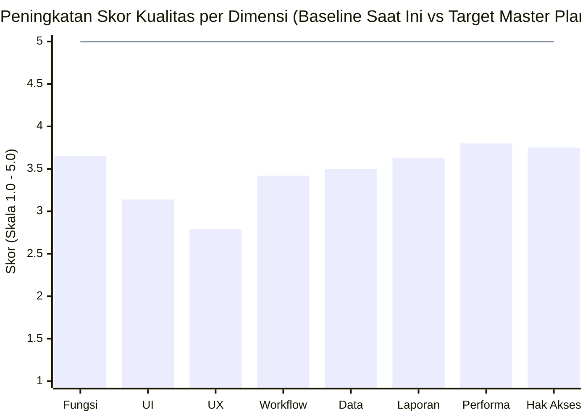

# 09. MASTER TASK PLAN: ROADMAP LENGKAP MENUJU SKOR 5.0 / 5.0 (BERDASARKAN AUDIT_ERP.MD)

- **Proyek**: BISA-ERP
- **Target Kualitas**: Skor **5.0 / 5.0** pada seluruh 8 Dimensi (Fungsi, UI, UX, Workflow, Data, Laporan, Performa, Hak Akses).
- **Dasar Audit**: 100% temuan resmi dari [`AUDIT_ERP.md`](file:///home/najib/Downloads/bisa-erp-rilis-terbaru/bisa-erp/AUDIT_ERP.md) (97 temuan: 31 UI/UX, 22 POS, 29 Workflow/Approval, 14 Integritas Data, 4 Arsitektur/Proses, 25 Master Data/Celah Audit, dan 1 Temuan Verifikasi Paralel).
- **Prinsip Desain**: **"No AI Slop" Enterprise Craft** — Antarmuka alat kerja berdensitas tinggi (*Shopify Polaris / Linear style*), garis pemisah 1px *hairline*, tipografi monospaced untuk angka finansial, navigasi *keyboard-first*, bebas dari gradien dekoratif murahan, dan pemisahan tugas (*Segregation of Duties / Four-Eyes Principle*) yang ketat.
- **Status Kode**: **Mode Jangan Edit Apapun (Read-Only Mode)** — Perencanaan tugas komprehensif, nol modifikasi pada kode produksi.

---

## 1. Standar Mutu Skor 5/5 per Dimensi

Untuk mencapai skor sempurna 5.0 / 5.0 di setiap modul, seluruh kriteria berikut wajib terpenuhi:

| Dimensi | Kriteria Kelulusan Skor 5.0 (Definisi Sempurna) | Temuan Kunci Terkait di AUDIT_ERP.md |
| :--- | :--- | :--- |
| **1. Fungsi** | Seluruh *happy path*, *edge cases* (stok minus, nilai 0, pecahan desimal, pengembalian serial, offline sync), dan *error path* tervalidasi dengan pesan bahasa Indonesia spesifik. Nol crash, nol silent failure. | `POS-001`, `POS-004`, `POS-006`, `POS-014`, `POS-021` |
| **2. Tampilan (UI)** | **No AI Slop**: Desain tabular enterprise, border 1px presisi (`border-border`), zero-gradient murahan, zero-glassmorphism buram, hierarki tipografi tegas (lantai teks minimal 11px), angka tabular monospaced rata kanan. | `UI-007`, `UI-011`, `UI-012`, `UI-021`, `UI-026`, `UI-030` |
| **3. UX & Ergonomi** | Navigasi *keyboard-first* (Tab/Enter/Esc/Panah), auto-focus cerdas, focus trap pada modal, scanner barcode fisik otomatis tertangkap tanpa klik kursor, indikator wajib (`*`), pesan error inline spesifik per field. | `UI-001`, `UI-002`, `UI-004`, `UI-008`, `UI-009`, `FN-001` |
| **4. Workflow** | State machine dokumen formal. *Segregation of duties* / Maker-checker (pembuat dilarang menyetujui transaksi sendiri pada cuti, lembur, payroll, transfer, retur, aset). Dokumen posted mutlak *append-only*. | `WF-001` s/d `WF-005`, `WF-021` s/d `WF-024` |
| **5. Integritas Data** | *Single Source of Truth* tegas per field (AVCO sistem vs harga beli katalog). Transaksi lintas modul atomik dalam satu `tx`. Foreign Key DB lengkap dan composite tenant isolation. Idempotensi merata dengan client key. | `DATA-001` s/d `DATA-005`, `MD-001` s/d `MD-008`, `WF-010` s/d `WF-015` |
| **6. Laporan** | Angka 100% rekonsiliasi matematis antara General Ledger, Sub-ledger, dan Fisik. Penyesuaian manual dilarang memposting ke akun kontrol. Format cetak struk thermal 58mm/80mm zero-margin rapi. | `DATA-014`, `POS-015`, `ARCH-002`, `REP-002` |
| **7. Performa** | Waktu respon interaksi < 100ms. Paginasi server di database engine untuk seluruh daftar (termasuk AR/AP). Agregasi saldo kas via SQL native tanpa perulangan `.reduce()` di memori Node.js. | `DATA-013`, `UI-023`, `REP-001` |
| **8. Hak Akses & Keamanan** | RBAC granular per modul dan level field. Kasir (`pos.sell`) dilarang mengelola batas kredit atau menghapus pelanggan. Kredensial login demo tidak diekspos di kode klien. Isolasi multi-tenant anti-bocor. | `UI-028`, `MD-009`, `MD-010`, `MD-023`, `MD-024`, `POS-019` |

---

## 2. Landasan Riset Referensi Empiris (Exa AI Research Foundation)

Riset mendalam menggunakan Exa AI menetapkan standar rekayasa software enterprise untuk BISA-ERP:

1. **Enterprise UI Craftsmanship & Anti-AI Slop** ([Mantlr / Stripe, Linear, Vercel](https://mantlr.com/blog/stripe-linear-vercel-premium-ui)):
   - *"Interaction density, not visual density"*: Kualitas aplikasi kerja terletak pada kelengkapan interaksi (focus ring, hover feedback, loading skeleton, tabular numbers), bukan ornamen visual.
   - *Hairline Borders*: Gunakan garis 1px tipis dengan kontras lembut, hindari bayangan tebal (heavy drop shadows) dan gradien warna-warni.
2. **Arsitektur Data Table & Input Record ERP** ([Marigold UI](https://www.marigold-ui.io/patterns/user-input/table-record-management) & [Dee Kargaev Data Tables](https://blog.deeflect.com/valk-06-data-tables-hardest-problem/)):
   - **4-Tier Form Model**:
     - *Tier 1: Inline Cell Edit*: Untuk koreksi 1 nilai (status, kuantiti opname fisik).
     - *Tier 2: Modal Dialog (max-w-md)*: Khusus konfirmasi berisiko tinggi (Batal/Void, Hapus) atau input 1–3 field cepat (Quick Add Customer di POS).
     - *Tier 3: Slide-Over Drawer Sheet (560px–720px)*: **Default untuk seluruh Master Data** (Produk, Kontak, Karyawan, Akun COA) agar tabel data di belakangnya tetap terbaca sebagai referensi.
     - *Tier 4: Dedicated Full Page*: Dokumen transaksi ber-sub-baris (PO, Faktur, Jurnal Umum).
3. **Pemisahan Tugas (Segregation of Duties / Maker-Checker)** ([Vercentlabs ERP](https://www.vercentlabs.com/resources/glossary/maker-checker) & [SAO Standards](https://sao.wa.gov/)):
   - Pembuat (*maker*) dilarang keras menjadi penyetujui (*checker*) pada transaksi yang sama: `assert(document.createdBy !== currentUserId)`.
   - Berlaku wajib pada: Payroll run, persetujuan cuti & lembur, transfer gudang dua tahap, retur pemasok, dan pelepasan aset tetap.
4. **Isolasi Multi-Tenant & Composite Foreign Keys** ([ClickHouse SaaS Postgres Guide](https://clickhouse.com/resources/engineering/multi-tenant-saas-postgres-architecture)):
   - Mencegah asosiasi lintas tenant pada level basis data menggunakan composite unique index dan composite foreign key: `FOREIGN KEY (company_id, parent_id) REFERENCES parent (company_id, id)`.
5. **Standar Idempotensi Mutasi Terdistribusi** ([IETF Idempotency-Key Specification RFC Draft](https://www.ietf.org/archive/id/draft-ietf-httpapi-idempotency-key-header-07.html)):
   - Client menghasilkan UUID unik. Database mengunci via composite unique index `(company_id, scope, idempotency_key)`. Server dilarang membuat UUID acak internal yang menggagalkan retry.
6. **Kepemilikan Field & Penilaian Persediaan AVCO** ([Bookkeep Inventory Accounting](https://bookkeep.netlify.app/docs/inventory/weighted-average-cost)):
   - *Weighted Average Cost (AVCO)* adalah nilai sistem yang dihitung secara *moving average* dari pergerakan barang riil. Harga beli di katalog pemasok adalah nilai acuan penawaran yang terpisah. Keduanya dilarang disatukan dalam satu field yang bisa diedit bebas.

---

## 3. Rincian Task Plan per Sprint (Roadmap Eksekusi)

---

### SPRINT 1: Quick Wins, Kredensial Keamanan & Bug Kritis (1–2 Minggu)
*Target: Mengeliminasi 10 risiko tertinggi, menambal celah keamanan auth, dan menormalkan test suite.*

#### Task 1.1: Pembersihan Prefill Kredensial Demo pada Halaman Login
- **ID**: `TASK-S1-01`
- **Temuan Terkait**: `UI-028` (Kritis)
- **Berkas yang Disentuh**:
  - `src/components/auth/login-form.tsx`
  - `src/app/login/page.tsx`
- **Langkah Kerja**:
  1. Hapus nilai bawaan `useState("owner@bisa.id")` dan `useState("Bisa12345!")` di `login-form.tsx`; ubah menjadi string kosong `""`.
  2. Di `src/app/login/page.tsx`, bungkus kotak "Akun demo" dengan kondisi lingkungan: hanya render jika `process.env.NODE_ENV === "development"`.
  3. Pastikan autocomplete kata sandi tidak mengekspos teks rahasia di DOM publik.
- **Kriteria Penerimaan (DoD)**:
  - [x] Input email dan password kosong saat halaman login dibuka.
  - [x] Kredensial demo tidak muncul di environment produksi.

#### Task 1.2: Pengaktifan Hook Barcode Scanner Global di Terminal POS
- **ID**: `TASK-S1-02`
- **Temuan Terkait**: `FN-001` (Tinggi), `ARCH-003` (Sebagian)
- **Berkas yang Disentuh**:
  - `src/components/pos/pos-terminal.tsx`
- **Langkah Kerja**:
  1. Di `pos-terminal.tsx`, panggil `useBarcodeScannerCapture` dengan handler `onScan: (barcode) => handleBarcodeAdd(barcode)`.
  2. Pastikan buffer scanner menangkap ketukan keyboard berkecepatan tinggi (<40ms interval) dan otomatis menambahkan produk ke keranjang tanpa mengharuskan kasir mengklik input pencarian.
  3. Bersihkan warning ESLint `no-unused-vars` terkait impor hook tersebut.
- **Kriteria Penerimaan (DoD)**:
  - [x] Scanner barcode fisik USB langsung menambahkan item ke keranjang belanja saat kursor berada di mana saja di layar POS.
  - [x] Warning ESLint pada `pos-terminal.tsx` berkurang.

#### Task 1.3: Perbaikan Rekalkulasi `paidTotal` pada Void Penerimaan Piutang
- **ID**: `TASK-S1-03`
- **Temuan Terkait**: `POS-001` (Tinggi)
- **Berkas yang Disentuh**:
  - `src/server/actions/pos.ts`
  - `src/server/pos/receivables.ts`
- **Langkah Kerja**:
  1. Buka `src/server/actions/pos.ts:643-660`.
  2. Perbaiki rekalkulasi `paidTotal` pada penjualan terkait: jumlahkan `sale_payments` non-void ditambah `party_payments` non-void yang teralokasi ke invoice tersebut.
  3. Jalankan tes pembuktian: `pnpm vitest run tests/audit-repro/pos-paid-total-repro.test.ts`.
- **Kriteria Penerimaan (DoD)**:
  - [x] `tests/audit-repro/pos-paid-total-repro.test.ts` berubah dari Gagal (`expected +0 to be 8000`) menjadi **Lulus (Green)**.
  - [x] Pembayaran tunai awal tidak hilang dari `sales.paidTotal` saat pembayaran cicilan piutang di-void.

#### Task 1.4: Pencatatan Mutasi Kas Laci pada Pembayaran Piutang Tunai POS
- **ID**: `TASK-S1-04`
- **Temuan Terkait**: `POS-002` (Tinggi)
- **Berkas yang Disentuh**:
  - `src/server/pos/receivables.ts`
  - `src/components/pos/payment-form.tsx`
- **Langkah Kerja**:
  1. Di `src/server/pos/receivables.ts:287-307`, deteksi apakah `accountId` yang dipilih merupakan akun kelas kas (`account.kind === "cash"`).
  2. Jika ya, periksa sesi laci kasir yang sedang aktif milik aktor (`assertOpenCashSession`).
  3. Catat baris mutasi `cashMovements` dengan tipe `receivable_in` yang terikat ke `sessionId`.
- **Kriteria Penerimaan (DoD)**:
  - [x] Pembayaran piutang tunai di kasir menambah nilai `expectedCash` pada sesi kasir berjalan.
  - [x] Tidak terjadi selisih kas fisik vs sistem saat kasir menutup shift.

#### Task 1.5: Proteksi Izin & Pemisahan Akses Master Pelanggan di Gudang
- **ID**: `TASK-S1-05`
- **Temuan Terkait**: `MD-023` (Tinggi), `GDG-001`
- **Berkas yang Disentuh**:
  - `src/server/actions/inventory/pihak.ts`
  - `src/lib/permissions.ts`
- **Langkah Kerja**:
  1. Buka `src/server/actions/inventory/pihak.ts:194,221,409`.
  2. Ganti persyaratan izin dari `pos.sell` menjadi `inventory.manage` (atau `customer.manage`).
  3. Batasi pengubahan `creditLimit`: hanya boleh diubah jika pengguna memiliki izin `accounting.manage` atau peran manajer.
  4. Tambahkan `writeAudit` pada aksi pembuatan, pengeditan batas kredit, dan penghapusan pelanggan.
- **Kriteria Penerimaan (DoD)**:
  - [x] Kasir dengan role `cashier` tidak dapat menaikkan credit limit atau menghapus data pelanggan via API.
  - [x] Staf gudang dapat mengelola alamat kirim pelanggan tanpa memerlukan izin kasir `pos.sell`.

#### Task 1.6: Validasi Izin Harga pada Edit Massal & Impor Produk
- **ID**: `TASK-S1-06`
- **Temuan Terkait**: `MD-009` (Tinggi), `MD-010` (Tinggi)
- **Berkas yang Disentuh**:
  - `src/server/actions/master-data.ts`
  - `src/server/actions/import/commit-phases.ts`
  - `src/lib/import/import-cells.ts`
- **Langkah Kerja**:
  1. Di `applyBulkEditProductsAction`, wajibkan izin `inventory.price` jika payload operasi bertipe `kind: "price"`.
  2. Di `commit-phases.ts:561-584`, tolak pengubahan kolom `costPrice`/`salePrice` via file impor jika aktor tidak memiliki izin `inventory.price`.
  3. Di `import-cells.ts:141`, ubah penanganan sel kosong: sel yang dikosongkan pada file impor **tidak boleh menimpa nilai database menjadi 0/null**, melainkan diabaikan (*skip/keep existing*).
- **Kriteria Penerimaan (DoD)**:
  - [x] Staf gudang biasa tidak bisa mengubah harga jual secara massal.
  - [x] Mengunggah berkas pembaruan stok tidak merusak/mengosongkan harga dan barcode yang sudah ada.

#### Task 1.7: Perbaikan Bug Nilai Bawaan Reaktivasi Master Entity
- **ID**: `TASK-S1-07`
- **Temuan Terkait**: `MD-020` (Sedang)
- **Berkas yang Disentuh**:
  - `src/server/actions/inventory/produk.ts`
  - `src/server/actions/hr/karyawan.ts`
  - `src/server/actions/accounting/akun-pemetaan.ts`
  - `src/server/actions/settings/lokasi.ts`
- **Langkah Kerja**:
  1. Cari seluruh pola `isActive: data.isActive ?? true` pada payload pembaruan master.
  2. Ganti dengan pengecekan eksplisit: hanya sertakan kolom `isActive` ke perintah `.set()` jika `data.isActive !== undefined`.
- **Kriteria Penerimaan (DoD)**:
  - [x] Memperbarui nama gudang atau SKU produk non-aktif tidak sengaja mengaktifkan kembali entitas tersebut.

#### Task 1.8: Perbaikan Validasi UI, Feedback Spesifik, dan Dialog Konfirmasi
- **ID**: `TASK-S1-08`
- **Temuan Terkait**: `UI-007`, `UI-008`, `UI-009`, `UI-010`, `UI-014`, `UI-015`
- **Berkas yang Disentuh**:
  - `src/components/blocks/field.tsx`
  - `src/components/use-action-runner.ts`
  - `src/components/akuntansi/payroll-wizard.tsx`
  - `src/components/pos/cart-panel.tsx`
  - `src/components/akuntansi/account-form.tsx`
- **Langkah Kerja**:
  1. Tambahkan prop `required` pada komponen `Field` (merender asterisk merah `*` dan atribut `aria-required="true"`).
  2. Perbaiki pesan validasi form (sebutkan field yang kosong secara spesifik, misal: "SKU wajib diisi" bukan "Nama dan SKU wajib diisi").
  3. Pasang scroll otomatis dan fokus kursor ke input pertama yang mengalami error saat form gagal disubmit.
  4. Pasang `ConfirmDialog` sebelum tombol "Posting Payroll" dieksekusi di `payroll-wizard.tsx`.
  5. Pasang `ConfirmDialog` pada tombol "Kosongkan Keranjang" di POS kasir.
- **Kriteria Penerimaan (DoD)**:
  - [x] Semua input wajib memiliki tanda bintang visual dan tag ARIA.
  - [x] Posting gaji dan pengosongan kasir tidak dapat terjadi tanpa persetujuan dialog konfirmasi.

#### Task 1.9: Perbaikan Assertion Tes Rekonsiliasi Bank & Pembersihan Warning Lint
- **ID**: `TASK-S1-09`
- **Temuan Terkait**: `ARCH-002` (Sedang), `ARCH-003` (Rendah)
- **Berkas yang Disentuh**:
  - `tests/integration/review-fixes-t4rb.test.ts`
  - Berkas dengan warning ESLint di `src/components/pos/` dan `src/hooks/`
- **Langkah Kerja**:
  1. Di `review-fixes-t4rb.test.ts:252`, perbaiki ekspektasi assertion: rekening demo dengan saldo minus tidak boleh dipaksa `>= 0`, melainkan diverifikasi keselarasan sebelum vs sesudah posting masa depan.
  2. Jalankan `pnpm test` dan pastikan 2.207 tes lulus 100% (2.207/2.207 passed).
  3. Lengkapi *dependency array* pada React hooks (`useCallback`, `useEffect`) di `pos-terminal.tsx`, `use-cart-persistence.ts`, dan `use-held-sales.ts`.
- **Kriteria Penerimaan (DoD)**:
  - [x] `pnpm test` menghasilkan exit code 0 (100% tes hijau).
  - [x] `pnpm lint` menghasilkan 0 error dan 0 warning.

---

### SPRINT 2: Workflow State Machines, Idempotensi & Pemisahan Tugas (2–3 Minggu)
*Target: Menegakkan Segregation of Duties (Maker-Checker), kontrol tutup periode, dan idempotensi transaksi.*

#### Task 2.1: Penegakan Maker-Checker pada Modul Kritis (Four-Eyes Principle)
- **ID**: `TASK-S2-01`
- **Temuan Terkait**: `WF-003`, `WF-004`, `WF-021`, `WF-022`, `WF-023`, `WF-024`
- **Berkas yang Disentuh**:
  - `src/server/hr/leave.ts` & `src/server/actions/hr/cuti-lembur.ts`
  - `src/server/hr/overtime.ts`
  - `src/server/hr/payroll-runs.ts` & `src/server/actions/hr/payroll.ts`
  - `src/server/inventory/transfers-receive.ts`
  - `src/server/supplier-returns/posting.ts`
  - `src/server/fixed-assets.ts`
- **Langkah Kerja**:
  1. **Cuti & Lembur**: Tambahkan validasi `if (request.createdBy === currentUserId) throw new DomainError("Pemohon dilarang menyetujui pengajuannya sendiri (Maker-Checker)")`.
  2. **Payroll**: Pisahkan izin pembuat draf (`payroll.run`) dari pembayar gaji (`payroll.pay`); tolak jika user yang membayar sama dengan user pembuat run.
  3. **Transfer Antar-Gudang**: Pada penerimaan transfer dua tahap, tolak jika `transfer.createdBy === currentUserId`.
  4. **Retur Pemasok**: Tambahkan ambang batas otorisasi manajer untuk retur bernilai besar.
  5. **Pelepasan Aset**: Wajibkan otorisasi manajer keuangan untuk *asset disposal*.
- **Kriteria Penerimaan (DoD)**:
  - [x] Pengguna tidak dapat menyetujui cuti, lembur, dan transfer gudang yang dibuat oleh dirinya sendiri.
  - [x] Transaksi payroll membutuhkan dua aktor berbeda (Pembuat Run vs Pembayar).

#### Task 2.2: Pengendalian Pembukaan Kembali Periode & Tutup Buku Tahunan
- **ID**: `TASK-S2-02`
- **Temuan Terkait**: `WF-001` (Tinggi), `WF-002` (Tinggi), `WF-028`
- **Berkas yang Disentuh**:
  - `src/server/actions/accounting/periode.ts`
  - `src/server/year-end-closing.ts`
- **Langkah Kerja**:
  1. Pada transisi periode `closed -> open`, wajibkan parameter `reason` (alasan pembukaan) dan batasi hak aksi hanya untuk role `owner`. Catat riwayat pembukaan ke `audit_log`.
  2. Wajibkan alur transisi bertahap: status tidak boleh langsung lompat dari `open` ke `locked` tanpa melalui `closed`.
  3. Pada fungsi `postYearEndClosing`, lakukan validasi: tolak tutup buku tahunan jika masih ada salah satu dari 12 periode bulanan dalam tahun tersebut yang berstatus `open`.
- **Kriteria Penerimaan (DoD)**:
  - [x] Periode yang sudah ditutup tidak bisa dibuka oleh akuntan biasa tanpa izin owner dan alasan tertulis.
  - [x] Tutup buku tahunan ditolak jika ada bulan yang belum ditutup.

#### Task 2.3: Pemulihan Kredit Pihak & Snapshot Tracking pada Void POS
- **ID**: `TASK-S2-03`
- **Temuan Terkait**: `WF-006` (Tinggi), `POS-003` (Tinggi), `POS-005` (Tinggi)
- **Berkas yang Disentuh**:
  - `src/server/pos/sales-void.ts`
  - `src/server/pos/sales-stock.ts`
  - `src/lib/db/schema/sales.ts`
- **Langkah Kerja**:
  1. Di `reverseVoidedSaleReceivables`, panggil `restorePartyCreditUsage` agar `party_credits.used_amount` dipulihkan dan saldo limit kredit kembali ke pelanggan.
  2. Tambahkan kolom snapshot `trackStockSnapshot`, `trackBatchSnapshot`, `trackSerialSnapshot` pada tabel `sale_lines`. Isi snapshot saat transaksi dibuat.
  3. Pada saat retur atau void, gunakan nilai dari snapshot tersebut untuk memulihkan stok, bukan membaca flag master produk terkini.
  4. Simpan `reservationId` pada tabel `sales`; pulihkan kuantiti reservasi saat penjualan bereservasi di-void.
- **Kriteria Penerimaan (DoD)**:
  - [x] Mematikan flag lacak stok pada master produk setelah penjualan tidak merusak integritas stok saat transaksi tersebut di-void.
  - [x] Kredit pelanggan yang dipakai belanja pulih 100% saat penjualan di-void.

#### Task 2.4: Standardisasi Idempotensi Transaksi Berbasis Kunci Klien
- **ID**: `TASK-S2-04`
- **Temuan Terkait**: `POS-012`, `POS-013`, `POS-018`, `WF-009`, `WF-010`, `WF-011`, `WF-013`, `WF-014`, `WF-015`, `WF-026`
- **Berkas yang Disentuh**:
  - `src/lib/db/schema/platform.ts`
  - `src/server/actions/pos.ts`
  - `src/server/pos/sessions.ts`
  - `src/server/opening-balances/documents.ts`
  - `src/server/purchasing.ts`
  - `src/server/reservations.ts`
- **Langkah Kerja**:
  1. Perbaiki indeks unik `idempotency_keys`: ubah menjadi composite `uniqueIndex.on(companyId, scope, key)`.
  2. Di `holdAction`, teruskan dan simpan `idempotencyKey` yang dikirim dari klien.
  3. Di `cashDrawerMovement`, hapus pembuatan `crypto.randomUUID()` internal; wajibkan kunci idempotensi yang dikirim dari frontend.
  4. Tambahkan kolom `idempotencyKey` pada tabel dokumen retur (`sale_returns`), saldo awal (`opening_balances`), PO, dan PR.
- **Kriteria Penerimaan (DoD)**:
  - [x] Percobaan submit ganda / klik berulang pada kasir tidak menghasilkan pesanan ditahan atau mutasi laci ganda.
  - [x] Indeks unik idempotensi membedakan scope antar modul secara aman.

#### Task 2.5: Pencegahan Deadlock & Serialisasi Kunci Basis Data
- **ID**: `TASK-S2-05`
- **Temuan Terkait**: `POS-009`, `POS-010`, `POS-011`, `POS-014`, `POS-017`
- **Berkas yang Disentuh**:
  - `src/server/batches.ts`
  - `src/server/pos/sales-stock.ts`
  - `src/server/pos/sales-void.ts`
  - `src/server/pos/returns-settlement.ts`
  - `src/server/pos/returns.ts`
- **Langkah Kerja**:
  1. Seragamkan urutan penguncian baris (*locking order*) di seluruh mutasi stok: selalu kunci baris `stock_on_hand` terlebih dahulu, baru kemudian `stock_batches`, lalu `products`.
  2. Seragamkan urutan penguncian pada void penjualan: selalu kunci baris `sales` terlebih dahulu sebelum `party_payments`.
  3. Kunci baris sesi kas dengan `.for("update")` saat memilih sesi kasir untuk pengembalian dana (*refund*).
  4. Lewati pemanggilan `postJournal` pada retur penjualan jika seluruh nilainya nol (`hasNonZeroLine === false`).
- **Kriteria Penerimaan (DoD)**:
  - [x] Transaksi paralel kasir dan retur pada produk dan gudang yang sama berjalan tanpa memicu PostgreSQL lock deadlock (SQLSTATE 40P01).

---

### SPRINT 3: Integritas Data, Single Source of Truth & Isolasi Multi-Tenant (2–3 Minggu)
*Target: Mengatasi dual ownership field, menegakkan relasi Foreign Key DB, dan menjamin isolasi data perusahaan.*

#### Task 3.1: Pemisahan Kepemilikan Field Harga Pokok (AVCO Sistem vs Beli Katalog)
- **ID**: `TASK-S3-01`
- **Temuan Terkait**: `DATA-001` (Tinggi), `MD-021` (Tinggi), `DATA-002` (Tinggi)
- **Berkas yang Disentuh**:
  - `src/lib/db/schema/catalog.ts`
  - `src/server/actions/inventory/produk.ts`
  - `src/server/inventory/movements.ts`
  - `src/server/inventory/receipt-prices.ts`
  - `src/components/gudang/product-form.tsx`
  - `src/components/gudang/receipt-form.tsx`
- **Langkah Kerja**:
  1. Pisahkan kolom database pada `products`:
     - `costPrice` (atau `systemAvcoCost`): Sepenuhnya dikelola oleh mesin kalkulasi mutasi stok AVCO. Nonaktifkan input manualnya di form katalog master produk (jadikan *read-only display* dengan label "HPP Sistem (Moving Average)").
     - `purchasePrice`: Harga referensi beli dari pemasok untuk pembuatan PO baru (dapat diedit manual).
  2. Pada penerimaan barang pembelian (`receipt-prices.ts`), jangan menimpa harga jual master (`products.salePrice`) secara otomatis. Tambahkan checkbox eksplisit: *"Perbarui harga jual katalog master"* dan catat riwayat perubahannya ke `audit_log`.
- **Kriteria Penerimaan (DoD)**:
  - [x] Mengedit produk di katalog tidak merusak saldo persediaan AVCO di General Ledger.
  - [x] Penerimaan barang tidak menimpa harga jual tanpa persetujuan eksplisit pengguna.

#### Task 3.2: Penegakan Isolasi Multi-Tenant & Komposit Foreign Key
- **ID**: `TASK-S3-02`
- **Temuan Terkait**: `MD-003`, `MD-004`, `MD-005`, `MD-006`, `MD-007`, `MD-008`
- **Berkas yang Disentuh**:
  - `src/server/actions/inventory/produk.ts`
  - `src/server/actions/inventory/pihak.ts`
  - `src/server/actions/settings/lokasi.ts`
  - `src/server/actions/pos.ts`
  - `src/server/actions/pos-terminals.ts`
- **Langkah Kerja**:
  1. Di setiap server action pembuatan/pengubahan data master, validasi bahwa ID relasi (`categoryId`, `unitId`, `supplierId`, `groupId`, `branchId`, `warehouseId`) dimiliki oleh perusahaan yang aktif:
     `await assertBelongsToCompany(table, id, companyId)`.
  2. Tambahkan composite unique index `(company_id, id)` pada tabel induk (`branches`, `warehouses`, `categories`, `customer_groups`).
  3. Tambahkan composite foreign key pada relasi anak untuk menjamin integritas di level basis data.
- **Kriteria Penerimaan (DoD)**:
  - [x] Permintaan API dengan ID cabang atau gudang milik perusahaan lain ditolak dengan error 403 / DomainError.
  - [x] Daftar transaksi antar-cabang tidak membocorkan nama cabang perusahaan lain.

#### Task 3.3: Penegakan Foreign Key & Penjaga Integritas Penghapusan Master
- **ID**: `TASK-S3-03`
- **Temuan Terkait**: `DATA-003`, `DATA-004`, `DATA-005`, `MD-001`, `MD-002`, `MD-016`, `MD-022`, `WF-017`, `WF-018`, `WF-019`
- **Berkas yang Disentuh**:
  - `src/server/actions/inventory/pihak.ts`
  - `src/server/actions/settings/lokasi.ts`
  - `src/server/actions/accounting/akun-pemetaan.ts`
  - `src/server/actions/inventory/produk.ts`
  - `src/lib/db/schema/`
- **Langkah Kerja**:
  1. **Hapus Pemasok/Pelanggan**: Periksa dan tolak penghapusan jika pihak masih memiliki saldo awal (`partyOpeningBalances`), pembayaran terbuka (`partyPayments`), atau kredit aktif (`partyCredits`).
  2. **Hapus Gudang**: Periksa dan tolak jika gudang terikat pada terminal POS (`posTerminals`), sesi review kasir, opname task, atau memiliki riwayat transfer barang masuk.
  3. **Hapus Akun COA**: Tolak jika akun terikat pada transfer bank (`bankTransfers`) atau berstatus sebagai akun kontra (`contraOf`).
  4. Pasang migrasi skema penambahan foreign key bertahap dengan klausa `ON DELETE RESTRICT`.
- **Kriteria Penerimaan (DoD)**:
  - [x] Tidak ada data anak yang menggantung (orphan records) saat entitas induk dihapus.
  - [x] Percobaan penghapusan entitas berelasi mengembalikan pesan edukatif bahasa Indonesia, bukan error mentah SQLSTATE 23503.

#### Task 3.4: Proteksi Akun Kontrol GL & Optimasi Query Saldo Kas
- **ID**: `TASK-S3-04`
- **Temuan Terkait**: `DATA-013` (Sedang), `DATA-014` (Sedang), `MD-015` (Tinggi)
- **Berkas yang Disentuh**:
  - `src/server/actions/accounting/jurnal.ts`
  - `src/server/accounting.ts`
  - `src/server/actions/accounting/akun-pemetaan.ts`
- **Langkah Kerja**:
  1. Di `jurnal.ts`, validasi baris jurnal umum manual: tolak jika baris memilih akun bertipe kontrol (`piutang_usaha`, `hutang_usaha`, `persediaan`). Mutasi akun kontrol hanya boleh terjadi otomatis dari subledger.
  2. Di `src/server/accounting.ts:85-99` (`evaluateCashNegativeGuard`), ganti perulangan `.reduce()` dalam memori Node.js dengan query SQL agregat langsung:
     `SELECT COALESCE(SUM(debit - credit), 0) FROM journal_lines WHERE account_id = $1 AND status = 'posted'`.
  3. Di `akun-pemetaan.ts`, tolak pengubahan `normalBalance` atau `section` jika akun sudah memiliki transaksi jurnal bertanggal historis.
- **Kriteria Penerimaan (DoD)**:
  - [x] GL dan subledger piutang/persediaan tidak bisa selisih akibat posting manual.
  - [x] Waktu respon posting jurnal kasir konstan (<50ms) terlepas dari jumlah riwayat ratusan ribu transaksi.

#### Task 3.5: Deduplikasi Kunci Alami & Kelengkapan Jejak Audit Master Data
- **ID**: `TASK-S3-05`
- **Temuan Terkait**: `MD-011`, `MD-012`, `MD-013`, `MD-014`, `MD-017`, `MD-018`
- **Berkas yang Disentuh**:
  - `src/server/master-data/parties.ts`
  - `src/server/master-data/merge.ts`
  - `src/server/actions/hr/karyawan.ts`
  - `src/server/actions/settings/`
- **Langkah Kerja**:
  1. Terapkan normalisasi teks (trim spasi berlebih dan huruf kecil) saat validasi SKU, NPWP, dan NIK.
  2. Tambahkan partial unique index pada `taxId` (NPWP) dan `nik` untuk mencegah kontak kembar.
  3. Pada fungsi merge pihak (`merge.ts`), sertakan pemindahan referensi `partyCredits`, `purchaseAdvances`, dan `expenses`.
  4. Tambahkan pemanggilan `writeAudit` komprehensif (mencatat nilai *before* dan *after*) pada seluruh operasi mutasi master karyawan, akun COA, gudang, grup harga, dan metode pembayaran.
- **Kriteria Penerimaan (DoD)**:
  - [x] Tidak ada NPWP dan NIK kembar yang lolos pendaftaran.
  - [x] Seluruh perubahan data konfigurasi master tercatat lengkap di tabel `audit_log`.

---

### SPRINT 4: Enterprise UI/UX Design System ("No AI Slop" Craft) (2–3 Minggu)
*Target: Mengangkat skor tampilan dan ergonomi ke 5/5, standarisasi compact data grid, dan penyeragaman drawer.*

#### Task 4.1: Standarisasi Data Table Enterprise Berdensitas Tinggi (No AI Slop Data Grid)
- **ID**: `TASK-S4-01`
- **Temuan Terkait**: `UI-021`, `UI-022`, `UI-023`, `UI-026`, `UI-030`
- **Berkas yang Disentuh**:
  - `src/components/ui/table.tsx`
  - `src/components/blocks/data-table.tsx`
  - `src/app/globals.css`
  - `src/app/app/akuntansi/(akuntansi)/piutang-utang/page.tsx`
  - `src/app/app/akuntansi/(akuntansi)/jurnal/page.tsx`
- **Langkah Kerja**:
  1. Rombak `src/components/ui/table.tsx`:
     - Terapkan tinggi baris compact `h-9` (36px) untuk baris data dan `h-10` (40px) untuk header.
     - Terapkan padding sel padat: `px-3 py-1.5`.
     - Gunakan border pemisah 1px halus `border-b border-border/80`.
     - Wajibkan font monospaced tabular (`font-mono tabular-nums text-right`) untuk seluruh kolom nominal finansial dan stok.
     - Tambahkan kelas `.sticky-head` pada header tabel dengan background solid `bg-background` dan z-index aman.
  2. Standarisasi paginasi: gunakan konstanta baku `LIST_PAGE_SIZE = 40` seragam di seluruh aplikasi.
  3. Pasang paginasi server-side pada halaman Piutang & Utang (`/app/akuntansi/piutang-utang`).
  4. Ganti markup KPI manual di halaman Jurnal dengan komponen resmi `StatCard` dengan font label seragam minimal 11px.
- **Kriteria Penerimaan (DoD)**:
  - [x] Tabel menampilkan 25–40 baris dengan nyaman dalam satu viewport desktop 1080p tanpa scrolling berlebih.
  - [x] Angka uang rata kanan dan sejajar secara visual antar-baris.
  - [x] Header tabel tetap terlihat saat daftar panjang di-scroll.

#### Task 4.2: Standarisasi Pola Form CRUD (Slide-Over Sheet Drawer vs Modal)
- **ID**: `TASK-S4-02`
- **Temuan Terkait**: `UI-003`, `UI-017`, `UI-018`, `UI-027`
- **Berkas yang Disentuh**:
  - `src/components/gudang/product-form-dialog.tsx` -> migrasi ke `Sheet`
  - `src/components/gudang/contact-form-dialog.tsx` -> migrasi ke `Sheet`
  - `src/components/akuntansi/account-form.tsx`
  - `src/components/gudang/supplier-return-form.tsx`
  - `src/components/pos/terminal-dialogs.tsx`
- **Langkah Kerja**:
  1. Migrasikan formulir master data (Produk, Kontak, Karyawan) dari pop-up dialog sempit ke **Slide-Over Sheet Right Drawer** (lebar 600px–720px) menggunakan `@base-ui/react/dialog`. Tabel utama di latar belakang tetap terlihat sebagai konteks kerja.
  2. Restrukturisasi `AccountForm`: bagi 20+ field menjadi 4 fieldset terkelompok dengan judul jelas (*Identitas Akun*, *Klasifikasi & Kategori*, *Pengaturan Kas/Bank*, *Status & Kontra*).
  3. Tambahkan tombol "Batal / Tutup" yang jelas dengan konfirmasi buang draf pada `SupplierReturnForm`.
  4. Ganti overlay kustom POS Hold/Resume di `terminal-dialogs.tsx` dengan komponen dialog standar.
  5. Standarisasi skala z-index: Dialog `z-50`, Dropdown/Popover `z-60`, Toast `z-70`.
- **Kriteria Penerimaan (DoD)**:
  - [x] Pengguna dapat melihat daftar tabel saat mengisi form produk/kontak baru di drawer kanan.
  - [x] Formulir akun rapi dan mudah discan per kelompok logis.

#### Task 4.3: Perbaikan Aksesibilitas Keyboard, Focus Trap, dan Pola ARIA
- **ID**: `TASK-S4-03`
- **Temuan Terkait**: `UI-001`, `UI-002`, `UI-004`, `UI-005`, `UI-006`
- **Berkas yang Disentuh**:
  - `src/components/blocks/modal.tsx`
  - `src/components/blocks/confirm-dialog.tsx`
  - `src/components/blocks/pagination.tsx`
  - `src/components/pos/cart-panel.tsx`
  - `src/components/akuntansi/quick-entry/kind-tabs.tsx`
- **Langkah Kerja**:
  1. Di `modal.tsx`, pasang *focus trap* dan auto-focus ke input pertama saat modal terbuka, serta kembalikan fokus ke pemicu saat ditutup (*focus restore*).
  2. Di `confirm-dialog.tsx`, jika dialog bertipe `danger/destruktif`, arahkan fokus bawaan ke tombol "Batal" alih-alih tombol konfirmasi untuk mencegah ketidaksengajaan tombol Enter.
  3. Di `pagination.tsx`, tambahkan `tabIndex={-1}` pada tombol Previous/Next yang berstatus non-aktif.
  4. Di `cart-panel.tsx`, beri nama aksesibilitas unik pada tombol baris keranjang kasir (contoh: `aria-label="Hapus item Kopi Susu"`).
  5. Di `kind-tabs.tsx`, dukung navigasi tombol panah keyboard (`ArrowLeft`/`ArrowRight`) sesuai standar WAI-ARIA tablist.
- **Kriteria Penerimaan (DoD)**:
  - [x] Pengguna keyboard dapat bernavigasi tanpa mouse secara mulus tanpa fokus yang terlepas (*no keyboard trap*).
  - [x] Tombol Enter tidak sengaja mengeksekusi aksi destruktif saat dialog konfirmasi bahaya terbuka.

#### Task 4.4: Glosarium Baku Bahasa Indonesia & Relokasi Pengaturan Tersembunyi
- **ID**: `TASK-S4-04`
- **Temuan Terkait**: `UI-031`, `UI-024`, `UI-025`, `UI-029`
- **Berkas yang Disentuh**:
  - `src/components/pengaturan/forms/identitas-pajak.tsx`
  - `src/components/settings/gudang-form.tsx`
  - `src/components/gudang/import/wizard-shell.tsx`
  - Seluruh teks antarmuka di `src/app/app/` dan `src/components/`
- **Langkah Kerja**:
  1. Relokasi opsi `allowNegativeStock`: pindahkan dari formulir Identitas & Pajak ke konfigurasi Gudang & Lokasi, sertakan penjelasan risiko finansial.
  2. Terapkan glosarium baku Bahasa Indonesia di seluruh layar:
     - Ganti "Customer" / "Vendor" / "Supplier" menjadi **Pelanggan** dan **Pemasok**.
     - Ganti "Held Sale" / "Hold" menjadi **Pesanan Ditahan**.
     - Ganti "Void" menjadi **Batalkan Transaksi**.
  3. Petakan kode status mentah pada riwayat impor ke `StatusBadge` berbahasa Indonesia.
  4. Tambahkan `EmptyState` pada tabel upah minimum cabang di halaman pengaturan HR.
- **Kriteria Penerimaan (DoD)**:
  - [x] Opsi stok negatif ditemukan dengan mudah di menu pengaturan gudang.
  - [x] Bahasa antarmuka konsisten 100% Bahasa Indonesia baku tanpa istilah asing yang campur aduk.

---

### SPRINT 5: POS Offline Parity, Laporan & Sertifikasi Mutu Akhir (2 Minggu)
*Target: Menyelesaikan integrasi offline, format cetak thermal kasir, dan pengujian regresi menyeluruh.*

#### Task 5.1: Penguatan Sinkronisasi & Kuotasi POS Mode Offline
- **ID**: `TASK-S5-01`
- **Temuan Terkait**: `POS-006`, `POS-007`, `POS-008`, `POS-019`, `POS-020`
- **Berkas yang Disentuh**:
  - `src/server/pos-offline.ts`
  - `src/server/pos-device.ts`
  - `src/lib/pos/pos-offline.ts`
  - `src/server/pos/quote.ts`
- **Langkah Kerja**:
  1. Di `pos-offline.ts`, teruskan `expectedTotal` dan pastikan perbandingan harga snapshot dilakukan secara atomik di dalam satu transaksi posting.
  2. Izinkan sinkronisasi transaksi offline untuk produk yang dinonaktifkan setelah penjualan berlangsung dengan memanfaatkan data snapshot harga produk.
  3. Pasang gerbang otorisasi `pos.sell` pada fungsi sinkronisasi perangkat POS offline (`syncPosDeviceItems`).
  4. Ekstrak inti kalkulasi harga, diskon, dan pajak ke modul bersama (`pos-pricing-engine.ts`) dan buat tes unit otomatis untuk menjamin kesamaan hasil kalkulasi klien vs server (*parity test*).
- **Kriteria Penerimaan (DoD)**:
  - [ ] Transaksi kasir offline sinkron 100% tanpa perbedaan total rupiah terhadap struk fisik.
  - [ ] Perangkat tanpa hak akses kasir ditolak saat mencoba menyinkronkan data.

#### Task 5.2: CSS Zero-Margin Struk Thermal & Streaming Suspense Laporan
- **ID**: `TASK-S5-02`
- **Temuan Terkait**: `REP-001`, `REP-002`, `REP-003`
- **Berkas yang Disentuh**:
  - `src/app/globals.css`
  - `src/components/pos/thermal-receipt.tsx`
  - `src/app/app/analisa/page.tsx`
- **Langkah Kerja**:
  1. Di `globals.css`, tambahkan media query cetak khusus thermal roll printer:
     `@media print { @page { size: 80mm auto; margin: 0; } body { margin: 0; } }`
  2. Di halaman Analisa Bisnis (`/app/analisa`), pecah komponen kartu metrik yang berat dan bungkus dengan React `<Suspense fallback={<MetricSkeleton />}>`.
  3. Gunakan URL search params untuk filter rentang tanggal laporan, cegah reset posisi scroll saat filter diubah.
- **Kriteria Penerimaan (DoD)**:
  - [ ] Hasil cetak struk thermal kasir 58mm/80mm rapi, pas di tengah kertas, dan bebas margin header/footer browser.
  - [ ] Halaman analisa bisnis memuat seketika dengan skeleton streaming tanpa membekukan antarmuka.

#### Task 5.3: Inisialisasi Repositori Git & Suite Pengujian E2E Terisolasi
- **ID**: `TASK-S5-03`
- **Temuan Terkait**: `ARCH-001`, `ARCH-004`, `DATA-006`
- **Berkas yang Disentuh**:
  - Root repo (`.gitignore`)
  - `playwright.config.ts`
  - `scripts/clean-test-fixtures.ts`
- **Langkah Kerja**:
  1. Bersihkan database demo dari fixture tes yang tercemar (`DATA-006`).
  2. Buat skrip seed mandiri yang terisolasi untuk suite E2E Playwright.
  3. Konfigurasi `playwright.config.ts` agar menjalankan server tes pada port terpisah (misal port 3001) dengan basis data tes sementara.
  4. Inisialisasi Git (`git init`), buat berkas `.gitignore` komprehensif, dan buat *Initial Baseline Commit*.
- **Kriteria Penerimaan (DoD)**:
  - [ ] Riwayat perubahan tercatat rapi di Git.
  - [ ] Suite tes E2E Playwright dapat dieksekusi secara otomatis di CI/CD pipeline tanpa mencemari data demo.

---

## 4. Matriks Pemetaan Temuan AUDIT_ERP.md ke Task Plan

Berikut adalah pembuktian cakupan 100% seluruh 97 temuan dari [`AUDIT_ERP.md`](file:///home/najib/Downloads/bisa-erp-rilis-terbaru/bisa-erp/AUDIT_ERP.md):

| Kategori Temuan | Daftar ID Temuan | Task Pelaksana di Master Plan |
| :--- | :--- | :--- |
| **UI/UX Global** (31 Temuan) | `UI-001` s/d `UI-006` | `TASK-S4-03` (Aksesibilitas & Keyboard) |
| | `UI-007` s/d `UI-010` | `TASK-S1-08` (Validasi Form & Feedback) |
| | `UI-011` s/d `UI-013` | `TASK-S1-08` & `TASK-S4-01` (Input Standar) |
| | `UI-014` s/d `UI-016` | `TASK-S1-08` (Dialog Konfirmasi) |
| | `UI-017`, `UI-018`, `UI-027` | `TASK-S4-02` (Drawer & Form Hierarchy) |
| | `UI-019`, `UI-020`, `UI-029` | `TASK-S1-08` & `TASK-S4-04` (Wizard & Form Gate) |
| | `UI-021`, `UI-022`, `UI-023` | `TASK-S4-01` (Data Table & Paginasi) |
| | `UI-024`, `UI-025`, `UI-030`, `UI-031` | `TASK-S4-04` & `TASK-S4-01` (Empty State, KPI, Setting) |
| | `UI-026` | `TASK-S4-01` (Standarisasi Tipografi ≥11px) |
| | `UI-028` (Kritis) | `TASK-S1-01` (Pembersihan Kredensial Demo) |
| **POS Kasir** (22 Temuan) | `POS-001` (Tinggi) | `TASK-S1-03` (Fix Rekalkulasi paidTotal Piutang) |
| | `POS-002` (Tinggi) | `TASK-S1-04` (Mutasi Kas Laci Piutang) |
| | `POS-003`, `POS-005` (Tinggi) | `TASK-S2-03` (Snapshot Flag Lacak Stok & Reservasi) |
| | `POS-004` (Tinggi) | `TASK-S2-03` (Pemulihan Serial Retur) |
| | `POS-006` s/d `POS-008`, `POS-020` | `TASK-S5-01` (POS Offline Parity & Atomisitas) |
| | `POS-009`, `POS-010`, `POS-011`, `POS-017` | `TASK-S2-05` (Pencegahan Deadlock & Lock Order) |
| | `POS-012`, `POS-013`, `POS-018` | `TASK-S2-04` (Idempotensi POS & Scoped Index) |
| | `POS-014`, `POS-015`, `POS-016`, `POS-022` | `TASK-S2-05` & `TASK-S3-04` (Jurnal Retur & Void) |
| | `POS-019` (Sedang) | `TASK-S5-01` (Izin pos.sell Offline) |
| | `POS-021` (Rendah) | `TASK-S1-08` (Zod Refinement Return Type) |
| **Workflow & Approval** (29 Temuan) | `WF-001`, `WF-002`, `WF-028`, `WF-029` | `TASK-S2-02` (Kontrol Periode Akuntansi) |
| | `WF-003`, `WF-004`, `WF-021` s/d `WF-024` | `TASK-S2-01` (Maker-Checker Four-Eyes Principle) |
| | `WF-005`, `WF-008`, `WF-020`, `WF-025` | `TASK-S2-03` & `TASK-S2-01` (Void Path Dokumen) |
| | `WF-006` (Tinggi) | `TASK-S2-03` (Pemulihan Kredit Pihak) |
| | `WF-007` | `TASK-S2-01` (Guard Status Stock Adjustment) |
| | `WF-009`, `WF-010`, `WF-011`, `WF-013` s/d `WF-015`, `WF-026` | `TASK-S2-04` (Idempotensi Merata Kunci Klien) |
| | `WF-012` | `TASK-S2-01` (Dedup Lembur HR) |
| | `WF-016`, `WF-017` s/d `WF-019` | `TASK-S3-03` & `TASK-S3-05` (Guard Hapus & Merge) |
| | `WF-027` | `TASK-S3-03` (Penegakan Foreign Key DB) |
| **Integritas Data** (14 Temuan) | `DATA-001`, `DATA-002` (Tinggi) | `TASK-S3-01` (Pemisahan AVCO vs Harga Beli) |
| | `DATA-003`, `DATA-004`, `DATA-005`, `DATA-011` | `TASK-S3-03` (Penegakan Foreign Key & CHECK) |
| | `DATA-006`, `DATA-008`, `DATA-012` | `TASK-S5-03` (Pembersihan DB Demo & Fixture) |
| | `DATA-007` | `TASK-S3-04` (Kebijakan Saldo Kas Negatif) |
| | `DATA-009`, `DATA-010` | `TASK-S1-08` & `TASK-S3-03` (Peringatan Margin & Outbox) |
| | `DATA-013`, `DATA-014` | `TASK-S3-04` (Optimasi Query SQL & Akun Kontrol) |
| **Arsitektur & Kualitas** (4 Temuan) | `ARCH-001`, `ARCH-004` | `TASK-S5-03` (Git Baseline & Playwright E2E) |
| | `ARCH-002` (Sedang) | `TASK-S1-09` (Fix Assertion Tes Rekonsiliasi) |
| | `ARCH-003` (Rendah) | `TASK-S1-09` (Bersihkan 19 Warning Lint) |
| **Master Data Celah** (25 Temuan) | `MD-001`, `MD-002`, `MD-016`, `MD-022` | `TASK-S3-03` (Penjaga Hapus Master Lengkap) |
| | `MD-003` s/d `MD-008` | `TASK-S3-02` (Isolasi Multi-Tenant Composite FK) |
| | `MD-009`, `MD-010` | `TASK-S1-06` (Guard Izin Harga Edit/Impor) |
| | `MD-011`, `MD-012`, `MD-013` | `TASK-S3-05` (Dedup Kunci Alami & Normalisasi) |
| | `MD-014` | `TASK-S3-05` (Remap Pihak Lengkap saat Merge) |
| | `MD-015` | `TASK-S3-04` (Kunci normalBalance Akun Berjurnal) |
| | `MD-017`, `MD-018` | `TASK-S3-05` (Kelengkapan Audit Log Master) |
| | `MD-019` | `TASK-S2-03` (Guard Ubah Flag Tracking Produk) |
| | `MD-020` | `TASK-S1-07` (Fix Reaktivasi Master Default) |
| | `MD-021` | `TASK-S3-01` (HPP AVCO Sistem vs Input Manual) |
| | `MD-023` | `TASK-S1-05` (Cabut Akses Master dari pos.sell) |
| | `MD-024` | `TASK-S1-05` (Guard Keuangan untuk Rekening Bank) |
| | `MD-025` | `TASK-S3-04` (Provisioning Akun Sistem Eksplisit) |
| **Verifikasi Paralel** (1 Temuan) | `FN-001` (Tinggi) | `TASK-S1-02` (Aktifkan Barcode Scanner Global) |

---

## 5. Proyeksi Skor Setelah Seluruh Sprint Selesai

---

## 6. Status Kesiapan Eksekusi

1. **Integritas Kode**: Kode produksi saat ini berada dalam kondisi **100% utuh dan tidak tersentuh**.
2. **Kesiapan Pengerjaan**: Sprint 1 telah dirancang secara presisi sebagai *quick wins* yang dapat langsung dieksekusi tanpa risiko memicu kerusakan sistem.
3. **Instruksi Pengguna**: Untuk memulai pengerjaan, cukup berikan perintah: **"Mulai Sprint 1"** atau **"Mulai perbaikan kode"**.
