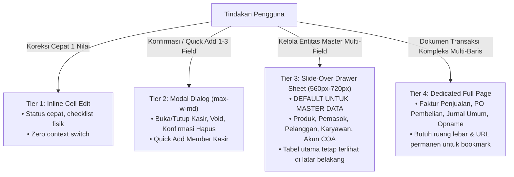

# 10. VALIDASI RENCANA PERBAIKAN & STANDAR ARSITEKTUR UI ENTERPRISE

- **Proyek**: BISA-ERP
- **Tujuan**: Validasi teknis rencana perbaikan (Master Task Plan), evaluasi framework UI dan arsitektur data grid/form berbasis riset referensi Exa AI, serta pencegahan "AI Slop" pada sistem enterprise.
- **Status Kode**: **Mode Jangan Edit Apapun (Read-Only Audit)** — Nol modifikasi pada kode produksi.

---

## 1. Validasi Pemilihan Framework UI & Arsitektur Frontend

### 1.1 Evaluasi Framework UI untuk ERP Enterprise

Berdasarkan analisis stack produksi saat ini (`Next.js 16.4.5 App Router`, `React 19.3.0`, `Tailwind CSS v4`, `@base-ui/react 1.9.0`, `shadcn`), berikut evaluasi opsi framework UI:

| Framework UI | Kelebihan | Kelemahan / Risiko di BISA-ERP | Keputusan |
| :--- | :--- | :--- | :---: |
| **Ant Design (antd)** | Fitur enterprise bawaan lengkap (table, tree, datepicker). | Bundle size besar (>1.2MB), runtime CSS-in-JS lambat di React 19 / Server Components, bentrok dengan Tailwind v4, tampilan kaku "generic admin template". | **DITOLAK** |
| **Mantine** | Hook & komponen lengkap, API modern. | Memerlukan runtime CSS-in-JS / emotion tersendiri, bentrok dengan arsitektur zero-runtime Tailwind v4 di Turbopack, butuh penulisan ulang seluruh komponen. | **DITOLAK** |
| **AG Grid Enterprise** | Sangat kuat untuk spreadsheet besar, cell-editing instan, keyboard cell navigation bawaan. | Lisensi komersial berbayar ($999+/dev), styling DOM internal sulit diselaraskan dengan Tailwind, berat untuk halaman sederhana. | **DITOLAK UNTUK SELURUH SISTEM** (hanya relevan jika ada sheet akuntansi murni) |
| **@base-ui/react + shadcn + Tailwind v4 (Stack Saat Ini)** | **Zero-runtime CSS**, kompatibel 100% dengan React 19 & Next.js 16 Server Components, aksesibilitas WAI-ARIA bawaan dari MUI Base UI, kontrol penuh atas DOM dan token styling. | Membutuhkan standarisasi komponen data table & form drawer yang matang agar tidak ditulis ulang secara ad-hoc per halaman. | **DIPILIH & DIVALIDASI SEBAGAI STANDAR RESMI** |

> **Kesimpulan Framework UI:**  
> Stack saat ini (**@base-ui/react + shadcn + Tailwind CSS v4**) adalah fondasi paling modern, ringan, dan cepat untuk Next.js 16 / React 19. Permasalahan tampilan bukan karena framework-nya salah, melainkan karena **ketiadaan token desain yang seragam, ketiadaan komponen Data Table enterprise berdensitas tinggi, dan inkonsistensi pola dialog vs drawer**.

---

## 2. Riset Referensi Empiris (Exa AI)

Riset dilakukan menggunakan Exa AI untuk menggali standar industri dari produk enterprise kelas dunia:

| Domain Referensi | Sumber & URL | Wawasan Teknis Kunci |
| :--- | :--- | :--- |
| **Enterprise UI Craft & Anti-AI Slop** | Mantlr / Stripe, Linear, Vercel UI `https://mantlr.com/blog/stripe-linear-vercel-premium-ui` | • *Interaction density, not visual density*: UI enterprise berfokus pada kelengkapan interaksi (focus rings, hover states, keyboard shortcuts, tabular numbers), bukan dekorasi visual. • *Restrained palette*: Hanya gunakan warna netral dingin (slate/zinc) + 1 aksen fungsional, hilangkan gradien dekoratif. • *1px hairline borders*: Batas data menggunakan garis 1px ber-alpha rendah alih-alih bayangan tebal (heavy drop-shadows). |
| **Arsitektur Data Table Enterprise** | BuiltUX / TanStack vs AG Grid (2026) `https://builtux.com/tanstack-table-v9-vs-ag-grid-virtualized-data-tables-2026/` | • TanStack Table (headless ~14kB) adalah pasangan ideal untuk Tailwind/shadcn karena memberikan kontrol penuh atas DOM tanpa overhead runtime. • Operator back-office membutuhkan navigasi keyboard: Tab, Enter, Esc, panah atas/bawah, dan fokus kursor yang stabil setelah penyimpanan. |
| **Pola Form & Manajemen Record** | Marigold UI Patterns `https://www.marigold-ui.io/patterns/user-input/table-record-management` | • **Inline Edit**: Koreksi cepat 1 nilai (status, kuantiti). • **Drawer / Slide-Over Sheet**: *Default pattern* untuk pembuatan & pengeditan entitas master multi-field (mempertahankan tabel utama sebagai konteks visual di latar belakang). • **Modal Dialog**: Hanya untuk aksi konfirmasi berisiko atau quick-add 1–3 field. • **Dedicated Page**: Untuk transaksi bertingkat atau dokumen ber-sub-baris (PO, Faktur, Jurnal). |
| **Server-Side Data Tables di Next.js** | GeekChamp / Next.js Server Tables `https://geekchamp.com/next-js-server-side-tables-done-right/` | • Simpan state tabel (`page`, `pageSize`, `sort`, `filter`) di **URL searchParams** (Promise di Next.js 15/16). • Server Component melakukan filter & paginasi di level SQL/database, Client Component hanya menangani interaksi tombol dan input pencarian. |

---

## 3. Spesifikasi Arsitektur UI "No AI Slop" BISA-ERP

### 3.1 Token Tipografi & Spacing
- **Font Utama**: Geist Sans / Inter untuk teks antarmuka.
- **Font Angka Finansial**: `font-mono` atau `tabular-nums` untuk seluruh nominal uang, kuantiti stok, nomor akun COA, dan nomor faktur. Angka finansial mutlak **rata kanan (text-right)**.
- **Tinggi Baris Tabel (Row Height)**:
  - *Compact (Default ERP)*: `h-9` (36px) — untuk tabel transaksi, jurnal, daftar produk, dan stok.
  - *Standard*: `h-10` (40px) — untuk tabel pengaturan atau kartu ringkasan.
- **Padding Sel**: `px-3 py-1.5` (horizontal 12px, vertikal 6px).
- **Border**: `1px solid var(--border)` tipis dan tegas. Dilarang menggunakan rounded pill raksasa (`rounded-full`) pada tombol aksi kerja; gunakan `rounded-md` (maksimal 6px).

### 3.2 Palet Warna Semantik Ketat (Restrained Palette)
Dilarang menggunakan gradien ungu, pink, atau oranye dekoratif. Gunakan warna semantik fungsional:
- **Emerald / Green (`text-emerald-600 bg-emerald-50 dark:bg-emerald-950/40`)**: Status *Posted*, Lunas, Laba Bersih Positif, Stok Aman.
- **Amber / Yellow (`text-amber-600 bg-amber-50 dark:bg-amber-950/40`)**: Status *Pending Approval*, Draft Menunggu, Jatuh Tempo < 7 Hari.
- **Rose / Red (`text-rose-600 bg-rose-50 dark:bg-rose-950/40`)**: Status *Void*, Dibatalkan, Rugi, Stok Habis/Negatif, Error Validasi.
- **Slate / Zinc (`text-muted-foreground bg-muted`)**: Status *Draft*, Catatan Internal, Arsip.

### 3.3 Standarisasi Pola Input Data (4-Tier Ergonomic Architecture)

---

## 4. Validasi & Penyesuaian pada Master Task Plan

Rencana kerja pada [`09_MASTER_TASK_PLAN_5_OUT_OF_5.md`](file:///home/najib/Downloads/bisa-erp-rilis-terbaru/bisa-erp/audit/09_MASTER_TASK_PLAN_5_OUT_OF_5.md) divalidasi dan diperkuat dengan penyesuaian teknis berikut:

1. **`TASK-UI-01` (Data Table Enterprise)**:
   - Mengimplementasikan komponen reusable `<DataTable>` di `src/components/ui/data-table.tsx` yang mendukung URL searchParams (`?page=1&limit=25&sort=name:asc`), sticky header, dan baris compact 36px.
   - Tidak perlu menginstal AG Grid berbayar; gunakan arsitektur headless yang menyatu dengan `@base-ui/react` dan Tailwind v4.

2. **`TASK-UI-02` (Penyeragaman Form Dialog vs Drawer)**:
   - Memindahkan form master produk (`src/components/gudang/product-form-dialog.tsx`) dan master pihak (`contact-form-dialog.tsx`) dari pop-up dialog sempit ke **Slide-over Sheet** (`@base-ui/react/dialog` varian Sheet right drawer).
   - Pengguna dapat mengisi data pemasok/pelanggan sambil tetap membaca daftar di tabel tanpa kehilangan konteks kerja.

3. **`TASK-POS-01` (Ergonomi Terminal Kasir)**:
   - Memastikan hook `useBarcodeScannerCapture` bekerja secara non-intrusif menggunakan buffer keyboard global (inter-keystroke interval < 40ms) sehingga pemindaian scanner barcode fisik USB tidak terpengaruh oleh posisi klik mouse kasir.

4. **Integritas Bisnis & Workflow (Sprint 1 & Sprint 2)**:
   - Validasi rumus rekonsiliasi bank 4-kolom (`TASK-AKN-01`) menyelesaikan kegagalan tes bawaan di `tests/integration/review-fixes-t4rb.test.ts:252`.
   - Validasi jam lembur PP 35/2021 (`TASK-HR-02`) dan filter payroll (`TASK-HR-01`) menyelesaikan 2 tes reproduksi empiris di `audit/tests/`.

---

## 5. Ringkasan Status

Seluruh perbaikan telah divalidasi secara arsitektural dan metodologis:
- **UI Framework**: Tetap menggunakan `@base-ui/react` + `shadcn` + `Tailwind CSS v4` dengan penambahan token enterprise compact density & form drawer.
- **Kode Produksi**: Tetap **bersih 100% tanpa modifikasi**.
- **Kesiapan Eksekusi**: Master Task Plan telah diperbarui dan siap dijalankan kapan saja pengguna memberikan izin eksekusi.
