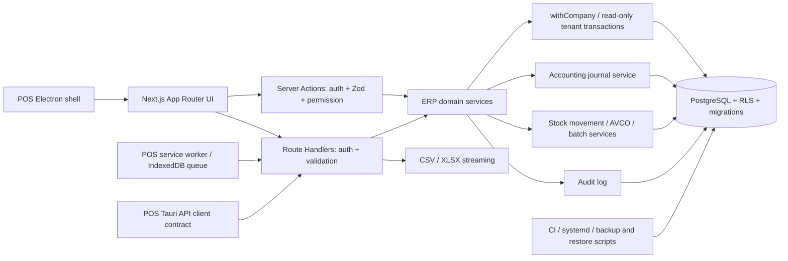

# Architecture and Dependency Map

## System shape

## Layer map and trust boundaries

| Layer | Repository entry points | Responsibility / dependency |
|---|---|---|
| UI | `src/app/app/**`, `src/components/**` | App Router pages, forms, tables, POS terminal and print views. Server pages/actions are not treated as inherently private; permission checks live in server code. |
| Auth / request context | `src/lib/auth.ts`, `src/lib/session.ts`, `src/proxy.ts` | Better Auth sessions, company membership selection, role/module permissions, fresh-session gate, CSP nonce, POS shell cookie. |
| API | `src/app/api/**` (32 route handlers) | Auth route; import parsing/templates; 16 exports; health; POS web/offline/device, pairing, desktop, telemetry and updater endpoints. |
| Actions | `src/server/actions/**` (59 files) | Server-side mutation/query facade. Most paths validate with Zod, resolve permission and company context, invoke domain service and revalidate UI paths. |
| Domain | `src/server/**`, `src/lib/**` | POS checkout/returns, journals, AR/AP, inventory movements/AVCO, receipts/transfers/adjustments, HR/payroll, purchasing, analytics and reports. |
| Persistence | `src/db/index.ts`, `src/db/tenant.ts`, `src/db/schema/**`, 87 migrations | Drizzle/postgres.js, transaction-local tenant context, migrations and RLS. Default pool is 24 connections per process (`src/db/index.ts:14-22`). |
| Integration clients | `public/pos-sw.js`, `pos-desktop/**`, `pos-electron/**` | PWA cache/offline queue, static POS export and Electron print shell. `src-tauri/**` is absent/deleted in this checkout. |
| Operations | `.github/workflows/ci.yml`, `deploy/**`, `scripts/**`, `docker/**` | CI build/test, systemd service/backup/restore-drill, environment setup, migration, encrypted backup and restore controls. No running app worker/queue service was discovered. |

## Shared business/data dependencies

- **POS checkout:** `checkoutAction` → `lockPosSaleAttempt` / fingerprint → `createSale` → server quote, session and payment validation → sale/payment rows → stock movement + cash movement + journal + audit, all in the tenant transaction (`src/server/actions/pos.ts:257-364`; `src/server/pos/sales-create.ts:22-82`).
- **Accounting:** `postJournal` centralizes balanced journal insert, period validation, idempotency and the configured cash/bank negative policy. It is consumed by POS, warehouse, purchasing, payroll, expenses, transfers and payments.
- **Inventory:** `applyStockMovement` serializes product and warehouse on-hand writes, validates available quantity, appends the movement and recalculates AVCO for inbound purchases/returns (`src/server/inventory/movements.ts:46-128`). Batch/serial helpers are layered around the same movement path. Transfers and adjustment/receipt documents feed this domain.
- **Purchasing:** purchase order and request documents are separate from receipt posting. Receipts update stock/cost and accounting/AP. Supplier returns reverse stock, liabilities/credits/advances and journals using source receipt provenance.
- **HR:** employees/attendance/leave/overtime feed payroll calculations; posted payroll journals are separate from payment journals; advances/loans/reimbursements are linked to payroll and accounting.
- **Reporting:** analytics and statement/report builders read operational tables and posted journals; analytics currently has a return-netting inconsistency (ANL-001).
- **Tenant enforcement:** actions/routes resolve membership and company; `withCompany` sets `app.company_id` transaction-locally; migrations define RLS. Actual production policies, grants and app DB role were not inspected through a live PostgreSQL connection.

## Route and workflow families

- POS pages: `/app/pos/**` (terminal, offline queue, held sales, history, returns, receivables, cash sessions/history and receipt views).
- Accounting pages: `/app/akuntansi/**` (CoA, journals, ledger, statements, period close, bank/reconciliation, tax, assets, receivables/payables, print) plus HR sub-route groups.
- Warehouse pages: `/app/gudang/**` (products/master data, purchase requests/orders, receipts, transfers, adjustments, stock count, returns, reservations, valuation, movement and imports).
- Other app pages: `/app/analisa`, `/app/data-master`, `/app/pengaturan/**`, shared dashboard/error/loading layouts.
- API route inventory is enumerated in `MODULE_INVENTORY.md`; security gates and runtime status are recorded in `SECURITY_AUDIT.md` and `WORKFLOW_COVERAGE.md`.

## Architectural strengths

- Shared domain code is used by POS web and offline/device sync rather than duplicating the sale engine.
- Financial and stock mutations are generally composed in tenant transactions; idempotency keys are claimed in the same transaction as the business document.
- Decimal values are used for money/quantity-sensitive arithmetic; server recomputes sale quote and posting rather than trusting UI totals.
- Domain-specific data access is scoped by `company_id` and reinforced by RLS migrations.
- Export paths use bounded pages/streams in several large result areas; the ledger stream explicitly chooses long-lived snapshot consistency over bounded connection lifetime.

## Architectural concerns

- The `accounting.ts` cash guard reads a shared account balance without serializing concurrent outflows (ACC-001).
- Some shared invariants exist only as application read/check/write sequences (owner count, leave quota, overtime same-day) and need a database/lock boundary for concurrency safety.
- POS outbox retains complete offline payloads and repeats JSONB scans without retention/key indexes (POS-002).
- Analytics loads product-level result sets into Node before filtering/pagination (ANL-001 report; static scale risk).
- Long-lived ledger streaming pins a repeatable-read snapshot and pool connection under client backpressure (PERF-001).
- Current Git working tree has extensive pre-existing modifications/deletions. Reports refer to the inspected working tree, not a clean commit; source commit review is needed before applying fixes.
