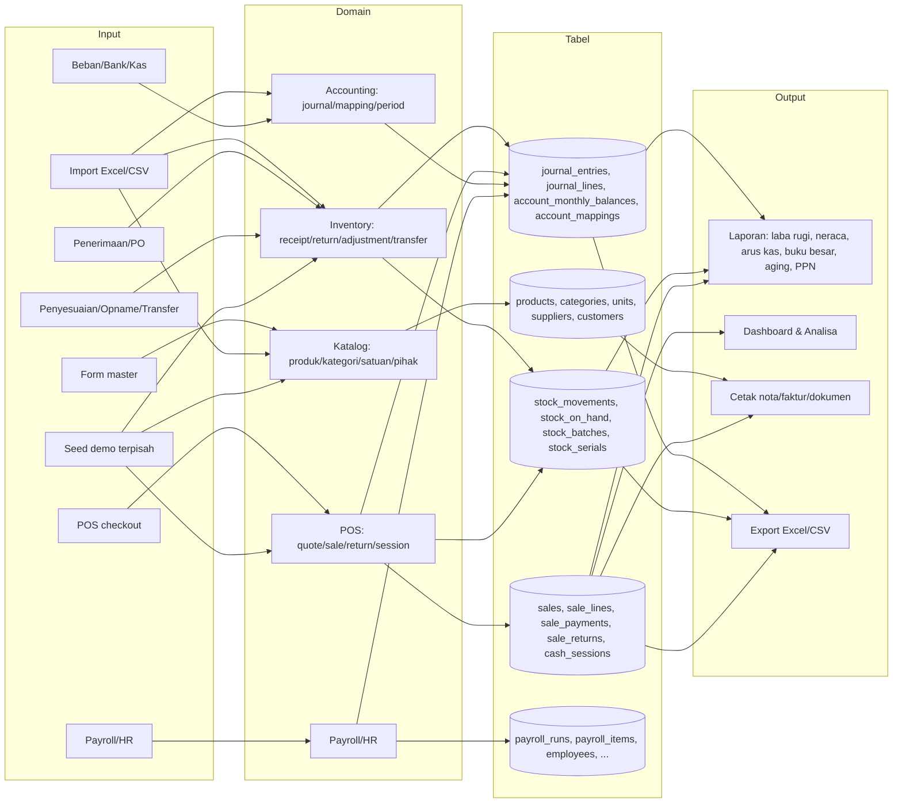

# DATA FLOW

Sumber kebenaran: **jurnal** untuk akuntansi, **stock_movements** untuk kuantitas/nilai persediaan, dan dokumen transaksi untuk subledger. Laporan membaca sumber tersebut, bukan kolom saldo yang bisa diedit.

## Jalur tulis penting

| Data | Penulis utama | Dibaca oleh |
| --- | --- | --- |
| `stock_movements` | penerimaan, penjualan, retur, penyesuaian, opname, transfer | stok, nilai persediaan, HPP, rekonsiliasi |
| `stock_on_hand` | `inventory/movements.ts` (satu pintu) | POS, daftar produk, laporan stok |
| `journal_entries/lines` | `server/accounting.ts` + dokumen domain | semua laporan keuangan |
| `account_monthly_balances` | `postJournal` (ringkasan) | laporan periode |
| `sales`/`sale_lines` | `pos/sales-persist.ts` | POS, laporan penjualan, analisa |
| `sale_returns` | `pos/returns.ts`, `returns-settlement.ts` | laporan penjualan, P&L |
| `payroll_*` | `server/hr/payroll-*` | slip, rekap, jurnal |
| `import_jobs/rows` | API impor | wizard impor, audit |

## Risiko alur

- **Multi-writer**: tabel pihak, stok, dan jurnal ditulis beberapa domain. Setiap jalur wajib memakai lock yang sama dan jurnal seimbang.
- **Saldo laporan**: P&L memakai `section` + tipe; neraca memakai tipe; buku besar memakai `normalBalance`. Ketidaksesuaian metadata akun bisa membuat angka antar-laporan berbeda — kini divalidasi di form/impor dan ada fallback P&L.
- **Retur penjualan** punya dua jalur: dokumen retur (pendapatan/refund) dan penerimaan stok “customer_return” (biaya/HPP). Keduanya tidak boleh mencatat pendapatan ganda.
- **Stok negatif** dicegah di domain; `allow_negative_stock` adalah saklar sadar.
- **Void** harus membalik jurnal dan stok pada tanggal yang tepat; periode tertutup memaksa pembalik di periode berjalan (dicatat di audit).

## Titik integritas yang diperiksa

1. Σ debit = Σ kredit untuk setiap jurnal posted.
2. `stock_on_hand` = Σ `stock_movements` per produk/gudang.
3. Σ batch = `stock_on_hand` untuk produk batch.
4. Total penjualan = Σ baris + pembulatan.
5. Total penerimaan = Σ baris + pajak.
6. Nilai persediaan (qty × AVCO) = saldo GL akun persediaan.
7. Laporan penjualan = P&L setelah retur/PPN.
