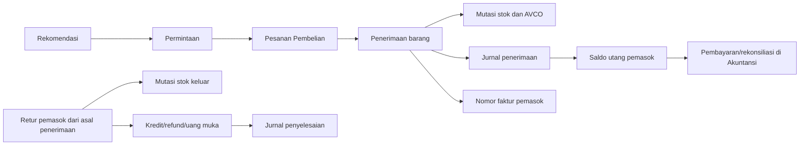
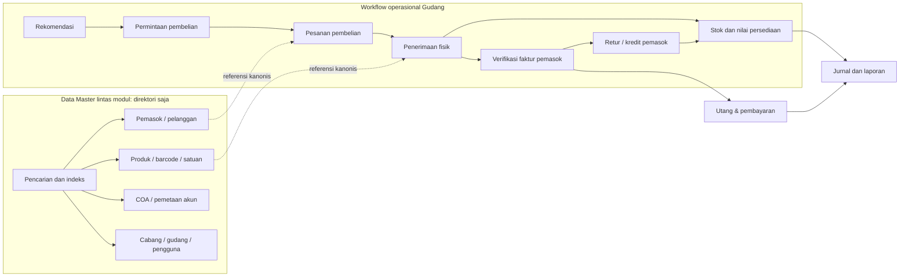
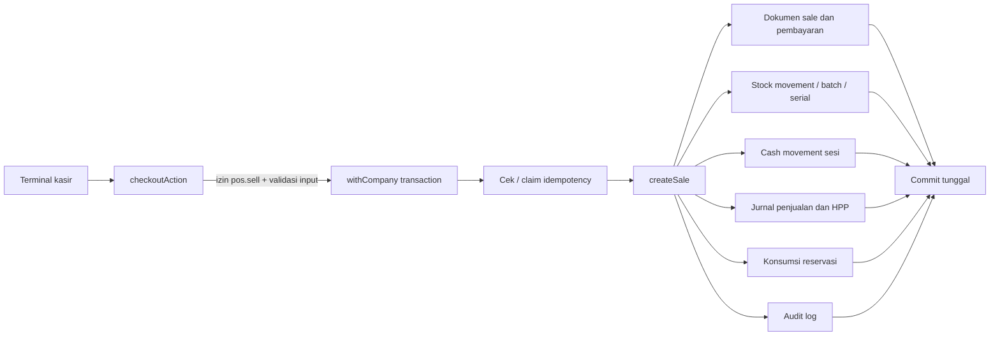

# Audit Keandalan Data, Arsitektur, Performa, Master Data, dan UX ERP

Tanggal: 14 November 2026
Branch: main
Status: audit source dan artefak lokal; bukan sertifikasi kesiapan produksi.

## 1. Ringkasan eksekutif

Fondasi implementasi cukup baik: PostgreSQL dengan Drizzle, transaksi berscope perusahaan, Row Level Security (RLS), constraint jurnal seimbang, migrasi eksplisit, job backup yang dapat dipasang, serta POS offline dengan antrean sinkronisasi. Banyak unit/integration test dan benchmark juga tersedia.

Namun, bukti belum cukup untuk menyatakan seluruh data aman atau sistem siap produksi. Fresh-install migrasi, backup terenkripsi, dan restore berisi data sintetis telah lulus uji PostgreSQL 18.6 terisolasi. Snapshot database lokal `localhost:5433/bisa_erp` pernah diperiksa hanya-baca pada checkpoint terdahulu; hasil migrasinya sampai 0073 tidak membuktikan keadaan deployment/production. Tidak ada perubahan pada snapshot itu. Temuan source terkini juga menunjukkan enam path dump pada `.next/standalone/backups`; builder kini mengecualikan direktori backup dan file dump, tetapi tarball produksi belum dibangun atau diperiksa. Risiko tersisa: kunci backup/offsite host memerlukan konfigurasi operator, transaksi POS offline tetap lokal sampai sinkron dan penyimpanan browser masih dapat dihapus/evict, serta ekspor multi-halaman dapat mencampur perubahan katalog antarwaktu. Database deployment, host, hasil UI/browser, serta performa volume operasional tetap belum diverifikasi.

Lookup katalog pada preview import produk kini dibatasi ke SKU/barcode kandidat, tetapi seluruh baris berkas masih dibaca untuk menjaga deduplikasi lintas berkas dan pilihan massal. Ekspor CSV dan XLSX produk sudah memakai keyset/halaman serta stream; benchmark sintetis writer XLSX 50 ribu baris lulus, tetapi ekspor database, proxy, dan concurrency belum diukur pada volume operasional. Katalog dapat berubah antarhalaman karena transaksi read-only dibuka ulang per halaman. Direktori Data Master kini memiliki 22 entri terkurasi, tetapi belum membuktikan seluruh master/reference/configuration data punya owner, tautan, serta hak akses yang tercatat. Impor pemasok/pelanggan kini memetakan dan memvalidasi custom field; browser workflow dan integrasi DB khusus tetap belum diverifikasi. Pengelolaan role masih menyimpan perubahan satu per satu.

**Kesimpulan:** arsitektur memiliki dasar yang layak dikembangkan, tetapi keamanan data aktual, pemulihan bencana, performa pada volume nyata, dan UX belum terverifikasi. Prioritas: tetapkan RPO/RTO; amankan backup/restore; selaraskan status backup; lalu optimalkan import.

## 2. Cakupan dan metode

Audit mencakup persistensi dan keselamatan data, PostgreSQL dan migrasi, backup/restore, POS offline dan sinkronisasi, performa, master data, navigasi/UX, serta bukti test. Source ditelusuri dengan CodeGraph dan pemeriksaan terarah. Riset standar menggunakan sumber primer: [PostgreSQL backup](https://www.postgresql.org/docs/18/backup.html), [PostgreSQL PITR](https://www.postgresql.org/docs/18/continuous-archiving.html), [pg_restore](https://www.postgresql.org/docs/18/app-pgrestore.html), [Drizzle migrations](https://orm.drizzle.team/docs/migrations), [OWASP ASVS](https://asvs.org/), [WCAG 2.2](https://www.w3.org/TR/WCAG22/), dan [Next.js data fetching](https://nextjs.org/docs/app/getting-started/fetching-data).

Klasifikasi: CONFIRMED berarti terlihat langsung pada source/artefak; SUSPECTED butuh bukti runtime; DESIGN GAP berarti celah desain; UNVERIFIED tidak dapat dipastikan. Severity menyatakan dampak potensial, bukan klaim insiden.

### Batasan

Pada checkpoint terdahulu, satu snapshot lokal `localhost:5433/bisa_erp` diperiksa dalam transaksi `READ ONLY`; tidak ada perubahan database, migration, seed, atau restore pada snapshot tersebut. Pada verifikasi terbaru, database uji baru digunakan hanya pada container PostgreSQL sementara tanpa volume persisten. Full unit/integration suites dan build tercatat lulus pada data sintetis; satu halaman Data Master dirender di tiga viewport. Full E2E, browser review semua modul, installer pada host systemd, restore backup deployment, dan performa dataset produksi belum diverifikasi. Isi backup pengguna tidak dibaca dan `.env.local` tidak dibuka. Working tree sudah memiliki banyak perubahan sebelum dan selama rangkaian tugas; perubahan yang sudah ada dipertahankan.

## 3. Arsitektur repository

| Area | Bukti | Penilaian |
|---|---|---|
| Web/API | Next.js 16.4.5, React 19.3, Drizzle 0.45.4; src/db/index.ts:10-24 | Pool PostgreSQL max 12, idle 20 detik, connect timeout 10 detik. Kecocokan pool dengan concurrency produksi belum diuji. |
| Isolasi tenant | src/db/tenant.ts:9-27; migrations/0001_rls_and_guards.sql:10-31 | Helper memakai transaksi dan menetapkan company scope; RLS dipaksa pada tabel berscope perusahaan. SQL migration juga menjaga jurnal seimbang dan melarang mutasi jurnal posted (:42-79). |
| Kebijakan RLS | migrations/0066_rls_initplan_policies.sql:26-47 | 97 kebijakan tenant diperbarui agar lebih ramah planner; belum memvalidasi DB aktif. |
| Migrasi/deploy | deploy/migrate.mjs; deploy/update.sh; src/db/migrations/meta/_journal.json | Source journal kini berisi 80 migrasi sampai 0079. Seluruh 80 migrasi telah diterapkan pada PostgreSQL 18.6 sintetis; rerun migrator yang pernah diverifikasi tidak menambah migration. Jalur gagal restart kini punya rollback kode teruji pada sandbox. Health membandingkan timestamp expected/installed dan mendeteksi gap. Deploy host, database aktif, upgrade dari snapshot lama, dan recovery setelah migration parsial tetap UNVERIFIED. |
| POS offline | src/lib/pos/pos-offline.ts:105-213; src-tauri/src/posdb.rs; src-tauri/src/syncengine.rs | Web memakai IndexedDB dan kini gagal tertutup bila API tidak tersedia (tanpa fallback memori di browser); adapter menunggu transaksi selesai commit. Desktop memakai SQLite/outbox. Indikator jumlah/umur antrean hanya lokal. Antrean yang belum sinkron tetap tidak ada di backup PostgreSQL dan IndexedDB masih best-effort storage. |
| Backup/status | scripts/backup.sh; scripts/restore.sh; deploy/backup-run.sh; src/server/backup-status.ts:174-195 | Dump custom, validasi arsip, umask privat, manifest/hash, enkripsi AES-GCM, guard restore dan restore drill tersedia. Backup/restore fixture nonkosong lulus di DB sintetis. Enkripsi/offsite deployment tetap bergantung konfigurasi operator; installer/host target belum diuji. |
| Master data | `src/db/schema/catalog.ts:47-231`; `src/lib/master-data-directory.ts:36-312`; `src/app/app/data-master/page.tsx` | Direktori baca-saja lintas modul ada, dengan 22 entri terkurasi dan tautan ke owner CRUD. Itu bukan CRUD gabungan dan belum menjadi inventaris lengkap atas seluruh tabel reference/configuration. |

### Aliran yang ditemukan

POS online → PostgreSQL. POS offline → IndexedDB/SQLite lokal → outbox → sinkronisasi ke PostgreSQL. PostgreSQL → pg_dump harian → manifest/hash; enkripsi dan salinan offsite tetap tergantung konfigurasi operator. `restore.sh` kini mewajibkan target eksplisit dan konfirmasi identitas; restore in-place harus diaktifkan terpisah. Diagram ini merepresentasikan source/config, bukan deployment aktual.

## 4. Inventaris fitur

| Area | Inventaris source | Status |
|---|---|---|
| POS | 15 file halaman POS; alur transaksi, payment, history, offline/sync ditemukan | Keberadaan terverifikasi; integrasi server diuji, tetapi browser/device recovery dan workflow visual belum diuji. |
| Gudang/katalog | 34 halaman Gudang; produk, supplier, pembelian/penerimaan dan proses gudang | Ada banyak area; kelengkapan end-to-end belum disimpulkan. |
| Akuntansi/HR | 41 halaman gabungan; audit sebelumnya ada di docs/reports/ERP-POS-ACCOUNTING-WAREHOUSE-AUDIT.md | Laporan ini tidak menggantikan audit fungsional sebelumnya. |
| Pengaturan | 11 item navigasi/tab, termasuk status sistem; pengguna/peran, gudang/cabang, cetak, penomoran, pembayaran, mapping, custom fields | Hitungan lama “5 halaman” adalah jumlah route/page, bukan jumlah item pengaturan. Hub Master Data Gudang tersedia; data tertentu tetap berada dekat modul pemakainya. |
| Total | 96 file page.tsx di src/app/app | Jumlah halaman file, bukan jumlah fitur yang selesai. |
| Test/benchmark | 106 file unit, 121 integration, e2e terpisah; benchmark import/saldo | Unit suite terbaru 106 file / 1.044 test PASS; integration suite 121 file / 1.016 test PASS pada DB sintetis. Satu halaman Data Master dirender manual. Full E2E dan benchmark query/import/export pada volume operasional belum dijalankan. Keberadaan bukan bukti pass. |

## 5. Temuan utama

| ID / prioritas / status | Bukti dan kondisi aktual | Dampak, rekomendasi, regresi yang diperlukan |
|---|---|---|
| DB-01 · HIGH · PARTIALLY MITIGATED IN SOURCE | scripts/backup.sh:21,81; deploy/backup-run.sh:34-36. Backup baru sekarang gagal tertutup bila passphrase kosong dan menggunakan AES-256-GCM; OFFSITE_CMD tetap opsional/mati secara bawaan. Arsip lama plaintext dan CBC tetap ada dan harus dianggap historis. | Perubahan source mengurangi keterbacaan dan memvalidasi autentisitas ciphertext, tetapi tidak membuktikan backup host terenkripsi, offsite, retensi, alert, atau restore. Environment dan artefak production tetap UNVERIFIED. |
| DB-02 · HIGH · MITIGATED IN SOURCE; DEPLOYMENT UNVERIFIED | `scripts/restore.sh` kini mewajibkan `RESTORE_TARGET_URL`, konfirmasi `host:port/database`, menolak target sama dengan `DIRECT_URL` kecuali override in-place eksplisit, memverifikasi manifest/arsip, dan memakai `--exit-on-error --single-transaction`. | Guard mengurangi risiko salah target dan error parsial pada source saat ini. Simulasi `pg_restore` tiruan lulus; restore riil ke DB isolasi, kompatibilitas target dan cutover belum diuji. |
| DB-03 · HIGH · PARTIALLY MITIGATED | src/lib/pos/pos-offline.ts:105-203 dan implementasi Tauri: antrean lokal menunggu sinkronisasi; Web kini menunggu transaksi IndexedDB `complete` dan terminal menampilkan jumlah serta umur antrean. | Perangkat hilang sebelum sync tetap dapat menghilangkan penjualan dari pusat/backup. Tetapkan SLA/recovery perangkat, monitor backlog terpusat dan uji offline/retry/duplicate/pergantian perangkat. |
| DB-04 · MEDIUM · MITIGATED IN SOURCE; DEPLOYMENT UNVERIFIED | `deploy/install.sh` menyamakan `BISA_BACKUP_DIR` di env aplikasi dan `BACKUP_DIR` job; `src/server/backup-status.ts:174-195` mengutamakan direktori manifest terkonfigurasi. | Risiko direktori berbeda ditangani di source installer. Instalasi bersih/upgrade pada host target belum dijalankan, jadi kesamaan runtime belum terbukti. |
| DB-05 · MEDIUM · PARTIALLY MITIGATED | Source installer memasang backup timer dan restore-drill timer mingguan. Sebelum checkpoint terbaru, error `systemctl enable --now` untuk kedua timer diabaikan; sekarang installer berhenti dengan pesan gagal jika aktivasi service/timer gagal. [`systemctl` mengembalikan status nonzero saat gagal](https://freedesktop.org/software/systemd/man/latest/systemctl.html). | Kegagalan aktivasi tidak lagi dilaporkan sebagai sukses pada source saat ini. Shell syntax dapat diverifikasi lokal, tetapi pemasangan systemd dan alert timer di host target belum diuji. |
| DB-06 · MEDIUM · PARTIALLY MITIGATED | Restore drill v1 membandingkan trial balance per perusahaan; versi v2 sekarang memeriksa jurnal posted per jurnal dan orphan journal lines pada hasil restore. | Pemeriksaan inventory masih agregat global dan belum direkonsiliasi per produk/gudang terhadap GL. Source lama yang menjumlahkan seluruh tenant sudah tidak berlaku. |
| DB-07 · HIGH bersyarat · DESIGN GAP | Backup harian ada; tidak ditemukan konfigurasi WAL archive/PITR pada deploy/scripts/docs yang ditelusuri. | Bila RPO yang dibutuhkan kurang dari satu interval harian, skema ini tidak memenuhinya. RPO/RTO belum ditetapkan. Putuskan kebutuhan bisnis; bila perlu gunakan WAL/PITR dan lakukan drill. [Rujukan PostgreSQL PITR](https://www.postgresql.org/docs/18/continuous-archiving.html). |
| DB-08 · MEDIUM · MITIGATED IN SOURCE; HOST UNVERIFIED | `scripts/backup.sh` dan `scripts/restore.sh` kini menetapkan `umask 077`; installer menetapkan direktori backup `0750` dan sidecar manifest dapat dibaca grup aplikasi secara terbatas. | Dump lokal lama bermode 0644 tidak membuktikan perilaku file baru. Mode aktual di host deployment belum diverifikasi. |
| DB-09 · HIGH · MITIGATED IN SOURCE; SYNTHETIC DB PASS; ACTIVE DB UNVERIFIED | `src/app/api/health/route.ts` membaca semua `created_at` dari `drizzle.__drizzle_migrations`, memvalidasi nilai unik/nonnegatif, dan membandingkan seluruh set timestamp build. | Migrasi 0074 dan health readiness lulus pada fresh-install PostgreSQL 18.6 sintetis; role runtime `app_user` dapat membaca journal tanpa hak insert, dan endpoint image melaporkan schema current. Ini belum memverifikasi upgrade dari DB lama atau database aktif/deployment target. |
| DB-10 · UNVERIFIED | Tidak ada query DB aktif. | Tidak diketahui apakah data terbaru tersimpan, tag migration aktif, saldo cocok, atau ada antrean sync. Verifikasi read-only terotorisasi di environment yang ditentukan. |
| DB-11 · HIGH · MITIGATED IN SOURCE / HOST UNVERIFIED | Unit backup dan restore drill kini memakai `LoadCredential=backup-passphrase:/etc/credstore/bisa-erp-backup-passphrase`; restore drill tidak lagi memakai `EnvironmentFile`. `deploy/backup-run.sh` mengirim hanya path credential, sedangkan `scripts/backup-crypto.mjs` membaca isi file tanpa menaruh passphrase ke environment Node. Installer memigrasikan nilai lama dari `backup.conf` ke file root-only pada systemd credstore. | Ini menghapus jalur environment unit yang terbukti pada source sebelumnya; `scripts/restore.sh` masih mendukung environment sebagai fallback manual yang kompatibel. Dampak host belum dapat diverifikasi. Target systemd ≥247 diperiksa oleh installer. Test sintetis file-key/backup/restore lulus; unit aktif, D-Bus, izin credential runtime, migrasi installer dan log host **UNVERIFIED**. Rujukan: [systemd.exec credentials](https://www.freedesktop.org/software/systemd/man/latest/systemd.exec.html), [systemd credentials](https://systemd.io/CREDENTIALS/). |
| DB-12 · MEDIUM · MITIGATED IN SOURCE / HOST UNVERIFIED | `deploy/install.sh` hanya mengaktifkan timer bila `/etc/credstore/bisa-erp-backup-passphrase` tersedia; kedua unit memerlukan credential dan job tetap gagal tertutup bila kunci kosong. | Source tidak menampilkan timer sebagai siap tanpa key; pada kondisi kosong installer menonaktifkan timer yang ada dan menyampaikan langkah aktivasi manual. Host systemd, migrasi config lama, pemberitahuan operator, dan hasil timer masih belum diuji. |
| DB-13 · CRITICAL · MITIGATED IN SOURCE / ARTIFACT NOT BUILT | `deploy/build-release.sh` menyalin `.next/standalone/.` seluruhnya. Pemeriksaan nama file saja menemukan enam file `backups/*.dump` pada `.next/standalone/backups` working tree saat ini; file tidak dibuka atau dimasukkan ke laporan. | Release yang dibuat dari pohon ini dapat menyertakan dump database lokal di paket distribusi. Jika berisi data operasional, dampaknya adalah kebocoran data finansial/pribadi. Builder kini mengecualikan direktori `backups`; test paket sintetis memastikan sentinel dump tidak masuk archive. File release nyata belum dibangun atau diperiksa. |
| DB-14 · HIGH · MITIGATED IN SOURCE / ARTIFACT NOT BUILT | Sebelum perubahan ini, `deploy/build-release.sh` hanya menyalin `backup.sh` dan `restore.sh`, sedangkan jalur systemd memakai `restore-drill.sh` dan ketiga script memerlukan helper crypto/manifest. | Instalasi dari paket dapat kehilangan operasi backup/restore atau drill meski source checkout berfungsi. Builder sekarang menyalin `restore-drill.sh`, `backup-crypto.mjs`, dan `verify-backup-manifest.mjs`; test builder sintetis memeriksa daftar berkas paket. Tarball rilis produksi/host masih **UNVERIFIED**. |
| PERF-01 · MEDIUM · CONFIRMED, mitigasi parsial | Bukti baseline: src/server/actions/import/rows.ts:63-86; src/server/actions/import/shared.ts:55-76,339-418. Update: analisis dan pratinjau kini hanya mengambil produk/barcode katalog yang cocok dengan SKU/barcode kandidat berkas, secara berkelompok; indeks ekspresi SKU ditambahkan ke schema dan migrasi 0075; persistensi isu per baris memakai UPDATE batch CASE. | Transfer dan materialisasi katalog produk/kemasan tidak lagi mencakup entitas yang tidak terkait dengan file. Semua baris file masih dibaca dan diklasifikasikan agar total, duplikasi global, serta pilihan massal tetap akurat. Benchmark parser/mapping 10k baris lulus (bukan benchmark DB); pagination filter/count SQL, benchmark 100k, query plan produksi, dan pengukuran import full-stack belum diverifikasi; migrasi indeks belum diterapkan. |
| PERF-02 · MEDIUM · MITIGATED IN SOURCE; SCALE/DB UNVERIFIED | Temuan baseline: route produk sebelumnya mematerialisasi XLSX/CSV. Kini `src/app/api/export/products/route.ts` memakai halaman keyset dan CSV stream; XLSX produk memakai ExcelJS streaming writer di `src/server/catalog/product-xlsx-stream.ts`. | Benchmark sintetis tanpa DB 50.000 baris menunjukkan stream XLSX terbatas oleh backpressure dalam skenario konsumen cepat/lambat; belum mengukur query DB, proxy/deployment, peak production heap atau concurrency. Tiap halaman memakai transaksi baru, sehingga perubahan katalog selama ekspor bisa menghasilkan snapshot campuran. |
| PERF-03 · MEDIUM bersyarat · SUSPECTED | src/lib/auth.ts:78-89: rate limiter in-memory per proses. | Kuota tidak konsisten pada multi-instance dan reset saat restart. Cocokkan topologi; gunakan backend bersama bila multi-instance dan uji lintas proses. |
| MD-01 · MEDIUM · PARTIALLY MITIGATED / COVERAGE UNVERIFIED | `src/lib/master-data-directory.ts:22-174`; katalog `src/db/schema/catalog.ts:47-231`. | Direktori global kini memberi entry point dan menjaga CRUD tetap pada owner; namun daftar 12 entri belum dicocokkan terhadap seluruh entity master/reference/configuration, relasi, lifecycle, dan owner. Lengkapi katalog owner dahulu, tandai entity tanpa UI kanonis sebagai gap, lalu uji discovery dan izin per role. Jangan memindahkan seluruh tabel transaksi ke CRUD generik. |
| MD-02 · MEDIUM · MITIGATED IN SOURCE; DB/UI UNVERIFIED | `src/app/api/import/template/[entity]/route.ts`, `src/server/import/analyze.ts`, `src/server/import/commit.ts`, `src/lib/import/import-custom-fields.ts`. | Template CSV/XLSX dan mapping menyediakan custom field; analyze/commit memvalidasi nilai dan mencatat error per baris. Required field yang kosong tetap dapat diimpor dengan catatan sesuai perilaku sebelumnya. Unit suite lulus; alur browser dan integration DB belum diverifikasi. |
| MD-03 · MEDIUM · DESIGN GAP | src/components/pengaturan/user-access.tsx:129-147 menyimpan role satu per satu. | Kegagalan di tengah dapat meninggalkan setelan parsial. Simpan atomic atau tampilkan status item dan retry aman; uji kegagalan pada item ke-N. |
| MD-04 · LOW · CONFIRMED | src/lib/custom-fields.ts:18-62. | Nilai custom field orphan dapat tersisa setelah definisi dihapus dan tidak dirender. Tampilkan dampak sebelum hapus dan tetapkan arsip/hapus; uji orphan. |
| UX-01 · PARTIAL / OVERALL UNVERIFIED | Halaman Data Master sudah dirender di Chrome pada desktop, tablet, dan mobile; pemeriksaan layar/modul lain dan audit WCAG belum lengkap. | Contoh ini membuktikan satu halaman responsif, bukan kualitas seluruh ERP. Lanjutkan audit per workflow/halaman, keyboard, kontras, focus, empty/error/loading dan WCAG 2.2. |
| UX-02 · UNVERIFIED | Tidak ada observasi atau timing pengguna. | Langkah, waktu, salah input dan recovery belum diukur. Uji tugas kasir, staf gudang, akuntan dan admin dengan pengguna/perangkat yang mewakili. |

### Kontrol positif dan batasnya

- Transaksi tenant helper serta RLS/guard jurnal ditemukan di source; konfigurasi runtime, role DB dan bypass belum diuji.
- Migrasi deployment eksplisit dan update memiliki backup sebelum migrasi; prosedur rollback setelah migrasi membatasi rollback sederhana.
- Produk dipaginasi dan indeks trigram tersedia. Sampling server action memperlihatkan parsing input dan permission checks; bukan review semua endpoint.
- Tidak ada bukti SQLi/XSS pada sampel, tetapi tidak ada penetration test atau audit menyeluruh.

## 6. Keamanan dan maintainability

| Kontrol | Hasil |
|---|---|
| Isolasi tenant | RLS forced dan company scope ditemukan; pool reuse/bypass aktif belum diuji. |
| Integritas jurnal | Constraint dan perlindungan jurnal posted ada di migration; seluruh posting/reversal belum diverifikasi. |
| Otorisasi/input | Sampling menunjukkan permission + parse input; inventory lengkap semua endpoint belum dilakukan. |
| SQLi/XSS/secrets | Tidak ada eksploitasi diuji; banyak area UNVERIFIED. File .env tidak dibaca. |
| Backup key delivery | Temuan source DB-11: passphrase berada di environment unit restore drill melalui `EnvironmentFile`; dampak runtime/host UNVERIFIED. Pindahkan ke systemd credential file, jangan menulis nilainya ke log atau baris perintah. |
| Maintainability | Struktur modul, migrasi dan test assets tersedia; master data tersebar dan update role parsial menaikkan biaya dukungan. |

## 7. Hasil verifikasi

| Pemeriksaan | Hasil |
|---|---|
| Inspeksi source, deploy, runbook dan metadata | PASS sebagai inspeksi source/metadata saja; temuan baseline dan mitigasi berikutnya dibedakan pada addendum. |
| SHA dump lokal terhadap backups/backup-manifest.json | PASS: file yang disebut manifest ada dan hash cocok. Ini tidak membuktikan dump bisa dipulihkan. |
| Enkripsi artefak pada manifest lokal | FAIL untuk kontrol enkripsi: encrypted=false. |
| Manifest restore drill lokal | NOT FOUND pada direktori lokal yang diperiksa; bukan bukti tidak ada di host lain. |
| Database aktif, migration terpasang, saldo dan antrean sync | NOT RUN; tidak ada koneksi database. Source migration 0074/0075 belum diterapkan. |
| Restore DB nyata | NOT RUN. Uji guard dengan `pg_restore` tiruan lulus; tidak ada koneksi DB. |
| Unit suite | PASS terbaru: 106 file / 1.044 test, setelah perubahan navigasi dan wrapping Data Master. |
| Integration suite | PASS: 121 file / 1.016 test pada PostgreSQL sementara yang sudah dimigrasi dan di-seed; source terakhir setelah itu hanya mengubah direktori/tampilan Data Master. |
| Lint/typecheck/build | Typecheck dan production build terbaru PASS; ESLint target Data Master PASS. Full-repository lint masih BLOCKED/NOT COMPLETED pada checkpoint terdahulu. |
| Browser, responsif, aksesibilitas dan workflow | PARTIAL: Data Master dirender manual pada 1440×1000, 768×1024, 390×844; 7 section/12 entry, document width sama dengan viewport, tidak ada teks metadata terpotong atau page error. Full E2E, keyboard/a11y dan workflow modul lain NOT RUN / UNVERIFIED. |
| Benchmark | NOT RUN; benchmark yang ada dapat memanipulasi fixture DB. |

## 8. Scorecard

Skala 0–5: 0 tidak ada; 1 placeholder; 2 tidak lengkap/defect serius; 3 berfungsi dengan keterbatasan; 4 baik dan terverifikasi dengan gap kecil; 5 matang dan terverifikasi. Skor adalah estimasi source-level, bukan sertifikasi.

| Dimensi | Skor | Confidence dan alasan |
|---|---:|---|
| Persistensi online | 3/5 | Medium: schema/transaksi ada, DB aktif dan semua jalur tulis belum diuji. |
| Ketahanan POS offline | 2/5 | Medium: outbox/retry ada, tetapi data lokal menunggu sync dan recovery perangkat belum terverifikasi. |
| Isolasi tenant/integritas jurnal | 3/5 | Medium: migration guard terlihat; runtime belum diuji. |
| Backup/disaster recovery | 2/5 | High untuk source dan bukti host: backup baru source wajib terenkripsi-terautentikasi, tetapi salinan offsite tetap mati default; restore host dan drill nyata belum terverifikasi. |
| Migrasi/deployment | 3/5 | Medium: migrator/version check source ada; semua set timestamp diuji unit, tetapi migration aktif dan role runtime di host tidak diperiksa. |
| Efisiensi performa | 2/5 | Medium: import O(N+M) terbukti; export/topologi perlu benchmark. |
| Maintainability | 3/5 | Medium: struktur/test ada; area master dan update parsial menjadi gap. |
| Master data | 3/5 | Medium: entitas inti tersedia; navigasi/validasi import perlu perbaikan. |
| UI/UX visual dan responsif | UNVERIFIED (untuk ERP secara keseluruhan) | Data Master memiliki sampel render tiga viewport; belum cukup untuk memberi skor pada sistem/modul. |
| Aksesibilitas | UNVERIFIED | WCAG belum diuji. |
| Kesiapan keseluruhan | UNVERIFIED | Unit/integration/build lulus sintetis dan Data Master dirender; database deployment, restore produksi, full E2E, benchmark dan audit workflow lintas modul masih terbuka. Skor gabungan tidak dibuat. |

## 9. Rencana peningkatan

| Urutan | Pekerjaan | Kriteria selesai |
|---:|---|---|
| 1 | Putuskan RPO/RTO, retensi, lokasi backup, pemilik pemulihan, dan toleransi transaksi offline | Kebijakan disetujui dan jadwal drill jelas. |
| 2 | Wajibkan enkripsi, offsite, permission least-privilege, retensi dan alert backup | Backup terenkripsi/offsite teruji; permission dan alert diverifikasi. |
| 3 | Buat restore aman ke DB terisolasi dengan guard target, hash dan fail-fast | Target salah ditolak; restore gagal terdeteksi; RTO tercatat. |
| 4 | Jadwalkan restore drill dan validasi per tenant | Alarm stale/fail; saldo, ledger/subledger dan referensi diperiksa per perusahaan. |
| 5 | Samakan direktori backup job dan UI status | Installer baru menunjuk lokasi yang sama; UI cocok dengan artefak terbaru. |
| 6 | Tetapkan durability/recovery POS offline | Antrean terlihat dan dimonitor; recovery perangkat, retry dan idempotensi diuji. |
| 7 | Readiness health membandingkan migration DB aktual | Mismatch schema mengubah readiness dengan pesan aman. |
| 8 | Pindahkan import preview ke query SQL dan batch | Pagination/filter server-side; benchmark volume memenuhi SLO. |
| 9 | Ukur dan batasi ekspor besar | Streaming/batas/queue dipilih berdasar benchmark; hasil lengkap. |
| 10 | Buat entry point Master Data yang terkelompok dan berizin | Tugas menemukan/mengelola entitas inti cepat dan jelas untuk tiap role. |
| 11 | Verifikasi alur custom field import pada browser/DB isolasi; perbaiki konsistensi role update | Uji template → mapping → preview → commit dan hasil per baris; pastikan update role atomic atau kegagalan per item terlihat dan dapat di-retry. |
| 12 | Audit browser, responsif, aksesibilitas, dan task timing | Screenshot/viewport, keyboard, kontras, error/empty/loading dan WCAG 2.2 tercatat. |
| 13 | Tetapkan SLO dan jalankan benchmark di staging khusus | p50/p95, heap, query count dan ambang regresi terdokumentasi. |

## 10. Keputusan bisnis yang belum ada

- Target RPO/RTO dan apakah interval backup harian dapat diterima.
- Retensi, offsite, enkripsi, pemilik secret dan prosedur pemulihan.
- Kebijakan kasir offline ketika perangkat rusak atau hilang.
- Volume produk, import, transaksi, tenant, concurrency dan ekspor yang harus didukung.
- Kebijakan nilai custom field ketika definisi dihapus.
- Apakah penyimpanan role harus atomic atau hasil parsial boleh dengan status per item.
- Perangkat/viewport dan kriteria UX untuk kasir, gudang, akuntansi dan administrator.

## 11. Area belum terverifikasi

Database aktif, data transaksi terakhir, migration terpasang, konsistensi saldo/subledger, backup production, offsite dan restorability; permission file host; recovery time; seluruh endpoint/otorisasi; konfigurasi secrets dan replica; akurasi integrasi transaksi pada data nyata; UI render/responsif/a11y; performa pada volume produksi; serta hasil test suite saat ini.

## 12. Evidence appendix

Source utama: src/db/index.ts, src/db/tenant.ts, src/db/migrations/0001_rls_and_guards.sql, src/db/migrations/0066_rls_initplan_policies.sql, src/db/migrations/0075_import_product_catalog_lookup.sql, src/db/migrations/meta/_journal.json, deploy/migrate.mjs, deploy/update.sh, deploy/install.sh, deploy/systemd/bisa-erp.service, deploy/systemd/bisa-erp-backup.timer, deploy/backup-run.sh, deploy/backup.conf.example, scripts/backup.sh, scripts/restore.sh, scripts/restore-drill.sh, docs/RUNBOOK-BACKUP-RESTORE.md, src/server/backup-status.ts, src/app/api/health/route.ts, src/lib/pos/pos-offline.ts, src-tauri/src/posdb.rs, src-tauri/src/syncengine.rs, src/db/schema/catalog.ts, src/server/import/masters.ts, src/server/actions/import/rows.ts, src/server/actions/import/shared.ts, src/lib/import/import-classify.ts, src/server/catalog/products.ts, src/app/api/export/products/route.ts, src/lib/auth.ts, src/lib/settings-nav.ts, src/components/pengaturan/user-access.tsx, src/lib/custom-fields.ts.

Artefak lokal: backups/backup-manifest.json dan file dump yang disebutnya diperiksa hanya melalui metadata/hash; tidak dibaca atau direstore. Temuan POS/Accounting/Warehouse terdahulu ada di [ERP-POS-ACCOUNTING-WAREHOUSE-AUDIT.md](ERP-POS-ACCOUNTING-WAREHOUSE-AUDIT.md); laporan ini menambah platform reliability, performa, master data, dan UX.

## Addendum verifikasi lanjutan — 14 November 2026

Audit lanjutan dilakukan setelah laporan awal. Database yang diperiksa dibatasi secara eksplisit ke localhost:5433/bisa_erp dan setiap query dijalankan dalam transaksi PostgreSQL READ ONLY. Hasil ini hanya menggambarkan snapshot database lokal saat pemeriksaan, bukan server production atau seluruh jalur tulis aplikasi.

### Verifikasi runtime database lokal

| Pemeriksaan | Hasil aktual | Makna dan batas |
|---|---|---|
| Identitas koneksi | PASS: database bisa_erp, PostgreSQL 18.6, transaction_read_only=on | Tidak ada mutasi database. Target dipastikan host lokal, port 5433, database bisa_erp. |
| Migrasi | PASS: tabel drizzle.__drizzle_migrations memiliki 74 record, id terbaru 74 dan created_at 1794536117935; sama dengan timestamp entri terakhir journal source 0073_cheerful_ghost_rider | Source dan snapshot DB lokal tampak selaras hingga migrasi 0073. Tidak membuktikan DB production memiliki versi sama. |
| Data tersimpan | PASS pada keberadaan row: produk 1.887; sales 5; sale lines 2; payment 2; journal entry 34; journal line 97; stock movement 13; stock on hand 8; penerimaan 7 dan baris penerimaan 7 | Menunjukkan tabel inti berisi data pada DB lokal. Jumlah kecil dan dapat berupa fixture/demo; tidak membuktikan semua transaksi aplikasi tersimpan atau data production lengkap. |
| Jurnal posted seimbang | PASS: 0 jurnal posted tanpa baris atau dengan selisih debit-kredit lebih dari 0,0001 | Pemeriksaan agregat pada snapshot saat ini. Tidak mencakup jurnal draft, histori sebelum migrasi, atau kelengkapan mapping sumber. |
| Ledger stok vs stock_on_hand | PASS: 0 key dengan selisih kuantitas; 0 key snapshot tanpa ledger; 0 key ledger tanpa snapshot | Membandingkan jumlah per perusahaan/gudang/produk. Tidak memvalidasi nilai persediaan/AVCO terhadap akun kontrol GL. |
| Duplikasi idempotency penjualan | PASS: 0 grup kunci idempotensi penjualan duplikat yang tidak null | Snapshot saat ini saja; tidak menguji race concurrent pada runtime. |
| Backup lokal | PASS untuk integritas hash: file manifest ditemukan, ukuran aktual cocok, SHA-256 cocok; file mode 0600; manifest menyebut encrypted=false | Hash menguji kesamaan dengan manifest, bukan restorability. Backup tetap plaintext. Beberapa dump historis bermode 0644, namun ancestor home lokal bermode 0700; permission host deployment belum diverifikasi. |
| Restore drill lokal | UNVERIFIED/NOT FOUND: restore-drill-manifest.json tidak ada pada direktori backups lokal yang diperiksa | Tidak membuktikan tidak ada drill di server atau direktori lain. |

### Test, typecheck, dan lint lanjutan

| Pemeriksaan | Hasil aktual | Batas |
|---|---|---|
| Full unit suite | PASS terbaru: 106 file, 1.044 test (15:19 WIB, setelah perbaikan Data Master). | Tidak menguji DB production atau seluruh behavior UI. |
| Full integration suite | PASS: 121 file, 1.016 test pada PostgreSQL sementara yang dimigrasi dan di-seed. | Data sintetis; tidak menggunakan database pengguna. |
| Regression navigasi Data Master | PASS: `tests/unit/master-data-directory.test.ts`, 5 test. | Memeriksa permission entry dan URL; bukan pengganti browser E2E. |
| Typecheck dan build | PASS terbaru: `pnpm build` menyelesaikan kompilasi, TypeScript dan route manifest setelah perubahan Data Master. | Tidak membuktikan runtime deployment. |
| Lint seluruh repository | BLOCKED/NOT COMPLETED pada percobaan terdahulu: ESLint seluruh repo memakai sekitar 2,7 GB RSS dan >3 menit tanpa output; dihentikan untuk menjaga beban workspace. | Tidak ada klaim lulus/gagal penuh. |
| Lint terbatas | PASS terbaru: ESLint pada direktori Data Master dan tesnya; lint terbatas area lain tercatat pada checkpoint sebelumnya. | Tidak meliputi seluruh repository. |
| Browser/E2E | PARTIAL: login + render Data Master di Chrome sistem pada 3 viewport PASS. Full Playwright suite NOT RUN. | Browser managed tidak terpasang; config standar mengarah ke port 3000 yang digunakan proses pengguna. |

Catatan historis: dua file navigasi pernah gagal terhadap working tree pada pemeriksaan subset sebelumnya. Full unit suite terbaru lulus seluruh 106 file, sehingga kegagalan lama tidak dianggap sebagai defect/test drift yang masih aktif.

### Perubahan status area yang sebelumnya belum terverifikasi

- DB-10 kini **PARTIALLY VERIFIED untuk database lokal**: row data inti ada, migrasi source dan DB lokal sama-sama sampai 0073, jurnal posted seimbang, agregat kuantitas stock ledger cocok dengan stock_on_hand, dan tidak ada duplicate sale idempotency key pada snapshot. Status untuk production dan semua jalur tulis tetap UNVERIFIED.
- Backup artifact lokal **hash verified**, tetapi restore belum dijalankan; kontrol enkripsi tetap FAIL untuk artefak manifest yang diperiksa. Tidak ada kesimpulan restorability.
- Pada checkpoint tersebut, unit terpilih dan typecheck memberi bukti positif, sementara subset navigasi masih menunjukkan kegagalan historis. Status terbaru: full unit suite lulus seluruh 106 file; catatan test drift historis tidak berlaku untuk working tree terakhir.
- Sebelum checkpoint browser terbaru, UI hasil render belum diperiksa. Kini Data Master punya sampel render tiga viewport; keyboard/accessibility menyeluruh, task timing, p95 latency, concurrency, import/export memory, restore drill nyata, dan nilai inventory versus GL masih **UNVERIFIED**. Full E2E tidak dijalankan melalui config default karena mengarah ke port 3000 yang dipakai proses pengguna; uji manual terbaru tetap memakai test DB terisolasi.

## Riset referensi dan rencana perbaikan terarah

Riset dilakukan melalui skill web-search, kemudian klaim teknis diperiksa pada dokumentasi primer/standar resmi. Rekomendasi di bawah ini menghubungkan hasil riset ke temuan repository; referensi tidak dianggap sebagai bukti bahwa implementasi sudah memenuhi standar.

| Prioritas | Tindakan yang direkomendasikan | Dasar audit dan cara membuktikan selesai | Rujukan |
|---:|---|---|---|
| 1 | Tetapkan RPO/RTO, retensi, lokasi backup, tanggung jawab on-call, dan toleransi transaksi offline bersama pemilik bisnis/operasi. | Ini keputusan operasional yang belum didefinisikan; tanpa itu tidak bisa memilih interval dump atau menilai apakah perlu PITR. | PostgreSQL mendokumentasikan SQL dump, file-system backup dan continuous archiving sebagai strategi berbeda dengan karakteristik berbeda. |
| 2 | Perkuat backup: enkripsi wajib, salinan terpisah/offsite, retensi, hak akses file minimal, alert backup gagal/basi, dan pemantauan ruang disk. | Backup source saat ini plaintext/offsite default mati; hash lokal cocok tetapi bukan bukti restorability. Kriteria: artifact terenkripsi terverifikasi, copy offsite tersedia, alert diuji, retensi berjalan. | [PostgreSQL Backup and Restore](https://www.postgresql.org/docs/18/backup.html). |
| 3 | Ubah restore menjadi workflow pemulihan dua tahap: restore ke database isolasi, verifikasi target dan checksum/manifest, validasi data, kemudian cutover yang disetujui. | Source restore saat ini melakukan pg_restore dengan --clean langsung ke DIRECT_URL. Target salah harus ditolak otomatis; kegagalan command tidak boleh dianggap sukses. PostgreSQL menyediakan --exit-on-error dan --single-transaction, tetapi kombinasi/kompatibilitas opsi harus diuji terhadap format backup dan runbook aktual. | [pg_restore options](https://www.postgresql.org/docs/18/app-pgrestore.html), khususnya opsi exit-on-error dan single-transaction. |
| 4 | Buktikan restore di target terisolasi; validasi journal per transaksi, inventory per produk/gudang, relasi dan nilai GL. | Timer source sudah dipasang, tetapi runtime belum diverifikasi. Drill v2 menguji invariant internal tanpa membandingkan snapshot lama dengan source live. Nilai inventory masih agregat. Kriteria: alert stale/fail, cakupan relasi dan rekonsiliasi inventori pada staging, serta RTO tercatat. | [PostgreSQL pg_dump](https://www.postgresql.org/docs/current/app-pgdump.html) menjelaskan dump konsisten saat dibuat; keadaan source dapat berubah sesudah snapshot backup. |
| 5 | Samakan konfigurasi direktori backup pada job systemd dan aplikasi status, lalu uji installer bersih dan upgrade. | Ada risiko producer menulis ke /var/backups/bisa-erp sedangkan status membaca cwd/backups. Kriteria: satu lokasi konfigurasi, status UI menunjuk hash/tanggal artefak yang sama dengan job. | Ini rekomendasi desain dari wiring aktual repository; bukan kewajiban dari framework tertentu. |
| 6 | Tetapkan durability POS offline: indikator antrean dan umur transaksi, retry/idempotensi lintas perangkat, prosedur ganti perangkat, dan alarm antrean tertunda. | Outbox lokal ada, tetapi transaksi lokal belum termasuk backup pusat hingga tersinkron. Kriteria: kehilangan jaringan, restart, retry, duplicate response dan kehilangan perangkat diuji tanpa menggandakan transaksi atau menghilangkan status pending. | Standar khusus untuk kebijakan bisnis ini belum diketahui; tetapkan target RPO offline sebelum implementasi. |
| 7 | Perbaiki preview import agar filter, klasifikasi, total, dan pagination diproses DB/batch; batasi atau streaming-kan ekspor besar. | Import saat ini memuat semua baris dan katalog lalu memotong array. Kriteria: query plan, waktu p50/p95, jumlah baris materialized dan heap diukur pada volume representatif; hasil sebelum/sesudah identik. | [PostgreSQL Performance Tips](https://www.postgresql.org/docs/18/performance-tips.html) membahas pemeriksaan rencana dengan EXPLAIN; gunakan ANALYZE hanya pada query aman di staging/read-only karena ANALYZE benar-benar menjalankan query. [Next.js Fetching Data](https://nextjs.org/docs/app/getting-started/fetching-data) menjelaskan streaming dengan loading.js/Suspense untuk memisahkan bagian UI yang menunggu data; streaming UI tidak menggantikan pagination SQL. |
| 8 | Entry point Master Data berkelompok dan berizin (diterapkan sebagian pada checkpoint 2026-11-14); lanjutkan pengujian task dan selesaikan kebutuhan pencarian/relasi entitas bila terbukti diperlukan. | Hub kini menautkan Produk, Pemasok & pelanggan, Kategori & satuan, dan Impor; menu Kategori & satuan memerlukan `inventory.manage`, Impor memerlukan `import.manage`. Data master berada di lebih dari satu modul sehingga harga pelanggan tetap di POS. | Tidak ada satu layout Master Data yang wajib untuk semua ERP; struktur harus diuji terhadap tugas kasir, gudang, akuntansi dan admin yang benar-benar berjalan. |
| 9 | Segerakkan unit test navigasi/settings dengan struktur baru; jangan melemahkan assertion hanya agar pass. | 9 assertion gagal karena route/group lama; route payroll-indonesia sudah dihapus dalam perubahan aktif. Kriteria: test merepresentasikan rute saat ini, memverifikasi tidak ada href duplikat/permission salah, dan meliputi desktop/mobile. | Perubahan standar source tetap perlu dijaga melalui kontrak test yang aktual; Drizzle juga menganjurkan perubahan schema dikelola sebagai migrasi yang terkontrol dan versioned. [Drizzle Migrations](https://orm.drizzle.team/docs/migrations). |
| 10 | Lakukan browser audit dan task test setelah navigasi selesai: POS checkout, receipt dan return; penerimaan/retur supplier; jurnal ke GL; master data; backup status. | UI render/responsif dan waktu tugas belum diuji. Catat screenshot, viewport, keyboard path, focus visible, validasi/error, status async, salah-input/recovery dan waktu/langkah task. | [WCAG 2.2](https://www.w3.org/TR/WCAG22/) mempunyai kriteria testable untuk keyboard, focus not obscured, ukuran target minimum, konsistensi navigasi, dan pencegahan kesalahan finansial/data. Gunakan tingkat AA sebagai target audit yang disepakati, bukan klaim compliance tanpa test. |
| 11 | Susun security verification matrix, lalu uji endpoint dan deployment per role/tenant. | Source sampling menunjukkan parsing/permission/RLS, tetapi belum audit menyeluruh. Kriteria: setiap area mencatat authn/authz, tenant boundaries, validation, secrets/logging, error handling dan hasil negative test; review restore input/sumber juga dilakukan. | [OWASP ASVS 5.0](https://asvs.owasp.org/) menyediakan kerangka persyaratan untuk menguji kontrol keamanan aplikasi web/service. |

### Urutan implementasi yang disarankan

1. **Keputusan operasi (P0):** setujui RPO/RTO, retensi, offsite, jadwal drill, dan policy offline. Tanpa keputusan ini, pilihan backup/recovery berisiko tidak sesuai operasi minimarket.
2. **Perlindungan dan recovery (P0):** enkripsi/offsite/permissions, restore isolasi dengan guard, automatic restore drill, validasi ledger per tenant, dan path status backup yang sama.
3. **Integritas transaksi (P1):** monitor sync offline, uji idempotensi lintas perangkat, rekonsiliasi GL vs inventory valuation, dan readiness migration DB.
4. **Performa data (P1):** pagination/query import, batch processing, ekspor streaming/queue, ukur EXPLAIN dan p95 di staging bervolume representatif.
5. **Kualitas penggunaan/master data (P2):** sentralisasi entry Master Data, validasi import wajib, role update yang atomic/terlihat parsialnya, lalu browser task test dan WCAG.
6. **Quality gates rilis (P2):** perbarui test drift, jalankan unit/integration/E2E hanya pada DB test yang terisolasi, typecheck/lint/build, latihan pemulihan, dan review ASVS sebelum menyatakan siap operasi.

Penomoran P0/P1/P2 ini adalah urutan usulan audit. Skor/kematangan target harus disepakati tim, dan langkah 6 belum dilakukan dalam audit ini.

## Checkpoint Implementasi — 2026-11-14

Audit dilanjutkan menjadi perbaikan terukur atas permintaan pengguna. Perubahan source di bawah ini belum diterapkan ke database aktif dan tidak membuktikan kebijakan operasi yang belum diputuskan.

| Area | Perubahan checkpoint | Verifikasi aktual | Batas yang masih berlaku |
|---|---|---|---|
| Backup | `scripts/backup.sh` memakai private umask, memverifikasi format arsip sebelum publikasi, mewajibkan passphrase dan menerbitkan AES-256-GCM, membuat sidecar ukuran/hash, serta membersihkan artefak sementara. Restore mempertahankan dukungan CBC historis. | Uji crypto AES-GCM round-trip, ciphertext rusak, passphrase salah, backup shell, status dan manifest: 4 file / 15 test PASS; `bash -n` dan `git diff --check` PASS. | Belum ada bukti enkripsi/offsite/retensi production atau restore riil. Sidecar hash tetap bukan trust anchor; autentisitas file baru berasal dari GCM. Backup lama plaintext/CBC harus dimigrasikan dengan membuat arsip GCM baru. |
| Restore | `scripts/restore.sh` mensyaratkan URL target dan konfirmasi identitas target, mencegah restore in-place tanpa override eksplisit, memverifikasi metadata dan arsip, serta menjalankan restore satu transaksi dengan fail-fast. | Simulasi memakai `pg_restore` tiruan: target konfirmasi salah ditolak dan target yang benar melewati guard. Tes regresi hash mencakup file cocok, file berubah, dan dump lama tanpa metadata. Tidak ada koneksi database yang dibuat. | Belum dilakukan restore drill nyata. File dump lama tanpa metadata hanya diterima melalui override operator. |
| Deployment backup | `deploy/backup-run.sh`, `deploy/install.sh`, contoh konfigurasi dan runbook menyamakan direktori status aplikasi dengan job, memisahkan metadata dari retensi dump, mengharuskan passphrase untuk offsite yang dikonfigurasi, memasang timer restore drill, dan berhenti dengan pesan jika aktivasi service/timer gagal. | `bash -n deploy/install.sh scripts/backup.sh scripts/restore.sh scripts/restore-drill.sh` PASS; unit health/backup 14 test PASS. | Instalasi systemd pada host target belum dilakukan; path service memakai `/opt/bisa-erp/current`. Unit timer/alert runtime belum diverifikasi. |
| Migration readiness | Endpoint health memeriksa timestamp migrasi yang benar-benar terpasang; migrasi 0074 memberi `app_user` hak `USAGE` dan `SELECT` terbatas pada tabel jurnal migrasi. Status `behind`/`unknown` memberi HTTP 503; migrasi lebih baru memberi status `ahead` agar rollout kompatibel tetap dapat dilayani. | Gabungan `health`, `backup-manifest`, dan `backup-status`: 3 file / 14 test PASS; ESLint tiga file PASS; `tsc --noEmit --pretty false --incremental false` PASS; shell parse lima script PASS; kesinambungan journal/snapshot 0073→0074 PASS. | Migrasi 0074 belum dijalankan pada database mana pun dalam checkpoint ini. Sampai migrasi diterapkan, health build baru akan gagal readiness bila role runtime belum dapat membaca jurnal. |
| Antrean POS offline | Adapter IndexedDB menunggu event transaksi `complete` sebelum add/put/remove dianggap berhasil; request error, transaction error/abort, dan exception sinkron ditolak. Indikator terminal menampilkan jumlah antrean dan waktu WIB transaksi tertua; ringkasan diperbarui ketika penjualan masuk antrean atau hasil sinkronisasi diterapkan. | Tiga file unit: 25 test PASS (termasuk request success sebelum commit, abort, FIFO, jumlah/waktu tertua, antre kosong, dan render indikator); ESLint tujuh file terkait PASS; `tsc --noEmit --pretty false --incremental false` PASS; `git diff --check` PASS. | Event `complete` membuktikan transaksi IndexedDB berhasil commit menurut browser, bukan jaminan fsync atas kehilangan daya atau perlindungan dari penghapusan/eviction origin. Indikator hanya terlihat pada terminal aktif, bukan alarm terpusat. Retensi/perangkat dan RPO antrean masih perlu keputusan; browser acceptance belum dijalankan. Rujukan: [IndexedDB transaction complete](https://developer.mozilla.org/en-US/docs/Web/API/IDBTransaction/complete_event) dan [IndexedDB 3.0](https://w3c.github.io/IndexedDB/). |
| Impor katalog produk | Analisis dan pratinjau membatasi lookup produk dan barcode kemasan ke SKU/barcode kandidat, dalam batch maksimal 20.000 key; SQL `lower(sku)` didukung indeks komposit perusahaan + ekspresi di migrasi 0075. | `import-classify` + `import-parse`: 2 file / 39 test PASS (unit menguji kandidat key/classifier, bukan query DB); ESLint empat file PASS; `drizzle-kit check` PASS; full TypeScript check PASS. | Hasil query/plan dan benchmark belum diukur pada DB representatif. Migrasi memakai `CREATE INDEX` biasa dalam transaksi sesuai runner Drizzle, sehingga waktu penguncian tulis pada tabel produk besar perlu diuji di staging dan dijadwalkan sebelum diterapkan. Migrasi 0075 belum diterapkan ke DB mana pun. Pagination/classification semua baris file masih diperlukan agar duplikasi lintas file dan pilihan massal tidak berubah. Perbandingan SQL `lower()` versus normalisasi JS untuk SKU Unicode juga belum diverifikasi pada locale/collation database target. Rujukan: [PostgreSQL indexes on expressions](https://www.postgresql.org/docs/18/indexes-expressional.html), [PostgreSQL LIMIT/OFFSET](https://www.postgresql.org/docs/18/queries-limit.html), [Drizzle indexes](https://orm.drizzle.team/docs/indexes-constraints), dan [Drizzle migrations](https://orm.drizzle.team/docs/migrations). |
| Ekspor CSV produk besar | CSV produk menggunakan stream baris dan keyset `(nama, id)` dalam batch maksimal 500; escaping CSV, netralisasi formula, BOM UTF-8, filter, izin biaya, dan nama/urutan data lama dipertahankan. XLSX masih memakai jalur materialisasi lama. | Test unit CSV menguji serialisasi baris dan metadata stream; hasil lengkap, typecheck, lint dan diff check dicatat pada addendum setelah seluruh pemeriksaan selesai. | Setiap halaman membuka transaksi read-only tenant tersendiri untuk tidak menahan koneksi selama unduhan, sehingga perubahan katalog selama ekspor dapat terlihat antarhalaman. XLSX tetap menampung keseluruhan hasil di memori. Belum ada benchmark heap/p95 atau verifikasi file hasil ekspor terhadap DB representatif. Rujukan: [Next.js Route Handler streaming](https://nextjs.org/docs/app/guides/streaming), [PostgreSQL LIMIT/OFFSET](https://www.postgresql.org/docs/18/queries-limit.html), dan [PostgreSQL ORDER BY](https://www.postgresql.org/docs/18/queries-order.html). |
| Kontrak navigasi | Test akuntansi, POS, HR, gudang, dan pengaturan sekarang mencerminkan grup, href, jumlah item, permission route, serta penghapusan tautan payroll Indonesia pada konfigurasi saat ini. | `nav-groups` + `settings-nav`: 2 file / 19 test PASS; ESLint dua file PASS. | Ini uji konfigurasi saja; urutan buka/tutup grup, fokus keyboard, responsif, ukuran target, dan kemudahan tugas belum diverifikasi dari browser render. |
| Riset | Rujukan PostgreSQL backup/PITR/restore, performa query, dokumentasi Next.js, WCAG 2.2 dan OWASP ASVS mendasari urutan kontrol. | Rujukan primer berada pada bagian “Riset referensi dan rencana perbaikan terarah”. | Riset tidak menggantikan restore drill, benchmark atau task test pada environment yang mewakili operasi. |

### Sisa roadmap dan dependency

1. **P0 kebijakan operasi masih menunggu keputusan bisnis:** nilai RPO/RTO, retensi, lokasi offsite, pemilik pemulihan, serta batas transaksi POS offline. Tanpa keputusan ini, otomatisasi operasional tidak boleh diklaim siap produksi.
2. **P0 validasi deployment:** uji installer bersih/upgrade dan restore drill di database/host terisolasi; buktikan permission serta status UI membaca artefak yang dibuat timer yang sama dan membandingkan data dari snapshot yang selaras.
3. **P1 ketahanan POS offline:** browser tanpa IndexedDB kini gagal tertutup; masih perlu pengukuran/alert terpusat, retry lintas perangkat, idempotensi saat jaringan putus-putus, serta uji recovery/pergantian perangkat dan perilaku eviction storage.
4. **P1 performa impor/ekspor:** lookup katalog impor dibatasi ke SKU/barcode kandidat dan indeksnya ada dalam migration 0075; CSV dan XLSX produk memakai halaman keyset/stream. Masih perlu benchmark/EXPLAIN, write-lock migration, query DB melalui proxy, dan keputusan snapshot konsisten. Klasifikasi semua baris impor dipertahankan demi deduplikasi dan pilihan massal.
5. **P1 rekonsiliasi finansial/persediaan:** belum ada benchmark atau rekonsiliasi staging baru untuk nilai inventory terhadap akun inventory/COGS.
6. **P2 Master Data, keamanan dan UX:** custom field import tersedia di source; verifikasi browser/DB isolasi, task test navigasi, device/accessibility, test drift, dan review ASVS per endpoint masih diperlukan.
7. **P2 Master Data dan data berskala besar:** pagination produk pada impor belum diubah karena deduplikasi lintas seluruh file harus tetap konsisten. Benchmark query dan ekspor masih perlu data staging; kebijakan konsistensi snapshot antarhalaman juga perlu diputuskan bila katalog dapat berubah saat ekspor.
8. **Metadata repository:** Repowise tidak tersedia karena repository belum memiliki indeks; CodeGraph dipakai untuk pemetaan source dan keterbatasan ini dicatat. Indeks tidak dibuat otomatis.

Source aplikasi pada checkpoint ini mencakup kontrol backup/restore, health readiness, fail-closed antrean POS browser tanpa IndexedDB, visibilitas umur backlog lokal, lookup katalog impor berbasis kandidat, serta stream CSV/XLSX produk per halaman. Navigasi Master Data dan modul telah ditata pada perubahan yang sudah ada; render browser tetap belum diverifikasi. Migrasi 0074/0075 diterapkan hanya ke DB sintetis; database aktif tidak dimigrasikan atau diubah.

### Addendum ekspor katalog — 2026-11-14

**Riset metode.** Skill `web-search` dipakai untuk memeriksa dokumentasi primer. Panduan Route Handler Next.js yang terpasang di `node_modules/next/dist/docs/01-app/02-guides/streaming.md` menyatakan Route Handler dapat mengirim raw response memakai Web Streams API untuk file besar; dokumentasi PostgreSQL menjelaskan hasil query harus memiliki urutan eksplisit dan `LIMIT/OFFSET` menghitung baris yang dilewati. Implementasi memilih keyset `(products.name, products.id)` supaya urutan tiap batch deterministik. Rujukan: [Next.js streaming in Route Handlers](https://nextjs.org/docs/app/guides/streaming), [PostgreSQL LIMIT/OFFSET](https://www.postgresql.org/docs/18/queries-limit.html), [PostgreSQL ORDER BY](https://www.postgresql.org/docs/18/queries-order.html).

| Area | Bukti/perubahan | Verifikasi | Batas/risiko |
|---|---|---|---|
| CSV ekspor produk | `src/app/api/export/products/route.ts` mengirim header lalu mengambil halaman data 500 baris saat stream dibaca. `src/server/catalog/products.ts::listProductExportPage` memakai keyset nama+ID, mempertahankan filter kategori/pencarian/stok rendah/aktif, dan memuat kemasan hanya untuk produk pada batch itu. `src/lib/csv.ts::csvRow` dipakai bersama `toCsv`, sehingga escaping dan perlindungan formula terpakai juga pada streaming; BOM UTF-8, header, urutan kolom, nama file, `no-store` serta izin `inventory.cost` dipertahankan. | `pnpm exec vitest run tests/unit/csv.test.ts`: 1 file, 7 test PASS. ESLint pada 4 file terdampak PASS. `pnpm exec tsc --noEmit --pretty false --incremental false` PASS. `git diff --check` PASS. | CSV halaman demi halaman memakai transaksi tenant read-only baru pada tiap batch untuk membebaskan koneksi di antara pembacaan jaringan. Perubahan pada nama/produk selama ekspor dapat menyebabkan isi antarbatches mencerminkan waktu yang berbeda; snapshot penuh belum dijamin. XLSX masih materialized seluruh hasil dan dapat tetap memakai memori besar. Belum dijalankan benchmark heap/p95, test endpoint dengan PostgreSQL test, atau verifikasi round-trip pada file katalog besar. |

**Batas XLSX yang diverifikasi.** Dokumentasi resmi SheetJS CE menampilkan streaming writer Node untuk CSV, HTML, JSON, dan SpreadsheetML 2003 (`to_xlml`), bukan XLSX. `XLSX.write` mengembalikan representasi file hasil workbook di memori. Karena itu audit tidak mengubah jalur XLSX menjadi stream semu. Mengurangi heap XLSX membutuhkan evaluasi writer lain yang benar-benar menulis XLSX secara bertahap, pemeriksaan lisensi/fitur/format yang dipakai aplikasi, lalu perbandingan output dan benchmark pada staging. Rujukan: [SheetJS NodeJS streaming write functions](https://docs.sheetjs.com/docs/api/#nodejs-streaming-write-functions), [SheetJS Stream Export](https://docs.sheetjs.com/docs/api/stream/), [SheetJS Writing Files](https://docs.sheetjs.com/docs/api/write-options/).

### Addendum instalasi timer dan ketepatan test health — 2026-11-14

Riset dokumentasi resmi systemd mengonfirmasi bahwa `systemctl` mengembalikan status nonzero saat operasi gagal ([systemctl exit status](https://freedesktop.org/software/systemd/man/latest/systemctl.html)). Source `deploy/install.sh` sebelumnya mengabaikan kegagalan aktivasi backup dan restore-drill timer dengan `|| true`, lalu mencetak bahwa unit aktif. Sekarang installer gagal dengan pesan eksplisit jika aktivasi aplikasi atau salah satu timer gagal; ini mencegah status sukses palsu. Source installer belum dijalankan pada host systemd, sehingga aktivasi runtime tetap **UNVERIFIED**. `shellcheck` tidak terpasang pada environment.

Pemeriksaan juga menemukan `tests/unit/health.test.ts` mengharapkan tag terakhir persis `0074_...` meskipun source journal sudah maju ke 0075. Assertion diperbaiki agar membandingkan tag dan timestamp terhadap entri terakhir journal; perilaku readiness tidak diubah. Hasil aktual: `health.test.ts`, `backup-manifest.test.ts`, `backup-status.test.ts` — **3 file / 14 test PASS**; ESLint pada test health — **PASS**; `bash -n` pada installer/backup/restore/drill — **PASS**; `tsc --noEmit --pretty false --incremental false` — **PASS**; `git diff --check` — **PASS**. `shellcheck` tidak terpasang. Tidak ada koneksi, penulisan DB, apply migration, atau installer yang dijalankan.

### Addendum navigasi Gudang dan pemeriksaan Master Data — 2026-11-14

Audit source dan kontrak tes memastikan menu sebelumnya menempatkan **Pemasok & pelanggan** pada **Pengadaan**, sementara **Produk** dan **Impor data** ada dalam **Persediaan & Data**. Ini menggabungkan pemeliharaan master dengan transaksi pembelian dan pekerjaan stok. Perbaikan awal mengelompokkan **Data Master**, **Persediaan**, dan **Pengadaan**; checkpoint berikutnya menambahkan halaman ringkasan, rute Kategori & Satuan, dan tautan menu berizin.

**Validasi referensi.** Odoo Inventory 18 memisahkan konfigurasi/jenis produk yang memengaruhi operasi Sales dan Purchase dari laporan stok yang merangkum stok tersimpan, reserved, purchased, in transit, dan delivered; ini mendukung pemisahan mental model master vs operasi stok, tetapi tidak menetapkan susunan sidebar wajib ([Product type](https://www.odoo.com/documentation/18.0/applications/inventory_and_mrp/inventory/product_management/configure/type.html), [Stock report](https://www.odoo.com/documentation/18.0/applications/inventory_and_mrp/inventory/warehouses_storage/reporting/stock.html)). WCAG 2.2 SC 3.2.3 meminta navigasi yang berulang mempertahankan urutan relatif agar pengguna dapat memprediksi lokasi ([W3C Consistent Navigation](https://www.w3.org/WAI/WCAG22/Understanding/consistent-navigation)). Itu menjadi alasan untuk menjaga urutan grup yang sama pada desktop/mobile; audit render keduanya tetap belum dilakukan.

Evidence source: `src/lib/modules.ts::MODULES.gudang`; kontrak grup dan href: `tests/unit/nav-groups.test.ts`. Verifikasi aktual: `pnpm exec vitest run tests/unit/nav-groups.test.ts` — **1 file / 11 test PASS**; ESLint kedua file — **PASS**; `git diff --check` — **PASS**. Ini membuktikan kontrak konfigurasi, bukan usability hasil render; keyboard, mobile, expanded/collapsed state, dan waktu task masih perlu diuji browser.

Catatan historis checkpoint ini: kebijakan existing membolehkan supplier diimpor dengan required custom field kosong dan catatan untuk melengkapinya lewat form edit (`src/server/import/masters.ts::loadRequiredCustomFields`, `src/server/import/commit.ts::commitMasterBatch`, `tests/integration/import-custom-fields-t5r.test.ts`). Pada saat itu template/pemetaan nilai belum ada; **Addendum riset dan validasi custom field impor** di bawah telah menambahkan dukungan source untuk nilai dinamis sambil mempertahankan perilaku required-empty. Tes integrasi tidak dijalankan karena isolasi database test belum dibuktikan.

Master Data kini memiliki halaman ringkasan di `/app/gudang/master-data`, sedangkan kategori dan satuan dapat dikelola pada `/app/gudang/kategori-satuan`; shortcut sheet pada Produk tetap dipertahankan. Kelompok harga tetap berada di modul POS agar pengaturan tersebut dekat dengan workflow penjualan. Belum ada browser task test; halaman hub tidak menampilkan jumlah record dan belum menyatukan semua jenis data lintas modul. Tes integrasi izin/rute perlu dilakukan pada database testing terisolasi.

### Addendum riset dan validasi custom field impor — 2026-11-14

**Riset rujukan primer.** Dokumentasi PostgreSQL menjelaskan `pg_dump` dapat membuat ekspor konsisten ketika database tetap menerima akses serentak; dokumentasi backup/PITR menekankan pemulihan titik waktu memerlukan backup dasar dan rangkaian WAL yang tersedia. Drizzle mendefinisikan alur migration sebagai membaca history lalu menerapkan migration yang belum dipakai. Odoo Import resmi menyediakan template, pemetaan kolom, uji/validasi sebelum commit, dan dukungan pemetaan kolom tambahan secara manual. OWASP menganjurkan backup berkala yang dilindungi permission dan idealnya dienkripsi. Referensi: [PostgreSQL pg_dump](https://www.postgresql.org/docs/current/app-pgdump.html), [PostgreSQL backup/PITR](https://www.postgresql.org/docs/current/continuous-archiving.html), [PostgreSQL transaction isolation](https://www.postgresql.org/docs/current/transaction-iso.html), [Drizzle migrations](https://orm.drizzle.team/docs/migrations), [Drizzle migrate](https://orm.drizzle.team/docs/drizzle-kit-migrate), [Odoo import/export](https://www.odoo.com/documentation/18.0/applications/essentials/export_import_data.html), [OWASP Database Security](https://cheatsheetseries.owasp.org/cheatsheets/Database_Security_Cheat_Sheet.html).

Riset ini menguatkan urutan rekomendasi: tetapkan RPO/RTO dan retensi; lindungi backup dan buktikan restore pada target terisolasi; ukur konsistensi/performa dari lingkungan representatif; validasi seluruh data sebelum commit; lalu ukur workflow pengguna. Rujukan praktik ERP membantu menyusun opsi desain, bukan persyaratan bisnis tambahan untuk aplikasi ini.

| Temuan/pekerjaan | Bukti source dan status | Verifikasi dan batas |
|---|---|---|
| Master Data Gudang tidak punya pusat dan kategori/satuan tidak memiliki entry point yang berkelompok | Sudah ditangani pada checkpoint sebelumnya: `/app/gudang/master-data` serta `/app/gudang/kategori-satuan`; kontrol izin ada pada halaman dan aksi. | Kontrak menu, tes kategori, lint, dan typecheck lulus pada checkpoint tercatat. Browser dan task timing tetap UNVERIFIED. |
| Import pemasok/pelanggan sebelumnya tidak membawa nilai kolom kustom ke record walaupun hasil baris bisa memberi catatan | Kini template CSV/XLSX dan peta analisis menyediakan kolom kustom aktif per tenant; pratinjau memvalidasi nilai select/angka/tanggal/teks; commit menyimpan nilai yang valid ke `attributes`. Kolom wajib yang sengaja kosong tetap mendapat catatan per baris agar kebijakan kompatibilitas yang ada tidak berubah; nilai salah menjadi error sebelum commit. Lihat `src/lib/import/import-custom-fields.ts`, `src/server/import/analyze.ts`, `src/server/import/commit.ts`, dan API template/parse. | **PASS:** 4 unit file / 35 test termasuk custom field, definisi field, navigasi dan taxonomy; ESLint file terkait PASS; `tsc --noEmit --pretty false --incremental false` PASS; `git diff --check` PASS. Tidak menjalankan tes integration karena isolasi database test belum dibuktikan; browser alur import belum dijalankan. |
| Resiliensi backup/recovery | Source memiliki dump, manifest/hash, opsi encryption/offsite, target guard, fail-fast restore, dan timer drill. Restore drill v2 memeriksa hasil restore sendiri, termasuk keseimbangan per jurnal dan orphan journal lines; trap membersihkan dump plaintext sementara. | Hash lokal cocok; backup lokal yang diverifikasi tidak terenkripsi. Nilai inventory hanya dicatat agregat dan belum direkonsiliasi per produk/gudang terhadap ledger/GL. Tidak ada restore riil, host installer, atau offsite yang diverifikasi. Tetap prioritas P0 dan tidak boleh disebut “data pasti aman”. |
| Migrasi dan konsistensi deployment | Source journal, migrator, dan readiness route ada; 0074/0075 masih menunggu deployment. | Tidak ada apply migration atau query DB. Status DB aktif tetap UNVERIFIED. Jalankan health dan migration test hanya pada database/host staging yang terisolasi sebelum produksi. |
| Kinerja import/export | Lookup katalog import sudah dibatasi key kandidat; CSV produk streaming keyset; XLSX masih materialized. | Tidak ada benchmark representatif atau plan `EXPLAIN ANALYZE`; perubahan data di sela batch ekspor dapat memberi pandangan lintas waktu. Ukur heap, p95, query plan, concurrency dan kesesuaian hasil pada staging. |
| Akses dan kemudahan UX | Hub dan navigasi bertambah dengan permission; test kontrak route/menu ada. | Tanpa browser render dan observasi pengguna, visual, mobile, keyboard dan jumlah langkah tugas masih UNVERIFIED. |

**Urutan tindak lanjut yang disarankan:** (1) kebijakan RPO/RTO, retensi dan antrean offline; (2) backup terenkripsi/offsite, restore drill terisolasi dan alert; (3) health/migrasi serta rekonsiliasi tenant pada staging; (4) benchmark import/export berskala dan uji concurrency; (5) browser/task test untuk Admin Master Data dan pemetaan impor; (6) lanjutkan audit kontrol otorisasi, logging dan test per endpoint. Tidak ada migrasi atau operasi database aktif yang dijalankan dalam checkpoint ini.

### Addendum validasi restore drill — 2026-11-14

Pemeriksaan source terkini menemukan perubahan yang belum tercermin pada temuan awal DB-06: `scripts/restore-drill.sh` telah membandingkan trial balance per perusahaan dan menghitung perusahaan dengan saldo tidak seimbang. Karena itu, masalah lama tentang pengimbangan antarperusahaan dicatat sebagai **PARTIALLY MITIGATED**, bukan temuan yang masih terbukti.

Temuan desain **DB-11 · MITIGATED IN SOURCE**: drill sebelum v2 membandingkan backup lama dengan source live, sehingga transaksi normal setelah backup berpotensi menghasilkan gagal palsu. Drill v2 memeriksa hasil restore secara mandiri—jumlah akun/produk, nilai inventory, jurnal posted, jurnal tidak seimbang per jurnal, dan baris jurnal orphan—tanpa membandingkan keadaan berbeda waktu. [PostgreSQL pg_dump](https://www.postgresql.org/docs/current/app-pgdump.html) menjelaskan dump melihat snapshot konsisten pada waktunya; itu bukan snapshot source ketika drill mingguan berlangsung.

Manifest v2 dibuat melalui `JSON.stringify`; parser mempertahankan dukungan untuk manifest v1 dan halaman Status sistem merender keduanya. Verifikasi aktual: `bash -n` tiga script backup/restore PASS; 6 unit file / 45 test PASS; ESLint file terkait PASS; TypeScript penuh PASS; `git diff --check` PASS. Restore riil dan uji SIGTERM belum dijalankan. Pemeriksaan mandiri menguji akses DB hasil restore dan invariant jurnal dasar; tidak membuktikan setiap record identik dengan source saat backup. Nilai inventory masih agregat, sehingga rekonsiliasi per produk/gudang terhadap GL tetap perlu diuji di staging.

### Addendum pusat Data Master — 2026-11-14

`src/app/app/gudang/master-data/page.tsx` menyediakan halaman hub berisi kartu menuju Produk, Pemasok & pelanggan, Kategori & satuan, dan Impor data. Kartu disaring menurut izin: halaman hub memerlukan `inventory.view`, Kategori & satuan tampil untuk `inventory.manage`, dan Impor hanya untuk `import.manage`. `src/app/app/gudang/kategori-satuan/page.tsx` membaca kategori dan satuan tenant melalui transaksi read-only serta menjaga rute dengan `requirePermissionPage("inventory.manage")`; mutasi tetap menggunakan aksi taksonomi yang telah memvalidasi permission. Sidebar menaruh hub dan entitas master dalam grup Data Master, tanpa menggandakan href.

Verifikasi aktual: `tests/unit/nav-groups.test.ts` dan `tests/unit/taxonomy-manager.test.ts` — **2 file / 15 test PASS**; ESLint pada dua halaman, konfigurasi sidebar, dan tes — **PASS**; typecheck `tsc --noEmit --pretty false --incremental false` — **PASS**. Tidak ada tes database atau browser yang dijalankan. Implementasi ini menciptakan entry point dan rute kategori/satuan; belum membuktikan kemudahan workflow dari task nyata atau tampilan responsif.

### Addendum autentikasi backup — 2026-11-14

**Riset keamanan.** Dokumentasi resmi OpenSSL menyatakan `openssl enc` tidak menyediakan authenticated encryption; dokumentasi perintah CMS menjelaskan AES-GCM tersedia sebagai AEAD. Karena itu, keberhasilan CBC/PBKDF2 lama hanya menunjukkan enkripsi, bukan autentisitas ciphertext. Untuk tidak menaruh passphrase literal pada argumen proses CMS, implementasi baru memakai Node.js `crypto` streaming AES-256-GCM, salt acak, nonce GCM acak, dan PBKDF2-SHA256 600.000 iterasi. Jumlah iterasi mengikuti nilai OWASP untuk PBKDF2-HMAC-SHA256 pada konteks FIPS-140; ini dipakai sebagai konfigurasi defensif, bukan klaim aplikasi tersertifikasi FIPS. Desain tersebut adalah inference dari sifat AEAD dan batas passphrase CLI yang terdokumentasi, bukan sertifikasi kriptografi. Referensi primer: [OpenSSL enc](https://docs.openssl.org/3.5/man1/openssl-enc/), [OpenSSL CMS](https://docs.openssl.org/3.5/man1/openssl-cms/), [Node.js crypto](https://nodejs.org/api/crypto.html), [OWASP Password Storage](https://cheatsheetseries.owasp.org/cheatsheets/Password_Storage_Cheat_Sheet.html), [NIST SP 800-132](https://csrc.nist.gov/pubs/sp/800/132/final).

Backup baru wajib `BACKUP_PASSPHRASE`, memakai format berversi `BISAENC1` dalam file `.dump.enc`, dan dekripsi menghapus file plaintext sementara bila autentikasi gagal. `scripts/restore.sh` dan `scripts/restore-drill.sh` mengenali format baru; arsip CBC historis memerlukan `RESTORE_ALLOW_LEGACY_CBC=1` dan verifikasi manual karena tidak mendapat autentikasi kriptografis. Override ini mencegah fallback CBC otomatis ketika header format baru tidak cocok. Arsip lama perlu diganti dengan backup baru setelah pemulihan. Backup plaintext historis yang tercantum di `docs/BACKUP.md` tidak diubah. OFFSITE tetap keputusan operator dan tidak aktif secara default.

Verifikasi aktual: `tests/unit/backup-script.test.ts`, `backup-crypto.test.ts`, `backup-status.test.ts`, dan `backup-manifest.test.ts` — **4 file / 16 test PASS**, mencakup empty passphrase berhenti sebelum dump, round-trip, perubahan ciphertext, passphrase salah, pemisahan framing legacy CBC, status dan manifest. ESLint pada helper dan test PASS; TypeScript penuh PASS; `bash -n` pada backup/restore/drill/deployment dan `git diff --check` PASS. Tidak ada akses ke database, tidak ada backup database aktual, dan tidak ada restore drill host. File konfigurasi host, offsite, key escrow, retensi, serta keberadaan salinan lama di deployment masih UNVERIFIED. Perubahan ini memitigasi DB-01 di source untuk backup baru; tidak membuktikan kesiapan DR production atau bahwa arsip lama telah dienkripsi.

### Addendum verifikasi migration readiness — 2026-11-14

**Bukti versi aktual.** `pnpm list drizzle-orm --depth 0` menunjukkan versi terpasang `0.45.4`. Source migrator yang terpasang di `node_modules/.pnpm/drizzle-orm@0.45.4_@opentelemetry+api@1.10.0_kysely@0.29.8_pg@8.23.1_postgres@4.0.0/node_modules/drizzle-orm/pg-core/dialect.js` membaca hanya baris `created_at` tertinggi; untuk tiap migration file, migrator menjalankan SQL bila `lastDbMigration.created_at < migration.folderMillis`. Artinya status berdasarkan timestamp tertinggi saja tidak mendeteksi migration gap (contoh: timestamp terbaru ada, tetapi file migrasi di tengah hilang). Riset dokumentasi resmi mengonfirmasi tabel history standar dan fungsi migrator, tetapi source paket versi yang benar-benar terpasang menjadi bukti utama perilaku spesifik aplikasi ini: [Drizzle migrations](https://orm.drizzle.team/docs/migrations), [Drizzle migration configuration](https://orm.drizzle.team/docs/drizzle-config-file).

`/api/health` kini memeriksa semua timestamp journal yang valid dan membandingkannya dengan seluruh baris DB: timestamp build yang hilang menghasilkan `behind`/503; set lengkap yang sama menghasilkan `current`/200; seluruh migrasi tambahan setelah build menghasilkan `ahead`/200; data null/malformed/duplikat atau extra timestamp yang tidak bisa dijelaskan menghasilkan `unknown`/503. Query hanya membaca jurnal, dan migrasi 0074 memberi role `app_user` hak baca. Unit coverage mencakup current, behind, unknown, ahead, NaN, migration gap walau timestamp tertinggi terpasang, dan tidak membocorkan detail error.

Verifikasi aktual: `tests/unit/health.test.ts` — **1 file / 9 test PASS**; ESLint file route/test PASS; TypeScript penuh PASS; `git diff --check` PASS. Tidak menjalankan endpoint terhadap DB, tidak menjalankan migrator, dan tidak menerapkan 0074/0075. Dengan demikian, kontrol source untuk mendeteksi gap lebih kuat, tetapi readiness deployment/role runtime dan status DB aktif masih UNVERIFIED.

### Addendum performa import row issue — 2026-11-14

**Temuan source terkonfirmasi:** `src/server/actions/import/shared.ts` dan `src/server/import/analyze.ts` sebelumnya menjalankan satu `UPDATE import_rows` berurutan untuk setiap baris pending. Pada batas parse 25.000 baris, jalur ini dapat menghasilkan hingga 25.000 round-trip update di dalam transaksi analisis. Risiko performanya merupakan inferensi dari pola query yang terlihat; dampak waktunya belum diukur pada database representatif.

**Mitigasi source:** kedua jalur kini memakai `src/server/import-row-issues.ts`, yang membagi pembaruan ke batch 500 baris dan memakai satu `UPDATE ... CASE` per batch. Predikat selalu membatasi `company_id`, `job_id`, `status = 'pending'`, serta ID dalam batch. Baris valid tetap mengosongkan pesan lama menjadi `NULL`; baris yang sudah diproses tidak disentuh. Untuk 25.000 baris pending, jumlah statement menjadi maksimal 50, namun ini bukan klaim bahwa waktu turun 500 kali karena biaya query, WAL, locking, dan payload tetap ada. Pola `UPDATE` banyak nilai dengan `CASE` adalah panduan resmi Drizzle; semantik `UPDATE` dikonfirmasi dokumentasi PostgreSQL: [Drizzle update many with different values](https://orm.drizzle.team/docs/guides/update-many-with-different-value), [PostgreSQL UPDATE](https://www.postgresql.org/docs/current/sql-update.html).

Verifikasi: `tests/unit/import-row-issues.test.ts` — **1 file / 2 test PASS**; ESLint pada tiga file source dan test PASS; `pnpm typecheck` PASS. Test memastikan pemfilteran status pending, urutan dan kelengkapan baris, serta ukuran chunk 500. Test ini tidak mengeksekusi PostgreSQL. Benchmark import dan test integrasi terhadap database khusus belum dijalankan, sehingga efisiensi runtime, query plan, kontensi, batas payload, dan rollback saat batch gagal tetap **UNVERIFIED**. Temuan ini mengatasi N+1 update error per baris, tetapi tidak mengatasi load seluruh dataset, klasifikasi di memori, pagination produk di aplikasi, atau biaya lookup duplikat yang telah dicatat pada PERF-01.

Benchmark `pnpm bench:import` juga dijalankan. Hasil satu run lokal untuk fixture sintetis 10.000 baris: XLSX 3,96 MiB; pembentukan file 307 ms; parse 528 ms; mapping 139 ms; total 973 ms; 15.006 baris/detik untuk parse+mapping; heap terlapor 69,9 MiB. Ini hanya ukuran parsing dan pemetaan di proses lokal, bukan end-to-end staging/DB, bukan p95, dan bukan jaminan performa host operasional. Source benchmark tidak membuka koneksi database.

### Addendum ekspor XLSX katalog — 2026-11-14

**Temuan source terkonfirmasi:** `/api/export/products?format=xlsx` memakai `listProductsForExport` yang memilih semua produk cocok tanpa pagination, mengambil semua kemasan, memetakan seluruh data ke `stringRows`, kemudian `cells`; `xlsxResponse` membuat `aoa`, worksheet, workbook, `Buffer`, dan `Uint8Array` sebelum mengirim response. Artinya beberapa representasi besar berpotensi hidup bersama. Dampak memori nyata bergantung jumlah/ukuran katalog dan concurrency, belum diukur.

**Riset primer:** SheetJS menyebut `XLSX.write` menghasilkan file dari workbook dalam memori dan daftar stream Community Edition mendukung CSV/HTML/JSON serta SpreadsheetML 2003; itu tidak sama dengan streaming XLSX OOXML. Next.js Route Handler menerima Web `Response`/stream, jadi transport stream memungkinkan, tetapi tidak menghilangkan batas bahwa serializer dan model workbook saat ini mematerialisasi datanya. [SheetJS data export](https://docs.sheetjs.com/docs/solutions/output/), [SheetJS stream export](https://docs.sheetjs.com/docs/api/stream/), [SheetJS large datasets](https://docs.sheetjs.com/docs/demos/bigdata/stream/), [Next.js Route Handlers](https://nextjs.org/docs/app/api-reference/file-conventions/route).

**Rekomendasi terurut:** 1) ukur `listProductsForExport` dan puncak heap secara lokal/isolated dengan fixture besar; 2) pertahankan CSV streaming untuk ekspor besar; 3) tetapkan bersama bisnis batas produk/ukuran untuk XLSX atau gunakan job asinkron bila kebutuhan file besar terkonfirmasi; 4) bila XLSX besar wajib, evaluasi serializer OOXML streaming yang terawat atau format ekspor alternatif, lalu uji kompatibilitas Excel, tipe sel/leading zero, izin `inventory.cost`, pembatalan unduh dan recovery. Tidak menetapkan batas baris arbitrer atau menambah dependency sebelum ukuran operasional, kompatibilitas dan pilihan pengguna disepakati. Snapshot antarhalaman CSV juga masih dapat berubah bila katalog dimutasi selama unduh.

Status verifikasi: inspeksi source dan dokumentasi resmi **PASS**; benchmark XLSX besar, browser download, uji Excel/LibreOffice, concurrency/heap, serta konsistensi snapshot **NOT RUN/UNVERIFIED**. Belum ada perubahan aplikasi pada jalur XLSX ini karena batas bisnis serta kebutuhan kompatibilitas `.xlsx` belum terdefinisi.

### Addendum full unit-suite dan drift kontrak — 2026-11-14

`pnpm exec vitest run tests/unit` dijalankan penuh setelah helper batching dipindah ke `src/server/import-row-issues.ts`. Hasil aktual: **92 file PASS, 7 file FAIL; 1.007 test PASS, 13 test FAIL dari 1.020**. Import helper adalah perubahan baru pada audit ini; focused check `architecture-module-boundaries` + `import-row-issues` lulus **2 file / 5 test**, sehingga pelanggaran batas domain awal telah diperbaiki. ESLint terarah, TypeScript penuh dan `git diff --check` PASS. Suite unit tidak menjalankan query database; suite integration/E2E tetap NOT RUN.

| File test / temuan | Bukti aktual | Klasifikasi dan tindakan |
|---|---|---|
| `tests/unit/a28-ui4-workflow.test.ts` — 2 gagal | Tes mencari copy “Sudah diproses — …” dan “Buka run …”; render aktual menampilkan status payroll dan link “Lihat payroll” ke rute run yang benar. | **CONFIRMED test/source copy drift**, belum membuktikan workflow gagal. Perbarui kriteria berdasarkan tujuan navigasi/status, bukan teks lama, setelah review UX. |
| `tests/unit/a28-v2-uiux.test.ts` — 1 gagal | Kontrak tes menuntut item “Payroll Indonesia”; daftar aktual tidak lagi menyertakannya. | **CONFIRMED stale test**; pengguna sebelumnya meminta rute/menu payroll Indonesia dihapus. Selaraskan kontrak jumlah/label dengan IA terbaru. |
| `tests/unit/hr-module.test.ts` — 6 gagal | Tes menuntut dashboard HR sendiri, 10 href dan grup lama; daftar aktual kini tiga href (absensi, kasbon, payroll), dua grup dan total 53 rute modul. | **CONFIRMED test drift**, sebab tes menyimpan rancangan HR/navigation lebih lama. Perlu spesifikasi final HR dan modul sebelum assertions diperbarui; jangan menghidupkan kembali menu hanya demi tes. |
| `tests/unit/date-input-pattern.test.ts` — 1 gagal | `src/app/app/akuntansi/(hr)/hr/absensi/page.tsx` mengandung input `type="date"`, sementara kontrak repo mengharuskan `DateField`. | **CONFIRMED UX consistency defect**; ganti dengan DateField atau revisi kontrak hanya jika kebutuhan perangkat menghendaki input native, lalu uji keyboard/locale. |
| `tests/unit/architecture-action-patterns.test.ts` — 1 gagal | Pemeriksaan presensi menemukan 3 fungsi; tes mengunci tepat 2, lalu gagal sebelum memvalidasi revalidasi semua fungsi. | **CONFIRMED brittle test / behavior UNVERIFIED**; audit setiap aksi dan cache path, lalu tes semua fungsi yang ditemukan tanpa jumlah hard-coded. |
| `tests/unit/architecture-table-writers.test.ts` — 1 gagal | `src/server/actions/inventory/penerimaan.ts` menulis `stockReceipts`, tetapi kontrak MODULE_BOUNDARIES/peta writer tidak memuat writer baru tersebut. | **CONFIRMED architecture-contract drift**; verifikasi apakah aksi penerimaan merupakan pemilik domain yang sah; bila ya, dokumentasikan ownership eksplisit dan tesnya. |
| `tests/unit/architecture-file-size.test.ts` — 1 gagal | `src/components/gudang/receipt-form.tsx` berukuran 801 baris, melewati ratchet 800. | **CONFIRMED maintainability threshold failure**; pecah tanggung jawab UI atau tetapkan pengecualian beralasan setelah review, bukan melonggarkan ambang diam-diam. |
| `tests/unit/architecture-module-boundaries.test.ts` — lulus setelah koreksi | Helper batch sempat diimpor melalui internal `server/import/row-issues`; sekarang ditempatkan pada utilitas server netral. | **MITIGATED**; focused architecture test lulus. |

Hasil ini berarti suite unit saat ini **belum hijau**. Enam kegagalan HR/settings adalah drift yang berkonflik dengan perubahan UX yang diinginkan, sedangkan native date, ownership writer, dan ukuran form membutuhkan keputusan/perbaikan source. Unit-suite ini hanya menyaring sejumlah area; test pass tidak menggantikan test integration yang terisolasi maupun browser audit.

### Addendum resolusi test drift dan kontrol penerimaan — 2026-11-14

Koreksi dilakukan setelah hasil suite di atas; status suite pada checkpoint ini menggantikan status merah tersebut.

| Temuan sebelumnya | Perubahan / hasil terbaru |
|---|---|
| Copy payroll dan test HR/settings mengacu kontrak navigasi lama | Assertions sekarang menguji nomor/rute payroll dan menu ringkas HR yang benar-benar dipilih: karyawan & gaji, kasbon, presensi. Test settings memastikan `/payroll-indonesia` bukan menu aktif. Tidak ada rute lama yang ditambahkan kembali. |
| Revalidasi presensi dikunci pada jumlah aksi 2 | Pagar memeriksa setiap fungsi yang ditemukan memanggil revalidasi halaman absensi. |
| Input tanggal native pada halaman absensi | Filter sekarang memakai `DateField` standar, dengan nilai ISO hidden untuk form GET. |
| `receipt-form.tsx` melewati 800 baris | Dialog selisih PO dan pembatalan dipindah ke `receipt-confirmations.tsx`; ukuran form menjadi **789 baris**. |
| Penerimaan menulis `stockReceipts` dari Server Action dan tidak tercantum dalam ownership map | Perubahan nomor faktur dipindah ke `server/inventory/receipt-invoice.ts`, diekspor lewat barrel domain inventory, dan dicatat dalam `docs/MODULE_BOUNDARIES.md` serta guard writer. File `server/inventory/receipts.ts` kembali **750 baris**. Service mengunci penerimaan dan pemasok, mengharuskan status posted/source purchase, membatasi tenant, menolak invoice number duplikat untuk pemasok yang sama (mengikuti pemeriksaan duplikasi saat create receipt), menulis metadata, lalu mencatat audit dalam transaksi yang sama. |
| Koreksi nomor faktur penerimaan tidak mengulangi pemeriksaan duplikat yang sudah dilakukan saat penerimaan awal | Sebelumnya Server Action hanya mengubah teks invoice sesudah lock, tanpa membandingkannya dengan penerimaan supplier lain. Kini service di atas menolak nomor sama case-insensitive pada supplier yang sama (kecuali dokumen yang sedang diedit dan dokumen void). Dampak merupakan kontrol duplikasi dokumen/pencegahan salah rekonsiliasi, bukan bukti jurnal sebelumnya terduplikasi. Test DB concurrency belum dilakukan. |
| Persistensi error impor melakukan satu UPDATE per pending row | Sudah diganti `UPDATE CASE` per 500 baris di dua jalur analisis; 25.000 baris berarti paling banyak 50 statement. Unit test batch lolos; query PostgreSQL/runtime belum diuji. |

Verifikasi aktual setelah seluruh koreksi: `pnpm exec vitest run tests/unit` — **99 file PASS / 1.020 test PASS**; `pnpm typecheck` PASS; ESLint terarah pada file source dan test yang berubah PASS; `git diff --check` PASS. Tidak ada integration/E2E yang dijalankan dan tidak ada database yang diubah. Duplicate invoice edit, transaksi DB batch import, download XLSX besar, serta tampilan browser masih perlu diuji pada environment khusus.

### Addendum validasi rancangan ekspor katalog besar — 2026-11-14

**Riset sumber primer**

- Dokumentasi SheetJS CE menyebut `XLSX.write` mengemas workbook menjadi file dalam memori. Halaman stream resminya menunjukkan stream untuk CSV, HTML, JSON dan format SpreadsheetML 2003; dokumentasi tersebut tidak menunjukkan writer streaming OOXML `.xlsx` untuk API yang digunakan repo. [SheetJS Data Export](https://docs.sheetjs.com/docs/solutions/output/), [SheetJS Stream Export](https://docs.sheetjs.com/docs/api/stream/).
- ExcelJS mendokumentasikan `ExcelJS.stream.xlsx.WorkbookWriter`, `row.commit()` dan bahwa row yang sudah di-commit dilepas dari worksheet sehingga penggunaan memori lebih rendah dibanding document writer. Ini membuatnya kandidat teknis, bukan validasi bahwa sudah cocok untuk aplikasi atau dataset ini. [ExcelJS README](https://github.com/exceljs/exceljs#streaming-xlsx), [ExcelJS releases](https://github.com/exceljs/exceljs/releases).
- Next.js Route Handlers menggunakan Web `Request`/`Response`; kemampuan streaming response tidak dengan sendirinya membuat workbook yang sudah dibangun sebagai satu buffer menjadi hemat memori. [Next.js Route Handlers](https://nextjs.org/docs/app/api-reference/file-conventions/route).

| ID / status | Bukti source dan perilaku | Penilaian dan langkah aman berikutnya |
|---|---|---|
| PERF-02 · MEDIUM · CONFIRMED; mitigasi CSV parsial | `src/app/api/export/products/route.ts:53-76` mengambil semua produk dengan `listProductsForExport`, memetakan `stringRows`, `cells`, kemudian memanggil `xlsxResponse`. `src/lib/xlsx.ts:44-81` membuat AOA, worksheet, workbook dan buffer sebelum response dikirim. Cabang CSV pada route menggunakan keyset 500 baris, tetapi XLSX belum. | Risiko penggunaan memori tumbuh bersama seluruh katalog dan salinan representasi/serialisasi. Ini terbukti dari source; kegagalan OOM atau batas volume belum direproduksi. Streaming HTTP saja tidak memperbaiki materialisasi ini. |
| PERF-02a · DESIGN GAP / UNVERIFIED at scale | Writer bersama saat ini menggunakan SheetJS `xlsx` versi `0.20.3` dari CDN SheetJS. ExcelJS belum terpasang pada dependencies. CSV keyset mengambil transaksi read-only terpisah per halaman sehingga concurrent catalog changes bisa mengubah isi snapshot; ini tercatat di komentar implementasi route. | Belum ada volume katalog target, batas heap/timeout deployment, kebutuhan snapshot konsisten, maupun benchmark unduhan XLSX dari database terisolasi. Jangan menetapkan ambang katalog arbitrer dan jangan mengklaim kebutuhan streaming telah terukur. |

**Keputusan dan rencana verifikasi**

Benchmark sintetis terisolasi terhadap `buildXlsx` saat ini, tanpa database, memakai empat kolom (SKU teks, nama, harga integer, stok integer): 10.000 baris diserialisasi 162 ms menjadi 1,58 MiB; RSS proses terukur 94,1 MiB sebelum, 96,5 MiB setelah pembentukan rows dan 141,9 MiB setelah serialisasi. 50.000 baris: 679 ms, 8,14 MiB; RSS 92,4 → 108,0 → 223,3 MiB. Ini pembacaan RSS setelah tahap, **bukan peak RSS**; benchmark belum meliputi array objek dan transformasi lengkap route, query database, network buffering, concurrency atau batas memori deployment. Hasil menunjukkan pertumbuhan materialisasi pada builder dan membenarkan stress test terisolasi; hasil tidak menetapkan kapasitas maksimal.

1. Pertahankan CSV keyset yang sudah ada sebagai pilihan volume besar; uji urutan dan efek perubahan katalog antarhalaman pada DB khusus sebelum menjanjikan snapshot konsisten.
2. Sebelum mengganti XLSX, buat spike terisolasi product-export dengan ExcelJS streaming writer: ambil halaman keyset, tulis/commit setiap baris, sambungkan Node writable ke Web response dengan backpressure, dan hentikan pembacaan saat client membatalkan.
3. Bandingkan hasil terhadap XLSX saat ini untuk header/kolom, SKU dan barcode dengan leading zero (harus tetap teks), nominal/qty (angka), filter, izin kolom harga beli, nama sheet dan file yang bisa dibuka serta diimpor kembali.
4. Ukur peak RSS/heap, durasi dan ukuran file pada fixture sintetis bertingkat serta environment deployment yang sama. Tambahkan uji query gagal di tengah stream dan pembatalan client. Jika response streaming tidak dapat memberi retry/unduhan utuh yang layak untuk deployment, evaluasi export job/temp artifact beserta kebijakan retention dan kontrol akses sebelum dibangun.
5. Ambil keputusan setelah pemilik operasional menetapkan volume katalog dan konsistensi snapshot yang dibutuhkan. Tidak ada dependensi, source aplikasi atau database yang diubah dalam addendum ini.

Status aktual tahap ini: riset dokumentasi **PASS**; pemeriksaan source ekspor **PASS**; benchmark sintetis builder XLSX 10k/50k **PASS dengan keterbatasan di atas**; benchmark end-to-end XLSX, uji DB/browser **NOT RUN**; migrasi/database aktif **tidak disentuh**.

### Addendum implementasi ekspor XLSX berhalaman — 2026-11-14

PERF-02 kini telah ditangani pada jalur produk XLSX. `src/app/api/export/products/route.ts:36-82` meminta halaman pertama (maksimum 500), lalu mengambil halaman berikutnya lewat cursor dan transaksi tenant read-only terpisah. `src/server/catalog/product-xlsx-stream.ts:1-133` memakai ExcelJS 4.4.0 streaming `WorkbookWriter`, mem-commit baris satu per satu, mematikan shared strings dan styles, mem-bridge Node stream ke Web `Response`, menunggu drain bila writable mencapai high-water mark, dan membatalkan query halaman berikutnya bila response dibatalkan. Perubahan hanya untuk XLSX produk; writer bersama SheetJS tetap dipakai modul ekspor lain. Referensi resmi: [ExcelJS streaming writer](https://github.com/exceljs/exceljs#streaming-xlsx), [Next.js Route Handlers](https://nextjs.org/docs/app/api-reference/file-conventions/route).

Benchmark sintetis 50.000 baris × 4 kolom dengan 100 halaman berukuran 500, tanpa DB:

| Jalur | Durasi | File | RSS awal → setelah | Peak teramati | Catatan |
|---|---:|---:|---:|---:|---|
| Builder SheetJS lama | 679 ms | 8,14 MiB | 92,4 → 223,3 MiB | tidak di-sampling | Membangun array semua baris, worksheet, workbook dan buffer. RSS 108,0 MiB setelah array baris saja. |
| Stream produk + konsumen cepat | 469 ms | 1,35 MiB | 96,3 → 130,7 MiB | 130,6 MiB | Sampel RSS tiap 5 ms; page source sintetis menghasilkan satu halaman pada satu waktu. |
| Stream produk + konsumen lambat | 2.589 ms | 1,35 MiB | delta 32,2 MiB | 131,3 MiB | Konsumen menunggu 5 ms per chunk; setelah 100 ms, 17 dari 100 halaman telah diminta. Menunjukkan writer tidak menyelesaikan seluruh dataset jauh di depan konsumen dalam skenario ini. |

Angka hanya perbandingan sintetis lokal di Node 22.23.0; bukan puncak produksi atau bukti database. RSS builder lama hanya disampel setelah tahap, sehingga tidak sebanding sebagai peak. Performa query, konsistensi lintas transaksi, proxy buffering, concurrency dan heap limit deployment tetap **UNVERIFIED**. Untuk ekspor multi-halaman, katalog yang berubah selama request dapat menghasilkan keadaan antarmuka waktu; XLSX berbagi sifat ini dengan CSV keyset yang sudah ada.

Regresi yang ditambahkan pada `tests/unit/product-xlsx-stream.test.ts`: file dibaca ulang dengan SheetJS; SKU/barcode leading-zero dan string mirip formula tetap teks, kolom harga tetap numerik, autofilter mencakup semua data, cursor memuat halaman kedua, dan cancel mencegah pemuatan halaman berikutnya. Hasil aktual: full unit suite **100 file / 1.022 test PASS**; `pnpm typecheck` **PASS**; ESLint terarah pada route/helper/test **PASS**. Tidak ada integration/E2E, DB, browser, atau build production yang dijalankan.

**Dependency security gate:** pemindaian awal `pnpm audit --prod` menemukan 4 advisory dan satu berasal dari `uuid@8.3.2` melalui ExcelJS. Versi tersebut ditimpa secara spesifik untuk ExcelJS dengan `uuid@11.1.1` lewat `pnpm-workspace.yaml`; `pnpm why uuid` membuktikan resolusi patched, dokumentasi resmi uuid menyatakan 11.1.1 membackport perbaikan advisory, dan suite XLSX tetap lulus setelah resolusi diubah. [UUID v11.1.1 release](https://github.com/uuidjs/uuid/releases/tag/v11.1.1), [pnpm workspace settings](https://pnpm.io/settings). `pnpm audit --prod` sesudah override masih exit status **FAIL** dengan 3 advisory yang tidak berasal dari perubahan ini: `esbuild` via `better-auth → drizzle-kit` (moderate), `minimatch` via `shadcn → ts-morph` (moderate), serta `deepmerge` via shadcn (low). Keberadaan jalur dependency terbukti; reachability runtime dan kemungkinan mitigasi tanpa mematahkan toolchain belum dibuktikan, sehingga dicatat sebagai dependency risks tersisa.

Status aktual tahap ini: source stream **IMPLEMENTED**; uji serialisasi, cancel, backpressure sintetis **PASS**; full unit suite setelah override **100 file / 1.022 test PASS**, typecheck **PASS**; DB/deployment/browser **UNVERIFIED**; audit dependency **FAIL dengan 3 advisory tersisa**; database aktif dan migrasi **tidak disentuh**.

### Addendum penutupan dependency produksi dan lint generated output — 2026-11-14

Status dependency yang lebih baru menggantikan status adendum ekspor sebelumnya:

- `shadcn` dipindahkan dari `dependencies` ke `devDependencies`. Pencarian source menemukan hanya pemakaian stylesheet `@import "shadcn/tailwind.css"` untuk proses build, tanpa import package runtime. Docker builder memasang seluruh dependency, tetapi runner menyalin `.next/standalone`, `.next/static` dan `public`, bukan seluruh `node_modules`. Ini mengurangi graph production manifest; keberadaan persis dependency di artefak standalone terbaru belum diverifikasi lewat build.
- `pnpm-workspace.yaml` kini memiliki override yang dibatasi ke jalur/versi pemicu advisory: `exceljs>uuid` → `11.1.1`; `esbuild@0.18.20` → `0.25.12`; `minimatch@10.2.6` → `11.0.8`. Resolusi dibuktikan dengan `pnpm why`; `drizzle-kit --version` tetap **0.31.11**. UUID 11.1.1 punya CommonJS export dan patched release resmi; minimatch 11.0.8 mendukung Node 22 yang digunakan environment audit.
- `pnpm audit --prod --json` kini **PASS untuk dependency graph production manifest: 0 advisory**. `pnpm audit --json` masih **FAIL: 1 low advisory**, `deepmerge@4.3.1` pada dependency development shadcn. Registry yang diperiksa menyatakan 4.3.1 masih versi terbaru, sedangkan advisory mencantumkan perbaikan mulai 4.3.2; tidak ada versi patched yang dapat dipasang saat checkpoint ini. Ini berada di dev dependency tree; audit artefak runner standalone terbaru tetap **UNVERIFIED**, jadi status graph manifest tidak boleh dipromosikan menjadi bukti image/runtime bersih.
- `pnpm lint` awal gagal karena ESLint memeriksa `.next-remediation/build` yang berisi output terkompilasi (61.744 temuan ESLint, didominasi file generated). Direktori itu telah ada sebelum perubahan dan tidak disentuh. `eslint.config.mjs` kini mengabaikan `.next-remediation/**` sebagai build output; `pnpm lint` full setelah perubahan **PASS**.

Verifikasi setelah perubahan dependency/config: `pnpm exec vitest run tests/unit` **100 file / 1.022 test PASS**; `pnpm typecheck` **PASS**; `pnpm lint` **PASS**; `pnpm audit --prod --json` **0 advisory pada graph manifest**; `pnpm audit --json` **1 low dev-only advisory**. `pnpm install` berhasil dan lockfile supply-chain policy diterima. Dockerfile membangun dan menyalin Next standalone runner; tidak dilakukan Next production build atau audit file traced dari image, DB integration/E2E, browser test, maupun operasi database aktif; kesiapan artefak deployment tetap **UNVERIFIED**.

### Addendum verifikasi standalone production build — 2026-11-14

Untuk tidak menimpa `.next` maupun `.next-remediation` di working tree pengguna, snapshot source dibuat di direktori sementara, mengecualikan `.git`, `.env*`, `backups`, `.codegraph`, `.repowise`, `node_modules` dan seluruh output build lama. Di snapshot tersebut `pnpm install --frozen-lockfile` **PASS**; build memakai `BISA_TEST_BUILD=1` agar output berada di direktori snapshot dan environment placeholder yang sama seperti Dockerfile untuk `DATABASE_URL`, `DIRECT_URL`, `BETTER_AUTH_SECRET` serta `BETTER_AUTH_URL`.

Hasil aktual: Next.js 16.4.5 Turbopack compile **PASS**, TypeScript **PASS**, static page generation **7/7 PASS**, seluruh App Router route inventory terselesaikan, standalone output **70 MiB** dan static assets **4,5 MiB**. Runtime standalone start **PASS** pada loopback dengan URL database placeholder dan URL auth HTTPS non-routable; `GET /login` menghasilkan HTTP **200**, `text/html`, 20.383 bytes. Percobaan awal dengan `BETTER_AUTH_URL` HTTP/localhost ditolak oleh validator konfigurasi produksi sebelum server siap, sesuai kontrol cookie Secure; proses itu dihentikan, lalu uji diulang dengan URL placeholder HTTPS. Tidak ada database aktif yang dipakai dan tidak ada operasi tulis database.

Pemeriksaan package manifests dalam `standalone/node_modules` menemukan dependency runtime ter-trace, termasuk `minimatch@3.1.5`; tidak menemukan `shadcn`, `deepmerge`, `esbuild`, `drizzle-kit`, `uuid@8`, atau `minimatch@10.2.6`. [Rentang advisory resmi minimatch](https://github.com/advisories/GHSA-g3hv-75wg-m249) dimulai pada 7.x, sehingga versi 3.1.5 yang ditemukan tidak termasuk rentang tersebut. Ini pemeriksaan manifest/file-tree, bukan SBOM/vulnerability scanner pada keseluruhan image; tool `syft`, `trivy`, dan `grype` tidak tersedia di environment, serta base image Node 24 Alpine belum dibangun/dipindai. Maka build dan smoke test runner kini **VERIFIED** pada host Node lokal, tetapi image container final dan CVE scan image tetap **UNVERIFIED**.

### Addendum verifikasi image container final — 2026-11-14

Setelah mengecualikan `.next-remediation`, `.codegraph`, dan `.repowise` dari konteks build (direktori lokal masing-masing sekitar 1,6 GiB, 89 MiB, dan 133 MiB), image benar-benar dibangun dari Dockerfile dengan Podman 5.7.2. `pnpm install --frozen-lockfile` dan target builder Next **PASS**; image runner selesai dan bertag `localhost/bisa-erp-audit:20261114`, digest `19583ed1cff36c26f48b6cc35ae1f4073d901b6850ecd5571e178012c94b111f`, ukuran terkompresi tersimpan 281.214.362 byte, Linux amd64. Config image menunjukkan `NODE_ENV=production`, entrypoint `node server.js`, direktori `/app`, port 3000 dan user non-root `bisa`.

Smoke runtime container **PASS**: proses server siap, lalu `GET /login` pada port loopback menghasilkan HTTP **200**, `text/html`, 20.383 byte. Seluruh URL database adalah placeholder ke loopback; tidak ada koneksi/query/tulisan ke database aktif. Kontainer uji dihentikan setelah request. Pemindaian manifest di `/app/node_modules` menemukan 84 paket; dari paket yang diseleksi untuk advisory sebelumnya hanya `minimatch@3.1.5` yang terikut. Ini bukan SBOM atau pemindaian CVE penuh, dan tidak membuktikan keamanan seluruh dependency/base image.

Podman mengeluarkan peringatan bahwa format OCI yang dipakai mengabaikan instruksi `HEALTHCHECK` pada Dockerfile. Konfigurasi production Compose sendiri mendefinisikan health check app secara terpisah, tetapi engine Docker Compose target **tidak tersedia untuk diuji**; status healthcheck deployment riil **UNVERIFIED**. Health check mengakses `/api/health`, sehingga perlu dites ketika DB uji tersedia. Tidak ada `syft`, `trivy`, atau `grype`; CVE image, health check terhadap DB uji, deployment Compose, reverse proxy/TLS, migration runner dalam image, backup/restore pada host target, dan performa container masih **UNVERIFIED**.

`git diff --check` **PASS** setelah perubahan `.dockerignore` dan pembaruan laporan. Perubahan source aplikasi tidak dibuat pada tahap verifikasi container ini; database aktif tidak disentuh.

### Riset rujukan dan prioritas lanjutan — 2026-11-14

Riset web diperbarui lewat skill `web-search`; klaim teknis recovery di bawah mengacu ke dokumentasi primer PostgreSQL, bukan artikel tutorial. Dokumentasi PostgreSQL membedakan SQL dump, file-system backup, dan continuous archiving. PITR memerlukan base backup beserta rangkaian WAL yang kontinu; `pg_dump` logical tidak dapat dipakai sebagai sumber WAL/PITR. Artinya kebutuhan PITR bergantung pada RPO yang disepakati, bukan asumsi bahwa setiap instalasi minimarket harus memakai konfigurasi yang sama. [PostgreSQL Backup and Restore](https://www.postgresql.org/docs/current/backup.html), [Continuous Archiving and PITR](https://www.postgresql.org/docs/current/continuous-archiving.html).

Dokumentasi `pg_restore` juga menyebut arsip tepercaya tetap penting karena restore dapat menjalankan SQL/arbitrary code dari superuser sumber, dan opsi `--exit-on-error` membuat kegagalan berhenti segera. Karena itu target restore harus berupa instance terisolasi, identitas target diperiksa, artefak diverifikasi, lalu hasil bisnis direkonsiliasi sebelum cutover. Guard source saat ini mengarah ke praktik tersebut, tetapi drill aktual belum dilakukan. [PostgreSQL pg_restore](https://www.postgresql.org/docs/current/app-pgrestore.html).

#### Temuan terbaru yang terverifikasi

| Area | Temuan/bukti terbaru | Batas bukti |
|---|---|---|
| Artefak deployment | Dockerfile selesai membangun image runner Node 24 Alpine; runtime berjalan sebagai user non-root `bisa`; `/login` HTTP 200 dalam container loopback. | Hanya Podman lokal amd64 dan URL database dummy; Docker Compose target, host toko/cloud, TLS/proxy, healthcheck terhadap DB, migrator, dan CVE scan belum diverifikasi. |
| Healthcheck | Podman membangun image OCI dan secara eksplisit memperingatkan bahwa Dockerfile `HEALTHCHECK` diabaikan dalam format itu; Compose production memiliki definisi healthcheck service terpisah. | Tidak ada bukti tentang status health container pada engine Docker Compose yang menjadi target. |
| Konteks build | `.dockerignore` kini mengecualikan output `.next-remediation` dan indeks lokal CodeGraph/Repowise yang tidak diperlukan untuk build. Build container berhasil setelah pengecualian. | Tidak membuktikan hasil install pada host deployment atau perlindungan semua file rahasia di seluruh pipeline CI. |
| Dependency image | Ditemukan 84 manifest package pada `/app/node_modules`; `minimatch@3.1.5` adalah satu-satunya dari daftar paket advisory terpilih yang terlihat. | Enumerasi manifest bukan SBOM, scanner CVE, pemeriksaan OS packages, atau jaminan terhadap dependency yang tidak masuk daftar seleksi. |
| Repowise | Tool tersedia, tetapi overview menyatakan repo belum memiliki indeks; tidak ada analisis Repowise yang dapat dijadikan bukti. CodeGraph memberi source terkini untuk health/permission; file yang berubah diperiksa berdasarkan working tree bila diperlukan. | Jangan menganggap knowledge graph Repowise aktif; tidak ada indeks dibuat atas keputusan pemilik repo. |

#### Rencana perbaikan berurutan, dengan gerbang verifikasi

1. **P0 — keselamatan pemulihan.** Di staging/host uji terpisah, ambil backup, verifikasi manifest, restore ke DB kosong terisolasi, dan rekonsiliasi tenant/jurnal/saldo/persediaan. Ukur RPO/RTO aktual; jangan menganggap keberadaan file backup sebagai lulus pemulihan. Tidak menyentuh DB aktif selama audit ini.
2. **P0 — kebijakan backup.** Pemilik operasi menetapkan RPO/RTO, retensi, lokasi offsite, kustodian kunci, dan siapa yang menerima alert. Jika RPO lebih pendek dari jadwal dump harian, rancang WAL/PITR dan uji pemulihannya; jika tidak, pertahankan logical backup yang dienkripsi tetapi tetap buktikan restore.
3. **P1 — rilis dan migrasi.** Fresh install source/image dan `/api/health` telah lulus pada PostgreSQL sintetis. Berikutnya uji upgrade dari snapshot skema/data lama, kegagalan migrasi, Compose health/cutover dan installer pada host staging.
4. **P1 — POS offline dan transaksi lintas modul.** Jalankan skenario jaringan putus, retry dan perangkat diganti pada environment uji; bandingkan satu transaksi POS dengan inventory movement, payment, journal, GL dan laporan, lalu retur/pembatalan. Ukur duplikasi dan backlog, bukan hanya unit test antrean.
5. **P1 — performa/data correctness.** Dengan dataset sintetis yang ukurannya ditetapkan bisnis, ukur import query/EXPLAIN, lock migrasi indeks, CSV/XLSX heap/p95 dan konsistensi ekspor; rekonsiliasi valuasi inventory ke akun persediaan/COGS.
6. **P2 — security/UX operasional.** Lengkapi review otorisasi per endpoint dan tenant, CVE/SBOM image di CI, lalu audit browser desktop/tablet/mobile dengan tugas kasir, penerimaan-retur, buku besar, backup status dan master data.

Urutan tidak mengasumsikan kebijakan finansial, ukuran toko, RPO/RTO atau metode costing yang belum disepakati. Riset dokumen hanya membatasi keputusan teknis; nilai target tetap keputusan operator/pemilik. Status saat ini: build image, smoke login, fresh migration/readiness, dan backup/restore fixture nonkosong **PASS di environment sintetis**; database aktif, upgrade/cutover host, Compose engine target, browser, dan ukuran operasional **NOT RUN/UNVERIFIED**.

### Addendum migrasi fresh-install dan readiness — 2026-11-14

Gerbang DB sintetis yang sebelumnya belum dijalankan kini diverifikasi tanpa menyentuh database pengguna. Dua PostgreSQL 18.6 Alpine sementara dijalankan dengan nama/port loopback unik, tanpa volume persisten, role `erp` sebagai pemilik skema, `pg_trgm`, dan `app_user` mengikuti `docker/init-prod.sh`. Migrasi pertama dijalankan pada DB kosong lewat `node deploy/migrate.mjs src/db/migrations`: **PASS, 0 → 76**, termasuk migrasi 0074/0075. Migrator yang dikemas di image runner lalu dijalankan terpisah terhadap DB sintetis kedua yang juga kosong: **PASS, 0 → 76**. Pengulangan runner source pada DB pertama menghasilkan **76 → 76, diterapkan=0**, membuktikan migrasi sudah-applied tidak diposting ulang dalam skenario ini.

Image runner final dijalankan dengan `DATABASE_URL` sebagai `app_user` dan `DIRECT_URL` ke instance sintetis; `GET /api/health` memberi HTTP **200** dengan `db=ok`, `migration=0075_import_product_catalog_lookup`, `migrationStatus=current`. Setelah migrasi artifact kedua, kueri role `app_user` menemukan 76 baris journal dan privilege **SELECT=true / INSERT=false**. Ini memverifikasi hak baca readiness terbatas pada skema/tabel tersebut untuk konfigurasi uji.

Kedua container sintetis dihentikan dan dihapus melalui `--rm`; pemeriksaan sesudahnya hanya menunjukkan container pra-eksisting `bisa-erp-db` pada port 5433. Tidak ada koneksi terhadapnya. Hasil ini memperbarui status sebelumnya: source + image migration, fresh install schema, repeat/idempotency, runtime health dan read-only journal **PASS pada PostgreSQL sintetis**. Belum memverifikasi upgrade dari snapshot schema/data lama, multi-tenant data, fail-injection/partial migration, lock time pada katalog besar, `docker compose` health condition, backup/restore drill, ataupun database aktif.

### Addendum backup terenkripsi dan restore berisi data sintetis — 2026-11-14

Backup/restore kini diuji end-to-end pada PostgreSQL 18.6 sintetis dengan schema hasil 76 migrasi dan satu fixture bisnis yang dibuat khusus untuk audit: 1 produk berbiaya Rp2.000, stok 8 unit, nilai inventori yang diharapkan Rp16.000, dua akun, dan satu jurnal posted seimbang Rp16.000. Fixture memakai `company_id` sintetis dan tidak berasal dari data pengguna.

`scripts/backup.sh` menghasilkan file AES-GCM `.dump.enc`, sidecar dan manifest dengan `encrypted: true`; `verify-backup-manifest.mjs` mengonfirmasi ukuran/SHA-256. File backup, sidecar dan manifest bermode **0600** di lingkungan uji. `scripts/restore-drill.sh` berhasil mendekripsi, memverifikasi dan memulihkan backup ke DB baru bernama unik, lalu menghapus target melalui trap. Hasil restore: 2 akun, 1 produk, nilai persediaan **16000.00000000**, 1 jurnal posted, 0 jurnal tidak seimbang, dan 0 orphan journal lines. Manifest drill v2 menyimpan hasil tersebut dan `ok: true`.

Jalur `scripts/restore.sh` juga diuji: restore ke database sumber tanpa override **ditolak sebelum penulisan**; restore ke target sintetis yang berbeda dengan konfirmasi host/port/database yang tepat **berhasil**. Kueri independen setelah restore menghasilkan `2|1|1|16000.00000000` untuk akun/produk/jurnal posted/nilai stok, serta nol jurnal tidak seimbang. Restore menggunakan `--exit-on-error --single-transaction --no-owner --no-privileges`; tidak ada `--clean` pada target berbeda.

Toolbox uji Alpine pertama gagal pada `mktemp /tmp/...-XXXXXX.dump` karena BusyBox tidak mendukung bentuk suffix yang diminta. Skrip menjalankan trap dan menghapus DB restore-test; tidak ada temuan yang dapat ditimpakan ke skrip karena host Linux tujuan memakai GNU coreutils. Pengulangan dengan paket GNU `coreutils` berhasil tanpa perubahan source. Backup/restore ini membuktikan jalur teknis dan konsistensi fixture kecil; belum menguji file backup production, offsite/retensi, kunci production, dataset besar, RTO, PITR, atau pemulihan DB aktif.

Semua kontainer DB sintetis uji dihentikan dengan `--rm`; kontainer pra-eksisting tidak disentuh. Tempat kerja utama tidak menyimpan fixture atau dump sintetis. Status backup & restore kini **PASS pada uji sintetis dengan data nonkosong**; drill berkala di host instalasi dan verifikasi pengguna tetap **UNVERIFIED**.

Pemeriksaan autentisitas tambahan: satu byte pada salinan ciphertext sintetis diubah; AES-GCM menolak dekripsi (`Unsupported state or unable to authenticate data`) dan file plaintext sementara tidak tertinggal. Ini membuktikan deteksi perubahan ciphertext pada fixture tersebut, bukan rotasi/penyimpanan passphrase atau pemulihan kunci production.

### Addendum valuasi persediaan: benchmark vs execution plan — 2026-11-14

Riset teknis dilakukan sebelum mengusulkan rewrite query. Dokumentasi resmi PostgreSQL menjelaskan bahwa `EXPLAIN ANALYZE` menunjukkan scan/join yang benar-benar dipilih beserta waktu aktual; `BUFFERS` dan jumlah `loops` membantu melihat kerja berulang. Karena itu rekomendasi performa harus mengikuti plan yang diukur, bukan aturan umum bahwa subquery pasti lebih lambat dari join. Referensi: [PostgreSQL EXPLAIN](https://www.postgresql.org/docs/current/sql-explain.html) dan [Using EXPLAIN](https://www.postgresql.org/docs/current/using-explain.html).

Probe GDG3-17 yang sudah dijalankan pada DB sintetis tetap menunjukkan waktu fungsi valuasi **42.895 ms** untuk halaman dan **62.388 ms** untuk daftar penuh pada data 5.001 produk / 30.000 movement. Namun pengukuran itu hanya mencatat elapsed time keseluruhan fungsi dan tidak menangkap SQL aktual per statement.

Untuk menguji dugaan awal bahwa subquery transit berkorelasi memindai movement berulang, saya membuat ulang fixture ekuivalen dalam transaksi PostgreSQL uji, menjalankan `EXPLAIN (ANALYZE, BUFFERS, TIMING OFF, SUMMARY ON)` pada query agregat stok dan transit dengan role `app_user`, lalu melakukan `ROLLBACK`. Plan membaca 5.006 produk, menjalankan lookup indeks movement 5.006 kali, menolak rata-rata enam baris non-transfer per lookup, menyentuh 31.299 buffer yang seluruhnya tercatat `shared hit`, dan selesai **40,248 ms** (plan kontrol sebagai role pemilik selesai 31,337 ms). Fixture dan query tidak meninggalkan perubahan.

**Kesimpulan yang diperbarui:** correlated lookup terlihat dalam plan, tetapi pengukuran plan ekuivalen tersebut tidak menjelaskan jeda fungsi 43–62 detik. Root cause awal “subquery transit adalah penyebab” belum terbukti; tidak ada rewrite query atau indeks yang dibenarkan dari bukti ini saja. Perbedaan dapat berada pada SQL penuh yang dirakit Drizzle (joins/aggregate/HAVING dan pengulangan query), pemetaan hasil di Node, atau kondisi test runner/database. Ini masih **SUSPECTED / UNVERIFIED**, bukan akar masalah terkonfirmasi.

Tindak lanjut prioritas: rekam SQL dan parameter persis yang dikirim pada setiap statement dari `getInventoryValuation`, ukur waktu DB vs waktu pemetaan untuk semua tiga query, ambil plan masing-masing memakai role/tenant dan data yang sama, lalu bandingkan dengan request tunggal terisolasi. Setelah bottleneck terbukti, buat perubahan terlokalisasi dan regresi untuk nilai qty, nilai, low-stock, transfer-in-transit, serta warehouse filter. Database pengguna `bisa-erp-db` tetap tidak diakses.

### Addendum reproduksi latency GDG3-17 — 2026-11-14

Probe dijalankan ulang pada PostgreSQL 18.6 sintetis baru, tanpa volume persisten, dengan migrasi 0→76 dan kemudian seed demo standar (65 produk). Parameter pencatatan PostgreSQL hanya berlaku untuk container ini: statement di atas 20 ms dicatat. Kasus GDG3-17 memakai fixture rollback yang sama (5.001 produk performa, 30.000 movement pada produk target).

Hasil sebelum demo seed: **PASS**, 1 test, valuasi halaman **105 ms**, penuh **195 ms**. Sesudah demo seed: **PASS**, 1 test, valuasi halaman **145 ms**, penuh **244 ms**. Log PostgreSQL memperlihatkan query aktual valuasi yang dikeluarkan Drizzle; query agregat halaman/penuh yang tercatat berada sekitar **32–58 ms per statement**, bukan puluhan detik. `EXPLAIN ANALYZE` ekuivalen terdahulu berada pada 31–40 ms.

Dengan demikian benchmark **42,895 / 62,388 ms dari full integration run tidak terulang** pada pengujian terisolasi, baik DB kosong berisi fixture maupun setelah seed demo. Tidak ada bukti yang membenarkan perubahan query sekarang. Perbedaan lama paling tepat diklasifikasikan sebagai **anomali pengukuran saat full-suite run; penyebabnya belum diketahui** (misalnya beban/penjadwalan pada saat itu belum dibuktikan). Temuan latency fungsi tersebut diturunkan dari dugaan bottleneck aplikasi menjadi **UNVERIFIED, tidak dapat direproduksi**; catatan awal dipertahankan sebagai riwayat bukti dan adendum ini menjadi status terkini. Tidak ada source code atau database aktif yang diubah.

### Addendum integritas antrean POS browser — 2026-11-14

**Temuan POS-OFFLINE-01 — fallback memori dapat mengaku sukses tanpa penyimpanan setelah halaman ditutup (CONFIRMED, High).** Sebelum perubahan ini, `getBrowserOfflineStorage()` memilih `MemoryOfflineStorage` ketika browser tidak menyediakan IndexedDB (`src/lib/pos/pos-offline.ts`). Jalur checkout menghapus keranjang dan menampilkan toast bahwa transaksi offline tersimpan setelah adapter berhasil menerima data (`src/components/pos/terminal/use-terminal-checkout.ts`). Pada adapter memori, operasi itu memang sukses, tetapi data hanya hidup di memori tab; reload/penutupan halaman menghilangkannya. Ini berisiko kehilangan transaksi yang sudah dilayani. Penelusuran source dan test mengonfirmasi jalur tersebut; browser tanpa IndexedDB tidak disimulasikan sebelum perbaikan.

Perbaikan terarah: `getBrowserOfflineStorage()` sekarang menolak fallback volatil pada browser dan hanya mempertahankan adapter memori untuk unit test/server-side. Checkout sudah memiliki jalur catch yang membatalkan pengosongan keranjang jika antrean gagal disimpan. Hook antrean kini menangkap kegagalan pembacaan awal maupun sinkronisasi agar tidak ada unhandled rejection dan memberi pesan bahwa penyimpanan offline tidak tersedia. Regresi ditambahkan untuk memastikan browser tanpa IndexedDB gagal tertutup. File terkait: `src/lib/pos/pos-offline.ts` (fungsi `getBrowserOfflineStorage`), `src/components/pos/use-offline-queue.ts` (fungsi `syncOfflineQueue`/inisialisasi), `tests/unit/pos-offline-indexeddb.test.ts`.

Verifikasi aktual: `vitest` untuk `pos-offline-indexeddb.test.ts` dan `pos-offline-queue.test.ts` **PASS, 2 file / 9 test**; `tsc --noEmit` **PASS**; ESLint pada tiga file terdampak **PASS**; `git diff --check` **PASS**. Belum ada browser end-to-end untuk memastikan toast, IndexedDB dinonaktifkan, pergantian tab/reload, atau kondisi kuota.

Batas jaminan: IndexedDB sendiri tetap browser-managed storage. Referensi MDN menyebut data penyimpanan best-effort dapat dihapus browser saat tekanan ruang; karena itu penolakan fallback memori mencegah klaim sukses palsu ketika API tidak ada, tetapi **tidak menjamin** data lokal bebas eviction, penghapusan manual, kerusakan profil, atau kehilangan perangkat. Status izin persistensi browser dan proses recovery lintas perangkat masih **UNVERIFIED** dan perlu diuji/diputuskan untuk terminal operasional: [MDN storage quotas and eviction](https://developer.mozilla.org/en-US/docs/Web/API/Storage_API/Storage_quotas_and_eviction_criteria), [MDN IndexedDB](https://developer.mozilla.org/en-US/docs/Web/API/IndexedDB_API).

### Checkpoint benchmark impor dan suite unit terbaru — 2026-11-14

`pnpm exec tsx scripts/bench-import.ts` dijalankan ulang pada fixture XLSX lokal 10.000 baris; source benchmark tidak membuka DB. Hasil aktual run ini: file **3,96 MiB**, build **275 ms**, parse **510 ms**, mapping **146 ms**, total **931 ms**, throughput parse+mapping **15.254 baris/detik**, heap terlapor **65,9 MiB**, valid **10.000**, invalid **0**. Ini satu run sintetis lokal (bukan p95, query katalog/DB, full import commit, atau batas produksi); angka berbeda dari run sebelumnya dan keduanya dicatat sebagai sampel, bukan SLA.

Sesudah regresi antrean offline fail-closed ditambahkan, seluruh unit suite dijalankan ulang: **PASS, 100 file / 1.023 test**. `tsc --noEmit --pretty false --incremental false`, ESLint tiga file antrean yang berubah, dan `git diff --check` juga **PASS**. Full integration 121 file / 1.016 test tetap hasil run sebelumnya; perubahan terakhir hanya memengaruhi pemilihan storage browser dan penanganan hook, dan belum menjalani ulang seluruh integration suite atau browser E2E.

Container PostgreSQL valuasi sintetis sudah berakhir dan dihapus via `--rm`; pemeriksaan container hanya menampilkan `bisa-erp-db` yang sudah ada. Database itu tidak disentuh pada checkpoint ini.

### Addendum konfigurasi dan perlindungan kunci backup — 2026-11-14

Audit source instalasi memperjelas dua celah backup yang berbeda. Pertama, contoh `backup.conf` memang kosong pada `BACKUP_PASSPHRASE`; installer memberi peringatan, tetapi setelahnya tetap menjalankan `systemctl enable --now bisa-erp-backup.timer`. Job `deploy/backup-run.sh` kemudian keluar status 1 sebelum membuat file jika secret kosong. Ini **CONFIRMED pada source**, bukan bukti bahwa timer pada host aktif atau bahwa host tertentu tidak memiliki passphrase. Hasil praktis di fresh install dengan nilai default: timer dapat tampak aktif, tetapi tidak menghasilkan backup sampai operator menyiapkan key. Installer host dan notifikasi operator **UNVERIFIED**.

Kedua, `deploy/systemd/bisa-erp-restore-drill.service` memuat seluruh `backup.conf` sebagai `EnvironmentFile`; konfigurasi yang sama menampung passphrase dan restore drill membacanya dari environment. Ini juga **CONFIRMED pada source**. Dokumentasi primer `systemd.exec` menyatakan environment tidak cocok membawa password/key karena dapat terekspos lewat D-Bus dan diwariskan ke proses; dokumentasi systemd credentials menyediakan `LoadCredential=`/`LoadCredentialEncrypted=` yang menyajikan isi sebagai file read-only pada direktori kredensial proses. Karena itu target perbaikan adalah menggunakan file kredensial root-only dan mengaksesnya dari `$CREDENTIALS_DIRECTORY`, sementara nilai pemulihan tetap disimpan kustodian di luar host. `LoadCredentialEncrypted=` yang terikat mesin tidak boleh dipilih sebelum recovery key/host-loss plan ditentukan, sebab kehilangan material lokal dapat menggagalkan pemulihan. Belum ada bukti passphrase production terekspos atau bahwa akses D-Bus host mengizinkan pembacaan.

Riset dilakukan melalui skill `web-search` dan diverifikasi pada dokumentasi primer: [systemd.exec — Execution environment configuration](https://www.freedesktop.org/software/systemd/man/latest/systemd.exec.html) dan [systemd Credentials](https://systemd.io/CREDENTIALS/). Dokumentasi menyebut credential unit diproyeksikan sebagai file read-only yang dapat dibaca oleh user unit; `systemd.exec` secara eksplisit memperingatkan agar environment variables tidak dipakai untuk membawa secret. Rujukan ini mendukung rekomendasi pengiriman secret, bukan klaim bahwa semua host target memiliki versi systemd atau policy yang sama.

#### Urutan perbaikan dengan gerbang verifikasi

1. **P0 — tetapkan pemilik, lokasi terpisah, retensi, RPO/RTO, dan pemulihan kunci.** Jangan membuat kunci acak otomatis tanpa jalur menyalin dan memulihkannya di luar host. Ini keputusan operasi yang belum terdefinisi.
2. **P0 — pindahkan passphrase keluar dari environment unit.** Gunakan `LoadCredential=` dan file input credential pada backup/restore scripts; jangan menaruh secret di `EnvironmentFile`, shell command, journal, atau command-line. Jalankan test unit parsers, kemudian systemd integration test pada versi minimum host yang didukung untuk membuktikan dekripsi berhasil dan nilai secret tidak ada di environment unit.
3. **P0 — buat status instalasi tidak ambigu.** Saat key belum tersedia, installer harus menyatakan backup schedule belum siap dan memberi aktivasi langkah yang jelas; setelah konfigurasi, aktifkan timer dan jalankan satu job, pastikan manifest baru terenkripsi. Uji fresh install serta upgrade dengan config lama agar timer yang sudah berjalan tidak berubah diam-diam.
4. **P1 — kirim alert dan ukur hasil backup.** Simulasikan exit nonzero, disk penuh, kunci salah, file rusak, dan timer tidak pernah aktif; buktikan alert sampai ke penerima yang ditunjuk dan status aplikasi berubah menjadi stale/missing.
5. **P1 — bukti offsite dan restore berkala.** Setelah tujuan offsite/kustodian disetujui, restore salinan offsite pada DB isolasi, rekonsiliasi nilai inventory/GL, ukur waktu pemulihan, dan catat RPO/RTO tercapai atau tidak.

Status verifikasi checkpoint ini: analisis source **PASS**; riset rujukan primer **PASS**; perubahan source/host, konfigurasi systemd aktif, paparan D-Bus, alur secret dengan `LoadCredential`, alert operator, dan database aktif **NOT RUN / UNVERIFIED**. Tidak ada source aplikasi, database, unit host, atau secret yang diubah pada checkpoint ini. `Repowise get_overview` dicoba tetapi mengembalikan bahwa repository belum memiliki indeks; CodeGraph tersedia namun tidak mengindeks deployment shell/unit dengan tepat, sehingga bukti spesifik di atas berasal dari pemeriksaan langsung file sumber dan nomor baris.

### Checkpoint installer timer backup fail-closed — 2026-11-14

Perbaikan source untuk DB-12 diterapkan di `deploy/install.sh`: dengan passphrase kosong, installer kini menonaktifkan timer backup dan restore drill lalu menjelaskan bahwa keduanya harus diaktifkan setelah kunci dikonfigurasi. Kegagalan menonaktifkan timer menghentikan installer; pesan sukses hanya menyatakan service aplikasi aktif. Dengan passphrase berisi, kedua timer diaktifkan dan kegagalan `systemctl enable --now` tetap menghentikan instalasi dengan pesan eksplisit. Pada mesin tanpa systemd, instruksi manual juga tidak lagi menyuruh mengaktifkan timer sebelum key siap. Runbook instalasi produksi diselaraskan.

Verifikasi aktual pada checkpoint ini: `bash -n deploy/install.sh` **PASS**; `git diff --check` pada source, runbook, dan laporan **PASS**. Tidak menjalankan installer karena akan mengubah host; unit systemd, dua cabang konfigurasi kosong/terisi, dan hasil aktivasi timer **UNVERIFIED**. Test proses backup tanpa passphrase dan enkripsi backup yang ada tetap bukti terpisah pada checkpoint sebelumnya, bukan uji jalur installer ini. DB-12 berubah menjadi mitigasi source, bukan dinyatakan selesai di deployment.

### Checkpoint systemd credential untuk kunci backup — 2026-11-14

Temuan DB-11 sekarang dimitigasi di source. Kedua unit systemd menggunakan `LoadCredential=backup-passphrase:/etc/credstore/bisa-erp-backup-passphrase`; unit restore drill tidak lagi memuat seluruh `backup.conf` sebagai `EnvironmentFile`. Lokasi kunci tetap stabil meskipun operator menggunakan `BISA_CONFDIR` untuk konfigurasi lain. Script backup dan restore drill meneruskan path credential saja, dan utilitas AES-GCM membaca passphrase dari file. Manual `deploy/update.sh` juga tetap dapat berjalan di luar systemd dengan membaca file root-only. `scripts/restore.sh` menerima `BACKUP_PASSPHRASE_FILE` sebagai cara manual yang disarankan, sambil mempertahankan input environment untuk kompatibilitas.

Installer memigrasikan nilai lama dari `backup.conf` ke file credential bermode `0600`, menghapus assignment lama setelah perpindahan, menolak file credential berupa symlink, serta memeriksa systemd versi minimal 247 sebelum memasang unit. Contoh konfigurasi dan runbook menjelaskan file kunci terpisah, penyimpanan salinan pemulihan di luar host, rotasi, dan alasan timer tetap mati saat credential belum ada. Kunci tidak dibuat otomatis karena tidak ada mekanisme tepercaya untuk menyimpan salinan recovery di luar host.

Riset dilakukan dengan skill `web-search`; dokumentasi resmi `systemd.exec` menyatakan environment tidak sesuai untuk password/key dan menyarankan `LoadCredential=`. Referensi tersebut menjelaskan credential diakses sebagai file read-only dalam `$CREDENTIALS_DIRECTORY`; halaman versi systemd mencatat fitur credential tersedia sejak systemd 247. Target runbook proyek (Ubuntu 24.04 atau setara) melampaui batas itu, dan installer menolak systemd yang lebih lama.

Verifikasi aktual: test AES-GCM, backup sandbox, restore sandbox tanpa koneksi DB, serta migrasi kunci sintetik **PASS, 4 file / 12 test**. Test membuktikan secret file dipakai tanpa `BACKUP_PASSPHRASE` di environment, plaintext restore sementara dibersihkan, key legacy dipindah persis ke file mode `0600`, assignment config dihapus, dan konflik key ditolak tanpa menimpa kedua nilai. `eslint` untuk crypto helper dan test **PASS**; `bash -n` untuk enam script/helper **PASS**; `git diff --check` pada file terkait **PASS**. `systemd-analyze verify` mengenali directive unit tetapi memberi error karena `ExecStart` menunjuk path produksi `/opt/bisa-erp/current` yang tidak ada di workspace; verifikasi unit pada host instalasi tetap **UNVERIFIED**. Migrasi installer belum dijalankan karena mengubah host, dan tidak ada database aktif yang digunakan.

### Checkpoint kelengkapan dan kebersihan release artifact — 2026-11-14

Pemeriksaan manifest package menemukan bahwa `deploy/build-release.sh` sebelumnya hanya mengemas `scripts/backup.sh` dan `scripts/restore.sh`, sementara unit restore drill memanggil script yang tidak ikut disalin dan kedua jalur baru membutuhkan helper crypto/manifest. Builder kini mengemas `restore-drill.sh`, `backup-crypto.mjs`, dan `verify-backup-manifest.mjs`. Test builder dijalankan di workspace sintetis terisolasi (bukan `dist-release` repository) dan memeriksa daftar isi tarball.

Temuan data-safety terpisah: folder `.next/standalone/backups` lokal berisi enam path file `.dump` yang tampak sebagai arsip database. Isi tidak dibuka atau diperiksa. Karena builder menyalin seluruh standalone tree, nama/path itu membuktikan risiko file ikut dikemas jika rilis dibuat dari pohon ini; status kebocoran data aktual tidak diketahui. Builder kini mengecualikan direktori `backups` dan menghapus file `*.dump`/`*.dump.*` dari staging setelah menyalin standalone tree; source backups tetap tidak disentuh. Test memasukkan sentinel dump biasa dan terenkripsi di lokasi sintetis lalu memastikan tidak muncul dalam paket.

Verifikasi aktual setelah perubahan: lima suite terkait backup/credential/packaging **PASS, 5 file / 13 test**; test release menjalankan builder dengan fixture `.next/standalone` sintetis dan memeriksa seluruh helper operasional serta eksklusi dump sentinel. Lint, syntax shell, dan `git diff --check` tercatat **PASS** pada file yang disentuh. Build release dari repository tidak dijalankan karena script akan menghapus dan membangun ulang `dist-release/<version>` yang mungkin berisi artefak pengguna; tarball produksi belum diverifikasi.

### Checkpoint simulasi kegagalan migrasi upgrade — 2026-11-14

Riset primer memisahkan tiga hal yang sering disamakan: migrasi schema yang versioned, transaksi PostgreSQL, dan backup/PITR. Dokumentasi Drizzle menjelaskan migrasi dijalankan dari file SQL yang tercatat; dokumentasi PostgreSQL menjelaskan mode autocommit dan transaksi. PostgreSQL menyatakan pemulihan PITR memerlukan base backup beserta WAL yang berurutan, jadi dump harian tidak otomatis memberi pemulihan titik-waktu. Rujukan: [Drizzle Migrations](https://orm.drizzle.team/docs/migrations), [PostgreSQL BEGIN](https://www.postgresql.org/docs/current/sql-begin.html), [PostgreSQL Backup and Restore](https://www.postgresql.org/docs/current/backup.html), dan [PostgreSQL Continuous Archiving/PITR](https://www.postgresql.org/docs/current/continuous-archiving.html).

Pengujian dilakukan pada PostgreSQL 18.6 sementara, nama container unik, port loopback 55439, tanpa volume persisten. Direktori migrasi uji dibuat di `/tmp`; seluruh SQL sampai journal idx 73 diaplikasikan, kemudian salinan migrasi idx 75 diberi satu pernyataan SQL sintetik yang sengaja tidak valid. Hasil baseline: **PASS, 0 → 74 record** (idx 0–73 adalah 74 migrasi). Setelah migrasi 0074 dieksekusi lalu migrasi 0075 gagal: runner keluar **2**, journal tetap **74 record**, indeks 0075 tidak ada, dan privilege yang diberikan migrasi 0074 juga tidak ada. Ini membuktikan pada versi dependency dan runner yang diuji bahwa kumpulan migrasi pending berjalan sebagai transaksi atomik: kegagalan mengembalikan seluruh batch pending, bukan hanya file terakhir. Container sintetis dihentikan; database aktif tidak diakses.

Kesimpulan deployment yang boleh diambil terbatas: karena `deploy/update.sh` menjalankan migrator sebelum mengganti symlink `current`, kegagalan uji tidak mengalihkan aplikasi ke rilis baru; pada eksperimen ini schema juga kembali ke baseline. Ini **bukan** bukti untuk semua kemungkinan SQL/versi dependency, installer host, systemd, atau kegagalan proses di tengah cutover. Output error runner masuk ke stderr, sementara updater menangkap stdout untuk variabel `migrate_out`; pesan Drizzle tetap terlihat di terminal tetapi field `Keluaran:` milik updater dapat kosong. Dampaknya diagnostik operasional, bukan perubahan data yang terbukti. Peningkatan yang disarankan: teruskan stdout+stderr dengan aman dan cetak kode keluar, rilis lama aktif/tidak, jumlah migrasi yang terkonfirmasi, serta instruksi pemulihan tanpa menaruh credential di log. Tidak ada source deployment yang diubah pada checkpoint ini.

| Area | Status setelah checkpoint | Batas verifikasi |
|---|---|---|
| Fresh migrations sampai idx 75 | **PASS pada DB sintetis** menurut checkpoint fresh-install sebelumnya. | Bukan upgrade dari snapshot data production atau schema historis yang benar-benar berisi transaksi. |
| Gagal di tengah pending batch (0074 lalu 0075 sintetik gagal) | **PASS: rollback semua batch pending**, journal 74→74, index/grant tidak tertinggal. | Hanya kombinasi PostgreSQL 18.6 + dependency/SQL pada working tree; tidak menguji migrasi non-transactional di masa depan. |
| `deploy/update.sh` pada host dan service | **UNVERIFIED**. | Tidak menjalankan script karena backup, symlink, restart systemd, dan konfigurasi host berpengaruh di luar fixture. |
| Backup, upgrade, rollback data, dan cutover di staging nyata | **NOT RUN**. | Perlu host/DB staging terpisah, snapshot representatif, dan operator yang memegang credential recovery. |

### Checkpoint konsistensi test navigasi — 2026-11-14

Catatan lama pada bagian hasil test menyebut sembilan assertion navigasi/settings gagal karena route legacy. Itu adalah hasil pada keadaan working tree sebelumnya dan tidak lagi cocok dengan source/test sekarang. Pemeriksaan ulang aktual: `pnpm exec vitest run tests/unit/nav-groups.test.ts tests/unit/settings-nav.test.ts tests/unit/a28-ui4-workflow.test.ts tests/unit/a28-v2-uiux.test.ts tests/unit/hr-module.test.ts` **PASS, 5 file / 66 test**. ESLint pada lima source navigasi dan lima test tersebut juga **PASS**. Tidak ada source atau test yang diubah pada checkpoint ini.

Perubahan status: kegagalan test drift tersebut **RESOLVED pada working tree sekarang**; test ini memverifikasi kontrak helper dan struktur/menu yang diuji, tetapi bukan hasil render browser. Desktop rail/flyout, mobile drawer, keyboard focus/escape, viewport responsif, dan tugas aktual pengguna tetap **UNVERIFIED** sampai browser dapat dijalankan tanpa setup yang menyentuh database aktif.

### Perbaikan diagnostik kegagalan migrasi — 2026-11-14

Berdasarkan simulasi gagal di atas, dua celah diagnosa yang terbukti pada source diperbaiki. `deploy/migrate.mjs:40-46` kini memakai `to_regclass` untuk membedakan tabel jurnal yang memang belum ada pada DB baru dari kegagalan koneksi/izin; kesalahan membaca jurnal tidak lagi diam-diam dikonversi menjadi jumlah nol. `deploy/migrate.mjs:49-70` melaporkan jumlah sebelum/sesudah yang berhasil dibaca setelah migrasi gagal, atau `unknown` bila status tidak dapat diperiksa. `deploy/update.sh:84-89` kini menangkap stdout dan stderr bersama exit code sehingga ringkasan kegagalan tidak kehilangan keluaran migrator.

Verifikasi aktual setelah perubahan: migrasi sintetis 0→74 **PASS**; migrasi 0075 yang diberi SQL invalid keluar 2 dan melaporkan `sebelum=74 sesudah=74 diterapkan=0`; indeks dan grant yang sedang diuji tetap tidak ada. URL database sintetis yang menolak koneksi menghasilkan `keadaan=unknown` dengan `ECONNREFUSED`, bukan laporan palsu `diterapkan=0`. `node --check deploy/migrate.mjs`, `bash -n deploy/update.sh`, ESLint `deploy/migrate.mjs`, dan `git diff --check` untuk dua file **PASS**. Tidak ada installer/update host atau database aktif yang dijalankan.

### Checkpoint verifikasi browser pada build UI aktual — 2026-11-14

Browser audit akhirnya berjalan dalam copy repository di `/tmp`, dengan dependency pnpm dan layout CSS tetap utuh, Chromium headless tersimpan hanya di folder sementara, PostgreSQL 18.6 tanpa volume, migrasi 0→76, dan seed demo pada database sintetis. Tidak memakai database/Next server yang telah berjalan di mesin pengguna. Copy pertama dengan Webpack menghasilkan halaman tanpa CSS karena konfigurasi styling proyek memakai Turbopack; hasil axe kritis dari copy itu **dibatalkan sebagai artefak harness**, bukan temuan aplikasi. Pada copy yang menjalankan Turbopack, stylesheet termuat, computed font `Inter`, screenshot berformat aplikasi, dan false positive tersebut hilang.

| Pemeriksaan browser | Hasil aktual | Batas bukti |
|---|---|---|
| Beranda, POS, daftar produk Gudang, laporan Akuntansi, Pengaturan (1440×1000) | **PASS**: semua navigasi HTTP 200; heading tampil; tidak ada horizontal overflow; browser tidak mencatat page error. Screenshot berada di workspace sementara audit. | Ini smoke/render check desktop, tidak melakukan semua tindakan tulis atau pengukuran waktu kerja operator. Satu request RSC berakhir `ERR_ABORTED` ketika navigasi diganti; tidak memengaruhi halaman tujuan. |
| Axe WCAG 2 A/AA rute utama + POS mobile 390×844 | **PASS, 6/6 test**: 0 pelanggaran pada impact critical/serious/moderate/minor di Beranda, POS, Gudang, laporan, Pengaturan, serta menu POS mobile. | Axe bukan sertifikasi WCAG; hanya halaman/state dan aturan yang diuji. Tidak menguji keyboard penuh atau screen reader. |
| Laporan laba-rugi dengan data seed bawaan | **PARTIAL**: halaman empty state tampil konsisten, tetapi dua assertion alignment yang membutuhkan baris gagal timeout karena database fixture tidak memiliki mutasi P&L pada rentang tanggal saat ini. Laporan neraca, neraca cetak, dan pembanding mobile lulus. | Ini membuktikan fixture E2E tidak menyediakan data untuk dua assertion tersebut; bukan bukti kerusakan perhitungan atau styling saat ada baris. Ulangi dengan jurnal sintetis posted pada akun pendapatan dan beban, lalu uji tampilan serta cetak. |

Tidak ada perbaikan UI yang dibenarkan dari hasil browser ini. Area yang kini terverifikasi secara visual terbatas pada 5 route desktop dan satu state POS mobile; alur interaktif penjualan, retur, penerimaan, pengaturan tab lain, cetak dengan baris transaksi, dan view tablet tetap belum diuji browser.

### Addendum verifikasi laporan keuangan layar dan cetak — 2026-11-14

Fixture demo memang tidak memiliki transaksi laba-rugi pada periode berjalan. Agar tes tata letak tidak berhenti di empty state, `e2e/financial-report-design.spec.ts` kini meminta opsi `nol=1` pada tampilan laba-rugi/neraca dan cetaknya. Perubahan ini hanya mengubah data yang diminta test, bukan logika aplikasi atau nilai jurnal.

Pengujian ulang berjalan pada salinan proyek, PostgreSQL sintetis tanpa volume, migrasi 0→76, akun demo, dan Next.js Turbopack di port sementara. Hasil Playwright aktual: **PASS, 5/5** — kolom pembanding sejajar dengan subtotal di layar untuk laba-rugi dan neraca; kolom nominal sejajar pada halaman cetak untuk kedua laporan; dan layout komparatif mobile bisa digeser tanpa overflow pada dokumen luar. Seluruh browser test memakai Chromium headless pada direktori sementara. Container DB sintetis dihentikan setelah tes.

Batas bukti: baris yang diuji menggunakan akun nol karena seed tidak menyediakan jurnal pendapatan/beban di periode itu. Jadi hasil ini **memverifikasi geometri/layout saat baris akun dirender**, bukan kebenaran angka laporan, rekonsiliasi jurnal ke buku besar, halaman cetak multi-halaman oleh printer/PDF produksi, atau report yang berisi aktivitas komersial nyata. Uji finansial tersebut tetap perlu jurnal sintetis posted dan rekonsiliasi independen. Database aktif dan data pengguna tidak disentuh.

### Checkpoint uji integrasi ekspor berizin dan impor/master-data — 2026-11-14

Pengujian dijalankan pada dua PostgreSQL 18.6 sementara tanpa volume, masing-masing migrasi 0→76. Uji izin biaya `tests/integration/audit-a4-cost-exports.test.ts` **PASS 1 file / 6 test**: viewer menerima ekspor produk tanpa harga pokok, pemegang `inventory.cost` dapat melihat biaya pada permukaan yang berhak, serta ekspor persediaan/halaman valuasi memeriksa gerbang field yang sama.

Batch impor/master-data yang terdiri dari 11 file (staging impor, XLSX, Accurate, paritas katalog, custom field, perluasan jenis impor, hardening, review, edit baris, Excel, CRUD master) awalnya dijalankan pada database **hanya bermigrasi, belum di-seed**: **FAIL 9 file / PASS 2 file; 22 test gagal / 37 lulus dari 59**. Keluaran membuktikan sebagian fixture mengasumsikan master demo: antara lain akun pertama/akun modal, akun-kode barang, dan gudang bawaan tidak ditemukan. Kegagalan tersebut belum menunjukkan bug aplikasi; beberapa test tidak memenuhi prasyarat fixture yang dicatat dalam `docs/VALIDATION.md` (migrasi lalu seed). Batch yang sama kemudian diulang pada DB baru setelah seed demo sintetis: **PASS 11 file / 59 test**, migrasi 0→76 dan seed 65 produk / nilai persediaan Rp28.349.600. Ini membedakan kegagalan setup DB kosong dari hasil implementasi dan menguatkan keberulangan test dengan prasyarat yang benar. Semua database uji dihentikan dan dihapus; `DATABASE_URL`/`DIRECT_URL` diarahkan eksplisit ke port sintetis. Tidak ada akses ke DB pengguna.

### Temuan konsistensi ekspor katalog lintas halaman — 2026-11-14

**EXP-01 · MEDIUM · DESIGN GAP (perilaku kode terkonfirmasi; dampak concurrent diinferensikan).** `src/app/api/export/products/route.ts:64-82, 85-119` mengambil halaman XLSX dan CSV secara terpisah; setiap halaman dibungkus transaksi tenant read-only baru. `src/server/catalog/products.ts:337-400` memakai cursor `(name,id)` dan `name` dapat berubah selama unduhan. Kode route sendiri menyatakan perubahan katalog saat ekspor dapat terlihat di antara halaman. Karena PostgreSQL memberi setiap transaksi/statement `READ COMMITTED` snapshot terkini dan tidak ada snapshot yang dibagikan, perubahan nama, penyisipan, atau penghapusan bersamaan dapat membuat file tidak merepresentasikan satu titik waktu; rename melintasi cursor secara khusus berpotensi melewatkan atau mengulang baris. Kode jalurnya terbukti, sementara reproduksi mutation-concurrent lewat HTTP endpoint belum dijalankan.

Dasar perilaku: dokumentasi PostgreSQL menyatakan query `READ COMMITTED` mengambil snapshot baru pada awal statement, sementara `REPEATABLE READ` melihat snapshot stabil selama satu transaksi; Drizzle mendukung konfigurasi isolation level per transaksi. Rujukan primer: [PostgreSQL transaction isolation](https://www.postgresql.org/docs/current/transaction-iso.html), [Drizzle transactions](https://orm.drizzle.team/docs/transactions). Menjamin snapshot dengan satu transaksi panjang dapat menahan koneksi dan mempertahankan versi baris lama selama klien lambat; itu merupakan risiko operasional yang perlu diukur, bukan alasan untuk mengklaim inkonsistensi tidak penting. Belum ada keputusan produk apakah ekspor katalog merupakan snapshot konsisten atau best-effort live export.

Rekomendasi terarah: tetapkan kontrak ekspor yang sama untuk CSV dan XLSX. Untuk konsistensi point-in-time, evaluasi snapshot job bertahap/berbatas waktu atau transaksi `REPEATABLE READ READ ONLY` dengan batas durasi, batas konkurensi, pembatalan saat client disconnect, dan metrik transaksi lama; ukur koneksi/pemakaian storage sebelum memilih. Tambahkan test concurrent rename/insert/delete pada endpoint dan verifikasi baris/kemasan/biaya tetap berasal dari snapshot yang sama. Sampai kontrak dan reproduksi disepakati, **jangan mengubah isolation global** atau mengklaim ekspor sebagai snapshot akuntabel.

### Perbaikan fail-closed database untuk suite Vitest — 2026-11-14

**SAFE-TEST-01 · HIGH · CONFIRMED / MITIGATED IN SOURCE.** Sebelum perubahan, `vitest.config.mts` memuat `.env.local` tanpa membedakan unit dan integrasi. Pada saat yang sama, 60 suite memakai `wipeCompanyFixture`; helper `tests/helpers/wipe-company.ts:68-83` memakai koneksi owner, menonaktifkan trigger FK per sesi, lalu menghapus seluruh tabel bertenant untuk ID perusahaan fixture, keanggotaan, organisasi, akun, dan user. Bila URL aplikasi aktif yang ada di `.env.local` dipakai tanpa sengaja, suite dapat menghapus data yang kebetulan memiliki ID fixture tersebut. Belum ada bukti penghapusan data pengguna terjadi.

Mitigasi source sekarang berjalan **sebelum** pemuatan `.env.local`: seluruh suite selain target eksplisit `tests/unit` wajib menerima `BISA_TEST_DATABASE_URL` dan `BISA_TEST_DIRECT_URL`; kedua URL harus PostgreSQL, menunjuk database dengan segmen nama `test` yang sama, dan memakai loopback. CI dengan database service terisolasi di jaringan non-loopback harus menyatakan `BISA_ALLOW_REMOTE_TEST_DATABASE=1`. Guard menimpa `DATABASE_URL`/`DIRECT_URL` dari kedua URL tersebut sebelum dotenv berjalan. Pengujian pemilah argumen memastikan nilai opsi `--config` dan `-t` tidak salah dikira sebagai target unit. Petunjuk menjalankan test terisolasi diperbarui di `docs/VALIDATION.md`.

Verifikasi aktual: unit guard **PASS, 1 file / 6 test**; full `tsc --noEmit --pretty false --incremental false` **PASS**; ESLint pada config/helper/test **PASS**. Invokasi integrasi tanpa URL khusus gagal saat konfigurasi dimuat dengan pesan keselamatan dan **tidak memulai** runner test. Dengan dua URL eksplisit ke PostgreSQL 18.6 sintetis (migrasi 0→76), test A4 izin ekspor **PASS, 1 file / 6 test**; `DATABASE_URL` dan `DIRECT_URL` warisan sengaja diarahkan ke port mati/database lain dan hasil tetap lulus pada DB test—membuktikan guard menggantinya sebelum test. Database sintetis dihentikan; database aktif tidak disentuh.

Batas: suite-unit-only masih dapat membaca konfigurasi dotenv untuk test yang memang dipilih; suite unit tidak menjalankan fixture pembersih database. Pengamanan ini mencegah jalur `vitest` yang tidak sengaja mewarisi DB aplikasi, bukan pengganti kredensial least-privilege, isolasi jaringan CI, atau pengamanan script destruktif lain di luar Vitest.

### Pengamanan skrip pembersih fixture manual — 2026-11-14

**SAFE-SCRIPT-01 · HIGH · CONFIRMED / MITIGATED IN SOURCE.** Pencarian seluruh repository menemukan `scripts/clean-test-fixtures.ts` hanya merujuk dirinya sendiri dan catatan audit; tidak ada package script atau pemanggil otomatis yang ditemukan. Namun, jika dipanggil manual, versi lama menghapus semua `journal_entries` berdeskripsi `Uji %`, semua `products` bersku `%-TERHAPUS-%`, beserta baris jurnal/gerakan stok terkait tanpa filter perusahaan dan tanpa satu transaksi atomik (`scripts/clean-test-fixtures.ts`, source sebelumnya baris 8–33). Dengan koneksi owner lintas tenant, pola tersebut bisa mengenai data perusahaan lain; belum ada bukti bahwa skrip pernah dijalankan atau data terhapus.

Sekarang skrip wajib menerima `BISA_TEST_DATABASE_URL` dan `BISA_TEST_DIRECT_URL` yang melewati guard test database yang sama dengan Vitest: database bernama khusus `*_test`, URL harus menunjuk database yang sama, dan koneksi loopback kecuali override jaringan CI dinyatakan eksplisit. Sebelum modul database diimpor, skrip meminta `BISA_TEST_COMPANY_ID` UUID yang eksplisit. Default menjadi dry-run; hanya argumen `--apply` yang mengaktifkan penghapusan. Pemilihan jurnal, produk, baris jurnal, dan pergerakan stok selalu memasang `company_id`; perubahan berjalan dalam satu transaksi sehingga error FK/SQL membatalkan seluruh cleanup. Rujukan source sekarang: `scripts/clean-test-fixtures.ts:6-25, 27-83`.

Dasar desain: dokumentasi resmi PostgreSQL menjelaskan transaksi mengelompokkan langkah menjadi operasi all-or-nothing dan `ROLLBACK` membatalkan perubahan bila terjadi kegagalan. Dokumentasi isolation menjelaskan snapshot `REPEATABLE READ`; cleanup ini tidak mengubah isolation global karena tidak memerlukan snapshot lintas transaksi. [PostgreSQL Transactions](https://www.postgresql.org/docs/current/tutorial-transactions.html), [PostgreSQL Transaction Isolation](https://www.postgresql.org/docs/current/transaction-iso.html).

Verifikasi aktual: ESLint skrip dan DB guard **PASS**; `git diff --check` skrip dan laporan **PASS**; full `pnpm exec tsc --noEmit --pretty false --incremental false` **PASS**. Invokasi tanpa URL test gagal pada guard sebelum modul DB dimuat (**PASS fail-closed**). Skrip diuji pada PostgreSQL 18.6 sementara di Podman dengan filesystem `tmpfs`, tanpa volume: dry-run menunjukkan 1 jurnal dan 1 produk kandidat tanpa perubahan; `--apply` menghapus kandidat perusahaan A beserta detail jurnal/gerakan stok, tetapi mempertahankan jurnal normal A dan data perusahaan B. Koneksi test dibuat read-only untuk memaksa error pada DELETE; skrip keluar 1 dan pemeriksaan pasca-gagal membuktikan jurnal, baris jurnal, produk, dan gerakan stok tetap utuh (**PASS rollback**). Uji ini memakai empat tabel sintetis minimal, bukan migrasi penuh atau RLS produksi. Database container dihentikan setelah rangkaian uji; DB aplikasi tidak dikontak.

### Pengamanan teardown perusahaan benchmark — 2026-11-14

**SAFE-SCRIPT-02 · HIGH · CONFIRMED / MITIGATED IN SOURCE.** `scripts/sim2-gen/cleanup.ts` membatasi hapus ke dua ID benchmark tetap dan filter `company_id` di tabel yang cocok, tetapi versi lama membaca `DIRECT_URL`/`DATABASE_URL` biasa, default langsung menghapus skala A, memakai `session_replication_role` untuk mem-bypass trigger, dan mengerjakan tabel satu per satu tanpa transaksi atomik. Jika keliru diarahkan ke DB aplikasi dengan ID sama atau terjadi error di tengah, hasilnya berisiko menjadi penghapusan parsial. Belum ada bukti script pernah dijalankan ke DB aktif.

Sekarang skrip memakai guard URL test yang sama seperti Vitest; koneksi non-loopback hanya boleh bila override CI eksplisit. Default `--scale=A` hanya menghitung kandidat; operasi hapus membutuhkan `--apply`, pilihan skala dibatasi A/B/ALL, dan URL/database target dicetak tanpa kredensial. Tiap perusahaan diproses dalam satu transaksi; `session_replication_role` kini `SET LOCAL` sehingga pengaturan berakhir saat transaksi selesai dan kegagalan membatalkan transaksi perusahaan tersebut. Inventaris tabel dibatasi ke `public` base table yang memiliki `company_id`. Rujukan source: `scripts/sim2-gen/cleanup.ts:6-40, 42-98`.

Verifikasi aktual: ESLint kedua cleanup script dan DB guard **PASS**; full TypeScript check **PASS**; `git diff --check` kedua script dan laporan **PASS**. Teardown dengan `--apply` tanpa dua URL test eksplisit gagal sebelum koneksi dibuat (**PASS fail-closed**). Pada PostgreSQL 18.6 sementara yang sama (tmpfs, tanpa volume), dry-run skala A melaporkan empat baris kandidat dan tidak mengubah baris; `--apply` menghapus data A dan mempertahankan organisasi/member/fixture/jurnal perusahaan B (**PASS tenant scope**). Koneksi read-only memaksa error DELETE; proses keluar 1, dan baris A organisasi/member/fixture tetap utuh (**PASS rollback**). Bukti ini memakai tabel sintetis minimal tanpa migrasi lengkap/RLS; tidak ada DB aplikasi yang dikontak.

Catatan alat repositori: Repowise MCP tersedia tetapi melaporkan belum ada indeks untuk repo ini. Sesuai instruksinya, saya tidak menjalankan inisialisasi indeks; discovery dilanjutkan dengan CodeGraph dan pencarian terarah pada konfigurasi/package scripts.

### Checkpoint audit ulang alur ERP, menu, dan kepemilikan data master — 2026-11-14

Checkpoint ini meluruskan ruang lingkup audit ke workflow ERP dan arsitektur data. Daftar menu di bawah berasal dari konfigurasi navigasi aktual `src/lib/modules.ts:131-253`; keberadaan tautan tidak diperlakukan sebagai bukti bahwa seluruh alur halaman sudah lulus acceptance browser.

| Area/menu yang terdaftar | Jumlah | Pengelompokan saat ini | Catatan audit alur |
|---|---:|---|---|
| POS | 10 | Penjualan; Pengaturan penjualan; Sesi & Perangkat | Alur kasir, transaksi ditahan/riwayat/retur/piutang terpisah dari sesi kas, terminal desktop dan antrean offline. Semua masih tetap di dalam modul POS; ini pembagian masuk akal, tetapi alur jual→tutup kas→rekonsiliasi perlu pintasan konteks ke bukti pembayaran/jurnal tanpa menggabungkan kewenangan modul. |
| Gudang | 20 | Operasi Stok; Data Master; Persediaan; Pengadaan | Urutan visual saat ini meletakkan Operasi Stok, Data Master, Persediaan, lalu Pengadaan. Workflow yang paling umum justru rekomendasi→permintaan→PO→penerimaan→faktur/utang→pembayaran atau klaim retur; grup Pengadaan sendiri sudah berurutan, tetapi jejak faktur/AP dan pembayaran lintas ke Akuntansi belum tampak sebagai satu alur tertuntun. |
| Akuntansi | 16 | Keuangan harian; Pembukuan; Bagan akun & pengaturan; Laporan & pengendalian | Pembagian berbasis pekerjaan relatif konsisten. `Beban` bukan fitur menu mandiri: `/app/akuntansi/beban` adalah pengalihan ke jurnal baru (`src/app/app/akuntansi/(akuntansi)/beban/page.tsx:3-12`). Pembayaran dan rekonsiliasi tetap pekerjaan Akuntansi, sehingga tautan asal dokumen dari POS/Gudang penting. |
| HR | 3 | Karyawan & gaji; Operasi harian | Menu saat ini hanya Karyawan & gaji, Kasbon, Presensi (`src/lib/modules.ts:237-249`). Cuti, Lembur & THR, pengaturan HR, persetujuan, klaim, pinjaman, dan halaman payroll Indonesia masih memiliki route/source tetapi tidak terlihat pada sidebar utama. Status produk masing-masing route harus ditetapkan; jangan menyimpulkan sudah hilang atau aman dihapus. |
| Analisa | 4 | Analisa | Ringkasan, kesehatan bisnis, penggerak kinerja, risiko; keempatnya anchor pada satu route. Verifikasi anchor dan alur filter di browser masih diperlukan. |
| Pengaturan | 11 | Tab/route terpisah: umum, pengguna/peran, cabang/gudang, modul, cetak, penomoran, metode bayar, kelompok harga, pemetaan akun, kolom kustom, status sistem | Ini kumpulan master/config bersama, bukan workflow transaksi. Beberapa objek yang dipakai lintas modul (gudang, metode bayar, pemetaan akun) tinggal di tempat berbeda dari Data Master Gudang. Satu daftar indeks lintas modul disarankan; tiap record tetap punya satu halaman pemilik dan satu aturan izin. |

#### Pemetaan alur yang terkonfirmasi dari source

Garis yang dapat dibuktikan: halaman PO menyatakan komitmen PO belum mencatat stok/utang dan penerimaan dilakukan terhadap PO (`src/app/app/gudang/pembelian/page.tsx:47-64`); pembacaan PO menggunakan pagination 40 baris per halaman dan query teks. Backend mengunci PO, menolak pemasok yang berbeda, PO belum dikirim/dibatalkan/diterima penuh, dan mengagregasi jumlah per produk sebelum membandingkan dengan sisa kuantitas (`src/server/purchasing.ts:286-360`). Saat penerimaan, PO diterapkan dalam transaksi dokumen yang sama dan status pemenuhan dihitung ulang; void penerimaan melepaskan kuantitasnya kembali (`src/server/purchasing.ts:363-467`). Menu “Riwayat pembelian” sebenarnya mendeskripsikan riwayat penerimaan barang dan menampilkan nomor faktur/status utang; validasi visual menyusul, tetapi label “Riwayat penerimaan” akan lebih langsung menyebut objek yang sedang dicari (`src/app/app/gudang/penerimaan/riwayat/page.tsx:86, 179-203`).

Penerimaan menaikkan batch/stok dan menulis stock movement dengan unit cost persediaan yang memisahkan DPP dari PPN masukan (`src/server/inventory/receipt-stock.ts:10-65`). Jurnal penerimaan mendebit persediaan DPP dan PPN masukan (jika ada); sisi kredit diarahkan ke utang pemasok, kas/bank, atau uang muka yang dipakai (`src/server/inventory/receipt-journal.ts:27-133`). Gerakan stok dan tabel on-hand memakai penguncian produk/on-hand untuk mencegah dua penulis mengubah saldo bersamaan (`src/server/inventory/movements.ts:21-97`). Ini bukti implementasi source, bukan acceptance end-to-end semua variasi transaksi.

#### Temuan workflow faktur pemasok dan utang

**PUR-INV-01 · HIGH · DESIGN GAP (batas implementasi saat ini terkonfirmasi; kebijakan bisnis unresolved).** UI penerimaan menyediakan satu form untuk menyimpan/memperbarui nomor faktur pemasok (`src/components/gudang/receipt-invoice-number-form.tsx:8-61`). Backend mengunci penerimaan dan pemasok, membatasi pencatatan ke penerimaan pembelian yang telah diposting, menolak nomor invoice ganda per pemasok, dan menulis audit trail (`src/server/inventory/receipt-invoice.ts:7-84`). Pencarian terarah seluruh route pembelian/faktur dan simbol `supplierInvoiceNumber` menemukan halaman faktur pelanggan POS, tetapi tidak menemukan route/dokumen terpisah untuk faktur pemasok; field faktur disimpan pada `stock_receipts` dan riwayat menampilkan penerimaan serta status utangnya (`src/app/app/gudang/penerimaan/riwayat/page.tsx:86, 179-203`; `src/server/inventory/receipts.ts:52-59, 320-348, 701`). Dengan demikian, pencocokan nilai faktur/pajak/biaya, jatuh tempo invoice, approval selisih dan relasi invoice-ke-banyak-penerimaan tidak tampak pada implementasi yang diperiksa. Ini bukan MISSING sebagai requirement bisnis karena kebutuhan tersebut belum dipastikan; keputusan minimum atau workflow invoice penuh masih **UNRESOLVED POLICY**.

Efek operasional yang perlu ditutup sebelum menyebut pembelian lengkap: kolom nomor faktur membuktikan referensi administratif, tetapi belum membuktikan invoice approval/matching. Dokumentasi Microsoft menjelaskan pola product receipt lalu invoice vendor yang dicocokkan terhadap kuantitas receipt, termasuk three-way match PO–receipt–invoice; ini rujukan praktik ERP, bukan kebutuhan bisnis yang otomatis wajib untuk toko ini. [Microsoft: Record vendor invoice and match against received quantity](https://learn.microsoft.com/en-us/dynamics365/finance/accounts-payable/tasks/record-vendor-invoice-match-against-received-quantity), [Microsoft: Vendor invoices overview](https://learn.microsoft.com/en-us/dynamics365/finance/accounts-payable/vendor-invoices-overview). Dokumentasi Microsoft juga menggambarkan retur sebagai dokumen retur/credit note yang terkait invoice asal dan penerimaan barang keluar. [Microsoft: Create a purchase return order](https://learn.microsoft.com/en-us/dynamics365/supply-chain/procurement/tasks/create-purchase-return-order).

Rekomendasi workflow yang dapat ditinjau pengguna: pada penerimaan, catat surat jalan/nomor penerimaan dan kuantitas fisik; lalu tautkan faktur pemasok ke satu atau beberapa penerimaan dan tampilkan selisih harga/qty sebelum kewajiban disahkan. Sediakan status Draft → Perlu verifikasi → Disahkan/Ditolak → Dibayar/Parsial → Lunas; retur harus memilih baris penerimaan/faktur asal, sisa qty returnable, dan metode penyelesaian (memo kredit, potong utang, uang muka, atau refund). Link “Lihat jurnal” dan “Lihat saldo pemasok” membawa pengguna ke record asal dalam modul Akuntansi sambil menyimpan konteks dokumen Gudang. Ini **rekomendasi desain**; kebijakan apakah usaha kecil perlu approval/three-way match, apakah invoice boleh mencakup beberapa penerimaan, toleransi selisih, tempo, dan perlakuan pajak faktur masih **UNRESOLVED POLICY**.

#### Temuan Master Data dan batas modul

**MD-ARCH-01 · MEDIUM · DESIGN GAP.** Hub `/app/gudang/master-data` memang ada dan mengelompokkan Produk, Pemasok & Pelanggan, Kategori & Satuan, dan Impor Data; deskripsinya menyatakan record tersebut dipakai oleh POS, pembelian, dan persediaan. Itu adalah direktori master katalog Gudang, belum direktori semua master ERP. Gudang, cabang, metode pembayaran, pemetaan akun, kelompok harga, pengguna/peran, serta karyawan berada pada pengaturan atau modul lain. Akibatnya pengguna belum mendapat satu peta: “data ini dikelola di mana, dipakai oleh proses apa, dan siapa yang boleh mengubahnya.”

**NAV-DATA-01 · LOW · DESIGN GAP.** “Kelompok harga” muncul di sidebar POS dan Pengaturan. Source menunjukkan bukan dua CRUD berbeda: `/app/pos/grup` adalah ringkasan read-only yang menjelaskan aturan harga dan menyediakan tautan “Atur harga”; CRUD grup/produk berada di tab Pengaturan melalui aksi `saveCustomerGroupAction` dan `saveGroupProductPriceAction` (`src/app/app/pos/grup/page.tsx:13-18, 36-45, 70-75`; `src/lib/settings-nav.ts:35-40`; `src/server/actions/settings/kelompok-harga.ts:27-48, 140-166`). Secara fungsi ini pemisahan “lihat” dan “kelola”, tetapi label sama berpotensi dianggap menu duplikat. Saran: pertahankan ringkasan dekat POS, beri label “Ringkasan kelompok harga”; label pemilik di Pengaturan “Kelola kelompok & harga”. Jangan gandakan CRUD.

#### Pembayaran pemasok, posting jurnal, dan rekonsiliasi bank

Jejak source menunjukkan menu pembayarannya berada pada Akuntansi → Piutang & utang (`src/app/app/akuntansi/(akuntansi)/piutang-utang/page.tsx`; izin action `accounting.post`). Action memanggil `payPayableDocument` di dalam `withCompany` transaksi. Domain mengunci penerimaan `FOR UPDATE`, hanya mengizinkan status posted dan pembelian kredit, menolak bayar sesudah receipt di-void/lunas, melarang tanggal bayar lebih awal daripada tanggal penerimaan, lalu menghitung sisa = total − pembayaran − alokasi retur (`src/server/actions/accounting/pembayaran.ts:41-103`; `src/server/payables.ts:369-486`). `executePayablePayment` menulis pembayaran, jurnal debit utang/kredit kas-bank atau kredit pemasok, memperbarui status receipt, menangani fee/withholding/kredit berlebih, dan audit trail dalam transaksi pemanggil (`src/server/payables.ts:144-358`). `postJournal` memvalidasi debit=kredit, akun tenant/postable/aktif, periode terbuka, serta replay key jurnal (`src/server/accounting.ts:286-412`). Jadi pemisahan modul UI tidak memisahkan commit database untuk pembayaran dan jurnal tersebut.

**PAY-AP-01 · HIGH · CONFIRMED.** UI membuat UUID `paymentKey`, tetapi `submit()` hanya mengirimnya ke `payReceivableAction`. Untuk `payPayableAction`, `payExpensePayableAction`, dan `payOpeningBalanceAction`, payload tidak mengandung kunci; action regular/AP juga tidak menerima kunci idempotensi (`src/components/akuntansi/payment-form.tsx:158-217, 262-280`; `src/server/actions/accounting/pembayaran.ts:41-105, 112-171`). Domain menghasilkan nomor pembayaran baru tiap panggilan, lalu menganggap setiap panggilan sebagai pembayaran sah. Karena pembayaran parsial memang boleh diulang, retry dengan jumlah, rekening, dan tanggal yang sama dapat membuat pembayaran kedua; tombol `busy` mencegah klik ganda biasa, tetapi tidak membuktikan aman terhadap respons yang hilang lalu retry setelah transaksi pertama sudah commit. Dampak: kelebihan pembayaran/kredit pemasok yang tidak direncanakan atau saldo pemasok dan rekonsiliasi kas keliru. Bukti langsung yang membedakan jalur: pembayaran piutang sudah memakai `paymentKey`; transfer bank juga memakai key dan mengembalikan dokumen pertama untuk replay (`src/components/akuntansi/bank-transfer-form.tsx:25-28, 42-78`; `src/server/bank-transfers.ts:21-68`). Rekomendasi: kirim key stabil per percobaan dari form untuk semua tipe pembayaran, claim dalam transaksi bersama posting, simpan referensi pembayaran hasil, dan pada replay validasi payload identik lalu kembalikan hasil pertama. Tambahkan test transaksi sama-key concurrrent/retry, beda-key untuk partial payment sah, same key dengan payload berbeda ditolak, serta rollback yang memastikan klaim ikut batal. Test void yang ada tidak membuktikan replay pembayaran berhasil.

Pembayaran bank masuk ke proses rekonsiliasi terpisah: impor CSV membuat baris statement dengan fingerprint, tabel mencocokkan statement line ke journal line, ada auto-match, unlink, dan pembuatan jurnal dari baris yang belum memiliki pasangan (`src/server/bank-reconciliation/statements.ts:31-77, 104-153`; `src/components/akuntansi/bank-reconciliation-panel.tsx:54-104, 206-287`; action dibatasi `accounting.manage` di `src/server/actions/bank-reconciliation.ts:25-135`). Akun yang dapat direkonsiliasi dibatasi ke akun kas/bank/clearing yang aktif dan postable (`src/server/bank-reconciliation/accounts.ts:14-48`). Pembatalan journal ditolak bila jurnal telah terkait statement (`src/server/accounting.ts:482`), sehingga ada penjaga terhadap rekonsiliasi yang telah dilakukan. Integration suite rekonsiliasi dan void memang tersedia, tetapi pada checkpoint ini tidak dieksekusi karena variabel DB khusus test tidak tersedia; database lokal aktif pada port 5433 tidak digunakan.

**PAY-AP-02 · MEDIUM · DESIGN GAP.** Ketika pengguna memilih bayar sebagian sekaligus tutup sisa sebagai write-off, `PaymentForm` memanggil aksi pembayaran lalu aksi write-off secara berurutan, dalam dua transaksi terpisah. UI mengakui partial success dan memberi pesan pembayaran tersimpan tetapi write-off gagal; sisa tetap terbuka dan harus ditutup dari tombol lain (`src/components/akuntansi/payment-form.tsx:209-256`). Tidak terlihat kehilangan data diam-diam, namun workflow bukan satu commit atomik dan memerlukan tindakan koreksi. Saran: sediakan operasi domain gabungan yang menjalankan bayar+write-off dalam satu transaksi bila kebijakan menghendaki pilihan “Bayar dan tutup sisa”; jika bukan kebijakan, pertahankan dua langkah tetapi tampilkan status sisa dan aksi pemulihan yang langsung.

Rekomendasi arsitektur: pertahankan pemisahan modul POS, Gudang, Akuntansi, HR, Analisa seperti preferensi pengguna. Tambahkan indeks “Data Master” lintas-modul sebagai pintu pencarian/kategori/pintasan, bukan salinan database atau form CRUD kedua. Kartu indeks menjelaskan pemilik record, penggunaan, status aktif, izin edit, dan dependensi yang terdampak; klik membuka satu tempat pemilik kanonis. Kelompok pemilik yang disarankan:

| Domain record | Pemilik kanonis yang disarankan | Dipakai oleh |
|---|---|---|
| Produk, SKU/barcode, kategori, satuan/kemasan, pemasok, pelanggan | Gudang / Katalog | POS, pembelian, stok, retur |
| Kelompok harga dan aturan harga jual | POS | Kasir, pelanggan, laporan penjualan |
| Bagan akun, pemetaan otomatis, pajak, periode fiskal | Akuntansi | POS, pembelian, payroll (bila diaktifkan), laporan |
| Perusahaan, cabang, gudang, metode bayar, nomor dokumen | Pengaturan | POS, Gudang, Akuntansi |
| Karyawan, gaji, presensi, kasbon | HR | Payroll/jurnal yang dihasilkan |
| Pengguna, peran dan hak akses | Pengaturan | Semua modul |

Pemisahan owner ini rekomendasi untuk menghindari record ganda dan konflik edit. Keberadaan constraint company-scoped untuk catalog adalah fondasi positif; audit foreign key lintas company, aturan arsip/nonaktif, serta semua entity master belum selesai. Kebutuhan multi-cabang dan apakah SKU/barcode harus unik per perusahaan atau per cabang masih perlu kebijakan eksplisit.

#### Struktur menu: rekomendasi yang menjaga alur cepat

Jangan mencampur seluruh modul dalam satu sidebar panjang. Pertahankan module switcher dan sidebar lokal. Dalam Gudang, urutkan grup mengikuti pekerjaan operator: **Pengadaan** (Rekomendasi → Permintaan → PO → Penerimaan → Faktur/Utang pemasok → Retur/Klaim → Uang muka), **Stok** (Ringkasan → Operasi → Transfer → Opname → Penyesuaian → Reservasi → Pergerakan → Nilai), kemudian **Data Master** (Produk → Pihak → Kategori/Satuan → Impor). Nama “Riwayat pembelian” saat ini menunjuk `/app/gudang/penerimaan/riwayat`; validasi label/isinya di browser perlu memastikan ini sungguh daftar riwayat pembelian penuh atau hanya riwayat penerimaan. Jika hanya penerimaan, namai “Riwayat penerimaan”.

Di setiap modul, sediakan link konteks pada halaman detail (nomor dokumen, status, dampak, tautan asal/lanjutan) agar pemilik proses tidak perlu mencari ulang dokumen ketika hanya perlu memeriksa hasil lintas modul. Deep link tidak boleh melewati permission checks atau membuat input master ganda. Mobile dan rail sidebar perlu acceptance dengan keyboard/screen reader; CodeGraph membuktikan logika grouped-nav shared desktop/mobile (`src/lib/modules.ts:66-117`, `src/components/shell/sidebar-nav.tsx`, `src/components/shell/mobile-nav.tsx`), bukan perilaku visual real-device.

#### Tabel besar, formulir, dan performa UX

TanStack Table v8 sudah terpasang dan shared table dipakai pada beberapa area, tetapi hasil pencarian source menunjukkan penerapan tersebar, bukan satu pola global. Jangan migrasikan semua tabel atau form ke TanStack. Terapkan pada ledger, riwayat transaksi, dokumen pembelian/retur, dan katalog yang memerlukan sort/filter multi-kolom/visibility/selection; query, filter, sort dan pagination harus berjalan di server untuk dataset besar. TanStack menjelaskan `manualPagination` menerima data yang sudah dipaginasi server dan `rowCount/pageCount` perlu diberikan; pagination klien memuat seluruh data dan bukan pengganti pagination server untuk dataset besar. [TanStack Table: Pagination](https://tanstack.com/table/v8/docs/guide/pagination), [TanStack: Client-side vs server-side](https://tanstack.com/table/latest/docs/guide/client-side-vs-server-side).

Gunakan form sederhana untuk satu record/edit cepat, wizard hanya ketika ada tahapan bisnis yang benar-benar bergantung; validasi di server tetap otoritatif. Untuk dokumen operasional, gunakan header ringkas + baris barang yang dapat discan, ringkasan finansial tetap terlihat, dan draft bisa disimpan sebelum posting. Loading/empty/error state perlu menyebut langkah berikutnya. Rekomendasi tabel belum berarti seluruh permukaan visual telah lolos inspeksi; audit browser seluruh menu masih berjalan.

#### Roadmap workflow ERP yang disusun berdasarkan dependency

| Urutan | Prioritas | Pekerjaan | Syarat selesai yang dapat diverifikasi |
|---:|---|---|---|
| 1 | P0 kebijakan | Tetapkan model faktur pemasok: invoice satu receipt atau banyak receipt, tanggal/jatuh tempo, pajak/biaya, approval dan toleransi selisih, serta kapan utang diakui. | Persetujuan pemilik bisnis/akuntansi tertulis; contoh faktur dan kasus partial receive ditetapkan. Tanpa keputusan ini jangan membuat kebijakan pajak/jurnal baru secara asumsi. |
| 2 | P1 finansial/data | Telusuri end-to-end AP: receipt/invoice → saldo pemasok → pembayaran/credit note/refund → bank reconciliation → GL. Tutup kasus duplicate, parsial, void dan periode tutup. | Tiap skenario punya satu sumber dokumen, satu posting jurnal, perubahan status konsisten, test rollback/idempotency, dan rekonsiliasi saldo independen. |
| 3 | P1 arsitektur master | Tetapkan owner kanonis setiap entitas; tambah master-data directory lintas modul (pencarian/kategori/shortcut/permission/status), tanpa tabel atau CRUD duplikat. | Entity map disetujui; tenant/cabang FK dan authorization diuji; nonaktif/hapus terproteksi oleh pemakaian transaksi historis. |
| 4 | P1 operasional | Sederhanakan entry point Gudang mengikuti Pengadaan → Stok → Data Master; ganti label riwayat bila kontennya memang penerimaan; tambahkan deep link asal/akibat di POS, Gudang, Akuntansi. | Task test kasir, penerimaan, opname, retur, pembayaran, cek jurnal bisa dilakukan tanpa cari ulang dokumen dan tanpa melewati permission. |
| 5 | P1 integrasi | Uji setiap alur penjualan, penerimaan, retur, adjustment, transfer dan pembayaran dengan transaksi atomik/idempotency serta fault injection terisolasi. | Tidak ada partial success; stok/GL/saldo dokumen seimbang setelah sukses dan tetap sama setelah gagal/ulang. |
| 6 | P2 pengalaman pengguna | Inspeksi browser aktual setiap menu yang berhak di desktop/tablet/mobile; cek keyboard, responsif, kontras, loading/empty/error, print, dan jumlah langkah. Terapkan table server-side pada dataset besar. | Bukti screenshot/task, axe/keyboard checks, pagination/filter server parity, dan hasil print PDF terlampir. |
| 7 | P2 maintainability & data lifecycle | Benchmark query/impor/ekspor, jalankan backup+restore drill pada lingkungan terisolasi, validasi migrasi dan monitoring health. | Batas volume, waktu dan penggunaan DB tercatat; restore direkonsiliasi; RPO/RTO/retensi disetujui; tidak pakai DB aktif untuk pengujian. |

#### Verifikasi checkpoint dan yang belum ditutup

| Item | Status aktual |
|---|---|
| Source konfigurasi menu per modul dan daftar route penting | **PASS — source inspected**; route ada bukan bukti fungsional penuh |
| PO → receipt → stock movement/valuation → receipt journal | **PASS — source path inspected**; scenario E2E penuh untuk seluruh tax/payment/void variant **UNVERIFIED** |
| Nomor faktur pada receipt dan supplier return/resolution | **PASS — source inspected**; faktur mandiri/approval/three-way match **UNVERIFIED** |
| Receipt payable → payment record/journal → reconciliation linking | **PASS — source path inspected**; DB integration scenarios not run this checkpoint |
| Supplier payment duplicate/retry idempotency | **FAIL — form/action omit idempotency key for payable paths; regression test required** |
| Audit seluruh layar browser per menu (desktop/tablet/mobile, keyboard) | **NOT RUN** pada checkpoint ini |
| Uji dampak perusahaan/cabang/master-data serta FK tenant | **PARTIAL / UNVERIFIED** |
| Full TypeScript check setelah pengamanan script benchmark | **PASS** — `pnpm exec tsc --noEmit --pretty false --incremental false` selesai dengan exit code 0 |
| DB aktif pengguna | **NOT ACCESSED** |

### Checkpoint fokus ulang: arsitektur menu, workflow, dan Data Master — 2026-11-14

Checkpoint ini menegaskan fokus audit: apakah operator minimarket bisa menyelesaikan pekerjaan dari satu alur yang jelas, data punya satu pemilik, dan lintas-modul tetap aman. Ini analisis/rekomendasi; belum ada perubahan source aplikasi dalam checkpoint ini.

#### Fakta struktur menu yang terlihat di source

| Modul | Pengelompokan saat ini | Catatan untuk alur pengguna |
|---|---|---|
| POS — 10 tujuan | Penjualan (5), Pengaturan penjualan (1), Sesi & Perangkat (4) | Pemisahan sudah mengikuti kegiatan kasir dan operasional sesi. “Kelompok harga” di POS berperan sebagai pintu ringkasan; pengelolaannya tetap di Pengaturan. |
| Gudang — 20 tujuan | Operasi Stok (5), Data Master (5), Persediaan (3), Pengadaan (7) | Pengadaan dan operasi stok terpisah sebagai grup, tetapi urutan menu menaruh Operasi Stok sebelum Pengadaan. Untuk staf penerimaan/pembelian, kelompok kerja utama sebaiknya terlihat lebih dahulu. |
| Akuntansi — 16 tujuan | Keuangan harian (4), Pembukuan (4), Bagan akun & pengaturan (2), Laporan & pengendalian (6) | Kelompok membedakan kerja harian, pencatatan, dan kontrol. Rekonsiliasi kontrol serta audit trail merupakan fungsi lanjutan; hierarki perlu diuji dengan tugas pengguna, bukan hanya jumlah menu. |
| HR — 3 tujuan | Karyawan & gaji (2), Operasi harian (1) | Tepat sebagai modul ringkas untuk kebutuhan sederhana yang diminta. Route legacy lain masih harus ditentukan statusnya; jangan menghapus atau menampilkan lagi tanpa keputusan pemilik. |
| Pengaturan — 11 tujuan | Perusahaan & Akses, Transaksi & Dokumen, Keuangan & Payroll, Sistem | Ini konfigurasi lintas-modul, bukan pengganti master-data index dan bukan tempat memindahkan workflow transaksi harian. |

Sumber daftar menu adalah konfigurasi aktual `src/lib/modules.ts:131-253` dan `src/lib/settings-nav.ts:28-42`. POS, Gudang, Akuntansi, HR, dan Analisa tetap modul tersendiri (`ModuleKey`); shared shell menggunakan konfigurasi yang sama untuk switcher/sidebar desktop/mobile. Ini membuktikan sumber navigasi dan pengelompokan kode, belum membuktikan kemudahan visual/keyboard pada perangkat nyata. Analisa memiliki empat tujuan berupa bagian/anchor dalam satu halaman, bukan empat halaman independen.

#### Kesimpulan arsitektur Data Master

Saat ini **sudah ada** `/app/gudang/master-data`, tetapi namanya dapat memberi kesan bahwa seluruh data ERP dikelola dari sana. Source menyebut hub tersebut sebagai kumpulan pintu Produk, Pemasok & Pelanggan, Kategori & Satuan, dan Impor. Data perusahaan/cabang/gudang, pengguna/peran, metode bayar, pemetaan akun, kelompok harga, COA, dan karyawan tetap dikelola di domainnya masing-masing.

Rekomendasi yang sesuai permintaan “mudah ditemukan, tanpa CRUD rangkap”:

1. Sediakan satu entry point **Data Master** yang tetap dapat dibuka dari seluruh modul (misalnya item global pada app switcher/workspace, tanpa mengganti modul aktif).
2. Jadikan halaman itu **direktori/pencarian dan navigasi**, bukan formulir universal. Setiap entitas menampilkan pemilik, tujuan pemakaian, status aktif, hak edit, dan tautan “Kelola” ke halaman kanonis.
3. Pertahankan tepat satu pemilik CRUD untuk setiap domain: katalog & pihak dagang di Gudang; COA/periode/pemetaan akun di Akuntansi; karyawan di HR; company/branch/warehouse, metode bayar dan akses di Pengaturan; aturan harga di POS.
4. Pada halaman detail dokumen, tampilkan panel/timeline dampak lintas-modul (nomor dokumen terkait, status stok, status jurnal/pembayaran, tautan asal/lanjutan). Panel bersifat navigasi/baca sesuai izin; jangan salin data atau membuka aksi posting tanpa permission modul tujuan.
5. Jangan menyamakan direktori Data Master dengan konfigurasi sistem: master menjawab “entitas apa yang dipakai operasi”; Pengaturan menjawab “bagaimana perusahaan menjalankan sistem”.

Ini rekomendasi desain, bukan klaim seluruh model foreign key/constraint sudah diaudit. Kepemilikan data historis, aturan hapus/nonaktif, cakupan unik SKU/barcode, perusahaan versus cabang, serta akses operator lintas gudang tetap memerlukan verifikasi schema dan keputusan usaha.

#### Target workflow yang direkomendasikan (belum seluruhnya diwujudkan)

Kode saat ini membuktikan rekomendasi/permintaan → PO → penerimaan → mutasi stok/AVCO/jurnal penerimaan; return pembelian ditautkan ke penerimaan/asal dan penyelesaian dapat berupa kredit/refund/penggantian. Kotak “verifikasi faktur pemasok” pada diagram adalah **usulan target**: saat ini yang terbukti ialah nomor faktur pada receipt, bukan workflow invoice terpisah/three-way match. Karena itu diagram tidak boleh dianggap sebagai klaim bahwa invoice approval sudah ada. Apakah faktur perlu one-to-one atau many-to-one terhadap penerimaan, approval/toleransi, pajak, dan kapan utang diakui masih keputusan bisnis/akuntansi.

Alur POS → stok → jurnal → laporan dan penerimaan → stok/nilai → jurnal harus tetap dapat dicari dalam konteks dokumen. Pemisahan hak dan domain modul dipertahankan; yang dikurangi adalah perpindahan halaman untuk sekadar melacak status. Pemrosesan finansial tetap di service/domain owner dan transaksi tenant-scoped, bukan dirangkai sebagai beberapa panggilan UI yang dapat commit sebagian.

#### Prioritas tindak lanjut yang menjawab masalah arsitektur/workflow

| Urutan | Tindakan | Alasan dan kriteria keputusan |
|---:|---|---|
| 1 | Sepakati kamus entitas dan satu pemilik CRUD per data master. | Cegah data pemasok/produk/COA rangkap. Sertakan scope perusahaan/cabang, status arsip, dampak terhadap dokumen historis, serta siapa yang boleh mengubah. |
| 2 | Rancang Data Master sebagai direktori global non-duplikatif. | Pengguna bisa menemukan “di mana data dikelola” tanpa dipaksa pindah konteks; halaman tujuan tetap memeriksa permission server. |
| 3 | Validasi menu memakai skenario per peran dan urutan kerja. | Uji kasir, penerima barang, pengelola stok, akuntan, admin: buat transaksi → lihat akibatnya → telusuri sumber tanpa mencari ulang nomor. Rapikan label/urutan hanya setelah observasi tugas. |
| 4 | Tetapkan workflow invoice pemasok/AP dan dokumen retur. | Tentukan relasi PO–receipt–invoice, pengakuan utang, selisih, jatuh tempo, credit note, uang muka dan refund sebelum memperluas form atau jurnal. |
| 5 | Tegakkan boundary lintas modul melalui use-case/service transaksional. | Satu aksi bisnis yang mengubah stok + jurnal + saldo harus atomik, tenant-scoped, idempoten, dapat diaudit, dan punya jalur reverse yang jelas. |
| 6 | Buktikan ketahanan data melalui test terisolasi dan restore drill. | Cek duplikasi/retry, rollback/fault injection, rekonsiliasi stok-GL, serta pemulihan backup. Statusnya belum boleh dinyatakan aman hanya dari keberadaan script atau layar status. |

#### Keterbatasan checkpoint

- Repowise dicoba sesuai urutan discovery tetapi repository ini belum memiliki indeks; tidak diinisialisasi. CodeGraph berhasil memberi source navigasi dan jejak return, lalu source langsung digunakan sebagai bukti.
- Git branch saat ini `main`. Working tree sudah berisi banyak perubahan staged/unstaged/untracked dari sesi sebelumnya; semuanya dipertahankan. Checkpoint ini hanya menambahkan laporan.
- Penilaian “mudah digunakan” final **UNVERIFIED** sampai menu dan alur benar-benar diamati pada browser desktop/tablet/mobile dengan tugas per peran.
- Keamanan dan keselamatan data secara operasional **UNVERIFIED** sampai test integrasi/fault injection dan backup-restore drill dijalankan di environment khusus; database aktif tidak digunakan.

### Checkpoint verifikasi isolasi tenant dan integritas referensi master — 2026-11-14

#### Bukti perlindungan tenant pada database

Migration `0001_rls_and_guards.sql:5-30` membuat fungsi `app_company_id()` dari `current_setting('app.company_id', true)`, lalu mengaktifkan dan **FORCE** RLS pada setiap tabel `public` yang memiliki kolom `company_id` pada saat migrasi dijalankan, dengan policy `USING` dan `WITH CHECK` terhadap perusahaan aktif. Helper `src/db/tenant.ts:9-27` mengatur nilai itu secara lokal di transaksi sebelum callback membaca/menulis data. Migration `0066_rls_initplan_policies.sql:1-60` mensyaratkan tepat 97 policy `tenant_isolation`, mengubah bentuknya, dan memeriksa dua policy lookup perangkat POS tetap ada. Ini bukti rancangan source/migrasi yang kuat untuk batas **perusahaan**; bukan verifikasi konfigurasi database aktif saat ini. PostgreSQL menegaskan bahwa superuser dan role `BYPASSRLS` melewati policy; pemeriksaan referential integrity untuk FK/unique juga melewati RLS. [PostgreSQL 18 — Row Security Policies](https://www.postgresql.org/docs/18/ddl-rowsecurity.html)

Master tertentu mempunyai keunikan scoped perusahaan: kode pemasok/pelanggan, SKU/barcode produk, kode satuan, serta nama kategori (`src/db/schema/catalog.ts:47-75, 76-105, 107-132, 134-184`). Tes data master juga menguji bahwa aksi merge menolak pihak dengan ID perusahaan lain (`tests/sim2/master-data.test.ts:940-958`). Bukti tes tersebut hanya mencakup merge pihak dan tidak membuktikan seluruh endpoint atau semua relasi master.

#### Temuan batas referensi lintas perusahaan

**TENANT-FK-01 · MEDIUM · DESIGN GAP (struktur database terkonfirmasi; exploit aplikasi tidak terbukti).** Beberapa foreign key yang menghubungkan data operasional dengan master hanya mereferensikan UUID record, sementara baris pemanggil dan tujuan masing-masing memiliki `company_id`. Contoh eksplisit: `products.category_id/unit_id/supplier_id` ditambah sebagai FK satu kolom (`src/db/migrations/0031_tricky_james_howlett.sql:18-20`); schema `products` menyimpan `companyId` terpisah (`src/db/schema/catalog.ts:134-147`). Migration yang sama memakai pola satu kolom pada relasi produk, gudang, pemasok, dan baris transaksi (`:21-42`). Karena UUID parent tetap global-unique dan FK standar hanya memastikan ID itu ada, constraint tersebut sendiri tidak membuktikan bahwa parent berasal dari perusahaan yang sama. RLS menyaring baris berdasarkan `company_id`, tetapi tidak mengubah definisi FK menjadi tenant-aware.

Tidak ada reproduksi melalui endpoint aplikasi pada checkpoint ini, dan validasi domain mungkin menolak kombinasi itu pada sebagian atau semua jalur tulis. Karena pemeriksaan FK PostgreSQL mengabaikan RLS, policy tenant sendiri tidak menutup kemungkinan referensi lintas perusahaan ketika ID parent diketahui dan child hanya memiliki FK satu kolom. Dampak yang terbukti pada desain adalah constraint tidak menjamin kepemilikan parent-child; dampak runtime aplikasi belum diuji. Rekomendasi: inventarisasi seluruh FK antar tabel bertenant; tambahkan unique key `(company_id, id)` pada parent dan composite FK `(company_id, foreign_id)` pada child setelah mendeteksi/memperbaiki referensi lintas tenant yang sudah ada. Tambahkan negative integration test untuk membuat produk, PO, receipt, stock movement, retur, mapping akun, dan transaksi HR dengan parent ID milik tenant kedua; tiap aksi harus ditolak dan seluruh transaksi rollback. Jangan jalankan migrasi perbaikan sebelum inventaris data dan rencana kompatibilitas selesai.

#### Batas perusahaan dan batas cabang/gudang

**TENANT-SCOPE-02 · UNRESOLVED POLICY.** Bukti RLS yang ditinjau membatasi data pada `company_id`; belum ada bukti bahwa RLS juga membatasi baris berdasarkan `branch_id` atau `warehouse_id`. Source memiliki entitas cabang dan gudang di bawah perusahaan dan halaman pengaturan dapat memilih semuanya. Jika karyawan toko harus dibatasi ke cabang/gudang tertentu, role-level permission perusahaan saja tidak cukup untuk membuktikan isolasi lokasi. Pemilik bisnis perlu menetapkan apakah petugas dapat melihat stok/transaksi cabang lain, apakah transfer lintas cabang perlu approval, dan apakah pusat boleh membaca seluruh lokasi. Setelah keputusan, implementasikan dan uji scope lokasi di server untuk setiap read/write/export; jangan menambahkan isolasi cabang yang belum disepakati karena itu dapat memutus workflow lintas-gudang yang sah.

#### Status verifikasi

| Area | Status | Batas bukti |
|---|---|---|
| Implementasi wrapper transaksi tenant | **PASS — source inspected** | Belum membuktikan semua akses tabel selalu melewati wrapper pada runtime. |
| Rancangan RLS tenant | **PASS — migration source inspected** | Policy historis mencatat 97 tabel pada migration 0066; DB aktif tidak diperiksa. |
| Keunikan kode master per perusahaan | **PASS — schema inspected, selected integration tests exist** | Tidak seluruh jalur CRUD/impor diuji pada checkpoint ini. |
| FK menjamin parent satu perusahaan dengan child | **FAIL — schema does not encode this invariant for sampled master/stock links** | Domain validation dapat melindungi jalur aplikasi, tetapi belum ada comprehensive negative test. |
| Pembatasan akses per cabang/gudang | **UNRESOLVED POLICY / UNVERIFIED** | Perlu keputusan akses operasional lalu inspeksi endpoint dan pengujian tiap role. |
| Tidak ada data lintas tenant yang sudah tersimpan | **UNVERIFIED** | Tidak mengakses DB pengguna; perlu query audit pada backup/staging terisolasi. |

#### Hak RLS pada role aplikasi dan migrator

**DB-ROLE-01 · HIGH · DESIGN GAP — MITIGATED IN SOURCE; TARGET ROLE UNVERIFIED.** Jalur instalasi membuat role `erp` dengan `BYPASSRLS` untuk administrasi/migrasi dan role `app_user` terpisah; `.env` produksi mengarahkan `DATABASE_URL` ke `app_user` serta `DIRECT_URL` ke `erp` (`deploy/install.sh:194-219`; `deploy/env.prod.example:6-10`). `src/db/index.ts:10-24` memakai `DATABASE_URL`, sedangkan `src/db/admin.ts:6-13` memakai `DIRECT_URL`; pencarian pemakai `adminDb` dalam `src/` hanya menemukan helper seed, bukan server action/runtime request. Pemisahan ini adalah arah yang benar.

Pada baseline audit, `install.sh` dan `docker/init-prod.sh` mengatur atribut aman hanya saat role `app_user` belum ada, sedangkan perintah alter yang ada hanya mengatur login/password. Role yang telah ada dengan atribut `BYPASSRLS` dapat melewati RLS walau namanya `app_user`. Belum ada bukti database aktif mempunyai atribut berbahaya; database aktif tidak dikueri.

**Mitigasi source:** `docker/init-prod.sh` dan `deploy/install.sh` kini menyetel `NOSUPERUSER NOCREATEDB NOCREATEROLE NOBYPASSRLS` baik saat membuat maupun mengubah role; `docker/init.sql` menyatakan `NOBYPASSRLS` pada role baru. Pemeriksaan atribut role target pada production tetap perlu dilakukan saat deployment/upgrade berikutnya. Pemeriksaan readiness atas `rolsuper/rolbypassrls` dan keanggotaan role istimewa masih direkomendasikan. Pastikan kredensial `DIRECT_URL` hanya tersedia pada migrator/admin/backup yang memerlukannya, bukan proses web. PostgreSQL menjelaskan bahwa role `BYPASSRLS` selalu melewati row security. [PostgreSQL 18 — Row Security Policies](https://www.postgresql.org/docs/18/ddl-rowsecurity.html)

| Area | Status | Batas bukti |
|---|---|---|
| Pemisahan koneksi runtime dan admin pada source/config | **PASS — source/config inspected** | Tidak membuktikan env proses production yang sedang berjalan. |
| Perintah provisioning menormalkan atribut role aplikasi | **PASS — source mitigated; `docker/init-prod.sh` tested on PostgreSQL 18.6 synthetic DB** | `deploy/install.sh` tidak dijalankan penuh; SQL alter yang sama diverifikasi. |
| Atribut `app_user` pada DB aktif | **UNVERIFIED** | Sengaja tidak mengakses database aktif; periksa via staging/maintenance terjadwal dengan otorisasi operator. |

Verifikasi mitigasi: `bash -n docker/init-prod.sh deploy/install.sh` dan `git diff --check` **PASS**. `docker/init-prod.sh` dijalankan pada PostgreSQL 18 Alpine sementara setelah `app_user` sengaja dibuat dengan `SUPERUSER BYPASSRLS CREATEDB CREATEROLE`; hasil query `pg_roles` setelah provisioning menunjukkan `rolsuper=false`, `rolcreatedb=false`, `rolcreaterole=false`, `rolbypassrls=false` (**PASS**). Percobaan host-level awal tidak berjalan karena `psql` tidak tersedia pada host; uji yang lulus dijalankan di dalam container. Container bersifat sementara tanpa volume dan dihentikan setelah tes. `deploy/install.sh` tidak dijalankan karena ia mengubah host/database yang dipilih operator; perintah SQL alter identiknya yang diuji terpisah pada DB sintetis.

### Koreksi fokus audit — workflow, arsitektur, dan keselamatan data

Fokus kerja saat ini adalah menilai ERP secara menyeluruh agar alur kerja mudah diikuti, batas modul dan pemilik data mudah dirawat, serta integritas dan pemulihan data dapat dibuktikan. Implementasi satu temuan seperti `PAY-AP-01` tidak menggantikan pemeriksaan tersebut; temuan itu tetap tercatat sebagai **HIGH/CONFIRMED**, tetapi tidak sedang dikerjakan sebagai perubahan aplikasi pada checkpoint ini.

Fakta yang telah dibuktikan dari source: aplikasi mempertahankan modul POS, Gudang, Akuntansi, HR, dan Analisa dengan sidebar modulnya; shared shell memilih navigasi modul. Pusat `/app/gudang/master-data` saat ini hanya mengindeks katalog Gudang (produk, pihak dagang, kategori/satuan, impor), bukan seluruh master ERP. Ini adalah celah **kemudahan menemukan owner**, bukan bukti bahwa semua master harus dipindah ke satu CRUD. Rekomendasi tetap satu direktori global tanpa duplikasi record/CRUD, dengan owner kanonis per domain dan pemeriksaan hak akses di halaman tujuan.

Pemeriksaan lanjutan harus dimulai dari pekerjaan pengguna, bukan daftar route: penjualan sampai dampak stok/kas/jurnal; PO sampai penerimaan/faktur/utang/pembayaran; retur sampai klaim/refund dan jurnal; serta opname/penyesuaian sampai valuasi dan GL. Untuk masing-masing, bukti yang dibutuhkan ialah entry point, aktor/izin, service transaksional, perubahan tabel, efek lintas modul, retry/rollback, tautan penelusuran dokumen, dan test isolasi. Sesudah itu nilai apakah menu menyediakan jalan pintas konteks yang tetap menghormati batas modul.

Batas keselamatan data yang sudah teridentifikasi dan harus tetap terlihat di roadmap: RLS memagari perusahaan pada desain source, tetapi constraint FK sampel belum menjamin company parent-child; scope cabang/gudang masih memerlukan keputusan akses; POS offline menyimpan transaksi lokal sampai sinkron; konfigurasi backup/restore aktif dan database deployment belum diverifikasi; serta invoice pemasok terpisah dari penerimaan masih merupakan keputusan kebijakan. Jadi status sistem bukan “aman/siap pakai” secara menyeluruh: source dan uji sintetis memberi bukti pada sebagian kontrol, sementara data aktif, host, perangkat, dan workflow browser tetap **UNVERIFIED**.

Pada checkpoint ini tidak ada source aplikasi atau database yang diubah. Perubahan pengguna yang sudah ada di working tree dipertahankan. Lanjutan audit diprioritaskan pada pemetaan workflow lintas modul, peta owner master, validasi tenant/lokasi, dan bukti backup-restore/runtime; UI visual hanya dinyatakan terverifikasi jika halaman aktual memang dijalankan dan diperiksa.

### Telusur transaksi POS sampai stok dan buku besar — 14 November 2026

#### Alur yang terbukti pada source

`checkoutAction` memeriksa izin modul POS, mem-parse payload Zod, lalu menjalankan pemeriksaan replay, penyelesaian keranjang tertahan, dan `createSale` dalam callback `withCompany` yang sama (`src/server/actions/pos.ts:220-305`; `src/db/tenant.ts:9-16`). `createSale` memeriksa periode, pelanggan, quote, sesi kas, metode bayar dan pemetaan akun, lalu dalam transaksi itu menyimpan penjualan, mutasi stok, mutasi kas, jurnal, audit serta konsumsi reservasi (`src/server/pos/sales-create.ts:21-142`). Kegagalan di jalur tersebut menyebabkan transaksi PostgreSQL rollback seluruh perubahan callback; ini arsitektur yang baik untuk mencegah penjualan sukses sebagian. Integrasi penjualan online → stok/kas/jurnal karena itu **PASS — source path inspected**, tetapi tidak berarti semua skenario sudah lolos E2E.

Kasir offline menyimpan snapshot payload (harga, jumlah, satuan kemasan, pembayaran, identitas kasir/sesi/perangkat dan `clientKey`) di antrean browser; penjualan dengan reservasi ditolak agar tautan reservasi tidak hilang. Key yang sama dikirim saat sync atau ketika transport checkout gagal, sehingga retry dapat dideduplikasi di server (`src/components/pos/terminal/use-terminal-checkout.ts:111-198, 267-348`). Batas residual tetap penting: IndexedDB lokal bukan salinan server/backup, dan penjualan belum menjadi catatan pusat sebelum sinkron berhasil.

#### POS-IDEM-02 · MEDIUM · DESIGN GAP (perilaku terkonfirmasi; dampak pada kasir bergantung pemakaian key)

Replay POS hanya mengidentifikasi transaksi dengan `(company_id, idempotency_key)`. Bila key sudah digunakan, `checkoutAction` mengembalikan sale lama sebelum membandingkan cart, total, metode/jumlah bayar, pelanggan, gudang, tanggal, atau reservation ID baru (`src/server/actions/pos.ts:248-260`); `claimSaleIdempotency` juga mengembalikan penjualan lama dari key tanpa fingerprint payload (`src/server/pos/sales-create.ts:152-197`). Skema `idempotency_keys` menyimpan key/scope/referensi, tetapi tidak menyimpan hash request (`src/db/schema/platform.ts:290-301`). Ini memastikan request ulang yang identik tidak menggandakan stok/jurnal, tetapi request yang berubah dan keliru memakai key lama tampak sukses dengan nomor/total transaksi lama. Tidak ada bukti penjualan kedua atau salah posting; risiko terkonfirmasi ialah replay ambigu/salah konfirmasi kepada kasir.

Tes concurrency yang ditemukan membuktikan dua checkout bersamaan dan replay berurutan dengan payload sama menghasilkan satu dokumen (`tests/integration/erp-concurrency-remediation.test.ts:92-106`). Tidak ada kasus pada tes yang diperiksa untuk key sama dengan payload berbeda. Rekomendasi: simpan fingerprint kanonis dari payload bisnis yang telah dinormalisasi, kembalikan hasil lama hanya bila fingerprint sama, dan tolak key sama dengan payload berbeda sebagai konflik. Uji replay identik, konflik payload, permintaan konkuren, serta rollback sebelum commit. Kebutuhan ini tidak boleh menghilangkan dukungan antrean offline yang harus mempertahankan key dan snapshot transaksi.

#### Implikasi arsitektur untuk perbaikan ERP

Pola yang patut dipertahankan adalah tiga lapisan yang tampak jelas pada jalur ini: server action sebagai batas autentikasi/izin/validasi; service domain sebagai orkestrator aturan usaha; satu transaksi tenant-scoped sebagai batas commit database. Domain POS memanggil accounting dan inventory helpers dengan `tx` yang sama alih-alih melakukan beberapa commit dari UI. Ini memberi dasar yang mudah ditelusuri dan diuji. Perbaikan sebaiknya menyasar kontrak lintas modul (request idempotency, sumber dokumen, journal/stock references, rollback test dan tautan trace) secara konsisten; jangan menggabungkan kepemilikan menu atau CRUD modul hanya demi mengurangi klik.

| Tahap POS | Trigger dan owner | Perubahan persisten | Jaminan source | Bukti tes / gap |
|---|---|---|---|---|
| Checkout online | Terminal → action POS | Sale/lines/payments, stock/batch/serial movement, cash movement, journal, audit, reservasi | Satu `withCompany`; key menghindari sale duplikat | Test replay/concurrency payload sama ada; beda payload belum diuji |
| Checkout offline | Terminal → IndexedDB → sync | Lokal dahulu; saat sync sale dan efeknya diposting melalui service server | Snapshot + key perangkat; jalur error transport dapat antre | Kehilangan perangkat sebelum sync belum teratasi oleh backup pusat; drill perangkat nyata belum dilakukan |
| Retur penjualan | Action retur → service POS | Return, refund/credit/exchange, stock disposition, journal dan audit | Ada idempotency key dan transaksi domain; harus tertaut ke sale asal | Test concurrency refund-return ada di suite; pemulihan lintas-perangkat/browser belum diverifikasi |

Tabel ini menutup telusur source POS untuk transaksi/retur dan menegaskan batasnya: receipt/stock adjustment/AP sudah memiliki telusur terpisah dalam checkpoint sebelumnya; audit menyeluruh tetap menunggu verifikasi runtime browser, test matrix lengkap, serta hasil restore/deployment yang tidak boleh disimpulkan dari source saja.

### Temuan performa dan akurasi badge sidebar — 14 November 2026

**NAV-PERF-01 · MEDIUM · CONFIRMED (sebelum perbaikan source).** `ModuleShell` menghitung badge saat setiap halaman modul dirender (`src/components/shell/module-shell.tsx:164-185`). Di Gudang, badge permintaan pembelian membaca semua permintaan berurut tanggal (`src/server/purchase-requests.ts:237-254`) padahal fungsi agregat status sudah tersedia (`:297-307`); pengingat opname mengeluarkan satu query terakhir-opname per setiap gudang dan kategori konfigurasi (`src/server/inventory/opname-tasks.ts:332-423`). Di HR, jumlah klaim membaca semua nominal untuk dihitung di JavaScript, permintaan cuti hanya membaca 100 baris paling baru (`src/server/hr/reads.ts:114-133`), dan lembur membaca semua baris dalam rentang 2000–2100 (`:171-197`), baru kemudian baris dipilih status pending di server shell. Karena itu, lebih dari 100 pengajuan cuti dapat menghasilkan badge yang kurang dari jumlah sebenarnya; query lembur berbiaya sesuai jumlah historis. Pengulangan query Gudang/HR terjadi pada setiap render halaman modul, bukan hanya saat pengguna membuka halaman antrean.

**Dampak dan reproduksi source-level:** buka beberapa halaman Gudang/HR pada perusahaan dengan riwayat besar; periksa fungsi badge yang mengambil data detail lalu menghitung status di JavaScript. Pada HR, masukkan >100 permintaan cuti dengan permintaan tertua masih pending: fungsi daftar hanya mengembalikan 100 terbaru sehingga badge lama kurang hitung. Dampak adalah informasi tugas tertunda yang tidak akurat dan kerja baca database yang tumbuh bersama riwayat transaksi. Belum dilakukan timing DB produksi; severity Medium didasarkan pada query tidak berbatas yang tampak pada source, bukan klaim latency yang sudah diukur.

**Mitigasi source diterapkan:** badge PO memakai `countPurchaseRequestsByStatus`; badge cuti/lembur memakai query `count()` tanpa memuat isi dokumen; total reimbursement memakai `COUNT` dan `SUM(numeric)` PostgreSQL; pengingat opname memakai agregasi `MAX(date/completed_at)` per gudang/kategori dalam jumlah query tetap, bukan N+1. Menu tetap pada shell modul; data badge tetap tenant-scoped oleh satu `withCompanyReadOnly`. Belum ada migrasi schema baru.

**Regression test yang diperlukan:** 101+ permintaan cuti dengan yang lebih tua masih pending; seluruh permintaan lembur dihitung tanpa batas tanggal buatan; agregat amount klaim dibanding hitung Decimal independen; beberapa gudang/kategori dengan tanggal opname berbeda memastikan tanggal maksimum dan daftar due tidak berubah; tenant lain tidak memengaruhi hitungan. Status sesudah source edit: typecheck `pnpm exec tsc --noEmit --pretty false --incremental false` **PASS**; tes integration regresi dan lint **PENDING**. Tidak ada benchmark latency produksi dan database aktif tidak digunakan.

### Pemeriksaan tambahan akses data Beranda lintas modul — 14 November 2026

**AUTHZ-DATA-01 · MEDIUM · CONFIRMED DESIGN GAP — MITIGATED IN SOURCE.** Sebelum mitigasi, `AppHomePage` menghitung modul yang terlihat tetapi selalu memanggil `getHomeSummary` dan `listSales` (`src/app/app/page.tsx`, source sebelum mitigasi: baris 75-103); ringkasan tersebut membaca penjualan, nilai inventory GL, low-stock, sesi kas, dan kas/bank. Ini bukan bukti informasi tersebut terkirim ke browser, tetapi menjalankan query lintas domain tanpa permission scope.

**AUTHZ-DATA-02 · HIGH · CONFIRMED AUTHORIZATION GAP — MITIGATED IN SOURCE.** Sebelum mitigasi, kartu statistik modul Gudang memanggil `moduleStats` dengan nilai ringkasan GL dan menampilkan “Persediaan (GL)” tanpa memeriksa `inventory.cost`; pemeriksaan `canSeeCost` hanya melindungi kartu nilai persediaan bagian atas. Pengguna dengan akses `inventory.view` tetapi tanpa izin biaya dapat melihat agregat nilai persediaan dari Beranda. Ini adalah paparan angka biaya/valuasi yang terbukti pada jalur render, bukan dugaan kebocoran RLS.

**Mitigasi source diterapkan:** `src/lib/home-dashboard-scope.ts` memetakan izin modul ke scope query per domain. `getHomeSummary` kini melewati query domain di luar scope; transaksi/daftar penjualan hanya dimuat untuk `pos.sell`, nilai persediaan hanya dimuat dan ditampilkan bila pengguna punya `inventory.view` serta `inventory.cost`, low-stock memerlukan `inventory.view`, sesi memerlukan `pos.session`, dan kas/bank memerlukan `accounting.view`. Ringkasan penjualan bulanan tetap dapat dibaca Akuntansi karena kartu ringkas Akuntansi memang menampilkan omzet; detail dan daftar transaksi tetap dibatasi POS. Default `getHomeSummary` dipertahankan untuk pemanggil lama. Tidak ada perubahan schema.

**Verifikasi mitigasi:** `tests/unit/home-dashboard-scope.test.ts` **PASS — 2 test**; salah satu memastikan scope kosong tidak menyentuh objek transaksi, dan satunya menguji matriks HR-only, Gudang tanpa izin biaya, serta akses penuh. `pnpm exec tsc --noEmit --pretty false --incremental false` **PASS**. Test integrasi query dengan role database dan pemeriksaan render browser **PENDING**; tidak ada database aktif yang digunakan.

**Reproduksi source-level:** masuk sebagai pengguna HR-only lalu ikuti redirect izin menuju `/app?denied=pos` atau buka Beranda yang mempertahankan notice; halaman tetap menjalankan `getHomeSummary` dan memuat enam transaksi terbaru, sementara bagian POS/akuntansi tidak dirender. Belum ada tes runtime dengan role-only yang mengukur SQL atau memeriksa payload RSC. Rekomendasi: jadikan kontrak ringkasan Beranda permission-scoped; query hanya domain yang dapat dibaca pengguna, pecah `getHomeSummary` menjadi read-model per domain atau terima scope eksplisit yang diuji, dan kembalikan nilai kosong untuk modul tanpa izin. Tambahkan negative test HR-only/role tanpa modul yang memastikan fungsi sales/GL tidak dipanggil, serta test bahwa angka modul yang berhak tetap benar. Jangan menganggap conditional JSX saja sebagai pembatas data query.

Riset rujukan backup menegaskan bahwa `pg_dump` merepresentasikan snapshot konsisten pada saat dump dimulai, sedangkan WAL archiving diperlukan untuk pemulihan titik-waktu sejak base backup. Karena implementasi yang ditinjau mengandalkan dump terjadwal dan belum menunjukkan WAL archive, kelayakannya tetap bergantung pada RPO/RTO yang harus ditetapkan bisnis; keberadaan enkripsi dan restore-drill script tidak menggantikan keputusan target pemulihan. [PostgreSQL 18 — SQL Dump](https://www.postgresql.org/docs/18/backup-dump.html), [PostgreSQL 18 — Continuous Archiving and PITR](https://www.postgresql.org/docs/18/continuous-archiving.html).

### Direktori Data Master lintas modul — 14 November 2026

Celah navigasi master data ditangani dengan indeks baca-saja di `/app/data-master`. Halaman ini mengelompokkan data menurut domain, menyebutkan pemilik kanonis dan modul pemakai, lalu mengarah ke layar CRUD yang sudah ada. Record maupun operasi tulis tidak diduplikasi. Tautan direktori tersedia dari pengalih aplikasi dan Beranda untuk pengguna yang memiliki setidaknya satu izin baca relevan; isi halaman difilter di server sesuai izin dan status modul. Grup pelanggan memberi kasir tautan baca ke `/app/pos/grup`, sedangkan pengelolaan tetap menuju Pengaturan. Ini mengatasi discovery/navigation gap; tidak mengubah batas kepemilikan data ataupun menyatakan bahwa seluruh master sudah memiliki satu layar CRUD.

**Files:** `src/lib/master-data-directory.ts`, `src/app/app/data-master/page.tsx`, `src/components/shell/app-switcher.tsx`, `src/components/shell/module-shell.tsx`; regression test `tests/unit/master-data-directory.test.ts`.

**Verifikasi:** unit test direktori **PASS — 3 test**; TypeScript **PASS**; ESLint pada file terkait **PASS**; `git diff --check` **PASS**. Halaman belum diverifikasi melalui browser responsive/aksesibilitas visual; statusnya **UNVERIFIED**. Test database/integration tidak dijalankan dan tidak ada database aktif yang disentuh.

### Status backup: manifest harus menunjuk artefak yang ada — 14 November 2026

**BACKUP-STATUS-01 · HIGH · CONFIRMED — MITIGATED IN SOURCE, DEPLOYMENT UNVERIFIED.** Sebelum mitigasi, `evaluateBackupStatus` (`src/server/backup-status.ts:169-199`) menandai backup `fresh` hanya dari waktu `backup-manifest.json`; `getBackupStatus` (`:219-240`) tidak memeriksa apakah dump yang dirujuk masih ada. Karena itu berkas yang dihapus setelah manifest dibuat dapat tetap tampil “Tercatat & segar” di halaman Status Sistem (`src/app/app/pengaturan/status/page.tsx:74-82, 98-103`). Ini membuktikan false green pada status pemantauan, bukan bahwa backup aktif hilang.

**Mitigasi source:** status kini menolak nama/path di luar pola artefak backup yang diharapkan, memakai `lstat` (symlink bukan dianggap backup), serta mencocokkan file reguler dan ukuran dengan manifest (`src/server/backup-status.ts:232-244, 262-270`). Status halaman membedakan “belum ada catatan” dari catatan yang file-nya hilang/ukurannya berubah, dan menerangkan bahwa hash penuh baru diverifikasi saat restore atau drill (`src/app/app/pengaturan/status/page.tsx:74-84, 118-155`). Manifest juga harus memiliki ukuran integer positif dan SHA-256 berbentuk 64 digit hex (`src/server/backup-status.ts:77-92`). Pemeriksaan halaman sengaja tidak membaca seluruh dump; berkas berukuran sama tetapi isi rusak tetap memerlukan verifikasi SHA/restore drill.

**Regression:** `tests/unit/backup-status.test.ts:88-139` mencakup direktori kosong, artefak cocok, artefak hilang, path traversal, dan manifest dengan hash tidak valid. Full unit suite saat perubahan backup **PASS — 106 file / 1.042 test**; run terbaru setelah perubahan Data Master **PASS — 106 file / 1.044 test**. TypeScript/build dan ESLint terpilih **PASS**; timer systemd di host aktif tetap **UNVERIFIED**.

Keterangan lama pada `deploy/systemd/bisa-erp-restore-drill.service` yang menyebut verifikasi dibanding database sumber juga dikoreksi: skrip memeriksa jurnal pada snapshot yang dipulihkan dan tidak membandingkannya dengan database live yang dapat berubah. Ini menyamakan deskripsi service dengan perilaku aktual skrip (`scripts/restore-drill.sh:133-211`).

**Batas audit saat ini:** eksekusi `pnpm test` tanpa filter **BLOCKED sebelum test mulai** oleh guard yang menolak suite non-unit bila `BISA_TEST_DATABASE_URL` dan `BISA_TEST_DIRECT_URL` khusus bernama `*_test` tidak ditetapkan (`tests/vitest-db-guard.mjs`). Tidak memakai URL database aktif untuk melewati guard. Repowise MCP dicoba, tetapi repo belum memiliki indeks; sesuai petunjuk tool, indeks tidak dibuat. CodeGraph tersedia dan dipakai untuk peta arsitektur, owner master, serta alur status backup. Keberadaan timer/offsite/PITR, RPO/RTO, host deployment dan pemulihan lintas-server masih belum dibuktikan. Audit keseluruhan tetap **BELUM SELESAI**.

### Verifikasi test database sementara dan build — 14 November 2026

Untuk memperoleh hasil suite integrasi yang valid, dibuat PostgreSQL 18 sementara yang hanya bind ke `127.0.0.1`, memakai database sintetis `bisa_test`, migrasi repository, dan seed demo pada database kosong. Run pertama sebelum seed menghasilkan kegagalan setup karena sebagian integration test bergantung pada baseline demo; run tersebut tidak diperlakukan sebagai hasil produk. Setelah migrasi dan seed, seluruh integration suite **PASS — 121 file / 1.016 test**. Full unit suite terbaru **PASS — 106 file / 1.044 test**. Production build setelah perubahan Data Master **PASS**, termasuk TypeScript dan route manifest.

Percobaan awal runner browser pada port 3107 gagal karena standalone server diluncurkan dari working directory yang salah dan tanpa aset runtime yang disalin release builder; itu bukan bukti bahwa halaman aplikasi sendiri mengembalikan 500. Setelah server dijalankan dari `.next/standalone` dan `.next/static`/`public` disalin sesuai `deploy/build-release.sh:51-58`, `/login` merespons 200 dan login demo pada database uji berhasil. Full Playwright suite **NOT RUN**: managed Chromium tidak terpasang, sedangkan pemeriksaan manual memakai `/usr/bin/google-chrome`; port 3000 tetap tidak dihentikan atau digunakan.

Hasil ini memperkuat bukti unit, integrasi pada data sintetis, build, serta satu halaman aktual yang responsif; ini tidak membuktikan kesiapan operasional penuh atau kualitas visual seluruh modul. Backup host, timer yang benar-benar aktif, offsite/PITR, target RPO/RTO, konsistensi FK tenant, dan kebijakan akses cabang/gudang masih memerlukan verifikasi atau keputusan kebijakan. Audit lintas fungsi dan UX belum selesai; hasil ini tidak boleh dibaca sebagai persetujuan bahwa ERP sudah siap produksi.

### Validasi owner data, isolasi tenant, dan backup schedule source — 14 November 2026

#### Direktori Data Master: sudah lintas modul, cakupan belum lengkap

`MASTER_DATA_ENTRIES` berisi 12 entri terkurasi: produk, pemasok, pelanggan, kategori/satuan, impor, kelompok/harga pelanggan, bagan akun, pemetaan akun, karyawan, cabang/gudang, metode pembayaran, pengguna/peran (`src/lib/master-data-directory.ts:22-174`). `visibleMasterDataEntries` menghilangkan entri bila modul tidak aktif/tidak tersedia atau izin baca tidak dimiliki, lalu memilih URL kelola hanya jika izin kelola ada (`:183-190`). Ini bukti yang baik untuk satu peta navigasi berizin; direktori adalah read-only index dan tidak memindahkan kepemilikan data.

Source schema juga memiliki data referensi/konfigurasi yang perlu klasifikasi owner sebelum menyebut direktori lengkap: kemasan produk dan harga kelompok pelanggan (`src/db/schema/catalog.ts:199-231`), departemen/jabatan/shift/jenis cuti (`src/db/schema/hr.ts:77-108,154-195,289-310`), serta penomoran dokumen dan setelan perusahaan (`src/db/schema/platform.ts:60-75,302-318`). Sebagiannya sudah dikelola di formulir produk, POS/Pengaturan atau pengaturan HR; contohnya kemasan tersimpan di editor produk (`src/components/gudang/packaging-editor.tsx:29-89`) dan harga kelompok memiliki pengelola di Pengaturan (`src/server/catalog/group-prices.ts:31-45`). Tidak semua tabel ini harus menjadi entri “master” tersendiri: beberapa adalah konfigurasi atau bagian dari layar owner. Belum ada matriks yang mengklasifikasikan semua tabel sebagai master, transaksi, ledger/audit atau internal/system dan menghubungkan tiap master dengan owner, rute kanonis, izin baca/tulis, serta lifecycle.

**MASTER-OWNER-01 · MEDIUM · DESIGN GAP.** Direktori lintas modul tersedia, tetapi kelengkapan dan owner mapping tidak dapat dibuktikan dari daftar 12 entri saja. Dampak: pengguna mungkin tetap mencari setelan di modul atau submenu yang berbeda, dan tim pengelola tidak punya peta utuh untuk mengetahui di mana data diedit. Rekomendasi: buat manifest metadata teruji untuk setiap entity master/reference (owner, pemakai, kanonis view/edit route, permission, relasi/duplikasi, arsip/hapus, import/export); tandai entitas tanpa halaman kanonis sebagai gap eksplisit. Pertahankan satu owner CRUD untuk menghindari duplikasi dan tetap pisahkan transaksi dari master. Regresi: audit setiap entity ke route/action dan pastikan pengguna hanya melihat tautan yang diizinkan serta tautan kelola tidak diberikan tanpa izin tulis.

**MASTER-LINK-01 · LOW · CONFIRMED — FIXED IN SOURCE.** Sebelum perbaikan, entri gabungan “Pemasok & pelanggan” selalu mengarah ke `/app/gudang/pemasok` tanpa tab; halaman default ke pemasok (`src/app/app/gudang/pemasok/page.tsx`, parameter `tab`). Pengguna yang mencari pelanggan mendarat di daftar yang salah. Entri direktori kini dipisah menjadi “Pemasok” (`?tab=pemasok`) dan “Pelanggan” (`?tab=pelanggan`) dengan permission yang sama seperti halaman kanonis (`src/lib/master-data-directory.ts`). Ikon Data Master dibedakan (`src/app/app/data-master/page.tsx`). Regression test memastikan role baca dan kelola masing-masing diarahkan ke tab yang benar (`tests/unit/master-data-directory.test.ts`). Tes khusus terkini **PASS — 5 test**; TypeScript dan ESLint **PASS**. URL dan render browser dikonfirmasi di seksi verifikasi browser di bawah.

Impor juga dipisahkan dari kelompok katalog master menjadi bagian “Impor & saldo awal”, karena ini adalah workflow onboarding data lintas domain, bukan entitas master yang dikelola lewat CRUD (`src/lib/master-data-directory.ts`; tampilan grup di `src/app/app/data-master/page.tsx`). Ikon pemetaan akun dibedakan dari bagan akun supaya dua tindakan konfigurasi yang berbeda tidak memakai simbol yang sama.

#### Isolasi perusahaan: source kuat, integritas referensi lintas perusahaan belum dipaksa oleh FK

Migration menerapkan `ENABLE ROW LEVEL SECURITY` dan `FORCE ROW LEVEL SECURITY`, dengan policy `company_id = app_company_id()` (`src/db/migrations/0001_rls_and_guards.sql:24-29`); helper mengatur `app.company_id` lokal untuk satu transaksi (`src/db/tenant.ts:9-16`). Provisioning produksi membuat `app_user` dengan `NOSUPERUSER NOCREATEDB NOCREATEROLE NOBYPASSRLS` (`docker/init-prod.sh:20-23`). Ini kontrol source yang saling mendukung, tetapi tidak membuktikan kredensial runtime deployment benar-benar memakai role tersebut ataupun menutup seluruh tabel dan jalur akses.

Temuan `TENANT-FK-01` yang dicatat pada bagian sebelumnya tetap terbuka: FK contoh produk ke kategori/unit/pemasok hanya mengikat UUID dan tidak mengikat `company_id` parent-child (`src/db/migrations/0031_tricky_james_howlett.sql:18-42`). RLS menyaring baris yang dibaca, tetapi tidak mencegah secara relasional suatu baris anak perusahaan A menunjuk ke ID parent perusahaan B jika jalur tulis menerima ID tersebut. Belum ada bukti eksploitasi atau baris silang yang tersimpan; ini gap pertahanan integritas, bukan klaim kebocoran data aktual.

Perbaikan harus berurutan: inventaris seluruh FK lintas tabel berscope perusahaan; query read-only di staging terisolasi untuk orphan/cross-company references; tambahkan unique key `(company_id,id)` yang kompatibel dan composite FK melalui migration bertahap; perbaiki data yang ditemukan dengan kebijakan pemilik; lalu test negatif per relasi dan per tenant. Jangan menerapkan migration tersebut ke database aktif sebelum pemeriksaan data dan rencana backfill selesai. OWASP menganjurkan menguji penolakan lintas tenant untuk setiap tabel tenant, memakai role biasa yang tidak dapat melewati RLS, dan menguji restore tenant secara terisolasi ([OWASP Multi-Tenant Security Cheat Sheet](https://cheatsheetseries.owasp.org/cheatsheets/Multi_Tenant_Security_Cheat_Sheet.html)).

#### Backup dan recovery: schedule tersedia pada source, salinan disaster recovery belum diwajibkan

Source timer menjadwalkan backup harian pukul 02:30 dengan randomized delay 20 menit dan `Persistent=true` (`deploy/systemd/bisa-erp-backup.timer:6-10`). Installer mengaktifkan backup dan restore-drill timers ketika credential tersedia; bila tidak, source installer menonaktifkannya atau meminta aktivasi manual (`deploy/install.sh:276-297`). Default job menyimpan 14 dump harian dan empat mingguan (`deploy/backup-run.sh:21-23,83-112`; `deploy/backup.conf.example:11-14`). `OFFSITE_CMD` kosong secara bawaan dan pengiriman hanya berjalan jika operator mengonfigurasinya (`deploy/backup-run.sh:114-119`; `deploy/backup.conf.example:26-30`). Tidak ditemukan konfigurasi WAL archive/PITR pada konfigurasi deployment yang diperiksa.

Dengan demikian, yang terverifikasi adalah kemampuan dan konfigurasi default source, bukan timer yang aktif pada mesin pengguna. Backup harian lokal dengan offsite mati tidak membuktikan pemulihan setelah host/storage hilang. PostgreSQL menjelaskan bahwa archive WAL bersama base backup mendukung pemulihan ke titik waktu yang tercakup oleh arsip; kebutuhan itu harus ditentukan terhadap RPO/RTO bisnis, bukan diasumsikan ([PostgreSQL 18 — WAL introduction](https://www.postgresql.org/docs/18/wal-intro.html), [PostgreSQL 18 — continuous archiving/PITR](https://www.postgresql.org/docs/18/continuous-archiving.html)). Kriteria kesiapan: operator mengonfigurasi lokasi lain dan retensi, memverifikasi timer serta notifikasi kegagalan pada host, dan melakukan restore drill lintas-host dengan durasi pemulihan dan rekonsiliasi ledger/inventory tercatat.

#### Urutan perbaikan yang direvisi

| Urutan | Pekerjaan dan dependency | Bukti selesai |
|---:|---|---|
| 1 | Audit 117 FK tenant-aware yang masih tersisa pada snapshot 0076; verifikasi data lama di staging, lalu tambahkan composite-FK secara bertahap. | Semua relasi berscope diklasifikasi; tidak ada orphan/silang yang tak tertangani; migration aman diuji pada ukuran data representatif dan versi deployment yang didukung. |
| 2 | Tetapkan kebijakan bisnis: RPO/RTO, retensi, cabang/gudang, dan durability POS offline. | Target dan pemilik keputusan disetujui; tidak ada kebijakan kritis yang ditebak dari source. |
| 3 | Selesaikan klasifikasi owner master/reference vs transaksi/internal untuk seluruh schema; gunakan hasilnya untuk melengkapi `MASTER_DATA_ENTRIES`. | Setiap entity tercatat dengan owner, pemakai, layar CRUD kanonis, permission, lifecycle dan status UI; rute dan permission regression tests lulus. |
| 4 | Tetapkan dan aktifkan backup offsite/atau WAL-PITR sesuai RPO; verifikasi systemd, credential, permission, alert dan retensi di host target. | Bukti `systemctl list-timers`, satu backup sukses, artefak/hash offsite, alarm simulasi gagal, dan restore drill terukur. |
| 5 | Ukur benchmark pada dataset/concurrency yang disepakati serta jalankan E2E/browser pada port dan DB audit sendiri. | p50/p95/heap/query count sesuai SLO; workflow POS, pembelian/retur, master data, laporan dan mobile/tablet punya bukti render/tugas. |

CodeGraph dipakai untuk pemetaan simbol dan relasi; Repowise kembali diperiksa sesuai workflow audit, tetapi tetap menjawab repo belum memiliki indeks. Tidak ada indeks yang dibuat. Pada checkpoint sebelum koreksi runtime di bawah, hasil UI browser belum terverifikasi; status terbaru dicatat di seksi berikutnya.

### Verifikasi browser Data Master — 14 November 2026

Koreksi status dari paragraf sebelumnya: browser audit kini berhasil setelah runner dibangun dengan cara yang sama seperti artefak release. Build standalone Next tidak membawa `public/` dan `.next/static` di direktori build; `deploy/build-release.sh:51-58` menyalinnya. Server dijalankan dari `.next/standalone` di port 3107 dengan secret dan DB sintetis, sementara `/usr/bin/google-chrome` dipakai karena executable Chromium bawaan Playwright tidak terpasang. Login demo dan `/app/data-master` berhasil, tidak ada page error, dan kedua tautan pihak yang dirender adalah `/app/gudang/pemasok?tab=pemasok` serta `?tab=pelanggan`. DB uji baru dimigrasi dan di-seed, tidak memakai DB aktif.

**MASTER-VIEW-01 · LOW · CONFIRMED — FIXED IN SOURCE, VISUAL RECHECK PASS.** Pada screenshot awal, metadata `Pengelola` dan `Dipakai oleh` terpotong oleh class `truncate` (`src/app/app/data-master/page.tsx`, metadata row). Ini menyembunyikan owner/pemakai, terutama pada layar sempit. Class ellipsis diganti dengan wrapping (`:102-104`). Pada build terbaru, halaman diperiksa langsung melalui Chrome pada 1440×1000, 768×1024 dan 390×844: masing-masing 7 section dan 12 entry dirender; `document.documentElement.scrollWidth` sama dengan lebar viewport; semua 24 nilai metadata tidak memiliki overflow horizontal/clipping; tidak ada page error. Screenshot desktop/tablet/mobile diperiksa visual. Unit regression terkait directory **PASS — 5 test**, ESLint **PASS**, build/typecheck **PASS**. Full Playwright E2E suite dan audit keyboard/kontras/WCAG tetap **NOT RUN**; temuan ini hanya menutup responsivitas dan keterbacaan halaman Data Master pada tiga viewport.

Percobaan browser ini juga menunjukkan penyebab error runner awal: command/working directory tidak mengikuti kontrak standalone yang dipakai release builder. `/login` sendiri merespons 200 setelah runtime disiapkan dengan benar; error awal tidak diklasifikasikan sebagai bug aplikasi. Port 3000 dan container DB aktif tidak disentuh. Container DB audit dihentikan setelah pemeriksaan. Screenshot tersebut mendahului penambahan enam entri owner; hasil visual 12-entri adalah bukti historis dan tidak mewakili tampilan terkini 18 entri.

### Koreksi status direktori master dan route payroll lama — 14 November 2026

Koreksi atas checkpoint di atas: enam owner tambahan sekarang tercantum sehingga `MASTER_DATA_ENTRIES` memiliki **18 entri**, bukan 12. Entri baru menunjuk kategori aset tetap (`/app/akuntansi/aset`), struktur HR (`/app/akuntansi/hr/pengaturan`), shift (`/app/akuntansi/hr/absensi`), jenis cuti (`/app/akuntansi/hr/cuti`), penomoran dokumen (`/app/pengaturan?tab=nomor`), dan kolom kustom (`/app/pengaturan?tab=kolom`). Test juga memastikan entri terkait hanya terlihat saat izin baca yang sesuai ada dan arah kelola menggunakan izin kelola. Unit directory **PASS — 7 test**; lint terpilih dan build/typecheck setelah penambahan ini **PASS**; unit suite terkini **PASS — 106 file / 1.046 test**. Browser visual sebelumnya hanya memeriksa versi 12 entri; tampilan 18 entri **belum diverifikasi ulang**.

Pemeriksaan route payroll menunjukkan `src/app/app/pengaturan/payroll-indonesia/page.tsx` hanya melakukan `redirect("/app/pengaturan")`; tidak ada form payroll statutori yang dirender dari route tersebut. Manifest Next tetap mencatat route karena file kompatibilitas masih ada. Form/action dan engine payroll statutori masih dirujuk oleh payroll/export/tests, sehingga route yang redirect tidak membuktikan seluruh implementasi payroll statutori dapat dibuang dengan aman. Tidak ada bukti navigasi aktif menuju route lama pada menu Pengaturan yang diperiksa. Ini bukan temuan layar payroll aktif; lifecycle engine dan tabelnya tetap perlu kebijakan produk sebelum dihapus.

Validasi perintah test pada checkpoint ini: `pnpm test` **BLOCKED sebelum test berjalan** oleh database guard karena URL database khusus `*_test` tidak disiapkan; `pnpm exec vitest run tests/unit` **PASS — 106 file / 1.046 test**. Tidak ada URL database aktif digunakan. Dengan demikian, penambahan owner memperbaiki ketercarian sebagian master data, tetapi belum menutup `MASTER-OWNER-01`: inventaris metadata/owner per tabel, lifecycle master, cross-tenant FK, izin cabang/gudang, backup offsite/PITR, dan workflow end-to-end tetap berada dalam backlog audit.

### Penyatuan definisi kelompok dan ikon Data Master — 14 November 2026

**MASTER-MAINT-01 · LOW · CONFIRMED — FIXED IN SOURCE.** Sebelum perubahan ini, urutan kelompok halaman `/app/data-master` dan daftar kelompok pada manifest owner didefinisikan terpisah; mapping ikon juga berupa `as const` tanpa kontrak yang mewajibkan satu ikon bagi setiap entri baru. Akibatnya, perubahan katalog dapat menghasilkan kelompok yang tidak dirender atau `Icon` yang tidak tersedia pada waktu runtime.

Kelompok kanonis kini didefinisikan sekali di `src/lib/master-data-directory.ts` dan dipakai langsung oleh halaman. Definisi entri mempertahankan literal ID untuk menghasilkan `MasterDataId`; mapping ikon memakai `Record<MasterDataId, typeof Package>` agar entri baru tanpa ikon menjadi kesalahan typecheck. Daftar publik tetap read-only dan fungsi penyaringan izin tetap memakai tipe entri biasa. Regression test memastikan ID unik dan setiap entry memakai kelompok kanonis.

Verifikasi perubahan: test direktori **PASS — 8 test**; full unit suite **PASS — 106 file / 1.047 test**; ESLint terpilih **PASS**; TypeScript `pnpm exec tsc --noEmit --pretty false --incremental false` **PASS**; `pnpm build` **PASS**. Visual browser setelah 18 entri **belum dijalankan ulang**. Build tetap menampilkan `/app/pengaturan/payroll-indonesia` karena route kompatibilitas masih ada; source route mengalihkan ke `/app/pengaturan`, bukan merender layar payroll statutori. Ini memperbaiki konsistensi manifest UI, tetapi tidak menutup cakupan katalog owner semua tabel atau risiko integritas tenant yang dicatat sebagai temuan lebih tinggi.

### Inventaris seluruh foreign key antar-tabel tenant — 14 November 2026

**TENANT-FK-02 · HIGH · CONFIRMED DESIGN GAP; STORED-DATA IMPACT UNVERIFIED.** Pemeriksaan programatis pada snapshot Drizzle terkini `src/db/migrations/meta/0075_snapshot.json` menemukan 107 tabel dan **120 relasi FK** yang tabel anak dan induknya sama-sama memiliki kolom `company_id`, tetapi FK hanya mencocokkan ID parent dan tidak memasangkan `company_id`. Contoh mencakup produk→kategori/satuan/pemasok; penerimaan/pembelian/retur→pemasok, produk, gudang dan akun; journal line→entry/akun; employee→departemen/jabatan/cabang; serta item payroll→run/karyawan. Ini adalah temuan struktur constraint yang terbukti. Hitungan ini tidak membuktikan ada record lintas perusahaan, tidak membuktikan jalur aplikasi bisa dieksploitasi, dan tidak mengabaikan filter RLS.

Pada jalur master katalog yang diperiksa, `saveProductAction` secara eksplisit mencari kategori, satuan, dan pemasok dengan `company_id` yang sama (`src/server/actions/inventory/produk.ts:196-220`). Jalur staging impor juga membangun peta referensi dari record perusahaan saat ini (`src/server/actions/import/commit-phases.ts:223-276`). Pemeriksaan itu menurunkan risiko pada jalur tersebut, tetapi tidak mengubah kontrak database dan belum membuktikan seluruh action, job, seed, internal service, maupun write SQL langsung memiliki validasi setara.

Rencana perbaikan harus per keluarga relasi dan memakai data staging: inventaris parent-child; jalankan audit read-only untuk orphan/cross-company references; ukur ukuran/lock serta durasi build indeks; siapkan unique key parent `(company_id,id)`; migrasikan FK ke `(company_id,reference_id) → (company_id,id)` secara bertahap; validasi constraint; perbarui schema Drizzle, snapshot, dan kontrak tes; verifikasi seluruh write path sebelum menghapus FK lama. Jangan menjalankan satu migrasi besar yang membangun indeks unik serentak pada seluruh tabel transaksi. PostgreSQL mensyaratkan FK mengarah ke kolom yang primary/unique dan menyatakan `NOT VALID` dapat menunda pemeriksaan data lama sambil tetap menerapkan constraint baru; index build concurrent mengurangi pemblokiran write tetapi tidak dapat berjalan di transaction block. Strategi deploy perlu mendukung tahap indeks di luar transaksi dan tahap FK/validasi yang terukur. [PostgreSQL 18 — Constraints](https://www.postgresql.org/docs/18/ddl-constraints.html), [ALTER TABLE](https://www.postgresql.org/docs/18/sql-altertable.html), [CREATE INDEX](https://www.postgresql.org/docs/18/sql-createindex.html).

**Belum diverifikasi:** tidak ada query ke database aktif atau data pengguna. Apakah salah satu dari 117 relasi yang tersisa telah menyimpan ID tenant lain/orphan, durasi migration pada ukuran produksi, validasi baris lama untuk tiga FK yang sudah ditambah, dan izin peran runtime tetap UNVERIFIED. Prioritas roadmap integritas tenant tetap blok kerja HIGH; keputusan backfill untuk baris bermasalah harus melibatkan pemilik data dan tidak boleh ditebak.

**Tahap mitigasi terbatas yang sudah diterapkan:** batas FK tenant pada master katalog produk sekarang dipaksakan oleh database untuk `products.category_id`, `products.unit_id`, dan `products.supplier_id` (`src/db/schema/catalog.ts`; migrasi `src/db/migrations/0076_tenant_catalog_references.sql`). Masing-masing parent mendapat unique key `(company_id,id)` dan FK anak memakai pasangan `(company_id,reference_id)`. Migrasi memasang FK sebagai `NOT VALID` sebelum menghapus FK ID tunggal lama. Dengan demikian insert/update baru diperiksa tanpa memaksa scan seluruh baris lama saat rollout; baris historis belum tervalidasi dan constraint belum berstatus tervalidasi. Baseline 0075 menghitung 120 relasi; hitung ulang statis pada snapshot 0076 menunjukkan 117 relasi tenant-aware masih memakai FK yang tidak memasangkan `company_id`. Angka ini hanya inventaris schema, tidak menyatakan seluruh 117 edge sama kritis atau seluruh jalur tulis tidak memeriksa tenant.

Perhitungan ulang dilakukan read-only terhadap snapshot Drizzle 0076: dari 107 tabel, hitung FK jika child dan parent sama-sama memiliki `company_id` dan `company_id` tidak hadir pada kedua sisi FK. Ini membuktikan 117 kontrak database masih tidak komposit; tidak membuktikan kondisi baris di DB aktif. Tiga composite FK baru mengurangi hitungan dari baseline 120 menjadi 117.

**Verifikasi aktual:** seluruh 77 migrasi berhasil diterapkan pada PostgreSQL 18.6 sementara di loopback (`127.0.0.1:36482`, database sintetis `bisa_test`), setelah role `erp` dan `app_user` disiapkan seperti prasyarat instalasi; container uji kemudian dihentikan. `tests/integration/tenant-product-fks.test.ts` **PASS — 4 test**, termasuk tiga penolakan referensi kategori/satuan/pemasok lintas perusahaan dan satu referensi kategori dalam perusahaan yang sama. `pnpm exec drizzle-kit check` **PASS**; `pnpm build` **PASS**; `git diff --check` **PASS**. Tidak ada koneksi ke database aktif. Belum ada restore/rollback drill untuk migrasi ini, benchmark tabel produksi, validasi constraint historis, maupun audit data lintas tenant.

**Batas rollout dan tindak lanjut:** migrasi ini belum diterapkan ke database aktif. Sebelum rollout, jalankan pemeriksaan read-only terhadap orphan dan pasangan tenant yang tidak cocok pada ketiga relasi; tetapkan jadwal backup dan rollback operasional; ukur lock/latensi pada data salinan berukuran representatif; lalu jalankan `VALIDATE CONSTRAINT` terpisah setelah data lama bersih. Terapkan pola serupa satu keluarga relasi per perubahan terukur, mulai dari relasi transaksi kritis, dengan indeks/constraint online yang sesuai kapasitas. Jangan menghapus temuan global sampai seluruh 117 edge tersisa telah dipetakan, ditangani, divalidasi pada database, dan write paths lintas modul diuji.

### Penutupan retry ganda pembayaran utang — 14 November 2026

**PAY-AP-01 · HIGH · CONFIRMED — MITIGATED IN SOURCE; DEPLOYMENT UNVERIFIED.** Temuan awal: `PaymentForm` (`src/components/akuntansi/payment-form.tsx:158-217`) sudah membuat key per pembukaan dialog, tetapi hanya mengirimnya ke penerimaan piutang. Action pembayaran utang pemasok, beban terutang, dan saldo awal tidak mewajibkan/mengirim key (`src/server/actions/accounting/pembayaran.ts::payPayableAction`, `::payExpensePayableAction`; `src/server/actions/accounting/saldo-awal.ts::payOpeningBalanceAction`). Bila transaksi commit tetapi respons tidak diterima klien lalu pengguna mengulang, domain dapat menganggap panggilan kedua sebagai pembayaran parsial baru. Ini adalah potensi efek finansial ganda yang terkonfirmasi dari jalur source; belum ada bukti kejadian di data.

**Perbaikan source:** ketiga action sekarang meminta UUID key dari form dan membungkus pemanggilan domain dengan `runIdempotentPayment` di transaksi `withCompany` yang sama dengan pembayaran, jurnal, dan perubahan saldo. Helper (`src/server/idempotency.ts::runIdempotentPayment`, `::paymentRequestFingerprint`) memakai scope pembayaran akuntansi, SHA-256 atas request yang dinormalisasi, klaim unique database, dan hasil replay. Retry identik mengembalikan hasil pertama; key yang sama dengan payload berbeda menghasilkan konflik; kegagalan transaksi membatalkan klaim bersama pembayaran. Tidak perlu migrasi schema: penyimpanan replay memakai kolom `idempotency_keys.result_ref` yang sudah ada. Nilai tersebut kini memuat envelope JSON bertipe/fingerprint/hasil khusus scope `accounting.payment`; perubahan ini wajib dipertahankan bila format envelope direfaktor.

**Verifikasi aktual:** `tests/integration/payment-idempotency.test.ts` **PASS — 3 test** pada PostgreSQL 18.6 sintetis yang sudah menjalankan seluruh 77 migrasi: request identik (termasuk urutan properti berbeda) tidak menjalankan operasi dua kali; payload berubah ditolak; klaim ikut rollback; permintaan konkuren dengan key sama menghasilkan satu hasil/operasi. `tsc --noEmit --pretty false --incremental false` **PASS**; ESLint file terkait **PASS**; `pnpm build` **PASS**. Uji gabungan yang juga menjalankan `payments-void-p2.test.ts` tidak lulus: suite tersebut berhenti pada setup karena database uji yang dipakai tidak memiliki fixture gudang demo (`warehouse` undefined); 9 test suite itu diskip. Ini kegagalan prasyarat fixture, bukan hasil lulus atau bukti bug pada pembayaran. Container database sementara dihentikan setelah verifikasi; database aktif tidak disentuh.

**Regresi lanjutan:** jalankan aksi pembayaran melalui integration test dengan fixture lengkap untuk PO/receipt, beban utang, serta kedua jenis saldo awal; bandingkan jumlah party payment, saldo utang, saldo akun kas/bank, jurnal dan hasil retry terhadap satu posting independen. Uji juga retry sesudah koneksi terputus setelah commit dan batas saat pengguna membuka kembali dialog (key baru harus tetap mengizinkan pembayaran parsial kedua yang disengaja). Selesaikan build lalu sinkronkan statusnya di laporan.

### Rujukan desain operasional dan tabel — riset 14 November 2026

Dokumentasi ERPNext menggambarkan POS dengan sesi kasir, metode pembayaran, validasi checkout, dan penutupan yang membandingkan jumlah transaksi dengan uang terhitung; panduan sales return menunjukkan dokumen asal, jumlah parsial/penuh, stock return, credit note dan refund. Ini pola pembanding workflow, bukan tuntutan bahwa aplikasi harus meniru ERPNext. [ERPNext — Point of Sale](https://docs.frappe.io/erpnext/point-of-sale), [ERPNext — Sales Return](https://docs.frappe.io/erpnext/sales-return). Untuk pembelian/utang, pola PO–penerimaan–invoice dan pencocokan faktur yang sudah dicatat di atas bersumber dari dokumentasi Microsoft Dynamics, bukan blog vendor pihak ketiga.

TanStack Table adalah headless table engine: state/model tabel dapat dipakai dengan client- atau server-side filtering, sorting dan pagination. Pilihan yang direkomendasikan untuk menu ERP ini: gunakan table engine konsisten pada daftar interaktif, pertahankan manipulasi client-side untuk daftar kecil yang sudah termuat, dan gunakan query server-side untuk riwayat transaksi/katalog besar; server harus memvalidasi kolom sort/filter serta menjaga tenant scope. TanStack tidak dengan sendirinya mengatasi query lambat atau UI berantakan. [TanStack Table — Client vs Server Processing](https://tanstack.com/table/latest/docs/guide/client-side-vs-server-side), [TanStack Table — Pagination](https://tanstack.com/table/v8/docs/guide/pagination).

Tabel laporan dan daftar transaksi tetap harus memakai elemen semantik (`table`, header cell, data cell, serta hubungan header/data) agar struktur terbaca oleh teknologi bantu; interaksi keyboard, focus, pesan kesalahan, target sentuh dan pencegahan input finansial keliru harus diuji terhadap WCAG 2.2. Hal ini belum membuktikan compliance visual halaman aplikasi. [W3C WAI — Tables Tutorial](https://www.w3.org/WAI/tutorials/tables/), [W3C — WCAG 2.2](https://www.w3.org/TR/WCAG22/).

**TABLE-ARCH-01 · MEDIUM · DESIGN GAP — source inventory confirmed.** Dependensi TanStack Table v8.21.3 ada (`package.json:29`), tetapi pencarian source menemukan satu pemakaian `useReactTable` aktual pada tabel buku besar (`src/components/akuntansi/ledger-table.tsx:114`). Primitive `DataTable` dan pagination/filter/view-options TanStack tersedia pada `src/components/blocks/data-table/`, namun daftar operasional lainnya masih memakai pola tabel/paginasi masing-masing; pencarian sintaks menandai 70 file UI di bawah `src/app/app` yang merender tabel. Angka 70 adalah file yang berisi markup tabel, bukan 70 menu unik atau bukti kualitas buruk.

**Rekomendasi terukur:** tetapkan shared table contract terlebih dahulu (kolom dan formatter, sorting/filter state yang tervalidasi, empty/loading/error, pagination, row actions, mobile overflow/priority columns, keyboard/accessible headers). Migrasikan katalog/riwayat besar ke TanStack manual server pagination/filter/sort supaya query dan hasil tidak memuat seluruh tabel; gunakan client row model hanya jika server memang memberi seluruh daftar kecil. Pakai primitive bersama pada ledger dan daftar operasi tanpa menghapus column semantics/domain-specific actions. Jangan melakukan penggantian mekanis semua 70 file: tiap halaman harus diklasifikasi berdasarkan volume, filter/aksi, print/export, izin dan interaksi pada browser. Regression perlu membandingkan hasil query (filter+sort+pagination), fokus keyboard, dan layout pada desktop/tablet/mobile. Bukti render selain Data Master dan ledger masih belum lengkap.

### Penataan urutan kerja sidebar Gudang — 14 November 2026

**NAV-WH-02 · MEDIUM · DESIGN GAP — mitigated in source.** Label `/app/gudang/penerimaan/riwayat` sebelumnya “Riwayat pembelian”, walau halaman menampilkan dokumen penerimaan, nomor faktur pemasok, dan status utang (`src/app/app/gudang/penerimaan/riwayat/page.tsx`). Grup sidebar menampilkan Operasi Stok dan Data Master sebelum Pengadaan, sehingga pekerjaan harian membuat/rekomendasi pembelian dan menerima barang memerlukan scroll melewati kelompok lain (`src/lib/modules.ts::MODULES.gudang.nav`).

Urutan sidebar kini: Ringkasan (tautan tanpa heading), Pengadaan (rekomendasi → permintaan → PO → penerimaan → riwayat penerimaan → retur → uang muka), Persediaan, Operasi Stok, Data Master. Label pada sidebar, judul halaman, metadata, dan tautan riwayat dari halaman Penerimaan disamakan menjadi “Riwayat penerimaan”. Semua 20 tujuan dan permission dipertahankan; tidak ada route baru atau perubahan otorisasi. Ini memperpendek akses menu berdasarkan workflow Gudang yang sudah ditemukan pada source, bukan klaim hasil task timing.

**Verifikasi:** `tests/unit/nav-groups.test.ts` **PASS — 11 test**; ESLint file yang berubah **PASS**; `tsc --noEmit --pretty false --incremental false` **PASS**; build produksi **PASS**. Pengujian browser visual/keyboard pada sidebar desktop, mobile, expand/collapse masih **UNVERIFIED**. Regression tambahan: task kasir bukan bagian dari sidebar Gudang; task penerimaan harus bisa dimulai dari `Penerimaan` dan kembali melalui `Riwayat penerimaan` tanpa kehilangan izin/deep-link.

### Indeks Data Master dan akses peran — 14 November 2026

**MD-DISC-02 · MEDIUM · CONFIRMED — MITIGATED IN SOURCE.** Indeks Data Master sebelumnya menyembunyikan kelompok dan harga pelanggan dari peran Pengaturan yang hanya memiliki `settings.manage`: aturan visibilitas mensyaratkan izin lihat `pos.sell`, walaupun tautan Kelola menuju layar pengaturan kanonis yang memakai `settings.manage`. Entri tersebut juga terikat ke modul POS sehingga konfigurasi yang dikelola Pengaturan ikut tersembunyi saat POS tidak aktif. Kini entri tidak lagi dibatasi modul POS dan pengguna dengan izin kelola dapat menemukan data tersebut; izin lihat tetap dibutuhkan bagi pengguna yang hanya membaca. Perbaikan tidak memperluas akses pada layar tujuan.

Audit silang daftar kategori dengan tab nyata Pengaturan menemukan beberapa pemilik pengaturan inti belum terdaftar: profil/kebijakan perusahaan, modul aktif, serta format cetak/nota. Ketiganya kini punya tautan langsung ke tab kanonis yang sudah ada. Entri lokasi diperjelas agar mencakup cabang, gudang, alasan penyesuaian, dan jadwal opname yang memang berada pada layar tersebut. Audit rute akuntansi juga menambahkan Periode pembukuan `/app/akuntansi/periode`, yang menampilkan ringkasan jurnal dan mengelola status buka/tutup/kunci (`src/app/app/akuntansi/(akuntansi)/periode/page.tsx:18-28,64-114`; `src/server/actions/accounting/periode.ts::setPeriodStatusAction`). Entry ini menggunakan `accounting.view` dan `accounting.manage` sesuai guard layar dan aksinya. Direktori kini 22 entri; ia merupakan indeks navigasi ke layar pemilik, bukan salinan data atau CRUD baru.

**Bukti:** definisi dan filter di `src/lib/master-data-directory.ts::MASTER_DATA_ENTRY_DEFINITIONS`, `::visibleMasterDataEntries`; daftar dirender oleh `src/app/app/data-master/page.tsx::DataMasterDirectoryPage`. Tujuan pengaturan diverifikasi terhadap tab yang sudah dirender oleh halaman Pengaturan. `tests/unit/master-data-directory.test.ts` **PASS — 9 test**, termasuk akses pengelola tanpa izin POS, penemuan entri pengaturan, dan hak lihat/kelola periode pembukuan; ESLint file terkait **PASS**; `pnpm typecheck` **PASS**; kelompok tes regresi Data Master/backup/update **PASS — 14 test**; `git diff --check` **PASS**. Build produksi tidak dijalankan setelah penambahan periode karena dev server pengguna sedang memakai `.next`; build sebelumnya lulus sebelum penambahan ini. Tidak ada perubahan database.

**Batas verifikasi:** keberadaan link belum membuktikan setiap item pengaturan menyimpan data ke database atau punya backup/restore yang benar. Akses browser pada layout direktori setelah bertambah menjadi 22 entri, responsive/keyboard, serta uji tujuan dengan akun role berbeda masih **UNVERIFIED**. Tindak lanjut: periksa setiap tujuan pengaturan pada source dan persistence, lalu jalankan smoke workflow dengan role/settings dan modul aktif/nonaktif pada environment sintetis.

### Pemulihan gagal restart saat update — 14 November 2026

**DEPLOY-UPDATE-01 · HIGH · CONFIRMED — MITIGATED IN SOURCE; HOST UNVERIFIED.** Pada `deploy/update.sh`, `systemctl restart "$SERVICE"` sebelumnya dieksekusi tanpa guard saat shell memakai `set -e`. Jika restart gagal sesudah symlink `current` diarahkan ke rilis baru, shell berhenti di sana dan tidak mencapai cabang pemulihan di bawah. Ketika tidak ada migrasi database yang diterapkan, versi kode sebelumnya semestinya dapat dipulihkan otomatis; jalur ini justru meninggalkan `current` menunjuk ke rilis baru yang gagal start.

Perbaikan mengubah kegagalan restart menjadi status verifikasi gagal, sehingga alur pemulihan yang sudah ada berjalan. Jika jumlah migrasi nol, symlink kembali ke rilis lama dan service dicoba restart kembali. Jika migrasi sudah diterapkan, kode tidak didowngrade otomatis; backup pra-update dan recovery runbook tetap menjadi jalur operator karena migrasi dapat mengubah data/schema.

**Verifikasi:** `tests/unit/release-update.test.ts` menjalankan `deploy/update.sh` pada direktori sementara, dengan `id`, `chown`, `node` migrasi dan `systemctl` tiruan. Simulasi memaksa restart pertama gagal dan restart kedua sukses; skrip keluar dengan status 2 untuk menandai update gagal, symlink kembali ke rilis lama, serta log memuat `ROLLBACK SELESAI`. Test **PASS — 1 test**; ESLint file test **PASS**; `pnpm typecheck` **PASS**; `bash -n deploy/update.sh` **PASS**; `git diff --check` **PASS**. Simulasi tidak menjalankan database, systemd, atau service aktif. Uji aktual pada host dan kasus kegagalan dengan migrasi yang sudah commit masih **UNVERIFIED**.

Repowise dicoba sesuai alur tetapi dua kali melaporkan indeks lama dengan tabel `repositories` yang tidak ada; tidak dilakukan re-index. CodeGraph menyatakan file shell/unit deployment tidak terindeks, sehingga bukti baris di atas berasal dari source on-disk dan simulasi terisolasi. Temuan terkait yang masih terbuka: bila migration runner gagal setelah migration terdahulu berhasil commit, rilis lama tetap aktif sementara database mungkin telah berubah. Update harus melaporkan hitungan migration yang benar-benar diterapkan dan backup yang tersedia, dan recovery tetap memerlukan keputusan operator. Backup aktif, notifikasi kegagalan service, RPO/RTO, offsite/PITR, serta restore lintas-host tetap belum diverifikasi pada host produksi.

### Serialisasi penulisan backup — 14 November 2026

**BACKUP-RACE-01 · HIGH · CONFIRMED — MITIGATED IN SOURCE; HOST UNVERIFIED.** Sebelum mitigasi, `scripts/backup.sh` membentuk nama final dan path sementara hanya dari waktu sampai detik (`bisa-${stamp}.dump`, `.tmp`, `.enc.tmp`) lalu menulis satu manifest global. Dua pemanggilan langsung atau pemanggilan manual yang berimpit dengan timer dapat memakai path sementara dan manifest yang sama; tidak ada pengunci pada jalur tulis. Ini memungkinkan dump terenkripsi/manifest saling menimpa atau gagal sebagian.

Kini skrip memperoleh exclusive `flock` pada `.backup.lock` di direktori backup dan menunggu maksimal 30 menit sebelum gagal tertutup. Nama artefak juga menyertakan PID supaya proses berurutan yang mulai dalam detik yang sama tetap mendapat nama unik. Pola glob dan parser status/restore tetap menerima nama tersebut. Pengunci dilepas oleh kernel ketika proses selesai atau mati. PostgreSQL menyatakan `pg_dump` menghasilkan snapshot konsisten saat database sedang dipakai; temuan race ini menyangkut path dan manifest lokal, bukan konsistensi snapshot database. `flock -w` mendukung exclusive lock berbatas waktu. [PostgreSQL 18 — pg_dump](https://www.postgresql.org/docs/18/app-pgdump.html), [Linux man-pages — flock(1)](https://www.man7.org/linux/man-pages/man1/flock.1.html).

**Verifikasi:** `tests/unit/backup-script.test.ts` menjalankan dua proses backup secara bersamaan pada sandbox temporer dengan `pg_dump` tiruan yang ditahan satu detik. Keduanya selesai, menghasilkan dua nama artefak berbeda, sidecar keduanya ada, dan manifest menunjuk artefak yang benar. Test backup **PASS — 4 test**; bersama `tests/unit/release-update.test.ts`, hasil **5/5 PASS**; ESLint file terkait **PASS**; `pnpm typecheck` **PASS**; `bash -n scripts/backup.sh deploy/update.sh` **PASS**; `git diff --check` **PASS**. Arsip pada tes adalah bytes sintetis, bukan dump database nyata; tidak ada database aktif yang diakses. Lock/permission pada filesystem dan eksekusi unit systemd produksi tetap **UNVERIFIED**.

### Checkpoint percepatan verifikasi — 14 November 2026

Metode yang dipakai untuk mempercepat sisa audit: telusuri alur kritis yang sudah ditemukan di source, dahulukan invariant finansial/persediaan dan keselamatan data, jalankan regression suite yang relevan, lalu build terisolasi. Referensi pembanding operasional yang dipakai adalah dokumentasi resmi [Microsoft Dynamics 365 Commerce cash management](https://learn.microsoft.com/en-us/dynamics365/commerce/cash-mgmt) untuk jejak kas kasir, dan [store inventory](https://learn.microsoft.com/en-us/dynamics365/commerce/work-with-store-inventory) untuk validasi item melalui transaksi POS dan operasi stok. Ini rujukan praktik, bukan requirement baru untuk aplikasi.

**Verifikasi baru:** `BISA_TEST_BUILD=1 pnpm build` **PASS** pada source kerja saat ini dan menghasilkan route manifest untuk POS, Gudang, Akuntansi, Data Master, dan Pengaturan. Build memakai `.next-remediation`, sehingga `.next` milik server development tidak ditimpa. Percobaan build dari salinan sementara **FAIL** karena Turbopack tidak dapat menyelesaikan paket Next di luar workspace; upaya itu tidak mengubah `node_modules` repo. Build PASS membuktikan compile, TypeScript build check, dan route generation; bukan bukti seluruh alur transaksi/render aktual atau kesiapan host produksi. CodeGraph mengembalikan source on-disk untuk telusur alur. Repowise tidak memiliki indeks repo ini; tidak dilakukan inisialisasi karena indeks berada di bawah kendali pengguna.

**Status objektif:** perubahan lama di working tree dipertahankan. Target “siap pakai” belum terbukti: database/host deployment, tenant-FK yang tersisa, recovery POS offline lintas perangkat, rekonsiliasi seluruh jalur laporan, task timing pengguna, dan aksesibilitas seluruh modul masih perlu verifikasi. Prioritas berikut adalah menutup gap integritas/operasional berisiko tinggi, kemudian smoke-test workflow per peran pada lingkungan sintetis; tidak menyamakan build hijau dengan penerimaan operasional.

Pemeriksaan statis ulang snapshot `0076_snapshot.json` mengelompokkan 117 relasi tersisa: 53 gudang/pembelian/retur pemasok, 22 akuntansi/kas/utang-piutang, 12 POS/retur pelanggan, 23 HR/payroll, dan 7 master/platform/lainnya. Parent dengan relasi terbanyak adalah `accounts` (13), `products` (13), `employees` (12), `warehouses` (11), `suppliers` (6), dan `product_packagings` (6). Klasifikasi tabel ini hanya penentuan urutan pemeriksaan, bukan bukti terdapat data tenant silang. Prioritas verifikasi pertama ialah jalur gudang/pembelian dan POS/akuntansi karena langsung menyentuh kuantitas, nilai stok, kas, serta jurnal; constraint diterapkan per kelompok setelah pola unique parent, data lama, dan efek migrasi diverifikasi di DB sintetis.

### Mitigasi tenant pada PO dan penerimaan — 14 November 2026

Migrasi `0077_tenant_purchase_receipt_references.sql` menambahkan composite FK untuk PO→pemasok dan penerimaan→gudang, PO, pemasok, akun pembayaran. Unique key parent dibuat sebelum pemasangan constraint; FK pengganti dipasang `NOT VALID` sebelum FK ID tunggal lama dilepas. Ini menolak relasi silang perusahaan pada data baru tanpa scan/validasi massal baris historis di rollout. Nilai historis dan penerapan deployment belum diperiksa.

**Verifikasi:** seluruh migrasi source **0001–0077 PASS** pada PostgreSQL 18.6 sementara tanpa volume persisten (`MIGRASI sebelum=0 sesudah=78 diterapkan=78`). `tests/integration/tenant-product-fks.test.ts` **10/10 PASS**, termasuk lima relasi baru: PO dengan pemasok perusahaan lain ditolak; penerimaan dengan gudang, PO, pemasok atau akun pembayaran perusahaan lain ditolak; kombinasi referensi sekantor diterima. Query katalog mengonfirmasi kelima constraint ada dengan `convalidated=false`; data fixture penerimaan dan PO kembali 0 setelah teardown. Typecheck **PASS**; ESLint empat file **PASS**; production build terisolasi (`BISA_TEST_BUILD=1 pnpm build`) **PASS**; `git diff --check` **PASS**. Database aktif tidak disentuh.

Snapshot `0077_snapshot.json` sekarang menyisakan **112** relasi FK tenant non-komposit: gudang/pembelian/retur pemasok **48**, akuntansi/kas/utang-piutang **22**, POS/retur pelanggan **12**, HR/payroll **23**, serta master/platform/lainnya **7**. Ini menghitung kontrak skema, bukan insiden atau data silang tersimpan. Tindak lanjut berikutnya: batch integritas garis penerimaan, pergerakan stok, penjualan/retur, dan jurnal; validasi data historis hanya di staging setelah query deteksi orphan/silang dan rencana koreksi disetujui.

### Mitigasi tenant pada baris PO/penerimaan — 14 November 2026

Migrasi `0078_tenant_purchase_receipt_lines.sql` menambahkan composite FK pada `product_packagings → products`, `purchase_order_lines → purchase_orders/products/product_packagings`, dan `stock_receipt_lines → stock_receipts/products/product_packagings`. Unique key parent tersedia sebelum constraint dibuat; FK baru ditambahkan `NOT VALID` sebelum constraint ID tunggal lama dilepas. Aturan cascade pada hubungan kemasan→produk dan baris→dokumen dipertahankan. Migrasi ini mencegah baris dokumen pembelian mencampur produk/kemasan atau dokumen perusahaan lain pada penulisan baru.

**Verifikasi:** migrasi source segar **0001–0078 PASS** pada PostgreSQL 18.6 sementara (`0 → 79` migration records). Tes integrasi `tenant-product-fks.test.ts` **13/13 PASS**, mencakup referensi sekantor dan penolakan produk/kemasan lintas perusahaan pada PO serta penerimaan. Tujuh constraint baru ditemukan dengan `convalidated=false`; fixture line/kemasan kembali **0** sesudah teardown. `pnpm typecheck`, ESLint target, `drizzle-kit check`, production build terisolasi, serta `git diff --check` **PASS**. Database aktif tidak digunakan; data lama tetap belum divalidasi.

Snapshot `0078_snapshot.json` menyisakan **105** relasi non-komposit: gudang/pembelian/retur pemasok **42**, akuntansi/kas/utang-piutang **22**, POS/retur pelanggan **12**, HR/payroll **23**, dan master/platform/lainnya **6**. Angka tersebut menghitung relasi skema, bukan kejadian data silang. Kandidat batch berikutnya adalah stock movements/batches, POS sale/return lines, lalu journal lines; untuk tiap batch, migration dan integrasi harus diuji lagi pada PostgreSQL sintetis sebelum rollout.

### Checkpoint 2026-11-14 — relasi tenant ledger & inventory (0079)

Migrasi `0079_tenant_inventory_ledger_references.sql` menambah pasangan FK `(company_id, id)` untuk saldo stok, batch, mutasi stok, baris jurnal ke header jurnal dan akun, serta saldo bulanan akun ke akun. Parent key komposit sudah disediakan; FK baru `NOT VALID` dipasang sebelum FK ID tunggal lama dihapus. Batasan ini mencegah referensi baru lintas perusahaan. Baris historis belum divalidasi.

**Verifikasi aktual:** semua migrasi source dari database kosong sampai 0079 lulus pada PostgreSQL 18.6 sintetis sementara (`0 → 80` catatan migrasi; tidak ada volume persisten). `drizzle-kit check`, ESLint tiga file, TypeScript typecheck, production build terisolasi (`BISA_TEST_BUILD=1 pnpm build`), dan `git diff --check` **PASS**. Tes integrasi ledger/stock sempat gagal pada setup karena fixture membuat header jurnal tanpa baris; fixture sudah diubah agar membuat dua baris seimbang dalam transaksi yang sama. Pengulangan tes integrasi **BLOCKED** pada checkpoint ini: Docker daemon dan PostgreSQL uji tidak tersedia, serta tidak ada `BISA_TEST_DATABASE_URL` di environment. Karena itu constraint runtime dan teardown untuk batch 0079 belum dinyatakan lulus. Database aktif tidak disentuh.

**Tindak lanjut dekat:** jalankan ulang hanya `tests/integration/tenant-product-fks.test.ts` pada PostgreSQL test terisolasi; periksa katalog FK baru (`convalidated=false`) dan bersihkan fixture. Sebelum rollout, cek orphan lama dengan query read-only, ukur lock/latensi pada salinan volume representatif, lalu jadwalkan validasi historis secara terpisah.

### Verifikasi lanjutan dan migrasi lokal — 14 November 2026

Percobaan sebelumnya dinyatakan **BLOCKED** karena kredensial test tidak ada; pemeriksaan proses lanjutan menemukan Podman test container tetap aktif. Role `app_user` dan `erp` pada container sintetis diberi kredensial acak sementara yang hanya berlaku pada container tersebut. Setelah seed demo standar tanpa `--force`, hasil aktual: `tenant-product-fks.test.ts` **16/16 PASS**; `erp-remediation`, `erp-concurrency-remediation`, `accounting-integrity`, `goods-receipt`, dan `supplier-returns` **46/46 PASS**. Kegagalan run awal pada empat suite disebabkan database test kosong tanpa fixture demo; suite yang sama lulus setelah fixture ditanam. Database aktif tidak dipakai untuk test.

Database aktif lokal diverifikasi dalam transaksi `READ ONLY`: sebelum migrasi ada 74 migration records sampai 0073; tidak ada sesi lain dengan transaksi aktif. Query ketidaksesuaian tenant pada **25 relasi** untuk 0076–0079 menghasilkan **0 mismatch**. Backup terenkripsi AES-256-GCM dibuat sebagai `backups/bisa-20261114-172714-293357.dump.enc`; SHA-256 sesuai sidecar/manifest, key disimpan di desktop Secret Service keyring, dekripsi terautentikasi **PASS**, dan `pg_restore --list` atas hasil decrypt **PASS**. Backup disimpan lokal dan belum ada bukti offsite.

Dengan backup terverifikasi, migrator aktif mencatat `MIGRASI sebelum=74 sesudah=80 diterapkan=6`. Rerun migrator **PASS / no-op** (`80 → 80`, `diterapkan=0`). Pemeriksaan katalog read-only mengonfirmasi 25 composite FK baru dengan `convalidated=false`, 11 unique parent indexes, dan role `app_user` dapat membaca migration journal. Artinya penulisan baru sekarang dibatasi tenant di database aktif; nilai historis belum divalidasi oleh desain `NOT VALID`. Tidak ada upaya membetulkan data lama. Ini membuktikan migrasi lokal saja, bukan rollout/restore produksi.

**Status yang menggantikan catatan BLOCKED pada checkpoint sebelumnya:** runtime test FK kini **PASS**, dan migrasi aktif lokal 0074–0079 telah diterapkan setelah backup. Tindak lanjut yang tersisa: validasi historis tenant FK sesudah pemeriksaan data, pengukuran DDL pada volume produksi representatif, salinan backup offsite dan uji restore lintas-host. Backup ini tidak dibaca atau dipulihkan ke database aktif.

### Pemeriksaan tambahan baca-saja: role aplikasi dan RLS database lokal

Pada 14 November 2026, koneksi `DATABASE_URL` dari `.env.local` diuji dalam transaksi PostgreSQL `READ ONLY` ke database lokal `localhost:5433/bisa_erp`. Hasil metadata aktual: `current_user=app_user`; `rolsuper=false`, `rolbypassrls=false`, `rolcreatedb=false`, `rolcreaterole=false`; tidak ada keanggotaan role yang memiliki salah satu hak istimewa tersebut. Di schema `public`, ditemukan **99 tabel dengan RLS aktif, 99 di antaranya FORCE RLS, dan 99 policy bernama `tenant_isolation`**.

Ini menggantikan status **UNVERIFIED** sebelumnya untuk atribut role runtime dan konfigurasi RLS pada database lokal ini. Pemeriksaan tidak membaca baris bisnis dan tidak membuktikan konfigurasi host produksi, secret deployment, role migrator/backup, isolasi antar perusahaan melalui skenario akses aplikasi, ataupun pembatasan cabang/gudang. Uji negatif lintas-tenant pada endpoint dan validasi data historis tetap tindak lanjut terpisah.

### POS-RETRY-01 — penggunaan ulang kunci checkout dengan payload berbeda

**Status terbaru: mitigasi diterapkan pada source; tes sintetis PASS.** Sebelumnya replay hanya mencari `sales.idempotency_key`, sehingga kunci yang sama dengan isi checkout berubah dapat mengembalikan struk lama tanpa konflik. Checkout sekarang menyimpan SHA-256 fingerprint payload bisnis di `idempotency_keys.result_ref` dalam transaksi yang sama. Jalur checkout online membandingkannya sebelum mengembalikan struk; sinkronisasi dan penyelesaian POS offline memakai fingerprint payload antrean dan membandingkannya sebelum memberi status duplikat (`src/server/actions/pos.ts:251-327`, `src/server/pos/sales-create.ts:22-220`, `src/server/pos-offline.ts:118-132, 292-321, 589-689`). Kunci identik tetap replay aman; kunci sama dengan payload berbeda menghasilkan konflik dan tidak membuat penjualan kedua.

**Kompatibilitas data lama:** transaksi yang telah ada sebelum mitigasi tidak mempunyai fingerprint. Sistem kini menolak replay transaksi lama tersebut dengan pesan agar kasir memeriksa riwayat, alih-alih menyatakan payload berbeda sebagai duplikat. Ini menjaga integritas tetapi memerlukan konfirmasi manual untuk retry transaksi lama.

**Verifikasi aktual:** `erp-concurrency-remediation.test.ts` dan `pos-offline-tahap2.test.ts` **19/19 PASS**, termasuk payload checkout berubah dan payload offline berbeda dengan `clientKey` yang sama; `pnpm typecheck` **PASS**; ESLint enam file terkait **PASS**; `git diff --check` **PASS**. Semua tes menggunakan `bisa_erp_tenant_test`; tidak ada migrasi skema atau perubahan database aktif untuk temuan ini.

### POS tenant-reference batch — migrasi 0080

**Status: diterapkan pada source, database test PASS; database aktif tidak diubah.** Migrasi `0080_tenant_pos_references.sql` menambahkan sembilan FK komposit untuk menjaga relasi perusahaan yang sama pada detail penjualan, pembayaran penjualan, header retur, dan detail retur terhadap dokumen asal, produk, serta kemasan. Parent key komposit dibuat lebih dulu; FK baru menggunakan `NOT VALID` sebelum FK ID-only lama dilepas. Constraint baru menolak penulisan silang perusahaan, sedangkan histori lama sengaja belum divalidasi.

**Verifikasi aktual:** migrasi test `80 → 81`, rerun `81 → 81` tanpa perubahan; katalog PostgreSQL menunjukkan **9/9 FK baru `NOT VALID`**; `tests/integration/tenant-product-fks.test.ts` **18/18 PASS** (referensi POS sekantor diterima, referensi lintas perusahaan ditolak); `pnpm typecheck`, ESLint target, `drizzle-kit check`, dan `git diff --check` **PASS**. Semua operasi database pada batch ini memakai container test `bisa_erp_tenant_test`.

Bukti: `src/db/schema/sales.ts:64-230`, `src/db/migrations/0080_tenant_pos_references.sql:1-67`, dan `tests/integration/tenant-product-fks.test.ts:277-290`. Tindak lanjut prioritas: FK header POS terhadap gudang/sesi/pelanggan, metode pembayaran dan mutasi kas; sesudah itu batch relasi accounting serta pembelian/warehouse yang masih ID-only. Pemeriksaan dan validasi data historis tetap memerlukan audit pada staging/backup terisolasi sebelum validasi constraint.
