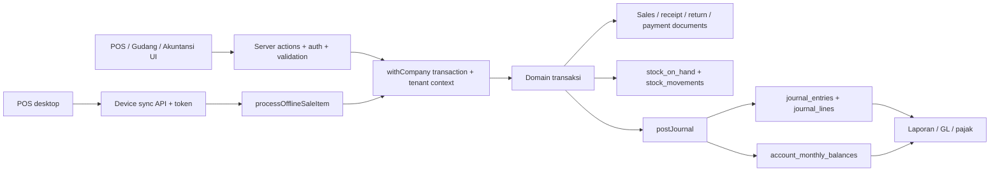
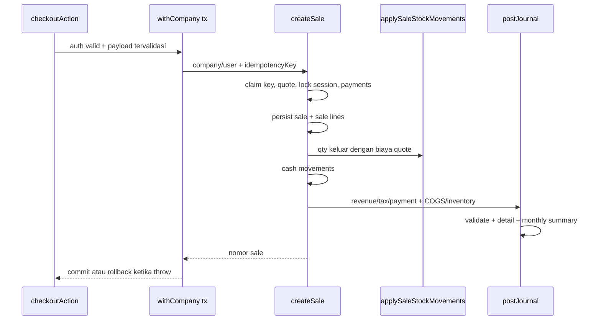

# ERP POS · Accounting · Warehouse — Evidence-Based Audit

Tanggal audit: **13 November 2026**. Repository: `/home/najib/Downloads/bisa-erp-rilis-terbaru/bisa-erp`.

**Status: audit source dan verifikasi aman selesai; penerimaan runtime end-to-end dan visual modul BLOCKED. Bukan sertifikasi siap produksi.** Semua fase memiliki status di §2. Tidak ada perbaikan aplikasi atau perubahan database.

## 1. Executive Summary

Implementasi ini memiliki domain transaksi yang nyata dan cukup luas, bukan sekadar kumpulan halaman. POS terhubung dengan mutasi stok dan jurnal, penerimaan membentuk persediaan serta utang/pembayaran, dan retur pemasok memiliki alokasi utang, kredit, refund, barang pengganti, serta konversi ke uang muka. Banyak kontrol yang layak dipertahankan: RLS, authorization pada action, transaksi database bersama, idempotensi checkout, lock stok, validasi jurnal dan periode, serta reversal append-only.

Namun, **integritas valuasi persediaan belum dapat dipercaya untuk semua jalur yang diizinkan aplikasi**. Edit massal dan impor dapat menimpa AVCO tanpa jurnal; produk nonaktif hilang dari valuasi; penerimaan transfer setelah perubahan biaya tidak memperbarui AVCO; dan penyesuaian dengan biaya berbeda tidak merekonsiliasi harga pokok. Sebagian masalah dibuktikan dengan menjalankan fungsi aktual memakai adapter in-memory, tanpa menyentuh database.

Akuntansi juga memiliki cacat pembulatan: detail jurnal dibulatkan per baris, tetapi ringkasan bulanan dibulatkan setelah dijumlahkan. Detail yang seimbang dapat menghasilkan ringkasan akun yang berbeda. Laporan yang memakai ringkasan bulanan berpotensi berbeda dengan buku besar detail. Kasus jurnal lain lolos validasi domain tetapi menjadi tidak seimbang setelah serialisasi; trigger DB semestinya menolak commit, sehingga risikonya kegagalan transaksi, bukan otomatis jurnal korup yang berhasil tersimpan.

POS mempunyai risiko pengulangan retur parsial tanpa kunci idempotensi dan tidak memiliki pemilahan barang retur layak jual versus rusak pada jalur retur. Risiko authorization pada identitas kasir dan faktor kemasan offline perlu pengujian lanjutan pada database khusus testing.

Verifikasi aktual: **typecheck PASS**, **lint area inti PASS**, **133/134 test unit PASS, 1 FAIL**. Perhitungan laba rugi sintetis melalui fungsi aktual cocok dengan perhitungan independen. Integrasi DB, build baru, dan E2E transaksi tidak dijalankan karena isolasi database belum terbukti dan aturan hanya mengizinkan perubahan laporan. Browser aktual tersedia, tetapi sesi test diarahkan ke login di seluruh enam kombinasi halaman/viewport; visual halaman ERP tidak terverifikasi.

Register memuat **17 temuan: 2 CRITICAL, 9 HIGH, 5 MEDIUM, 1 LOW**; statusnya 11 CONFIRMED (source/harness), 4 DESIGN GAP dan 2 SUSPECTED. Tidak seluruhnya merupakan bug yang sudah direproduksi pada database.

Prioritas pertama adalah memperbaiki invariant stok–nilai–GL dan idempotensi retur sebelum mengandalkan laporan keuangan untuk keputusan operasional. Tidak ada skor agregat yang menyamarkan temuan CRITICAL.

## 2. Scope and Audit Methodology

### Baseline dan keselamatan

| Item | Bukti aktual |
|---|---|
| Branch / HEAD | `main` / `39f1d54b5bcb519d4739bb90f979012368c39999` |
| Perubahan pengguna awal | `.claude/CLAUDE.md`, 4 additions / 4 deletions; tidak disentuh |
| Instruksi | `/home/najib/Downloads/AGENTS.md`, root `AGENTS.md`, AGENTS dalam permintaan; daftar file tidak menemukan AGENTS turunan di proyek |
| File laporan | Nama yang diminta belum ada ketika dibuat; laporan historis tidak ditimpa |
| Database | `.env.local` ada; isinya tidak dicetak. Aplikasi dan Vitest mengarah ke konfigurasi environment bersama, tanpa test-DB gate pada konfigurasi yang dibaca |
| Test DB terisolasi | Tidak teridentifikasi konfigurasi test DB khusus yang dapat dibuktikan disposable; tidak membuka koneksi/query audit ke DB |
| Operasi dilarang | Tidak menjalankan seed/reset/migration/restore/checkout/install; tidak menulis source/config |
| Build aktif | `.next/BUILD_ID` ada dan server lokal menjawab login; freshness build terhadap HEAD tidak dibuktikan |

Repowise MCP tersedia. `get_overview` mengembalikan **repository has no index**. Sesuai instruksi tool, `get_answer`, `search_codebase`, `get_context`, `get_symbol`, `get_risk`, `get_health`, dan `get_dead_code` tidak dipanggil ulang karena semuanya akan menghasilkan kegagalan yang sama. Inisialisasi tetap keputusan pengguna (`repowise init --yes --no-prose`); audit tidak mengubah indeks. Karena itu tidak ada klaim health/dead-code hasil Repowise.

CodeGraph dipakai sebagai pintu pertama area source. Respons menyatakan membaca source current on-disk dan tidak menampilkan stale banner. Bagian yang elided dilengkapi targeted reads; tidak menganggap call graph sebagai bukti correctness runtime. File konfigurasi, migrasi, dan dokumen dibaca langsung. Laporan lama pada `audit/`, `docs/*-audit/`, `docs/reports/` diperlakukan sebagai petunjuk, bukan bukti bahwa perbaikan lama berhasil.

### Status fase dan batas pembuktian

| Fase | Status | Hasil / batas |
|---|---|---|
| 0 Baseline | PASS | Git, instruksi, test config, laporan lama dan keselamatan dicatat |
| 1 Inventory | PASS source | Inventaris fitur/domain/route/schema/test §3–4 dan lampiran; keberadaan tidak disamakan kelulusan |
| 2 POS | PASS source; runtime BLOCKED | Checkout, pricing, pembayaran, sesi, void, retur, offline; peripheral nyata belum diuji |
| 2 Accounting | PASS source + kalkulasi terbatas | Posting/reversal/periode, laporan, bank matching; rekonsiliasi DB belum diuji |
| 2 Warehouse | PASS source + kalkulasi terbatas | Penerimaan, PO, stok, AVCO, adjustment, opname, transfer, retur dan uang muka |
| 3 Cross-module | PASS tracing; DB BLOCKED | Enam rantai utama §8; atomicity diamati pada source, rollback SQL belum dibuktikan |
| 4 Calculation | PASS/FAIL campuran | Referensi rasional independen dan harness fungsi aktual §9 |
| 5 UI/UX | BLOCKED autentikasi | Browser dijalankan; seluruh target redirect login. Workflow source diperiksa; tidak ada klaim visual modul |
| 6 Technical/security | PASS review terbatas | Typecheck/lint + review OWASP; exploit/DB constraints deployment UNVERIFIED |
| 7 Verification | PASS/FAIL/BLOCKED | Daftar perintah dan hasil aktual §13 |

CONFIRMED = terbukti pada source atau harness, tidak otomatis live DB. SUSPECTED = indikasi perlu reproduksi tambahan. DESIGN GAP = invariant/workflow belum lengkap. MISSING hanya untuk kebutuhan terverifikasi setelah pencarian sistematis. UNVERIFIED berbeda dari tidak diimplementasikan. Confidence tinggi = bukti langsung; sedang = source kuat, runtime belum diuji; rendah = indikasi terbatas.

Perhitungan independen memakai Python `fractions.Fraction`, bukan fungsi aplikasi. Harness Node memanggil fungsi TypeScript aktual menggunakan `tsx/cjs` dan fake transaction; seluruh operasi `.select/.insert/.update` ditangkap dalam memori. Tidak menggunakan aplikasi untuk menghitung expected result. Harness tidak memodelkan MVCC, FK, trigger, RLS, SQL execution ataupun rollback PostgreSQL. Skrip inline tidak disimpan sebagai source/test baru.

## 3. Repository Architecture

| Lapisan | Implementasi |
|---|---|
| Framework / package manager | Next.js `16.4.5`, React `19.3.0`, TypeScript, pnpm `11.8.0` (`package.json`) |
| UI | App Router `src/app/app`, komponen `src/components/pos`, `gudang`, `akuntansi`; Tailwind, Base UI, TanStack Table |
| Entry point transaksi | Server actions `src/server/actions/**`; native POS `/api/pos/pair`, `/snapshot`, `/sync`, `/update/**` |
| Domain | `src/server/pos/**`, `inventory/**`, `accounting.ts`, `reports/**`, `supplier-returns/**`, `purchase-advances.ts`, `purchasing.ts` |
| Database | PostgreSQL; Drizzle ORM `0.45.4`, postgres-js; `src/db/index.ts` pool max12, idle20s/connect10s |
| Tenant transaction | `src/db/tenant.ts::withCompany` set_config tenant dalam transaksi; versi read-only menambahkan `set transaction read only` |
| Auth | better-auth; `src/lib/session.ts` membership perusahaan, role/perizinan, module enabled guard |
| Schema | `src/db/schema.ts` barrel → `schema/{auth,platform,catalog,sales,inventory,accounting,...}.ts` |
| Migrasi | SQL `0000`–`0072`; RLS/append-only `0001`, POS guards `0012`, monthly totals `0046`, kemasan `0062`/`0063`, RLS optimization `0066` |
| Finansial | Decimal.js, representasi DB numeric(19,4); output report sering number; display rupiah dan report memiliki helper berbeda |
| Desktop/offline | `pos-desktop`, Tauri/Rust `src-tauri`, IndexedDB antrean web, registry/token terminal dan server outbox |
| Export/import | API `/api/export/**`, `/api/import/**`, staged import actions/domain |
| Test | Vitest unit/integration/sim2; Playwright E2E; banyak test memakai fixture perusahaan demo |
| Background processing | Outbox dan sinkronisasi dipicu action/API; worker persisten terjadwal untuk memproses outbox tidak dibuktikan. Jangan menganggap tabel outbox berarti job berjalan |



Diagram merangkum panggilan yang ditemukan, bukan jaminan seluruh cabang lolos test. Retry offline memakai savepoint di dalam transaksi item.

## 4. Feature Inventory

Legenda: **S** = implementasi inti diperiksa pada source; **H** = sebagian fungsi dijalankan in-memory; **L** = ditemukan route/domain/schema/test, detail runtime belum divalidasi. Seluruh UI modul **U** = render belum terverifikasi. Nama test menunjukkan test tersedia, bukan hasil PASS kecuali §13.

| Modul / fitur | UI (semua U) | Backend / database | Bukti test tersedia | Verifikasi / isu |
|---|---|---|---|---|
| POS lookup SKU/barcode/kemasan | `/app/pos`, product catalog | actions/pos search, catalog/products, productPackagings | barcode-burst; packaging-pos | S; barcode hardware U |
| Keranjang, qty, kelompok harga, diskon | `/app/pos`, terminal hooks | quoteCart, group prices, settings | pos-quote-parity, money | S; unit helpers diuji |
| Pajak inclusive & rounding | payment panel | quote + postSaleJournal | money, fix-p1-ppn-pemetaan | S/H helper; F06/F07 |
| Pembayaran cash/bank/QRIS/campuran | payment panel | sales-payments/persist, salePayments | sale-flow, fee tests | S; gateway settlement otomatis U |
| Piutang POS / jatuh tempo | `/pos/piutang`, debt-section | receivables, partyPayments | pos-debt-sales | S/L |
| Shift & mutasi laci | `/pos/sesi`, riwayat sesi | sessions, cashSessions/cashMovements | session-close-hardening | S |
| Struk, faktur, cetak | `/pos/nota/[id]`, `/faktur` | snapshot saleLines + print settings | print*, journal-source-print | L; printer U |
| Riwayat transaksi | `/pos/riwayat` | reports/sales, sales | sales-report-netting | L |
| Hold/resume/delete | `/pos/ditahan` | sales-hold, actions/pos | pos-hold-cash | S; F17 |
| Void | nota/action | sales-void + reversal + restore stock | sale-flow, fix-p1-retur-void | S |
| Retur/refund/tukar/kredit toko | `/pos/retur`, return-form | returns, settlement, saleReturnLines | pos-returns, return-settlement-gate | S; F08/F09 |
| Offline web/sync/review | `/pos/offline` | pos-offline, idempotencyKeys, outbox | offline-queue/local-quote/sync | S, unit sebagian; F11/F12 |
| Registry/pair/update desktop | `/pos/terminal` | pos-device, terminals, posTerminals | pos-device-api, native Rust tests | S/L; native runtime U |
| COA, parent/postable/active | `/akuntansi/akun` | accounting.ts, akun-pemetaan, accounts | journal-validation, a27* | S |
| Mapping otomatis | pengaturan akun | accountMappings, getAccountMap/getAccountId | mapping-sync, system-accounts | S; missing mapping menolak, bukan tebakan |
| Jurnal manual / posting | `/akuntansi/jurnal/baru` | postManualJournalAction, postJournal | journal-validation, integrity | S/H; F06/F07 |
| Reversal / audit trail | jurnal detail/riwayat | reversalOfId, reverseSourceJournal | accounting-actions, payments-void | S; DB guard F13 |
| Periode / tutup buku | `/akuntansi/periode` | fiscalPeriods, year-end-closing | period-integrity | S |
| General ledger | `/akuntansi/buku-besar` | reports/ledger, journalLines | reports-p2 | L; aggregates ditelusuri |
| Trial Balance | tab neraca-saldo | statements/shared/monthly balances | reports-p2, monthly-balances | S; F06 |
| Laba rugi / compare | tab laba-rugi | getIncomeStatement | grouping/report-money/reports-p2 | S/H; sintetis benar, real data U |
| Neraca / ekuitas | tab neraca/ekuitas | statements | reports-p2, fix-p1-angka-salah | S; SQL/runtime U |
| Arus kas | tab arus-kas | cash class + grouped counter entries | cashflow-sql | S; runtime attribution U |
| AP/AR, saldo awal/pelunasan | `/akuntansi/piutang-utang` | payables, opening-balances, partyPayments | opening-balances, parity | S/L |
| Kas/bank/transfer/beban | `/bank`, `/bank/transfer`, `/beban` | bank-transfers, expenses | bank-reconciliation, payments tests | L |
| Rekonsiliasi bank | `/akuntansi/rekonsiliasi` | statements/matching/book-lines | bank-reconciliation | S; bukan bank feed otomatis |
| Rekonsiliasi kontrol | `/rekonsiliasi-kontrol` | reports/control | fix-gdg-tahap2, cost exports | S; F03–F05 dapat tidak tertangkap oleh kontrol ledger saja |
| Pajak | `/akuntansi/pajak` | getVatReport akun tax_input/output | ppn-toggle, ppn-akrual | S; buku PPN GL, bukan bukti e-Faktur/SPT |
| Aset & input cepat | `/aset`, quick-entry surfaces | fixed-assets, quick-entry | fixed-assets, quick-entry | L; hanya cakupan terkait akuntansi |
| Master produk, SKU/barcode/supplier | `/gudang/produk`, `/pemasok` | actions inventory, catalog; products/suppliers | master-crud, packaging | S; F01–F03 |
| Satuan / konversi kemasan | product editor/line editor | packaging snapshots, toBaseQty | packaging; packaging-warehouse | S/H helpers; bukan arbitrary UOM engine |
| Lokasi gudang | pengaturan/gudang | warehouses, stockOnHand | transfers, warehouse-race | S; bin/rack tidak dibuktikan |
| PO & purchase request | `/pembelian`, `/purchase-request` | purchasing, purchase-requests | purchase-order, purchase-requests | S/L |
| Penerimaan / faktur | `/penerimaan`, riwayat/detail | receipts, receipt-stock/tax/journal | goods-receipt, packaging-purchasing | S |
| Uang muka pembelian | `/gudang/uang-muka` | purchaseAdvances, FIFO allocations | purchase-advances | S |
| Mutasi & histori | `/pergerakan`, product detail | stockMovements, stock card | stock-card-valuation | S; chronological order createdAt, bukan biaya replay backdate |
| Penyesuaian / approval | `/penyesuaian`, `/dokumen/[id]` | adjustments/post, stockDocuments | adjustment-approval | S; F05 |
| Opname full/cycle/mixed units | `/opname`, lembar-hitung | opname, opname-tasks, draft local | opname-count/tasks | S; F14/F15 |
| Transfer 1/2 tahap + selisih | `/transfer`, detail | transfers/receive, documents | reservations-transfers | S/H primitive; F04 |
| Rusak/hilang/expired/karantina | `/operasi`, adjustment forms | adjustment family + batches/serials | inventory-p2, fefo-expired | S; beda dengan kondisi retur F09 |
| Retur pemasok + provenance | `/retur-pembelian`, baru/detail | supplier-returns, allocations/resolutions | supplier-returns, gdg fixes | S |
| Penyelesaian retur pemasok | detail retur | offset utang, kredit/refund/replacement/advance | supplier-returns, purchase-advances | S/L; kebijakan harga/pajak §17 |
| Minimum stok/rekomendasi | `/rekomendasi`, gudang dashboard | minStock + purchasing recommendations | stock/inventory tests | S/L |
| Batch/expiry/FEFO/serial | line editor/produk/operasi | batches, serials, stockBatches/Serials | stock-batches, serial-numbers | S/L; scanning nyata U |
| Valuasi AVCO | `/gudang/nilai` | movements + getInventoryValuation | costing/receipt-void tests | S/H; F01–F05 |
| Import/export | `/gudang/impor`, `/api/export/**` | staging + commit-phases, export builders | import/export tests | S terbatas; F02 |
| Reservasi | `/gudang/reservasi` | reservations, consume/restore on sale | reservations-transfers | S/L |

UI yang belum punya backend: tidak ada fitur inti yang dapat secara bertanggung jawab dinyatakan sekadar tampilan dari pemeriksaan ini. Sebaliknya, server mempunyai helper otomasi seperti `postJournal`, AVCO dan consume reservation tanpa UI sendiri; itu bagian domain yang dipanggil action, bukan fitur hilang. Kelengkapan seluruh tombol/modal masih UNVERIFIED.

## 5. POS Audit

Alur online: product lookup → quote server → pembayaran → `checkoutAction` → `createSale` → sale header/lines/payments → stock → cash → journal → audit → nomor nota. Harga dan diskon dihitung ulang server; HPP disimpan pada baris asal. Produk non-stock tidak membentuk HPP/stock relief. Qty serial dan batch memiliki jalur khusus.

`claimSaleIdempotency` memeriksa sale yang sudah ada lalu mengklaim `(company, scope, key)` dengan insert conflict-safe. Checkout duplikat berkunci sama tidak ditujukan membuat sale baru. Lock sesi membatasi checkout terhadap close. Kredit retur dikunci sebelum digunakan. Void mengunci sale, menolak sale yang sudah memiliki retur posted, mengembalikan stock/credit/reservation, membalik jurnal sale dan pembayaran piutang terkait.

Retur mengunci sale asal dan membatasi qty kumulatif per sale line; saldo piutang dipotong sebelum refund. Nilai biaya mengikuti baris penjualan asal. Itu kontrol yang baik tetapi tidak menyelesaikan retry permintaan yang sama (F08), kondisi barang (F09), maupun drift costing lintas waktu (F04/F10).

Offline memang kebutuhan yang diimplementasikan, bukan tambahan audit. Antrean memori diuji; persist IndexedDB/crash recovery/desktop SQLite belum diuji. Server membandingkan expected total dengan quote, menahan konflik harga/stok/sesi, serta memakai savepoint agar kegagalan createSale tidak meninggalkan penjualan parsial dalam item. Tanggal periode tertutup dapat dialihkan ke hari posting dengan catatan; konsekuensi akuntansi kebijakan ini perlu persetujuan bisnis (§17). F11/F12 adalah trust-boundary yang perlu ditutup pembuktiannya.

Struk, keyboard, barcode scanner fisik, printer, pembayaran QRIS aktual, drawer fisik, offline browser reload dan sinkron dua perangkat tetap UNVERIFIED.

## 6. Accounting Audit

`postJournal` menolak baris negatif, debit-kredit pada satu baris sekaligus, kurang dari dua baris bernilai, total tidak seimbang, akun lintas perusahaan/tidak ditemukan, akun induk/tidak aktif (kecuali koreksi reversal), dan periode tertutup. Reversal menukar debit-kredit, membawa `reversalOfId`, memakai key `reversal:<original>`, dan menolak jurnal yang masih matched ke bank.

Action reversal umum hanya mengizinkan manual/quick_cash_sale, sehingga jurnal sistem harus dikoreksi dari dokumen asal. Ini menghindari GL berubah sendirian sementara stok/dokumen masih aktif. Mapping tidak lengkap umumnya menyebabkan validasi/gagal posting, bukan silent journal omission.

Laporan memakai dua sumber: ledger detail dan summary bulanan. TB memakai cumulative totals; laba rugi di halaman meminta `excludeClosing: true`, sehingga source year_end_closing dikecualikan dari laporan aktivitas. Neraca menambahkan laba akumulasi ke ekuitas. Arus kas mengelompokkan counterpart jurnal, dan kelompok tidak terklasifikasi dipertahankan. Buku pajak mengambil akun input/output dari jurnal posted. Angka sintetis laba rugi normal benar (§9), tetapi itu tidak membuktikan seluruh neraca/arus kas/pajak cocok pada DB nyata.

**F06 adalah cacat langsung pada konsistensi laporan dengan ledger**, walaupun nilainya per kejadian kecil. F01/F02/F04/F05 dapat material dan memengaruhi HPP/margin transaksi berikutnya. Debit=credit saja tidak membuktikan ekonomi transaksi benar. `cashNegativePolicy` tersedia allow/warn/block, tetapi locking agregat saldo cash tidak dibuktikan tahan transaksi bersamaan; jangan menganggap mode block sudah concurrency-safe.

Tutup buku tahunan membutuhkan seluruh periode yang ada tidak open, memindahkan revenue/expense ke equity. Pemeriksaan kelengkapan 12 periode dan race dua proses closing belum dieksekusi. Jalur membalik closing dari UI tidak terverifikasi; jangan memasukkan hipotesis reversal P&L sebagai bug terbukti.

## 7. Warehouse Audit

Penerimaan bukan hanya stock-in: source purchase/opening/bonus/customer_return/other menentukan lawan jurnal. Purchase dapat cash atau AP, memisahkan input tax, mengalokasikan uang muka FIFO, mengisi PO, dan membekukan kemasan/batch/seri. Nomor faktur pemasok dicegah duplikat secara case-insensitive dengan lock supplier di `receipts.ts:325`; ketiadaan unique index invoice saja bukan bukti fitur anti-duplikat hilang.

PO memakai status draft→sent→partial/received; penerimaan mengunci header dan menolak over-receipt/supplier berbeda. Void receipt menolak pembayaran/alokasi retur yang masih melekat, mengembalikan pemakaian advance/qty PO, membalik jurnal, lalu recompute cost dari ledger. Semuanya berada dalam transaksi caller yang sama, tetapi crash/rollback PostgreSQL belum diuji.

Retur pemasok memiliki provenance barang pemasok, penilaian AVCO pada posting, alokasi utang FIFO termasuk perhitungan tax reversal, kredit pemasok untuk sisa, refund/replacement/konversi advance. Nilai retur tidak otomatis sama harga faktur asal; itu kebijakan yang harus disahkan, bukan langsung disebut salah. Konversi kredit retur ke advance adalah reklasifikasi aset, tidak kas keluar kedua kali.

Stok on-hand dikunci per company/warehouse/product. AVCO global hanya blend untuk inbound purchase dan sale_return. Jalur lain dapat membawa nilai yang berbeda tetapi tidak memperbarui AVCO; inilah F04/F05. Transfer dua tahap tidak memposting jurnal normal, tetapi mengeluarkan stock ledger sebelum leg masuk, sehingga laporan kontrol dapat menunjukkan selisih sementara dan AVCO sesudah penerimaan dapat salah permanen.

Opname membedakan kosong dari nol, melakukan blind count→review, mengunci stok pada posting, merekam worksheet, dan mengonversi komponen kemasan server-side. Karena stok dapat berubah antara penghitungan fisik dan posting, kebijakan cut-off operasional perlu ditetapkan. Tidak menganggap lock saat posting sama dengan freeze stock selama petugas menghitung.

## 8. Cross-Module Integration

Seluruh alur di bawah ditelusuri source; kolom rollback adalah kontrak transaksi, bukan hasil forced-failure DB.

| Rantai / trigger | Service dan data berubah | Financial/inventory impact | Atomicity, side effects, error/rollback | Idempotensi dan test |
|---|---|---|---|---|
| A Bayar POS | actions/pos::checkoutAction → sales-create::createSale → sales-persist; sales, lines, payments, onHand, movements, cash, journal, audit | Dr cash/bank net + fee/AR/discount/rounding; Cr revenue/tax; Dr COGS Cr inventory; qty keluar | `withCompany` satu tx; throw membatalkan rangkaian; revalidate sesudah tx; kegagalan revalidate/response sesudah commit tetap perlu replay | claimSaleIdempotency + unique sale key; sale-flow/pos-guards tersedia, NOT RUN DB; F10/F17 |
| B Simpan penerimaan | actions/inventory/penerimaan → createReceipt → applyReceiptStock/postReceiptJournal; receipt/lines, batch/serial, PO, advance allocations | Dr inventory DPP + input tax; Cr AP/cash/advance; qty naik & AVCO blend | satu tx; lock periode, supplier invoice, PO, onHand/product; missing mapping/stock/serial failure dimaksud rollback utuh | key receipt optional di domain; invoice duplicate guard; goods-receipt/receipt-void-avco NOT RUN |
| C Retur POS | createReturnAction → createSaleReturn → load origin/compute/restore/settlement/journal | original cost kembali; Dr sales return/output tax; Cr refund/credit/AR; Dr inventory Cr COGS | satu tx, sale asal locked; refund laci & perubahan paidTotal satu rangkaian; tak ada panggilan bank refund eksternal yang dibuktikan | tidak ada request key F08; limit qty bukan idempotensi; pos-returns NOT RUN |
| D Retur pemasok | supplier-returns action → postSupplierReturn → freeze/issue/allocate/journal → resolutions | qty keluar AVCO; Dr AP/supplier credit; Cr inventory/input tax. Refund: Dr cash Cr credit. Advance: Dr advance Cr credit | tx caller; header/supplier locks, provenance; void ditolak setelah resolution; reversal + restore stock bersama | status draft→posted menahan double posting satu dokumen; resolutions punya keys berbasis row ID; supplier-returns NOT RUN |
| E Adjustment/opname | createAdjustment/postStockAdjustment atau createOpname; stock doc/lines, onHand, movement, journal | Dr/Cr inventory vs shrink; quarantine bisa transfer tanpa jurnal; opname memakai delta | periode dan dokumen locked; pending approval maker≠checker; throw dimaksud rollback; F05 pada nilai bukan atomicity | doc lock/status + claim optional; adjustment-approval/opname-tasks NOT RUN |
| F Payment→GL→reconcile | POS payments → postSaleJournal → bank lines → matchLine/autoMatch | akun bank net fee, cash movements; matching hanya link, tidak jurnal kedua; createJournalFromLine khusus unmatched | journal/cash satu tx; matching row lock, unique claim; reversal matched ditolak sampai unlink | sale key dan unique matched line; bank-reconciliation NOT RUN; mutasi bank aktual U |



**Partial success yang perlu dibedakan:** savepoint offline mencegah sisa sale gagal; hasil satu item boleh commit sementara item lain gagal (desain batch). Kegagalan respons setelah commit tidak membatalkan commit; karena itu F08/F17 penting. Pembulatan F07 dapat lolos domain tetapi gagal deferred trigger pada commit. Sebaliknya F01/F02 berhasil commit secara konsisten secara SQL, namun salah secara finansial karena jurnal revaluasi tidak pernah dibuat.

Orphan dan double posting tidak ditemukan sebagai kejadian di database karena DB tidak dibaca. Risiko race F10 dan trust-boundary F11 tidak diberi status runtime CONFIRMED.

## 9. Calculation Verification

### AVCO independen dan fungsi aktual

Kebijakan yang ditemukan: global product moving average; sale memakai AVCO saat quote; sales return memakai original sale cost; purchase return memakai AVCO; bukan FIFO costing walaupun batch keluar FEFO. Skenario lanjutan berikut dinyatakan eksplisit: purchase baru 30×Rp14.000, purchase return10, damaged2, adjustment+3 memakai biaya berjalan. Ini data sintetis audit, bukan requirement bisnis baru.

| Langkah | Qty | Nilai eksak independen (Rp, 8dp) | AVCO independen | Cost tersimpan fungsi aktual | Nilai qty×cost aktual (4dp) |
|---|---:|---:|---:|---:|---:|
| Opening100×10.000 | 100 | 1.000.000 | 10.000 | initial 10.000 | 1.000.000 |
| Purchase50×12.000 | 150 | 1.600.000,00000000 | 10.666,66666667 | 10.666,6667 | 1.600.000,0050 |
| Sales20 | 130 | 1.386.666,66666667 | 10.666,66666667 | 10.666,6667 | 1.386.666,6710 |
| Return5 original cost | 135 | 1.440.000,00000000 | 10.666,66666667 | 10.666,6667 | 1.440.000,0045 |
| Purchase30×14.000 | 165 | 1.860.000,00000000 | 11.272,72727273 | 11.272,7273 | 1.860.000,0045 |
| Purchase return10 | 155 | 1.747.272,72727273 | 11.272,72727273 | 11.272,7273 | 1.747.272,7315 |
| Damaged2 | 153 | 1.724.727,27272727 | 11.272,72727273 | 11.272,7273 | 1.724.727,2769 |
| Adjustment+3 current cost | 156 | 1.758.545,45454545 | 11.272,72727273 | 11.272,7273 | 1.758.545,4588 |

**PASS formula AVCO dasar dalam batas 4dp biaya per unit.** Expected Rp10.666,67 adalah tampilan dua desimal; nilai internal Rp10.666,6667 bukan bug karena tidak sama angka display. Qty×rounded cost membawa residual; belum ada kebijakan toleransi/revaluation residual yang disahkan. Tidak mengklaim selisih Rp0,005 sebagai material dengan sendirinya.

Expected COGS sales20 = Rp213.333,333333…; actual basis tersimpan = Rp213.333,3340. Return5 memulihkan Rp53.333,3335 dengan biaya tersimpan. Expected GL inventory setelah seluruh rangkaian mengikuti nilai gerakan, bukan sekadar pembulatan tampilan.

### Kasus yang gagal invariant

| Probe fungsi aktual | Expected independen | Actual / hasil | Status |
|---|---|---|---|
| applyBulkEditProducts, qty100, cost10k→20k | AVCO tidak berubah tanpa revaluasi; atau ledger/GL ikut direvaluasi +1m | cost20k; valuation2m; hanya tabel products/audit_log ditulis, tanpa journal/movement | FAIL F01 |
| transfer_out40@10k → purchase40@20k → transfer_in40@10k | qty140, inventory GL1,8m; qty×cost harus1,8m setelah transfer lengkap | qty140 cost14k →1,96m, selisih+160k | FAIL F04 |
| adjustment+3@20k pada stock100@10k | qty103, nilai1,06m; cost≈10.291,2621 atau kebijakan revaluasi eksplisit | qty103 cost10k →1,03m, selisih−30k | FAIL F05 |
| postJournal: Dr a0,00006 dua baris; Cr b0,00012 | canonical stored debit=credit | domain menerima; serialisasi Dr0,0002 / Cr0,0001 | FAIL F07; DB commit belum dijalankan |
| postJournal: Dr a0,00006×2, Cr b0,00006×2 | detail & monthly akun a/b sama0,0002 | detail seimbang0,0002; monthly masing-masing0,0001 | FAIL F06 |

Probe transfer memakai model agregat onHand satu produk untuk menyederhanakan warehouse, bukan menjalankan keseluruhan createTransfer/receiveTransfer. Urutan movement types dan unitCost sesuai source ship/receive. Ia membuktikan primitive yang dipakai tidak reblend transfer_in; workflow DB lengkap masih NOT RUN. Tidak memasukkan stok transit sebagai saldo tersedia pada model.

### Laba rugi dan jurnal

Data sintetis: revenue1.000.000, contra revenue50.000, COGS600.000, operating expense100.000, other income20.000. Independently: net revenue950.000; gross350.000; operating250.000; net270.000. `getIncomeStatement` aktual dengan fake account/journal aggregates menghasilkan **950000 / 600000 / 350000 / 250000 / 270000**, PASS.

Keseimbangan normal diperiksa pada source `postJournal`; journal negative/dual-sided ditolak. Reversal membawa reference original. Idempotensi checkout memiliki claim; retur parsial tidak. TB/BS/CashFlow reconciliation terhadap ledger SQL aktual, monthly summary backfill, pajak faktur, pembayaran campuran lengkap dan concurrent duplicate journal **UNVERIFIED**, bukan PASS berdasarkan contoh laba rugi ini.

## 10. UI/UX and Workflow Findings

### Browser aktual

Server lokal `/login` HTTP200. Browser headless pertama gagal karena Playwright mengharapkan Chromium revision1248 yang tidak terpasang. Percobaan berikutnya memakai executable revision1254 yang sudah ada; tidak menginstal apa pun. Semua non-GET/HEAD/OPTIONS diblokir. Memakai `e2e/.auth/user.json` yang ada tanpa menampilkan cookie/token.

| Target | Viewport | Hasil aktual |
|---|---|---|
| `/app/pos` | 1440×1000 | redirect `/login`, HTTP200 halaman login |
| `/app/gudang/penerimaan` | 1440×1000 | redirect `/login` |
| `/app/akuntansi/laporan` | 1440×1000 | redirect `/login` |
| `/app/pos` | 768×1024 tablet | redirect `/login` |
| `/app/gudang/penerimaan` | 390×844 mobile | redirect `/login` |
| `/app/akuntansi/laporan` | 390×844 mobile | redirect `/login` |

Pada halaman login yang benar-benar dirender, DOM tidak menunjukkan horizontal overflow dan tidak ada pageerror. Ini **bukan** bukti layout POS/Gudang/Akuntansi baik. Tidak memperoleh screenshot modul atau melakukan penilaian visual typography, warna, contrast, tabel, modal, loading/empty/error/a11y modul. Tidak login ulang karena login menulis sesi dan sesi/environment khusus audit belum ditetapkan.

### Workflow source, bukan simulasi browser berhasil

| Pekerjaan | Jalur yang ditemukan | Masalah / pemeriksaan berikutnya |
|---|---|---|
| Jual barcode | scan/search → tambah → qty/diskon → bayar → nota; sesi wajib open | Hitungan klik/latensi belum diukur. Uji scanner burst, fokus setelah pembayaran, scan barcode kemasan |
| Ubah qty / diskon | cart item + quote server + permission threshold | Test keyboard dan feedback error pada mobile belum dijalankan |
| Cancel/void | cart reset untuk belum posted; nota/riwayat→void untuk posted | Bedakan secara eksplisit pembatalan keranjang dari refund; pastikan UI tidak menjanjikan bank refund otomatis |
| Retur | cari sale → pilih line/qty → metode/alasan → submit | F08 retry; F09 tidak ada pilihan kondisi/restock; contoh alasan UI mencakup kemasan rusak |
| Receiving | sumber/gudang/pemasok/PO → line/kemasan/harga/pajak/advance → submit → riwayat/faktur | Receiving merangkap pencatatan invoice/AP. Kebutuhan GRNI/invoice terpisah belum disahkan; jangan tambah workflow tanpa keputusan |
| Stock adjustment | jenis/gudang/qty/cost/alasan → posted atau pending→checker | F05 nilai biaya yang disimpan dapat berbeda dari AVCO saat posting |
| Transfer | asal/tujuan→ship; mode dua tahap perlu receive | F04 informasi barang transit dan dampak nilai wajib konsisten |
| Stock history | produk→kartu stok/pergerakan | Uji deep link dan date business versus createdAt order; belum diukur |
| Accounting | jurnal→detail/source; ledger akun→periode; report tab/compare/cetak | F06 cache ringkasan; tampilan jurnal seimbang belum cukup untuk membuktikan keselarasan laporan |

Rekomendasi spesifik mengikuti F08/F09/F17: receipt/retry harus kembali ke dokumen yang sama; form retur menampilkan disposisi barang; hasil penyesuaian menampilkan dampak nilai/biaya. Mobile report tab memiliki horizontal-scroll pada source, tetapi affordance dan keyboard focus belum dapat dinilai. Tidak memberikan skor visual berdasarkan JSX.

## 11. Bugs and Technical Findings

Seluruh path pada register di bawah relatif terhadap root absolut di awal laporan, dengan line source saat audit. Reproduksi yang menyentuh data **hanya untuk test DB disposable di masa mendatang**, tidak dilakukan pada DB pengguna. Harness yang sudah dijalankan disebut eksplisit.


### Register temuan

| ID | Modul / fitur | Severity | Status |
|---|---|---|---|
| F01 | Warehouse / Accounting — Edit massal harga pokok | **CRITICAL** | CONFIRMED — fungsi aktual in-memory + source; confidence tinggi |
| F02 | Warehouse / Accounting — Impor update harga pokok | **CRITICAL** | CONFIRMED — source; runtime import NOT RUN; confidence tinggi |
| F03 | Warehouse / Accounting — Valuasi produk nonaktif | **HIGH** | CONFIRMED — source; confidence tinggi |
| F04 | Warehouse / Accounting — AVCO transfer dua tahap | **HIGH** | CONFIRMED — source + actual movement harness; DB workflow NOT RUN; confidence tinggi |
| F05 | Warehouse / Accounting — Cost override / pending adjustment | **HIGH** | CONFIRMED — source + actual movement harness; confidence tinggi |
| F06 | Accounting — Ringkasan bulanan berbeda dari detail | **HIGH** | CONFIRMED — postJournal aktual dengan fake tx; confidence tinggi |
| F07 | Accounting / POS / Warehouse — Validasi jurnal sebelum pembulatan | **MEDIUM** | CONFIRMED — fungsi aktual + migrasi; commit DB UNVERIFIED; confidence tinggi |
| F08 | POS / Accounting / Warehouse — Replay retur parsial | **HIGH** | CONFIRMED — source, reproduksi HTTP NOT RUN; confidence tinggi |
| F09 | POS / Warehouse — Penilaian kondisi barang retur | **HIGH** | DESIGN GAP — source; confidence tinggi |
| F10 | POS / Warehouse / Accounting — Pembekuan biaya sebelum lock | **HIGH** | SUSPECTED — source interleaving; concurrency test NOT RUN; confidence sedang |
| F11 | POS / Security — Identitas kasir asal offline | **HIGH** | SUSPECTED — trust-boundary source; exploit NOT RUN; confidence sedang |
| F12 | POS / Warehouse / Security — Faktor kemasan snapshot offline | **HIGH** | DESIGN GAP — source trust-boundary; exploit NOT RUN; confidence sedang |
| F13 | Accounting / Database — Constraint ledger tidak menutup insert lanjutan | **MEDIUM** | DESIGN GAP — schema/migration source; deployment DB UNVERIFIED; confidence sedang |
| F14 | Warehouse / Testing — Kontrak draf opname gagal | **MEDIUM** | CONFIRMED — Vitest FAIL; confidence tinggi |
| F15 | Warehouse / Accounting / Performance — Loop query per baris dan pencocokan | **MEDIUM** | DESIGN GAP — source; latency benchmark NOT RUN; confidence tinggi untuk bentuk kode |
| F16 | Warehouse / Maintainability — Dokumen kebijakan satuan tertinggal | **LOW** | CONFIRMED — docs versus source; confidence tinggi |
| F17 | POS — Replay checkout dari held sale | **MEDIUM** | CONFIRMED — source, HTTP replay NOT RUN; confidence tinggi |

### F01 — Edit massal harga pokok

| Field | Bukti / penilaian |
|---|---|
| Modul / severity / status | Warehouse / Accounting; **CRITICAL**; CONFIRMED — fungsi aktual in-memory + source; confidence tinggi |
| Evidence source, exact path / line / symbol | src/server/master-data/bulk-edit.ts:179 (evaluateBulkOperation), :337 (applyBulkEditProducts), :361; src/server/actions/master-data.ts:170; src/server/actions/inventory/produk.ts:242 |
| Expected | Produk yang sudah bergerak mempertahankan AVCO otoritatif, atau perubahan nilai harus melalui dokumen revaluasi dan jurnal. |
| Actual | Bulk operation target costPrice langsung patch products; jalur individual justru menghapus costPrice dari update jika ada movement. Harness actual menghasilkan cost20.000 dari10.000 dan hanya menulis products/audit_log. |
| Reproduksi | Siapkan produk100×10.000; pengguna inventory.manage+inventory.price memilih bulk costPrice +10.000; simpan. Valuasi berubah1m→2m tanpa transaksi finansial. Harness tidak memerlukan DB. |
| Root cause | Penjaga AVCO hanya ada di action save individual, tidak di domain bulk; tidak ada stock movement/postJournal pada jalur bulk. |
| Dampak operasional/bisnis | Selisih material Rp1.000.000 pada contoh100unit; HPP transaksi berikutnya memakai biaya yang tidak berasal ledger. |
| Rekomendasi | Satukan invariant AVCO di domain; tolak edit langsung sesudah pergerakan atau buat revaluasi atomik yang disahkan kebijakan. |
| Required regression test | Bulk cost edit pada stocked/history product tidak dapat mengubah cost diam-diam; GL=movement value=valuation setelah seluruh entry point. |

### F02 — Impor update harga pokok

| Field | Bukti / penilaian |
|---|---|
| Modul / severity / status | Warehouse / Accounting; **CRITICAL**; CONFIRMED — source; runtime import NOT RUN; confidence tinggi |
| Evidence source, exact path / line / symbol | src/server/actions/import/commit-phases.ts:511, :561, :571, :577; src/server/actions/import/commit.ts:90 |
| Expected | Impor menghormati larangan overwrite AVCO yang sama dengan save individual. |
| Actual | Jika updateExisting dan mapping costPrice terisi, updateFields.costPrice ditulis langsung pada produk lama; tidak memeriksa history stock di cabang ini. Mengimpor tanpa stock baru tidak membentuk revaluasi. |
| Reproduksi | Di test DB, produk100@10k dengan history; impor SKU sama cost20k, updateExisting=true, importStock=false. Bandingkan nilai/report/ledger sebelum-sesudah. |
| Root cause | Update master import melewati penjaga AVCO individual; price permission tidak menjamin nilai terjurnal. |
| Dampak operasional/bisnis | Drift material sama F01 dari file impor yang sah; banyak SKU dapat terkena sekaligus. |
| Rekomendasi | Terapkan invariant domain yang sama pada bulk/import/form; jangan ubah AVCO sebagai metadata biasa. |
| Required regression test | Impor updateExisting dengan cost mapped tidak mengubah AVCO/history product tanpa dokumen revaluasi; uji importStock true/false dan replay batch. |

### F03 — Valuasi produk nonaktif

| Field | Bukti / penilaian |
|---|---|
| Modul / severity / status | Warehouse / Accounting; **HIGH**; CONFIRMED — source; confidence tinggi |
| Evidence source, exact path / line / symbol | src/server/reports/inventory.ts:37 (getInventoryValuation); src/server/actions/inventory/produk.ts:336 (toggleProductAction), :372 (deleteProductAction) |
| Expected | Persediaan yang masih dimiliki masuk laporan nilai walaupun tidak dijual lagi. |
| Actual | Valuation where memaksa products.isActive=true. Toggle nonaktif diizinkan tanpa stock guard/jurnal; delete bahkan menyarankan nonaktifkan produk yang masih memiliki stok. |
| Reproduksi | Produk qty100 cost10k nonaktifkan lewat toggle; jalankan valuation. Rp1m hilang dari total valuation sedangkan onHand/movements/GL tidak berubah. |
| Root cause | Filter katalog aktif dipakai pada laporan finansial tanpa membedakan sellability dan ownership. |
| Dampak operasional/bisnis | Persediaan terlapor lebih rendah; barang discontinue/rusak yang dinonaktifkan tidak tampak; kontrol ledger dapat tetap seimbang sehingga luput. |
| Rekomendasi | Masukkan seluruh saldo bernilai/berqty; status aktif menjadi filter operasional opsional yang transparan terhadap total finansial. |
| Required regression test | Deactivate stocked SKU mempertahankan total valuasi; aktif/nonaktif sum merekonsiliasi GL dan ledger. |

### F04 — AVCO transfer dua tahap

| Field | Bukti / penilaian |
|---|---|
| Modul / severity / status | Warehouse / Accounting; **HIGH**; CONFIRMED — source + actual movement harness; DB workflow NOT RUN; confidence tinggi |
| Evidence source, exact path / line / symbol | src/server/inventory/transfers.ts:293, :307, :332; src/server/inventory/transfers-receive.ts:422; src/server/inventory/movements.ts:113 |
| Expected | Transfer internal lengkap tidak mengubah nilai perusahaan dan AVCO tetap merepresentasikan seluruh stok, termasuk nilai yang kembali dari transit. |
| Actual | Ship mengurangi onHand; purchase saat transit blend memakai stok yang tersisa; receive memakai biaya kirim lama dengan type transfer_in yang tidak reblend. Harness qty140×14k=1,96m melawan GL1,8m. |
| Reproduksi | Opening100@10k; ship40 mode twoStep; purchase40@20k; receive40@10k. Tidak ada kehilangan barang. Valuasi selisih+160k sesudah transfer selesai. |
| Root cause | Stok transit tidak ikut basis AVCO global; transfer_in dikecualikan dari blend/recompute. Kontrol ledger juga mengeluarkan nilai transfer_out sebelum in meski tidak ada jurnal. |
| Dampak operasional/bisnis | Selisih temporer saat transit dan permanen setelah perubahan biaya; HPP sale selanjutnya dapat terlalu besar. |
| Rekomendasi | Tetapkan inventory-in-transit sebagai bagian valuation/cost pool, atau reblend/reconcile receipt transfer dengan biaya historis tanpa menciptakan nilai baru. |
| Required regression test | Two-step ship→purchase→receive; multiwarehouse, partial receive, close shortage, void, dan sale selama transit; GL/value/onHand reconcile. |

### F05 — Cost override / pending adjustment

| Field | Bukti / penilaian |
|---|---|
| Modul / severity / status | Warehouse / Accounting; **HIGH**; CONFIRMED — source + actual movement harness; confidence tinggi |
| Evidence source, exact path / line / symbol | src/server/inventory/adjustments.ts:335, :361, :384; src/server/inventory/adjustments-post.ts:102, :112; src/server/inventory/movements.ts:113 |
| Expected | Adjustment bernilai berbeda menjaga nilai stok, AVCO dan jurnal tetap sama; biaya saat approval konsisten kebijakan. |
| Actual | Biaya override diizinkan dengan permission+alasan dan disimpan di doc. Posting memakai biaya beku, tetapi type adjustment tidak mengubah AVCO. Pending dokumen juga dapat memakai biaya lama setelah receipt lain. |
| Reproduksi | Stok100@10k; adjustment+3 unitCost20k berizin+alasan. Jurnal/movement +60k; qty103×cost10k=1,03m, expected1,06m. Harness mengonfirmasi cost tidak berubah. |
| Root cause | Validasi izin override tidak disertai mekanisme penyesuaian cost pool. Approval memakai stored unitCost tanpa revaluation/recompute. |
| Dampak operasional/bisnis | Drift nilai Rp30k contoh; makin besar qty/selisih biaya makin material; audit trail saja tidak memperbaiki invariant. |
| Rekomendasi | Pilih kebijakan biaya adjustment; gunakan AVCO saat posting atau revalue/recompute eksplisit, dan nilai approval terhadap dampak terkini. |
| Required regression test | Positive/negative adjustment dengan biaya berbeda; pending→receipt→approve; ledger=GL=valuation sesudah semua jalur. |

### F06 — Ringkasan bulanan berbeda dari detail

| Field | Bukti / penilaian |
|---|---|
| Modul / severity / status | Accounting; **HIGH**; CONFIRMED — postJournal aktual dengan fake tx; confidence tinggi |
| Evidence source, exact path / line / symbol | src/server/accounting.ts:442, :465, :479; src/server/reports/shared.ts:84, :100 |
| Expected | Monthly totals merupakan jumlah persis angka canonical journal_lines yang tersimpan. |
| Actual | Detail toDb tiap baris; monthly menjumlah debitValue presisi penuh lalu toDb. Dua baris0,00006 ke akun sama menjadi detail0,0002, monthly0,0001. Jurnal balanced dengan dua sisi identik tetap memiliki summary berbeda. |
| Reproduksi | Panggil postJournal: Dr a0,00006 dua kali, Cr b0,00006 dua kali. Inspect writes. Laporan bulan selesai membaca summary, ledger detail membaca0,0002. |
| Root cause | Pembulatan diterapkan pada tahap berbeda; summary dibangun dari nilai input, bukan persisted canonical lines. |
| Dampak operasional/bisnis | TB/neraca/ekuitas dapat berbeda dengan ledger dan berubah pada batas bulan; nilai contoh kecil tetapi invariant finansial rusak dan akumulatif. |
| Rekomendasi | Canonicalize lines sebelum validasi/write; bangun summary dari angka yang benar-benar ditulis; setelah perbaikan audit/backfill summary secara terkontrol. |
| Required regression test | Multiple same-account fractional lines, reversal dan month-boundary: summary=SQL SUM(detail) exact4dp. |

### F07 — Validasi jurnal sebelum pembulatan

| Field | Bukti / penilaian |
|---|---|
| Modul / severity / status | Accounting / POS / Warehouse; **MEDIUM**; CONFIRMED — fungsi aktual + migrasi; commit DB UNVERIFIED; confidence tinggi |
| Evidence source, exact path / line / symbol | src/server/accounting.ts:317, :350, :442; src/db/migrations/0001_rls_and_guards.sql:42, :66 |
| Expected | Jurnal canonical tersimpan harus seimbang, dan input yang tidak dapat direpresentasikan ditolak/ditangani sebelum write. |
| Actual | Dr0,00006+0,00006=Cr0,00012 lolos domain exact; write menghasilkan Dr0,0002 Cr0,0001. Deferred balance trigger dirancang menolak pada commit. |
| Reproduksi | Panggil postJournal dengan tiga baris tersebut pada fake tx (sudah dilakukan); ulangi test DB terisolasi untuk memastikan commit ditolak dan seluruh side effect rollback. |
| Root cause | Validation mendahului toDb(4dp) per line. |
| Dampak operasional/bisnis | Transaksi receipt/refund/payment berpresisi tinggi dapat gagal walaupun pesan domain menyatakan balance; tidak dibuktikan ada jurnal rusak berhasil commit. |
| Rekomendasi | Validasi canonical amounts dan tetapkan alokasi residual/presisi; sajikan pesan kesalahan yang menunjuk baris. |
| Required regression test | Fractional qty×cost, tax split dan return proration; journal canonical balanced dan failed commit tidak meninggalkan dokumen/stok. |

### F08 — Replay retur parsial

| Field | Bukti / penilaian |
|---|---|
| Modul / severity / status | POS / Accounting / Warehouse; **HIGH**; CONFIRMED — source, reproduksi HTTP NOT RUN; confidence tinggi |
| Evidence source, exact path / line / symbol | src/server/actions/pos.ts:438; src/server/pos/returns.ts:26, :213, :304, :469; src/db/schema/sales.ts:128 |
| Expected | Retry satu operasi retur menghasilkan dokumen/refund/movement yang sama, sementara retur baru tetap diizinkan. |
| Actual | Payload/action/domain retur tidak membawa request idempotency key. Lock sale dan limit sisa hanya membatasi total qty. Retry parsial yang masih muat sisa dapat membuat retur kedua. |
| Reproduksi | Sale10; retur2 berhasil commit, respons hilang; kirim payload sama lagi. Sisa8 masih cukup, total returned4 dan refund dua kali. Simulasi ini diturunkan dari alur source, bukan dijalankan di DB. |
| Root cause | Idempotensi bisnis diganti dengan pengecekan kuantitas maksimum; tidak ada identitas operasi request. |
| Dampak operasional/bisnis | Double refund dan stock-in palsu pada timeout/retry, meskipun tidak melebihi qty sale asal. |
| Rekomendasi | Client operation key stabil, claim dalam tx + unique key tenant; replay kembalikan retur lama. |
| Required regression test | Same payload/key concurrent+sequential setelah lost response → satu refund/movement/journal; key baru untuk retur kedua sah. |

### F09 — Penilaian kondisi barang retur

| Field | Bukti / penilaian |
|---|---|
| Modul / severity / status | POS / Warehouse; **HIGH**; DESIGN GAP — source; confidence tinggi |
| Evidence source, exact path / line / symbol | src/server/pos/returns-settlement.ts:20; src/server/pos/returns.ts:520, :588; src/components/pos/return-form.tsx:219 |
| Expected | Stock assessment membedakan layak jual, karantina/rusak, dan tidak restock, sesuai kebutuhan rantai retur yang diminta pengguna. |
| Actual | Setiap tracked return masuk kembali ke gudang sale/batch asal. Input tidak membawa condition/restock disposition; alasan UI dapat berupa kemasan rusak. Tidak ada penilaian kondisi pada jalur ini. |
| Reproduksi | Retur barang tracked dengan alasan kemasan rusak; telusuri restoreReturnedStock: positive sale_return ke warehouse asal, sama jalur barang sehat. |
| Root cause | Rantai finansial retur terhubung langsung ke restock tanpa keputusan kondisi barang. |
| Dampak operasional/bisnis | Barang rusak dapat tersedia lagi bagi kasir; perlu adjustment/karantina kedua yang rawan terlupa dan salah tanggal. |
| Rekomendasi | Tetapkan kebijakan kondisi barang dan disposisi pada form retur; arahkan ke sellable/quarantine/write-off secara atomik dengan akuntansi yang disahkan. |
| Required regression test | Retur layak/rusak/expired/no-restock, batch/serial; hanya layak menambah stok tersedia dan semua nilai reconcile. |

### F10 — Pembekuan biaya sebelum lock

| Field | Bukti / penilaian |
|---|---|
| Modul / severity / status | POS / Warehouse / Accounting; **HIGH**; SUSPECTED — source interleaving; concurrency test NOT RUN; confidence sedang |
| Evidence source, exact path / line / symbol | src/server/pos/quote.ts:393, :749; src/server/pos/sales-create.ts:30, :58; src/server/pos/sales-persist.ts:47, :155; src/db/tenant.ts:9 |
| Expected | HPP sale memakai AVCO yang koheren terhadap urutan mutasi stok yang di-commit. |
| Actual | Quote membaca products.costPrice tanpa lock; costTotal/persist sudah dibentuk sebelum applyStockMovement mengunci stok. withCompany tidak menyetel isolation/retry eksplisit. |
| Reproduksi | Tx sale pause setelah quote10k; tx receipt commit mengubah AVCO12k; lanjut sale stock/journal memakai10k. Perlu dua koneksi test dan barrier untuk membuktikan urutan lock aktual. |
| Root cause | Indikasi TOCTOU cost snapshot; locking qty saja tidak menjamin costing snapshot terbaru. |
| Dampak operasional/bisnis | Mungkin valuation drift/COGS salah pada receipt dan sale serentak. Besar/kejadian aktual belum diketahui. |
| Rekomendasi | Serialisasikan snapshot biaya dan mutasi produk dengan lock order bersama; audit deadlock/retry lintas domain. |
| Required regression test | Barrier concurrency receipt↔sale serta supplier return↔receipt pada gudang sama/berbeda; ledger/current valuation cocok. |

### F11 — Identitas kasir asal offline

| Field | Bukti / penilaian |
|---|---|
| Modul / severity / status | POS / Security; **HIGH**; SUSPECTED — trust-boundary source; exploit NOT RUN; confidence sedang |
| Evidence source, exact path / line / symbol | src/server/pos-device.ts:107, :116; src/server/actions/pos-offline.ts:61; src/server/pos-offline.ts:187, :285, :298, :388 |
| Expected | Payload klien tidak dapat menaikkan hak diskon atau mengatribusikan transaksi kepada kasir lain tanpa bukti/delegasi sah. |
| Actual | cashierId berasal payload; server meresolusi entitlement id tersebut dan memakai canDiscount milik kasir asal. Belum ditemukan bukti kriptografis asal payload pada jalur web yang ditelusuri. |
| Reproduksi | Pada test DB, akun pos.sell tanpa pos.discount mengirim cashierId supervisor dengan sesi valid, diskon di atas ambang dan expectedTotal sesuai. Uji apakah accepted/ditahan. Jangan jalankan pada DB pengguna. |
| Root cause | Indikasi hak subjek transaksi diturunkan dari identitas klaim klien, terpisah dari aktor request. |
| Dampak operasional/bisnis | Potensi bypass approval diskon dan pemalsuan audit attribution; belum dinyatakan vulnerability tereksploitasi. |
| Rekomendasi | Buktikan kebutuhan sync lintas kasir; bind asal ke receipt/session/device yang terautentikasi atau delegasi server tersimpan. |
| Required regression test | Malicious cashierId/sessionId combinations, revoked cashier, own/foreign supervisor, device token dan web action. |

### F12 — Faktor kemasan snapshot offline

| Field | Bukti / penilaian |
|---|---|
| Modul / severity / status | POS / Warehouse / Security; **HIGH**; DESIGN GAP — source trust-boundary; exploit NOT RUN; confidence sedang |
| Evidence source, exact path / line / symbol | src/server/pos-device.ts:134; src/server/pos-offline.ts:92; src/server/pos/quote.ts:529, :555, :611 |
| Expected | Faktor historis berasal snapshot otoritatif/versioned yang dapat diverifikasi, sambil mempertahankan transaksi offline yang sah. |
| Actual | Schema menerima isiSnapshot positif dari klien; mapLines meneruskannya; resolveQuotePackagings memeriksa produk/kemasan ada tetapi memakai faktor payload tanpa pembandingan riwayat/server signature. Harga kemasan tetap dapat sama sementara qty dasar berubah. |
| Reproduksi | Kemasan master isi40 harga100k; payload qty1 isiSnapshot1 dengan expectedTotal100k. Uji di fake quote/test DB apakah stok berkurang1, bukan40, tanpa supervisor review. Belum dieksekusi. |
| Root cause | Komentar menyebut jalur server tepercaya, tetapi nilai dasarnya tetap berasal input client untrusted. |
| Dampak operasional/bisnis | Potensi under/over stock movement dan HPP; kebutuhan menjaga faktor lama tidak cukup menjadi bukti keaslian snapshot. |
| Rekomendasi | Versikan snapshot katalog yang diterbitkan server atau sign/freeze factor; perubahan yang tidak terbukti masuk review tanpa auto-post. |
| Required regression test | Tampered/valid historic isi; master changed/nonaktif; expectedTotal sama tetapi qty dasar berbeda harus tertahan. |

### F13 — Constraint ledger tidak menutup insert lanjutan

| Field | Bukti / penilaian |
|---|---|
| Modul / severity / status | Accounting / Database; **MEDIUM**; DESIGN GAP — schema/migration source; deployment DB UNVERIFIED; confidence sedang |
| Evidence source, exact path / line / symbol | src/db/migrations/0001_rls_and_guards.sql:66, :99; src/db/schema/accounting.ts:132; docker/init.sql:19 |
| Expected | Append-only ledger tetap balance dan summary konsisten bila write di luar helper terjadi; garis pertahanan DB tidak hanya UPDATE/DELETE. |
| Actual | Balance constraint trigger hanya AFTER INSERT journal_entries; immutable journal_lines hanya BEFORE UPDATE/DELETE. Tidak ditemukan trigger insert line yang mengunci/memeriksa ulang entry lama dalam pencarian migrasi. Role app diberi INSERT tabel. |
| Reproduksi | Di test DB saja: commit jurnal sah; transaksi baru insert tambahan line pada entry itu; verifikasi penolakan. Tidak dilakukan. Tidak ditemukan endpoint aplikasi langsung untuk exploit ini. |
| Root cause | Guard mencegah perubahan baris lama tetapi tidak menutup penambahan baris pada entry yang sudah selesai; summary dikelola helper aplikasi saja. |
| Dampak operasional/bisnis | Defense-in-depth lemah jika ada bug writer baru/akses DB aplikasi; bukan bukti SQL injection atau user biasa bisa menulis ledger langsung. |
| Rekomendasi | Desain lifecycle posting/constraint atau stored entry point yang memastikan seluruh penambahan detail dan summary tervalidasi. |
| Required regression test | Insert late line, insert negatif/dua sisi, tenant foreign FK; jurnal/summary harus tetap konsisten meski helper dilewati. |

### F14 — Kontrak draf opname gagal

| Field | Bukti / penilaian |
|---|---|
| Modul / severity / status | Warehouse / Testing; **MEDIUM**; CONFIRMED — Vitest FAIL; confidence tinggi |
| Evidence source, exact path / line / symbol | tests/unit/opname-count.test.ts:92; src/lib/gudang/opname-count.ts:312, :331 |
| Expected | Test kontrak legacy draft dan canonical parser sepakat, serta draf pengguna dapat dipulihkan benar. |
| Actual | Round-trip test expected objek lama; parser menambah scope=full dan fullLoaded=false. 1/14 test file gagal. Tidak ada bukti rows/count hilang dari kegagalan ini. |
| Reproduksi | Jalankan vitest run tests/unit/opname-count.test.ts --cache=false; assertion round-trip serialize/parse utuh gagal pada dua field default. |
| Root cause | Kontrak test tertinggal atau perilaku canonical parser belum diadopsi oleh test; pilihan final perlu review kompatibilitas draft. |
| Dampak operasional/bisnis | Gate tidak hijau; kepercayaan backward compatibility menurun, tetapi jangan menyebutnya kehilangan data terbukti. |
| Rekomendasi | Tegaskan canonical draft contract dan validasi pemulihan draft legacy/new; ubah implementasi/test kelak sesuai keputusan. |
| Required regression test | Legacy absent scope/fullLoaded, new full/cycle, reload dan review; rows/qty terjaga, state fullLoaded tidak mengizinkan posting tak lengkap. |

### F15 — Loop query per baris dan pencocokan

| Field | Bukti / penilaian |
|---|---|
| Modul / severity / status | Warehouse / Accounting / Performance; **MEDIUM**; DESIGN GAP — source; latency benchmark NOT RUN; confidence tinggi untuk bentuk kode |
| Evidence source, exact path / line / symbol | src/server/inventory/opname.ts:179; src/server/inventory/receipt-stock.ts:22; src/server/bank-reconciliation/matching.ts:60 |
| Expected | Opname/penerimaan banyak SKU dan rekonsiliasi banyak mutasi tetap responsif dengan batas yang terukur. |
| Actual | Opname query product di setiap line, lalu movement/batch/serial per line; autoMatch memfilter seluruh bookLines bagi setiap statement (O(S×B)). Tidak ada angka latensi hasil audit ini. |
| Reproduksi | Di test DB sintetis benchmark100/1.000/10.000 lines; catat query count dan p95, jumlah book/statement candidates, lock wait. Bukan menjalankan benchmark pada data pengguna. |
| Root cause | Batch data reads belum merata dan matcher memakai pencarian linear nested. |
| Dampak operasional/bisnis | Potensi operasi stok lama, lock lebih lama, rekonsiliasi lambat; ukuran minimarket aktual belum diketahui. |
| Rekomendasi | Batch product reads, index candidate amount/date, batasi/paginasi beban dengan metrik nyata; pertahankan atomicity. |
| Required regression test | Query budget, result parity, ambiguous candidates, lock time dan p95 pada skala kebutuhan yang disahkan. |

### F16 — Dokumen kebijakan satuan tertinggal

| Field | Bukti / penilaian |
|---|---|
| Modul / severity / status | Warehouse / Maintainability; **LOW**; CONFIRMED — docs versus source; confidence tinggi |
| Evidence source, exact path / line / symbol | docs/BUSINESS_RULES.md:105; src/server/pos/quote.ts:604; src/server/purchasing.ts:152; src/db/migrations/0062_product_packagings.sql:1 |
| Expected | Dokumen bisnis membedakan kemampuan aktif dari keputusan historis. |
| Actual | BUSINESS_RULES menyatakan konversi multi-satuan tidak dibangun; source dan migrasi sudah memiliki kemasan/faktor serta snapshot konversi pembelian/POS/gudang. |
| Reproduksi | Bandingkan teks aturan dengan toBaseQty pada quote/PO dan schema productPackagings. |
| Root cause | Dokumentasi historis tidak mengikuti perluasan implementasi. |
| Dampak operasional/bisnis | Audit/training dapat salah menyimpulkan fitur MISSING atau memakai kebijakan lama. |
| Rekomendasi | Perbarui kebijakan satuan setelah audit; catat batas kemasan fixed-factor versus arbitrary UOM. |
| Required regression test | Inspeksi dokumentasi terhadap contoh kemasan aktif dan domain snapshots; tidak perlu test aplikasi hanya untuk teks. |

### F17 — Replay checkout dari held sale

| Field | Bukti / penilaian |
|---|---|
| Modul / severity / status | POS; **MEDIUM**; CONFIRMED — source, HTTP replay NOT RUN; confidence tinggi |
| Evidence source, exact path / line / symbol | src/server/actions/pos.ts:254, :267, :276, :294; src/server/pos/sales-create.ts:151 |
| Expected | Retry checkout yang sudah commit mengembalikan sale/nota yang sama untuk operation key yang sama. |
| Actual | Action memeriksa heldSaleId masih berstatus held sebelum createSale memeriksa idempotencyKey. Checkout pertama menghapus held sale. Retry pasca-commit ditolak karena hold hilang sebelum replay sale tercapai. |
| Reproduksi | Hold→checkout sukses, hilangkan respons, kirim ulang heldSaleId+key sama. Action melempar pesanan sudah diselesaikan; tidak mengembalikan nota lama. |
| Root cause | Precondition hold diletakkan sebelum replay lookup transaksi final. |
| Dampak operasional/bisnis | Kasir melihat gagal padahal penjualan/stok/jurnal sudah committed; berpotensi memasukkan transaksi baru dengan key baru. Tidak otomatis menduplikasi key yang sama. |
| Rekomendasi | Validasi replay final sebelum prasyarat hold yang sudah dikonsumsi, tanpa membuka reuse hold untuk key baru. |
| Required regression test | Lost response + retry same hold/key → nomor sama; hold/key berbeda tetap ditolak; concurrent resume/checkout tidak double sale. |

## 12. Security Findings

Acuan dibaca langsung dari sumber resmi pada audit ini: [OWASP Code Review Guide](https://owasp.org/projects/code-review-guide) dan [OWASP Authorization Cheat Sheet](https://cheatsheetseries.owasp.org/cheatsheets/Authorization_Cheat_Sheet.html). Prinsip yang digunakan: batas kepercayaan jelas, least privilege, deny by default, dan validasi hak pada setiap request. Ini review kode, bukan penetration test.

| Area | Bukti implementasi / pemeriksaan | Kesimpulan |
|---|---|---|
| Auth sebelum permission | `src/lib/session.ts:172` requirePermission→requireAuth→assertCan; membership company cookie diverifikasi ke daftar membership | Kontrol nyata pada action yang ditelusuri; seluruh role/endpoint matrix runtime U |
| Tenant isolation | `src/db/tenant.ts:9`, migrasi0001 FORCE RLS; schema company fields dan explicit tenant filters | Source defense berlapis; role deployment, policy aktif dan migrasi live U |
| Module disabled | requirePermissionInModule; checkout/write gudang/accounting guards | Source benar pada sample; lint/page-only guard tidak cukup untuk menyatakan seluruh endpoint aman |
| Harga pokok sensitif | quote public menghilangkan unitCost kecuali inventory.cost; loadOpnameProductsAction:722 mengembalikan null jika tanpa hak | Kontrol source ada; network payload role rendah U |
| SQL injection | Area domain target memakai Drizzle dan SQL tagged template; pencarian `sql.raw`, eval/exec tidak menemukan pemakaian pada area inti yang dipindai | Tidak ditemukan injection terbukti; bukan jaminan seluruh repo/API import aman |
| XSS | Pencarian dangerouslySetInnerHTML pada komponen tiga modul tidak menemukan match | Tidak ditemukan sink langsung di area itu; stored/XSS export/print/runtime U |
| Device auth | route sync resolve Bearer token; registry memeriksa permission user; token pairing/digest di domain terminal | Tidak dites pairing; GET snapshot dapat update lastSeen pada resolver sehingga tidak dipanggil dalam audit read-only |
| Offline cashier | F11 | Potensi escalation/attribution, **SUSPECTED**, belum exploit |
| Offline quantity snapshot | F12 | Trust-boundary **DESIGN GAP**, belum exploit |
| Financial data integrity | F01/F02/F06/F08/F13 | Kebenaran finansial adalah integrity concern walau pengguna sudah authorized; tidak menyebutnya bypass login |
| CSRF/session | Next server action/better-auth dipakai; tidak menguji origin policy atau cookie runtime | UNVERIFIED; tidak mengasumsikan versi framework otomatis menyelesaikan semua CSRF |
| SSRF/path traversal/upload | Import/export dan updater route teridentifikasi; implementasi detail seluruh input/file target belum diaudit penuh | UNVERIFIED; tidak menjalankan payload ofensif |
| Secrets/deploy | Environment tidak ditampilkan; compose dev menyatakan kredensial contoh harus diganti | Tidak ada bukti deployment memakai contoh tersebut; tidak diklasifikasikan breach |
| Dependencies | Versi manifest dicatat; tidak menginstal/update atau menjalankan advisory scan terhubung registry | UNVERIFIED untuk CVE/transitive dependencies; tidak mengarang status aman/bermasalah dari versi saja |

Tidak ada vulnerability CRITICAL auth/SQLi/XSS yang berhasil dieksploitasi dalam audit ini. CRITICAL F01/F02 adalah integritas finansial dari jalur resmi. F13 tidak membuktikan pengguna HTTP dapat melakukan INSERT SQL sewenang-wenang.

## 13. Testing Results

### Pemeriksaan konfigurasi sebelum run

`vitest.config.mts` memuat `.env.local`, include `tests/**/*.test.ts`, `fileParallelism:false`. `audit/tests/vitest.audit.config.mts` juga memakai environment yang sama. `tests/helpers/rollback-transaction.ts` menyediakan helper rollback tetapi suite lain dapat commit/cleanup fixture; keberadaan helper tidak mengizinkan menjalankan seluruh suite pada data pengguna. `playwright.config.ts` menjalankan production server dan fixture demo; `e2e/global-setup.ts` dapat `pnpm db:seed -- --force` ketika BISA_E2E_RESEED=1. Tidak dijalankan.

| Check | Perintah / metode aktual | Hasil |
|---|---|---|
| Typecheck web | `./node_modules/.bin/tsc --noEmit --incremental false` | **PASS**, exit0; incremental dimatikan agar tsbuildinfo tidak ditulis. Tidak mencakup pos-desktop/src-tauri yang excluded tsconfig |
| Lint scoped | `./node_modules/.bin/eslint src/server/pos src/server/inventory src/server/accounting.ts src/server/reports src/server/supplier-returns src/server/actions/pos.ts src/app/api/pos` | **PASS**, exit0; bukan full-repo lint |
| Unit subset10files | command di bawah, cache disabled | **FAIL suite**: 9file passed,1failed; 133tests passed,1failed; total134, duration1,77s |
| AVCO basic actual primitive | Node tsx/cjs fake transaction, applyStockMovement7 langkah | **PASS formula**, residual4dp dibahas §9 |
| Independent reference | Python fractions.Fraction | **PASS**, angka rasional §9; tidak memakai kalkulator aplikasi |
| Bulk cost | applyBulkEditProducts actual + fake tx | **FAIL invariant F01**, cost20000, products/audit_log only |
| Transfer crossing cost | applyStockMovement actual, transfer_out→purchase→transfer_in | **FAIL invariant F04**, +160000 |
| Adjustment override | applyStockMovement actual + trace stored doc cost | **FAIL invariant F05**, −30000 |
| Journal canonical balance | postJournal actual + fake tx | **FAIL F07**, serialized debit0,0002 vs credit0,0001 |
| Monthly totals parity | postJournal actual + fake tx | **FAIL F06**, ledger0,0002 vs summary0,0001 per account |
| Income statement | getIncomeStatement actual + synthetic aggregate adapter | **PASS**, expected/actual net270000 |
| HTTP availability | read-only fetch local login | **PASS** HTTP200 setelah izin jaringan lokal; sandbox attempt awal EPERM bukan bug aplikasi |
| Browser default binary | Playwright Chromium default | **BLOCKED**, expected revision1248 absent; tidak install |
| Browser fallback installed | existing revision1254, 6navigations, write requests blocked | Browser **PASS launch**, target modul **BLOCKED login**; login DOM no overflow/pageerror |
| DB integration / database constraints | tidak ada DB disposable terverifikasi | **BLOCKED / NOT RUN**, tidak memakai DB user bahkan untuk test rollback |
| Playwright E2E suite | tidak menjalankan global setup/login/seed | **NOT RUN**, mutation safety |
| Fresh build | tidak menjalankan next build | **NOT RUN**, menulis artifact/source-generated agent files berpotensi bertentangan strict read-only; hanya existing build dicatat |
| Full test, lint repo, Rust/desktop build | tidak dijalankan | **NOT RUN**; scope/status tidak diekstrapolasi dari web checks |
| Load / dead code / advisory scan | tidak dijalankan | **NOT RUN**; Repowise unindexed, tidak ada hasil dead-code terverifikasi |

Perintah unit yang benar-benar dijalankan:

```sh
./node_modules/.bin/vitest run \
  tests/unit/money.test.ts \
  tests/unit/packaging.test.ts \
  tests/unit/payment-settlement.test.ts \
  tests/unit/accounting-grouping.test.ts \
  tests/unit/report-money.test.ts \
  tests/unit/permissions.test.ts \
  tests/unit/pos-offline-queue.test.ts \
  tests/unit/pos-offline-local-quote.test.ts \
  tests/unit/barcode-burst.test.ts \
  tests/unit/opname-count.test.ts --cache=false
```

Matriks unit: opname-count **13pass/1fail**; sembilan file lainnya bersama-sama **120pass**. Failure exact: `expected {warehouseId:'w1', …} to deeply equal …`, received tambahan `fullLoaded:false`, `scope:'full'` pada `opname-count.test.ts:92`. Tidak memperbaiki test ataupun aplikasi.

### Desain regression gate berikutnya (belum dijalankan)

Gunakan DB disposable baru di luar database pengguna, role app sama produksi, seluruh migrasi, perusahaan sintetis sendiri. Gate: checkout→sale→journal→stock→reports; receipt+PPN+advance→PO/AP→void; sale return parsial+replay+damaged; supplier return+offset/refund/advance/replacement; adjustment override+pending; transfer twoStep dengan pembelian di tengah; concurrency+lost response; balance detail=monthly=report dan movement value=inventory GL=valuation (termasuk transit/nonaktif). Tidak ada usulan seed/reset terhadap database pengguna.

## 14. Missing Features

Tidak ada label MISSING baru yang dipaksakan berdasarkan fitur ERP lain. Kebutuhan yang telah jelas dari permintaan pengguna adalah stock assessment retur, duplicate prevention, dan rekonsiliasi nilai; ketiganya memiliki implementasi parsial/cacat yang dicatat F08/F09/F01–F06, sehingga label yang lebih akurat adalah CONFIRMED defect / DESIGN GAP.

| Kebutuhan/kandidat | Hasil pencarian / status | Dasar operasional / keputusan |
|---|---|---|
| Disposisi barang retur | Tidak ditemukan field condition/restock pada CreateSaleReturnInput, action, form dan saleReturnLines; stock selalu dikembalikan. **DESIGN GAP F09** | Permintaan stock assessment; minimarket tidak boleh menjual kembali barang rusak tanpa keputusan |
| Idempotensi retur parsial | Input/schema/domain tanpa operation key; **CONFIRMED F08** | Request retry setelah timeout dapat membayar dua kali; sudah termasuk tujuan duplicate prevention |
| Revaluasi AVCO lewat bulk/import | Tidak ada journal pada jalur overwrite; **CONFIRMED F01/F02** | Invariant biaya/GL yang sudah menjadi kebijakan proyek |
| Koreksi retur posted | Sales void secara eksplisit menyatakan retur posted final, tidak menyediakan void retur (sales-void.ts:130). **DESIGN GAP / unresolved policy**, tidak diberi temuan terpisah sebelum jalur koreksi disahkan | Human error butuh koreksi tanpa double restock; jangan menambah tombol void generik yang membalik GL saja |
| Faktur terpisah dari receiving / GRNI | Source receipt langsung membentuk invoice/AP; tabel receipt punya supplierInvoiceNumber. Tidak menemukan invoice posting terpisah pada inventaris schema/rute. **UNRESOLVED**, bukan MISSING | Perlu keputusan apakah barang bisa datang sebelum faktur dan satu faktur mencakup banyak receipt |
| Supplier return dari faktur spesifik | Provenance supplier/product dan alokasi payable FIFO ditemukan. Hubungan faktur/harga faktur/tax-credit-note bisnis perlu keputusan. **UNRESOLVED** | Jangan menganggap nilai AVCO harus sama harga refund pemasok tanpa kebijakan |
| Bank feed/payment gateway/refund API | Tidak dibuktikan; mapping akun/QRIS dan pencocokan bank ada. **UNVERIFIED requirement** | Manual settlement bisa sah; perlu tahu integrasi pembayaran yang memang dipakai |
| Offline | Ada web queue/server review/desktop implementation; **implemented source, runtime U** | Bukan MISSING |
| Arbitrary UOM / rak-bin / multi-cabang advanced / promo kompleks | Tidak menjadi requirement pasti dalam audit ini; fixed packaging dan gudang ada | **NOT APPLICABLE sebagai tuntutan wajib baru**, kebutuhan bisnis dapat menetapkan kemudian |
| e-Faktur/SPT compliance | Buku PPN GL ada; integrasi pelaporan resmi tidak dibuktikan | **UNVERIFIED**, tidak menyatakan compliant hukum/pajak dari saldo GL |

## 15. Quality Scorecards

Skor hanya untuk aspek yang mempunyai bukti cukup pada review ini; **bukan readiness certification**. Confidence menyatakan kekuatan bukti, bukan peluang tidak ada bug. 0–5 mengikuti skala permintaan. Tidak ada angka keseluruhan.

| Dimensi | POS | Accounting | Warehouse |
|---|---|---|---|
| Functional completeness | **3**, sedang — inventory luas, checkout/retur/offline source, perangkat U | **3**, sedang — COA/GL/APAR/statements/period/reconcile ada; live U | **3**, sedang — receipt/PO/return/advance/opname/transfer ada; invoice policy unresolved |
| Business logic correctness | **2**, tinggi — F08/F09, costing race F10 belum dibuktikan | **2**, tinggi — F06/F07 dan valuasi lintas domain, P&L normal PASS tidak menutup cacat | **2**, tinggi — F01–F05, contoh material terhitung |
| Data integrity | **2**, sedang — key checkout kuat tetapi retur tidak idempotent | **2**, tinggi — detail-summary berbeda; guard DB parsial F13 | **2**, tinggi — cost pool bisa diubah tanpa ledger, nonaktif/transit |
| Integration reliability | **2**, sedang — source tx bersama; F08/F17; rollback runtime U | **2**, sedang — journal/source trace ada tetapi invariant reports tidak utuh | **2**, tinggi — receipt↔GL ada; transfer/adjustment value mismatch |
| Security | **UNVERIFIED** — guards nyata; F11/F12 perlu role/exploit tests | **UNVERIFIED** — RLS/role DB dan seluruh entry points belum diuji | **UNVERIFIED** — price perms nyata; akses semua import/export belum diuji |
| Performance | **UNVERIFIED** — tidak ada p95 checkout/scan | **UNVERIFIED** — F15 matcher code pattern, tanpa benchmark | **UNVERIFIED** — F15 N+1; bulk scale aktual belum diukur |
| Maintainability | **3**, sedang — fase domain/hook terbagi, public barrel; trust boundary snapshot membingungkan | **3**, sedang — shared writer/report helper, rounding rule tidak seragam | **3**, sedang — domain terpisah, penjaga AVCO tidak sentral, F16 docs |
| Workflow efficiency | **UNVERIFIED** — source flow bisa dipetakan, klik/waktu nyata belum diukur | **UNVERIFIED** — drilldown source ada, browser terhalang | **UNVERIFIED** — form komplex belum disimulasikan rendered |
| UI/UX quality | **UNVERIFIED** — redirect login | **UNVERIFIED** — redirect login | **UNVERIFIED** — redirect login |
| Test coverage | **2**, sedang — tests luas tersedia + pure subset PASS, DB/E2E tidak dieksekusi | **2**, sedang — helpers dan P&L synthetic PASS; core DB test U | **2**, tinggi — pure opname FAIL, actual cost counterexamples; DB workflow U |

Tidak memberikan code coverage percentage karena tidak menjalankan instrumentation. Banyak file test dan laporan historis tidak setara coverage operasional matang.

## 16. Prioritized Improvement Roadmap

Ini rekomendasi audit, **belum diimplementasikan**.

| Urutan | Prioritas / temuan | Hasil yang dituju | Dependency & bukti penerimaan |
|---|---|---|---|
| 1 | P0 / CRITICAL F01,F02 | Semua entry point menjaga AVCO; revaluasi hanya lewat dokumen sah | Putuskan policy revaluasi; regression bulk/import/form; tidak perlu redesign ERP keseluruhan |
| 2 | P0 / HIGH F03,F04,F05 | Valuation lengkap termasuk nonaktif/transit; adjustment cost koheren | Definisikan inventory cost pool & transit; contoh +160k/−30k menjadi0; cek historical residual secara read-only dahulu |
| 3 | P0 / HIGH F06 + F07 | Canonical4dp posting, detail-summary identik | Satu rounding rule sebelum write; full-month/partial-month/reversal parity. Rencana koreksi data lama terpisah dengan backup/approval kelak |
| 4 | P0 / HIGH F08 | Retur retry tepat satu kali | Operation idempotency, lost response/concurrency test; jangan hanya disable tombol |
| 5 | P1 / HIGH F09 | Barang rusak tidak otomatis tersedia jual | Kebijakan condition, quarantine/write-off/refund; integrasi batch/serial/journal |
| 6 | P1 / HIGH F10,F11,F12 | Cost concurrency dan offline trust boundaries terbukti | Disposable DB, dua koneksi/barrier, role fixtures; snapshot provenance dan delegasi kasir disahkan |
| 7 | P1 / MEDIUM F13,F17 | DB ledger defense dan retry hold konsisten | Constraint lifecycle & write API contract; same key returns same document; migration kelak tidak dilakukan dalam audit |
| 8 | P1 / F14 dan seluruh verifikasi blocked | Gate dapat dipercaya | Canonical draft test; DB disposable tanpa demo user; fresh build & authenticated screenshot dengan environment aman |
| 9 | P2 / F15 | Query/latency sesuai skala minimarket | Dataset sintetis & target p95 yang disahkan sebelum optimasi; preserve transaction semantics |
| 10 | P2 / F16, usability follow-up | Dokumen tidak menyesatkan; alur terukur | Browser role cashier/warehouse/accountant pada desktop/tablet/mobile; catat langkah, error recovery, contrast/a11y |

Sebelum koreksi data lama: ukur selisih per produk antara qty×AVCO, movement value, akun inventory GL dan monthly totals pada tanggal sama; pisahkan transit, produk nonaktif, jurnal manual, rounding dan perubahan biaya master. Jangan melakukan blanket reseed, reset, atau menutup selisih dengan jurnal tanpa diagnosis.

## 17. Unresolved Policies

| Policy | Fakta saat ini | Keputusan bisnis yang diperlukan |
|---|---|---|
| Otoritas harga pokok | Dokumen menyebut AVCO ledger; form individual memproteksi; bulk/import menimpa | Apakah revaluasi pernah sah, siapa menyetujui, akun lawan dan tanggalnya |
| Precision/residual | DB4dp, cost per-unit4dp, quote/report number, display rupiah | Batas residual dan alokasi rounding, bukan menuntut tampil2dp disimpan2dp |
| Negative stock | Ada allowNegativeStock; blend mempunyai cabang globalAfter<=0 | Apakah minimarket mengizinkan; bagaimana kekurangan stok/cost dikoreksi saat replenishment |
| Transit | Two-step onHand keluar sebelum masuk, tanpa jurnal transfer biasa | Inventori perusahaan mencakup transit; akun/lokasi transit dan costing pool |
| Return purchase valuation | Return dinilai AVCO posting, payable FIFO; tax reversal mengikuti alokasi utang yang terbuka | Harga kredit pemasok berdasarkan invoice asal atau AVCO? Selisih harga, PPN barang faktur lunas, credit note dan advance dari retur |
| Receiving/invoice | Receipt sekaligus posting AP/cash dan inventory | Boleh barang datang sebelum faktur? Partial receipt satu faktur; kebutuhan GRNI, supplier invoice mismatch |
| Advance dan pajak | Advance mempunyai taxInvoiceNumber referensi; PPN pada receipt | Kebijakan uang muka, dokumen pajak dan pelaporan yang disahkan akuntan; audit ini tidak menentukan kewajiban hukum |
| Sale return condition | Semua tracked return restock gudang asal | Layak/rusak/expired/karantina/no-restock; biaya dan financial effect |
| Return correction | Posted sale return final menurut source | Mekanisme koreksi salah qty/metode tanpa merusak stock/credit/refund |
| Offline origin | Payload cashierId/isiSnapshot diterima demi histori | Bukti identitas/snapshot dan delegasi sync; batas hak supervisor |
| Offline date closed period | ResolvePostingDates dapat memindahkan ke hari ini dan menggeser dueDate | Persetujuan cut-off, umur piutang, tanggal transaksi versus tanggal buku |
| Opname cut-off | Lock hanya ketika posting; physical count dapat berlangsung sebelumnya | Freeze lokasi, transaksi berjalan, tanggung jawab checker dan full/cycle count |
| Kas/bank | Opening session mencatat laci, bukan otomatis GL capital; fee memengaruhi bank net | Modal laci adalah cash existing atau funding baru; reconcile per cashier/cabang/metode |
| Legal/compliance/report | Buku PPN GL dan tagging laporan ada | Standar pelaporan dan pajak yang benar-benar diwajibkan; tidak dinyatakan compliant dari source saja |

## 18. Unverified Areas

- **Database**: konektivitas/status data, role RLS live, migrasi benar-benar terpasang, constraints/triggers, balance aktual, orphan/duplicate existing, isolation default deployment. Tidak ada query langsung ke data pengguna.
- **Main end-to-end**: A–F ditelusuri source, tidak dibuktikan dengan commit/forced rollback di DB disposable. Atomicity SQL tidak boleh dianggap PASS dari fake tx.
- **Reports**: TB/BS/CashFlow/VAT SQL dan real figures belum dibandingkan ledger; P&L sintetis normal terverifikasi hanya pada pengolahan aggregate yang disediakan adapter.
- **UI**: seluruh layar modul, modal/form states, responsive rendered, contrast, focus order, axe audit, error/empty/loading; enam navigasi hanya login. Tidak ada screenshot modul yang berhasil.
- **Hardware & native**: scanner, printer, drawer, QRIS/acquirer, Tauri/keychain/SQLite, updater signing/install, Android/tablet touch, IndexedDB crash/restart. Native test/build tidak dijalankan.
- **Concurrency & failures**: deadlock lintas period/supplier/stock/product, unique key rollback, cash-negative guard, multiple terminals, refund retries. F10/F11 adalah indikasi yang perlu test.
- **Peripheral modules**: aset/beban/payable/quick-entry sebagian ditemukan; seluruh fitur HR/payroll dan analisa di luar fokus tidak diaudit. Tidak mengekstrapolasi lint area inti ke seluruh repo.
- **Security**: seluruh role matrix, SAST/DAST, SSRF/upload/path traversal, auth cookie/CSRF deployment, advisory CVE, backup/restore drills. Tidak ada hasil tool health/dead-code karena Repowise tidak punya indeks.
- **Business fit**: kebijakan invoice, credit note, rounding, UOM, tax, return condition, throughput toko belum sepenuhnya ditetapkan. Rekomendasi adalah praktik operasional/invariant, bukan requirement baru yang dikarang.

Untuk menutup area tersebut diperlukan environment disposable dengan akses pengguna sintetis, build yang freshness-nya diketahui dan izin menjalankan workflow pada data sintetis. Tidak diperlukan perubahan aplikasi untuk melanjutkan audit; persiapan environment dilakukan terpisah dari aturan read-only ini.

## 19. Evidence Appendix

### A. Bukti utama dan freshness

| Evidence | Lokasi / symbol | Cara diperoleh |
|---|---|---|
| Baseline | git status/branch/HEAD dan diff stat | shell read-only awal dan akhir; user edit dipertahankan |
| Stack & config | package.json, tsconfig.json, vitest.config.mts, playwright.config.ts, drizzle.config.ts, docker-compose.yml | direct config inspection; secret env tidak dicetak |
| POS | sales-create/quote/sales-persist/sales-void/returns/returns-settlement/sessions, actions/pos | CodeGraph current source + targeted gaps; baris register F08–F12/F17 |
| Warehouse | inventory/{movements,receipts,receipt-stock,receipt-journal,receipt-void,adjustments,adjustments-post,opname,transfers,transfers-receive} | CodeGraph/direct omitted sections; baris F03–F05/F15 |
| Return/advance/PO | supplier-returns/posting/resolutions, purchase-advances.ts, purchasing.ts | current source; runtime DB NOT RUN |
| Financial | accounting.ts, reports/{shared,statements,inventory,control,vat}, actions/accounting/{jurnal,periode}, year-end-closing | source + synthetic probes |
| DB | schema/{sales,inventory,accounting,catalog,platform}, migrations0001/0012/0046/0062, docker/init.sql | direct inspection & systematic targeted migration search |
| Auth/offline | lib/session, actions/pos-offline, pos-device, pos-offline, terminals | source; no token output or API mutation |
| Historical docs | docs/BUSINESS_RULES.md:80, :105; docs/KEPUTUSAN.md:26; existing audit/report file inventory | kebijakan versus source, tidak mengambil klaim PASS lama |
| Public security reference | OWASP Code Review Guide & Authorization Cheat Sheet | web-search scrape primary sources; DNS sandbox awal gagal lalu akses disetujui |

### B. Hasil probe aktual yang dipertahankan

```text
applyBulkEditProducts:
  applied=[{id:p,sku:S}], skipped=[]
  costAfter=20000.00
  valuationBefore=1000000, valuationAfter=2000000
  writtenTables=[products,audit_log]

applyStockMovement (modeled aggregate stock):
  transfer_out(-40,10000) → purchase(+40,20000) → transfer_in(+40,10000)
  qty=140.0000 cost=14000.0000
  valuation=1960000.0000 expectedGL=1800000.0000 difference=160000.0000

adjustment(+3,20000) on100@10000:
  qty=103.0000 cost=10000
  valuation=1030000.0000 expectedGL=1060000.0000 difference=-30000.0000

postJournal rounded imbalance:
  input Dr0.00006+0.00006, Cr0.00012
  writes ledgerDebit=0.0002 ledgerCredit=0.0001
postJournal monthly drift balanced:
  input Dr0.00006+0.00006, Cr0.00006+0.00006
  writes ledgerDebit=0.0002 ledgerCredit=0.0002
  monthly(a).debit=0.0001 monthly(b).credit=0.0001

getIncomeStatement:
  revenue=950000 cogs=600000 gross=350000 operating=250000 net=270000
  expectedNet=270000
```

Probe dijalankan inline `node --require tsx/cjs`; beberapa menggunakan `--env-file=.env.local` untuk resolve dependency, tetapi fake tx menangkap semua query/write dan tidak menjalankan DB connection/query. Tanggal sintetis journal2026-11-13, company/user/product placeholder. Fake select memilih hasil berdasar `getTableName`; fake insert/update menyimpan argumen untuk diperiksa. Probe movement memulai qty/cost eksplisit lalu memanggil exported function aktual. Ini bukti fungsi/serialisasi, bukan DB integration test.

Perhitungan referensi dapat direproduksi tanpa dependency aplikasi:

```python
from fractions import Fraction as F
qty, value = F(100), F(1_000_000)
cost = value / qty
for delta, inbound_cost in [(50,F(12000)),(-20,None),(5,F(1600000,150)),
                            (30,F(14000)),(-10,None),(-2,None),(3,None)]:
    value += delta * (inbound_cost if inbound_cost is not None else cost)
    qty += delta
    cost = value / qty
    print(qty, value, cost)
```

### C. Checkpoint history

1. Discovery disimpan: baseline main/HEAD/user edit, Repowise unindexed, CodeGraph current, test DB belum terisolasi. Fase lanjutan ditandai pending saat itu.
2. Domain/verification checkpoint disimpan: source transaksi inti ditelusuri, typecheck/lint exit0, unit133pass/1fail, AVCO basic7langkah; indikasi rounding/cost/offline dicatat sebagai belum terbukti.
3. Financial checkpoint: bulk, rounding, transfer dan adjustment counterexample dibuktikan dengan fungsi aktual in-memory; indikasi concurrency/offline tetap SUSPECTED/DESIGN GAP. Temuan lama tidak dihapus atau dipromosikan menjadi runtime PASS.
4. Final consolidation: seluruh fase memiliki status, browser limitation dan NOT RUN eksplisit, register17 temuan, roadmap dan policy unresolved. Tidak ada code fix. Audit empiris penuh tetap belum selesai pada area §18.

### D. Route inventory aktual

Daftar berikut dihasilkan dari file page dalam tiga modul (HR di dalam folder akuntansi dikecualikan). Ini inventaris route filesystem, bukan bukti route berhasil dirender. Route group dibuang hanya untuk menampilkan URL; nama file asal tetap dicantumkan.

| URL | Exact page file |
|---|---|
| `/app/pos/ditahan` | `src/app/app/pos/ditahan/page.tsx` |
| `/app/pos/grup` | `src/app/app/pos/grup/page.tsx` |
| `/app/pos/nota/[id]/faktur` | `src/app/app/pos/nota/[id]/faktur/page.tsx` |
| `/app/pos/nota/[id]` | `src/app/app/pos/nota/[id]/page.tsx` |
| `/app/pos/offline` | `src/app/app/pos/offline/page.tsx` |
| `/app/pos` | `src/app/app/pos/page.tsx` |
| `/app/pos/piutang/cetak` | `src/app/app/pos/piutang/cetak/page.tsx` |
| `/app/pos/piutang` | `src/app/app/pos/piutang/page.tsx` |
| `/app/pos/retur` | `src/app/app/pos/retur/page.tsx` |
| `/app/pos/riwayat` | `src/app/app/pos/riwayat/page.tsx` |
| `/app/pos/sesi` | `src/app/app/pos/sesi/page.tsx` |
| `/app/pos/sesi/riwayat/[id]/cetak` | `src/app/app/pos/sesi/riwayat/[id]/cetak/page.tsx` |
| `/app/pos/sesi/riwayat/[id]` | `src/app/app/pos/sesi/riwayat/[id]/page.tsx` |
| `/app/pos/sesi/riwayat` | `src/app/app/pos/sesi/riwayat/page.tsx` |
| `/app/pos/terminal` | `src/app/app/pos/terminal/page.tsx` |
| `/app/akuntansi/akun/[id]` | `src/app/app/akuntansi/(akuntansi)/akun/[id]/page.tsx` |
| `/app/akuntansi/akun` | `src/app/app/akuntansi/(akuntansi)/akun/page.tsx` |
| `/app/akuntansi/aset` | `src/app/app/akuntansi/(akuntansi)/aset/page.tsx` |
| `/app/akuntansi/bank` | `src/app/app/akuntansi/(akuntansi)/bank/page.tsx` |
| `/app/akuntansi/bank/transfer` | `src/app/app/akuntansi/(akuntansi)/bank/transfer/page.tsx` |
| `/app/akuntansi/beban` | `src/app/app/akuntansi/(akuntansi)/beban/page.tsx` |
| `/app/akuntansi/buku-besar` | `src/app/app/akuntansi/(akuntansi)/buku-besar/page.tsx` |
| `/app/akuntansi/jurnal/[id]` | `src/app/app/akuntansi/(akuntansi)/jurnal/[id]/page.tsx` |
| `/app/akuntansi/jurnal/baru` | `src/app/app/akuntansi/(akuntansi)/jurnal/baru/page.tsx` |
| `/app/akuntansi/jurnal` | `src/app/app/akuntansi/(akuntansi)/jurnal/page.tsx` |
| `/app/akuntansi/jurnal/riwayat` | `src/app/app/akuntansi/(akuntansi)/jurnal/riwayat/page.tsx` |
| `/app/akuntansi/laporan` | `src/app/app/akuntansi/(akuntansi)/laporan/page.tsx` |
| `/app/akuntansi/migrasi-coa` | `src/app/app/akuntansi/(akuntansi)/migrasi-coa/page.tsx` |
| `/app/akuntansi` | `src/app/app/akuntansi/(akuntansi)/page.tsx` |
| `/app/akuntansi/pajak` | `src/app/app/akuntansi/(akuntansi)/pajak/page.tsx` |
| `/app/akuntansi/periode` | `src/app/app/akuntansi/(akuntansi)/periode/page.tsx` |
| `/app/akuntansi/piutang-utang` | `src/app/app/akuntansi/(akuntansi)/piutang-utang/page.tsx` |
| `/app/akuntansi/rekonsiliasi` | `src/app/app/akuntansi/(akuntansi)/rekonsiliasi/page.tsx` |
| `/app/akuntansi/rekonsiliasi-kontrol` | `src/app/app/akuntansi/(akuntansi)/rekonsiliasi-kontrol/page.tsx` |
| `/app/akuntansi/riwayat` | `src/app/app/akuntansi/(akuntansi)/riwayat/page.tsx` |
| `/app/akuntansi/buku-besar/cetak` | `src/app/app/akuntansi/(cetak)/buku-besar/cetak/page.tsx` |
| `/app/akuntansi/jurnal/[id]/cetak` | `src/app/app/akuntansi/(cetak)/jurnal/[id]/cetak/page.tsx` |
| `/app/akuntansi/laporan/cetak` | `src/app/app/akuntansi/(cetak)/laporan/cetak/page.tsx` |
| `/app/akuntansi/pajak/cetak` | `src/app/app/akuntansi/(cetak)/pajak/cetak/page.tsx` |
| `/app/akuntansi/piutang-utang/cetak` | `src/app/app/akuntansi/(cetak)/piutang-utang/cetak/page.tsx` |
| `/app/gudang/dokumen/[id]` | `src/app/app/gudang/dokumen/[id]/page.tsx` |
| `/app/gudang/impor` | `src/app/app/gudang/impor/page.tsx` |
| `/app/gudang/nilai` | `src/app/app/gudang/nilai/page.tsx` |
| `/app/gudang/operasi` | `src/app/app/gudang/operasi/page.tsx` |
| `/app/gudang/opname/lembar-hitung` | `src/app/app/gudang/opname/lembar-hitung/page.tsx` |
| `/app/gudang/opname` | `src/app/app/gudang/opname/page.tsx` |
| `/app/gudang` | `src/app/app/gudang/page.tsx` |
| `/app/gudang/pelanggan/[id]` | `src/app/app/gudang/pelanggan/[id]/page.tsx` |
| `/app/gudang/pemasok/[id]` | `src/app/app/gudang/pemasok/[id]/page.tsx` |
| `/app/gudang/pemasok/duplikat` | `src/app/app/gudang/pemasok/duplikat/page.tsx` |
| `/app/gudang/pemasok` | `src/app/app/gudang/pemasok/page.tsx` |
| `/app/gudang/pembelian/[id]/cetak` | `src/app/app/gudang/pembelian/[id]/cetak/page.tsx` |
| `/app/gudang/pembelian/[id]` | `src/app/app/gudang/pembelian/[id]/page.tsx` |
| `/app/gudang/pembelian` | `src/app/app/gudang/pembelian/page.tsx` |
| `/app/gudang/penerimaan/[id]/cetak` | `src/app/app/gudang/penerimaan/[id]/cetak/page.tsx` |
| `/app/gudang/penerimaan/[id]` | `src/app/app/gudang/penerimaan/[id]/page.tsx` |
| `/app/gudang/penerimaan` | `src/app/app/gudang/penerimaan/page.tsx` |
| `/app/gudang/penerimaan/riwayat` | `src/app/app/gudang/penerimaan/riwayat/page.tsx` |
| `/app/gudang/penyesuaian` | `src/app/app/gudang/penyesuaian/page.tsx` |
| `/app/gudang/pergerakan` | `src/app/app/gudang/pergerakan/page.tsx` |
| `/app/gudang/produk/[id]` | `src/app/app/gudang/produk/[id]/page.tsx` |
| `/app/gudang/produk` | `src/app/app/gudang/produk/page.tsx` |
| `/app/gudang/purchase-request/[id]` | `src/app/app/gudang/purchase-request/[id]/page.tsx` |
| `/app/gudang/purchase-request` | `src/app/app/gudang/purchase-request/page.tsx` |
| `/app/gudang/rekomendasi` | `src/app/app/gudang/rekomendasi/page.tsx` |
| `/app/gudang/reservasi` | `src/app/app/gudang/reservasi/page.tsx` |
| `/app/gudang/retur-pembelian/[id]/cetak` | `src/app/app/gudang/retur-pembelian/[id]/cetak/page.tsx` |
| `/app/gudang/retur-pembelian/[id]` | `src/app/app/gudang/retur-pembelian/[id]/page.tsx` |
| `/app/gudang/retur-pembelian/baru` | `src/app/app/gudang/retur-pembelian/baru/page.tsx` |
| `/app/gudang/retur-pembelian` | `src/app/app/gudang/retur-pembelian/page.tsx` |
| `/app/gudang/transfer/[id]/cetak` | `src/app/app/gudang/transfer/[id]/cetak/page.tsx` |
| `/app/gudang/transfer` | `src/app/app/gudang/transfer/page.tsx` |
| `/app/gudang/uang-muka` | `src/app/app/gudang/uang-muka/page.tsx` |

### E. API dan schema inventory tambahan

API route files yang ditemukan terkait scope (auth/shared health untuk entry point):

- `src/app/api/auth/[...all]/route.ts`
- `src/app/api/export/account-mappings/route.ts`
- `src/app/api/export/accounts/route.ts`
- `src/app/api/export/aging/route.ts`
- `src/app/api/export/cash-sessions/route.ts`
- `src/app/api/export/categories/route.ts`
- `src/app/api/export/customers/route.ts`
- `src/app/api/export/inventory/route.ts`
- `src/app/api/export/journal/[id]/route.ts`
- `src/app/api/export/journals/route.ts`
- `src/app/api/export/ledger/route.ts`
- `src/app/api/export/opname-sheet/route.ts`
- `src/app/api/export/products/route.ts`
- `src/app/api/export/report/route.ts`
- `src/app/api/export/suppliers/route.ts`
- `src/app/api/export/units/route.ts`
- `src/app/api/health/route.ts`
- `src/app/api/import/parse/route.ts`
- `src/app/api/import/template/[entity]/route.ts`
- `src/app/api/pos/pair/route.ts`
- `src/app/api/pos/snapshot/route.ts`
- `src/app/api/pos/sync/route.ts`
- `src/app/api/pos/update/[target]/[arch]/[version]/route.ts`
- `src/app/api/pos/update/download/[target]/[arch]/route.ts`

Tabel inti yang ditelusuri hubungan transaksinya: products/productPackagings, suppliers/customers, warehouses, stockOnHand, stockMovements, stockBatches/stockSerials; sales/saleLines/salePayments/saleReturns/saleReturnLines/cashSessions/cashMovements; stockReceipts/stockReceiptLines, purchaseOrders/purchaseOrderLines, stockDocuments/stockDocumentLines, purchaseAdvances/purchaseAdvanceAllocations, supplierReturns/Lines/Allocations/Resolutions; accounts/accountMappings/fiscalPeriods/journalEntries/journalLines/accountMonthlyBalances; partyPayments/partyCredits/partyOpeningBalances; bankStatementImports/Lines; idempotencyKeys/outbox/auditLog. FK/unique schema source tidak membuktikan deployment sudah menerapkan migrasi.

Native/backend-only code paths teridentifikasi: device pair/snapshot/sync/update dan terminal session close reviews, stock/cost primitives, journal posting/monthly summary, return provenance/allocation, reservation consume/restore. Tidak ada kesimpulan dead-code hanya karena tidak mempunyai menu. Test ditemukan pada tests/unit, tests/integration, tests/sim2, e2e serta Rust; hasil aktual hanya subset §13.

### F. Final working-tree check

`git status --short` sesudah penulisan hanya menampilkan perubahan awal `.claude/CLAUDE.md` dan file laporan baru ini. `git diff --numstat` untuk perubahan tracked tetap4/4 pada file pengguna; `git diff --check` exit0. Source, konfigurasi dan database tidak diperbaiki. Pemeriksaan path literal laporan tidak menemukan file referensi yang hilang.


## Tindak lanjut implementasi — 13 November 2026

Laporan di atas tetap merupakan bukti **baseline sebelum perbaikan**. Setelah pengguna meminta implementasi, F01–F17 ditangani dan diverifikasi; pengguna kemudian menyetujui backup+migrasi database aktif. Rincian perubahan, test aktual, batas verifikasi, backup, migrasi0073 dan smoke aplikasi aktif dicatat di [ERP-REMEDIATION-2026-11-13.md](ERP-REMEDIATION-2026-11-13.md). Temuan dan skor historis pada laporan ini tidak dihapus atau diubah menjadi klaim verifikasi baru.
