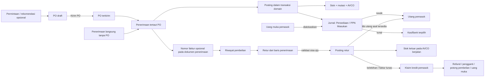

# Audit Modul Gudang — UX, Pembelian, Penerimaan, dan Retur

Tanggal pemeriksaan: **15 November 2026** 
Repository: `/home/najib/Downloads/bisa-erp-rilis-terbaru/bisa-erp` 
Branch/HEAD: `main` / `5117392ea635a3622f49413682ac398164cd6042` 
Status working tree: **sudah berisi perubahan lokal sebelum audit**. Perubahan itu dipertahankan; audit ini hanya menambahkan file laporan ini.

## 1. Ringkasan

Modul Gudang mempunyai implementasi operasional yang luas: master produk dan pemasok, permintaan dan rekomendasi pembelian, PO, penerimaan parsial, uang muka, retur pemasok, transfer, penyesuaian, stok opname, reservasi, riwayat pergerakan, dan valuasi. PO dan penerimaan memang terhubung ke stok serta pembukuan; alur ini bukan sekadar tampilan.

Untuk pertanyaan operasional utama:

- **Pembelian kredit:** posting penerimaan menambah stok dan membuat utang pemasok. Jurnal mendebit Persediaan sebesar DPP, mendebit PPN Masukan bila dipakai, lalu mengkredit Utang Pemasok.
- **Pembelian tunai:** jurnal yang sama mengkredit akun Kas/Bank yang dipilih, bukan Utang Pemasok.
- **Uang muka pemasok:** bagian uang muka dikredit ke akun uang muka pada jurnal penerimaan; sisanya masuk ke utang atau akun Kas/Bank sesuai cara pembelian.
- **Retur pembelian:** alur utama dimulai dari penerimaan pembelian yang sudah terposting. Nomor faktur pemasok, bila dicatat, membantu pencarian; sumber kuantitasnya tetap baris penerimaan. Posting mengurangi stok pada AVCO berjalan, mengurangi utang penerimaan asal bila masih ada, dan mencatat sisa sebagai klaim kredit pemasok.

Temuan paling penting adalah penerimaan fisik dan faktur/tagihan pemasok saat ini merupakan **satu dokumen posting**. Nomor faktur opsional dan dapat dicatat setelahnya, tetapi pencatatannya tidak membuat jurnal tagihan baru atau mengubah nilai, pajak, dan tanggal pembukuan. Ini bisa sederhana dan benar bila praktik perusahaan selalu menerima barang dan faktur bersamaan. Jika keduanya dapat terpisah, sistem belum menyediakan pencocokan PO–penerimaan–faktur.

Tiga masalah UX/workflow yang terbukti dari source:

1. Harga beli PO dapat diubah saat penerimaan, tetapi validasi PO hanya membandingkan pemasok, produk, dan kuantitas; tidak ada pemeriksaan selisih harga.
2. Pilihan retur masih menampilkan penerimaan yang sudah pernah diretur. Form mengisi kuantitas asli, bukan sisa yang masih dapat diretur; backend baru menolak kelebihan saat submit.
3. Daftar PO hanya menyediakan pencarian nomor/pemasok dan pagination, tanpa filter status atau tanggal untuk pekerjaan yang menunggu.

Audit visual halaman aktual **belum dapat disahkan**. Request halaman Gudang tanpa sesi autentikasi dialihkan HTTP 307 ke `/login`; karena itu hasil desktop/tablet/mobile, kontras, fokus keyboard, modal, dan keterbacaan tabel belum dilihat di browser. Source memperlihatkan pola komponen yang cukup konsisten, tetapi itu bukan bukti kualitas render.

## 2. Cakupan dan metodologi

Pemeriksaan mencakup 36 file route `page.tsx` di bawah `src/app/app/gudang`, menu Gudang, komponen form/list utama, server actions/domain, schema, dan tes relevan. Source CodeGraph menyatakan source yang dikembalikan adalah isi on-disk saat ini. Repowise MCP dipanggil sekali tetapi indeks repo belum tersedia; hasilnya tidak digunakan. Pemeriksaan lanjutan memakai CodeGraph serta pencarian file dan pembacaan terarah.

Riset memakai skill `web-search` dan dokumentasi resmi sebagai pembanding pola produk, bukan sebagai requirement BISA ERP. Dokumentasi Odoo memisahkan vendor bill dari penerimaan dan menjelaskan pencocokan tiga arah PO–bill–receipt; Odoo juga mendokumentasikan credit note yang ditautkan ke vendor bill. Ini praktik produk yang dapat dipilih, bukan aturan yang otomatis wajib bagi perusahaan ini. Prinsip SAP Design System dipakai sebagai referensi UX: sederhana, koheren, adaptif, role-based, dan inklusif.

Tidak ada transaksi yang dibuat di database aktif. Tidak ada source/config aplikasi yang diedit. Pengujian terbatas pada dua tes unit yang menggunakan render statis dan mock action. Integration test/database, E2E, screenshot, dan simulasi input authenticated **NOT RUN**.

## 3. Arsitektur dan inventaris fitur

Menu Gudang di `src/lib/modules.ts:153-184` dikelompokkan menjadi Pengadaan, Persediaan, Operasi Stok, dan Data Master, dengan Ringkasan sebagai pintu modul. Source yang ditelusuri menunjukkan fitur berikut:

| Kelompok | Halaman/fungsi yang ditemukan | Bukti implementasi utama |
|---|---|---|
| Data master | Produk, SKU/barcode, kategori, satuan/kemasan, pemasok/pelanggan, impor data | `/produk`, `/kategori-satuan`, `/pemasok`, `/impor`; form dan action katalog |
| Perencanaan pembelian | Rekomendasi pembelian, permintaan pembelian, PO | `/rekomendasi`, `/purchase-request`, `/pembelian`; status PO draft/terkirim/parsial/diterima/dibatalkan |
| Penerimaan | Penerimaan langsung atau tertaut PO; pemasok, gudang, qty, harga beli, diskon, pajak, nomor faktur, uang muka, batch/ED/seri; riwayat dan cetak GRN | `receipt-form.tsx`, `inventory/receipts.ts`, `receipt-stock.ts`, `receipt-journal.ts` |
| Retur pemasok | Retur dari penerimaan atau manual; kategori/alasan; draf/post; batch; penyelesaian sebagai pengganti, refund, kredit, atau uang muka | `/retur-pembelian/**`, `supplier-return-form.tsx`, `supplier-returns/**` |
| Operasi stok | Mode antrean operasi, transfer, penyesuaian, barang rusak/hilang/kedaluwarsa, stok opname/tugas hitung | `/operasi`, `/transfer`, `/penyesuaian`, `/opname` |
| Kontrol dan laporan stok | Reservasi, pergerakan/kartu stok, nilai persediaan, peringatan stok/ED | `/reservasi`, `/pergerakan`, `/nilai`, ringkasan Gudang |
| Uang muka pemasok | Catat, lihat sisa, alokasi pada penerimaan, dan konversi kredit retur menjadi uang muka | `/uang-muka`, `purchase-advances.ts`, `receipt-advance.ts` |

Daftar ini membuktikan keberadaan jalur source, bukan bahwa setiap interaksi berhasil diuji di browser atau database aktif.

## 4. Alur aktual pembelian, penerimaan, dan retur

### Pembelian dan jurnal

PO adalah dokumen komitmen. Halaman PO menjelaskan bahwa stok dan utang baru dicatat saat barang diterima (`src/app/app/gudang/pembelian/page.tsx:49-53`). Status PO Draf harus dikirim sebelum penerimaan dapat ditautkan; penerimaan parsial memperbarui kuantitas yang sudah diterima. Pemeriksaan domain mengunci PO dan mencegah penerimaan melebihi sisa kuantitas (`src/server/purchasing.ts:286-360`). Penerimaan langsung tanpa PO juga didukung.

Pada form penerimaan, pilihan awal adalah **Pembelian kredit**. UI menjelaskan bahwa pembelian kredit menambah utang dan tunai memilih akun Kas/Bank (`src/components/gudang/receipt-form.tsx:53-92, 621-629`). PPN dihitung dari DPP dan hanya dapat dipakai bila akun PPN Masukan telah dipetakan (`:590-607`).

Jurnal yang ditemukan pada `src/server/inventory/receipt-journal.ts:55-133`:

| Mode | Debit | Kredit |
|---|---|---|
| Kredit tanpa uang muka | Persediaan = DPP; PPN Masukan bila ada | Utang pemasok = total bruto |
| Tunai tanpa uang muka | Persediaan = DPP; PPN Masukan bila ada | Akun Kas/Bank yang dipilih = total bruto |
| Dengan uang muka | Persediaan = DPP; PPN Masukan bila ada | Akun uang muka sebesar alokasi; sisa ke Utang atau Kas/Bank |

Contoh aritmetika struktur jurnal (ilustrasi, bukan transaksi DB): pembelian DPP Rp1.000.000 dan PPN Rp110.000 menghasilkan debit Rp1.000.000 Persediaan dan Rp110.000 PPN Masukan; kredit Rp1.110.000 ke Utang jika kredit, atau Kas/Bank jika tunai. Jika Rp300.000 uang muka dipakai pada pembelian kredit, kredit dibagi Rp300.000 uang muka dan Rp810.000 utang.

`createReceipt` memvalidasi PO sebelum penulisan, lalu menyimpan receipt, mengalokasikan uang muka, memutasi stok, memperbarui PO, dan memposting jurnal dalam rangkaian transaksi domain yang sama (`src/server/inventory/receipts.ts:124-220`). Ini bukti desain transaksi dari source; forced failure/rollback PostgreSQL tidak diuji dalam audit ini.

### Retur pembelian

Jalur yang direkomendasikan oleh UI adalah memilih penerimaan pembelian terposting. Form membawa pemasok, gudang, dan `receiptLineId` dari baris penerimaan (`src/app/app/gudang/retur-pembelian/baru/page.tsx:90-110`). Pilihan retur menampilkan nomor faktur bila tercatat, nomor penerimaan, tanggal, pemasok, dan PO bila ada (`:161-183`). Nomor faktur bukan entity dokumen tersendiri; schema yang ditemukan menyimpan `supplierInvoiceNumber` langsung di `stock_receipts` (`src/db/schema/inventory.ts:250`).

Backend membatasi retur dari receipt pada sisa qty baris tersebut dan memvalidasi lagi ketika posting (`src/server/supplier-returns/provenance.ts:131-207`, `posting.ts:409-417`). Return manual memiliki validasi provenance yang lebih luas per pemasok/produk.

Saat posting, biaya barang dibekukan pada AVCO saat itu; retur dari receipt mengurangi payable receipt asal lebih dahulu, sementara sisa nilainya menjadi kredit pemasok. Return manual menggunakan urutan saldo supplier-wide. Jurnal mendebit utang bruto dan/atau klaim kredit, mengkredit Persediaan, serta membalik PPN Masukan yang dialokasikan (`src/server/supplier-returns/posting.ts:230-299, 301-305, 431-457`). Resolution form mendukung refund, pengganti, offset pembelian berikutnya, dan uang muka; uang muka dari kredit retur diposting sebagai reklasifikasi, lalu dapat teralokasi pada penerimaan berikutnya (`posting.ts:499-512`).

## 5. Temuan

| ID | Modul/fitur | Prioritas dan status | Bukti aktual | Dampak dan langkah perbaikan | Reproduksi dan regresi |
|---|---|---|---|---|---|
| WH-01 | Penerimaan vs faktur pemasok | **MEDIUM · DESIGN GAP · confidence tinggi** | Faktur hanya field opsional `stock_receipts.supplierInvoiceNumber` (`schema/inventory.ts:250`). Penerimaan yang sama menambah stok dan memposting AP/Kas serta pajak (`inventory/receipts.ts:171-220`, `receipt-journal.ts:55-133`). Action setelah posting hanya mencatat nomor faktur; tidak membentuk bill atau jurnal tagihan terpisah (`receipt-invoice.ts:8-84`). | Jika faktur selalu datang bersama barang, berikan label yang eksplisit “Penerimaan & Faktur” dan jadikan aturan nomor faktur jelas. Jika invoice dapat datang terpisah, modelkan dokumen vendor bill dan pencocokan dengan PO/receipt, termasuk tanggal invoice, qty/harga/PPN/biaya, pembayaran, dan reversal. Putuskan kebijakan perusahaan sebelum migrasi model. | Isi penerimaan tanpa nomor faktur, posting, kemudian catat nomor dari detail. Amati bahwa stok/jurnal sudah tercatat dan hanya nomor yang berubah. Regresi: invoice sebelum/sesudah receipt, receipt parsial, duplicate invoice per supplier, nilai/PPN berbeda, dan rekonsiliasi stok–AP–GL. Tidak dijalankan pada DB. |
| WH-02 | Selisih harga PO dengan penerimaan | **MEDIUM · DESIGN GAP/CONFIRMED source · confidence tinggi** | `lockPurchaseOrderForReceipt` hanya menerima `productId` dan `qty`, lalu membatasi pemasok/status/sisa qty (`src/server/purchasing.ts:286-360`). Ringkasan selisih form hanya membandingkan kuantitas (`receipt-form.tsx:195-230`). Harga beli pada baris penerimaan dapat diedit (`src/components/gudang/line-editor.tsx:443-453`) dan harga tersebut menjadi basis nilai stok/jurnal. | Harga faktur yang berbeda dari PO dapat masuk ke AVCO dan AP tanpa peringatan selisih. Tambahkan pembandingan harga PO–penerimaan serta batas toleransi dan persetujuan pengecualian setelah kebijakan nilai disetujui. Jangan mengunci harga secara kaku bila praktik pemasok memang memperbolehkan perubahan. | Buat PO 10 unit @Rp10.000, tautkan penerimaan 10 unit, ubah harga beli ke Rp12.000. Source menunjukkan validasi PO tidak membawa harga dan dialog selisih hanya qty. Regresi: tepat pada harga, selisih dalam/batas, selisih di atas batas, diskon, kemasan, PPN, dan otorisasi override. Reproduksi source-derived, bukan DB. |
| WH-03 | Picker retur dari penerimaan | **MEDIUM · DESIGN GAP/CONFIRMED source · confidence tinggi** | Query picker hanya memfilter receipt `posted`, sumber `purchase`, dan supplier ada; tidak menghitung sisa kuantitas retur (`src/server/catalog/receipt-links.ts:29-70`). Halaman memuat kembali qty asli receipt ke form (`src/app/app/gudang/retur-pembelian/baru/page.tsx:97-105`). Guard server mengurangi seluruh retur posted dari qty asal dan menolak nilai di atas saldo (`src/server/supplier-returns/provenance.ts:172-207`). | Dokumen yang sudah habis diretur tetap tampak valid. Retur parsial memaksa petugas mengetahui sisa sendiri; nilai bawaan qty penuh dapat ditolak saat posting. Hitung `qtyAvailable` per receipt line pada pilihan, keluarkan dokumen habis atau tandai “sudah habis”, tampilkan “diterima / sudah diretur / sisa”, dan isi qty awal tidak lebih dari sisa. | Receipt 10 unit, retur posted 4 unit; pilih receipt yang sama lagi. Picker tetap menawarkannya dan form memuat 10; posting 10 ditolak karena sisa 6. Sintetis/source-derived; tidak dieksekusi pada DB. Regresi juga perlu untuk dua retur bersamaan dan return void. |
| WH-04 | Daftar PO dan antrean pembelian | **MEDIUM · DESIGN GAP/CONFIRMED source · confidence tinggi** | Route PO menerima hanya `page` dan `q`; query meneruskan hanya dua parameter itu (`src/app/app/gudang/pembelian/page.tsx:24-43`). UI toolbar hanya mencari nomor PO/nama pemasok dan halaman 40 baris (`:66-92`). Status ditampilkan sebagai kolom tetapi tidak dapat difilter dari daftar tersebut. | Ketika PO bertambah, menemukan order “terkirim/parsial”, order terlambat, atau pekerjaan penerimaan butuh pencarian/halaman tambahan. Tambahkan filter status, pemasok, tanggal/jadwal tiba dan tindakan kerja “menunggu penerimaan”; pertahankan paginasi server. | Dengan PO beberapa status, buka daftar dan cari filter status/tanggal: hanya q tersedia. Regresi: kombinasi q/status/pemasok/tanggal tetap mempertahankan query saat paginasi/reset dan tetap server-side. |
| WH-05 | Nilai retur, payable, dan nota kredit supplier | **MEDIUM · DESIGN GAP / UNRESOLVED POLICY · confidence sedang** | Nilai retur dihitung memakai AVCO saat posting, bukan harga historis per unit di invoice (`src/server/supplier-returns/posting.ts:67-100, 301-305`). Retur dari receipt menargetkan payable receipt itu, dan kelebihannya menjadi klaim kredit (`:431-457`). Tidak ditemukan entity vendor bill/credit-note terpisah; nomor invoice disimpan di receipt. | Belum ditentukan apakah supplier credit/tax reversal harus mengikuti harga invoice asal atau nilai AVCO; juga belum jelas bagaimana nomor nota kredit supplier dan tanggal pajaknya disimpan. Jangan ubah angka secara asumtif. Tetapkan kebijakan akuntansi dan bukti dokumen; bila butuh legal/audit reference terpisah, simpan referensi credit note pada dokumen resolusi/retur. | Uji receipt dengan harga 10k, perubahan AVCO berikutnya 12k, return parsial, invoice belum lunas vs lunas, PPN, refund dan credit. Cocokkan stok, credit supplier, PPN dan jurnal menurut kebijakan yang disetujui. Belum bisa diberi hasil PASS karena kebijakan belum diputuskan dan DB workflow tidak dijalankan. |

### Hal yang sudah bekerja dengan baik pada source

- PO Draf memiliki aksi **Kirim & terima** yang meminta konfirmasi, mengirim PO melalui aksi yang sama, lalu membuka penerimaan dengan baris PO terisi (`purchase-order-actions.tsx:15-23, 51-62`).
- PO yang salah pemasok, masih draft, sudah penuh, dibatalkan, atau melebihi sisa tidak bisa dipakai untuk receiving (`purchasing.ts:286-360`).
- Receipt idempotency key dibuat per form; receipt, stok, advance, PO, dan jurnal berada dalam transaksi domain penerimaan.
- Nomor faktur supplier dicek duplikat dengan normalisasi huruf besar/kecil dan lock pemasok (`receipt-invoice.ts:40-58`; `receipts.ts:325-341`).
- Return dari receipt mengikat source line, dan validasi ulang saat posting mencegah retur kumulatif melewati kuantitas asal.
- Supplier return dari receipt mengurangi payable receipt yang sama, bukan diam-diam membebankan ke invoice supplier lain; selisih menjadi supplier credit (`posting.ts:431-457`).
- Stok, batch, serial, kemasan, riwayat dokumen, dan akun berjalan melalui service server; halaman tidak berdiri sendiri tanpa backend.

## 6. UI/UX dan kemudahan kerja

### Yang terlihat pada source

- Sidebar Gudang mempunyai empat kelompok kerja yang masuk akal: Pengadaan, Persediaan, Operasi Stok, dan Data Master (`src/lib/modules.ts:165-184`).
- List utama menggunakan pola `DataList`/`DataListToolbar` dan pagination server; riwayat penerimaan serta pergerakan stok mempunyai filter tanggal, pemasok/gudang/status/sumber sesuai layar. PO lebih terbatas seperti temuan WH-04.
- Form PO, penerimaan, dan retur memakai `DocumentForm`; line editor dan input angka digunakan ulang. Ini membantu konsistensi, bukan bukti visual yang rapi.
- Penerimaan memisahkan pembelian tunai/kredit dari penerimaan lain, menampilkan hint lawan akun, ringkasan total, PPN/uang muka, dan ringkasan selisih kuantitas PO (`receipt-form.tsx:461-481, 539-667, 671-708`).
- Retur dari receipt mengunci supplier/gudang/baris sumber; versi desktop menggunakan tabel dan source menyediakan layout mobile yang berbeda (`supplier-return-form.tsx:360-386, 497-512`).
- Picker retur menggunakan server-side search dan pagination 20 dokumen; daftar penerimaan/PO menggunakan pagination 40 baris.

### Friksi yang ditemukan

1. **Retur dari invoice/receipt memerlukan pencarian, pilih dari dropdown, lalu klik “Muat baris penerimaan”.** Ini menjaga konteks sumber, tetapi pengguna tidak melihat jumlah yang masih bisa diretur sebelum form dimuat; lihat WH-03.
2. **Penerimaan menggabungkan banyak keputusan dalam satu workspace:** sumber, gudang, tanggal, supplier, invoice number, PPN, akun tunai, advance, PO, kuantitas, harga, diskon, kemasan, batch, tanggal kedaluwarsa, dan serial. Pengelompokan DocumentForm mengurangi kepadatan, tetapi browser belum dipakai untuk memastikan hierarki, panjang halaman, atau fokus.
3. **Nomor invoice opsional pada penerimaan kredit** dapat membuat utang terbentuk sebelum nomor/tagihan supplier tercatat. Ini membutuhkan indikator status “faktur belum dicatat” yang mudah dilihat di antrean utang/riwayat.
4. **Daftar PO belum berorientasi tindakan.** Kolom progres/status ada, tetapi filter untuk status yang perlu diproses tidak ada.
5. Source memakai teks 10–11 px untuk beberapa bantuan dan metadata. Ini adalah sinyal untuk verifikasi keterbacaan, bukan vonis font buruk tanpa tampilan browser.

### Status visual aktual

`GET /app/gudang/penerimaan` dari sesi tanpa autentikasi memberi **HTTP 307, `Location: /login`**. Halaman Gudang yang sesungguhnya belum diuji pada desktop/tablet/mobile. Tidak ada klaim bahwa tabel, warna, kontras, jarak, modal, keyboard, atau accessibility sudah baik. Uji berikutnya perlu memakai akun audit dan data sintetis pada lingkungan disposable.

## 7. Pembanding praktik ERP dan keputusan yang diperlukan

Dokumentasi resmi Odoo 20.0 memodelkan vendor bill sebagai dokumen payable dan menawarkan kebijakan tagihan berdasarkan kuantitas yang dipesan atau yang diterima; fitur three-way matching membandingkan PO, vendor bill, dan receipt. Ini menunjukkan pemisahan sebagai pola umum ERP, namun bukan keharusan untuk setiap minimarket. [Manage vendor bills — Odoo 20.0](https://www.odoo.com/documentation/20.0/applications/inventory_and_mrp/purchase/manage_deals/manage.html)

Odoo juga memperlihatkan credit note/refund dari vendor bill terkait dan payment terpisah ketika uang dikembalikan. Ini relevan sebagai model keterlacakan invoice dan klaim, bukan penetapan aturan pajak Indonesia. [Credit notes and refunds — Odoo 20.0](https://www.odoo.com/documentation/20.0/applications/finance/accounting/customer_invoices/credit_notes.html)

SAP Design System menyebut prinsip sederhana, koheren, role-based, adaptif lintas perangkat, dan inklusif. Pada Gudang, penerapannya berarti layar berorientasi antrean pekerjaan dan dokumen, bukan menambah kartu dekoratif; input yang jarang dipakai dapat ditampilkan bertahap, sedangkan jumlah yang dapat diretur dan status dokumen harus selalu jelas. [SAP Design System](https://www.sap.com/design-system)

Hal yang perlu diputuskan pemilik proses/akuntansi sebelum perubahan model:

| Keputusan | Pilihan yang perlu ditentukan |
|---|---|
| Faktur datang bersama barang atau terpisah | Tetap satu posting penerimaan; atau faktur terpisah dan pencocokan PO–receipt–bill, termasuk GRNI/periode pengakuan |
| Selisih harga PO vs faktur | Toleransi nominal/persen, siapa yang boleh override, dan alasan/audit trail |
| Dasar nilai retur | AVCO berjalan atau harga invoice asal; perlakuan selisih nilai dan PPN |
| Retur saat invoice sudah lunas | Refund tunai/bank, supplier credit note, dipotong pembelian berikutnya, atau uang muka |
| Retur manual tanpa invoice asal | Diizinkan untuk claim supplier-wide atau wajib menautkan receipt/invoice tertentu |

Tidak satu pun keputusan ini diasumsikan sebagai kebijakan perusahaan.

## 8. Verifikasi

| Pemeriksaan | Hasil aktual |
|---|---|
| CodeGraph | Dipakai untuk eksplorasi route, komponen, service, dan caller. Hasil eksplorasi menyatakan source yang ditampilkan adalah isi on-disk. |
| Repowise | **UNAVAILABLE** untuk analisis: repo belum mempunyai indeks Repowise. Tidak menjalankan init karena indeksasi adalah keputusan pengguna. |
| Tes unit aman | **PASS** — `pnpm exec vitest run tests/unit/a28-ui5-consistency.test.ts tests/unit/a28-ui4-workflow.test.ts`; 2 file, 22 tes. Tes memakai mocked server actions/render statis. |
| Tes integration Gudang | **NOT RUN** — suite menggunakan database dan konfigurasi test khusus `*_test`; audit tidak menulis transaksi ke `localhost:5433/bisa_erp`. |
| E2E / screenshot / browser desktop-tablet-mobile | **BLOCKED/NOT RUN** — route Gudang dialihkan ke `/login`; tidak memakai sesi atau kredensial pengguna. |
| Alur bisnis interaktif dari awal sampai GL | **NOT RUN** di UI/DB. Yang dilaporkan sebagai perilaku implementasi berasal dari source; bukan transaksi live. |
| Runtime health | **PASS untuk konektivitas dasar saja** — `/api/health` menjawab DB `ok`, migration current `0080_tenant_pos_references`. Ini tidak menguji workflow Gudang. |
| Perubahan source/config/database | **Tidak dilakukan.** Hanya laporan audit ini dibuat. |

Tes integration yang tersedia dan layak dijalankan pada database disposable mencakup `purchase-order.test.ts`, `a28-ui4-po-send-receive.test.ts`, `supplier-returns.test.ts`, `purchase-advances.test.ts`, dan `packaging-purchasing.test.ts`. Keberadaan file test tidak dihitung sebagai PASS.

## 9. Roadmap perbaikan yang disarankan

| Urutan | Pekerjaan | Alasan/dependensi |
|---|---|---|
| 1 | Tetapkan kebijakan faktur, selisih harga, retur invoice lunas, basis nilai retur, dan bukti nota kredit supplier | Mencegah desain database/jurnal salah arah. WH-01 dan WH-05 bergantung pada keputusan ini. |
| 2 | Tambahkan pemeriksaan harga PO–penerimaan dengan batas toleransi dan override beralasan | Menghindari harga faktur berbeda masuk ke HPP/AP tanpa diketahui. WH-02. |
| 3 | Tampilkan qty diterima, qty sudah diretur, qty sisa dan nilai klaim pada picker/form retur; sembunyikan/labeli sumber habis | Menghilangkan percobaan posting yang pasti gagal. WH-03. |
| 4 | Buat filter antrean PO berdasarkan status, pemasok, tanggal/jadwal tiba dan progres penerimaan | Mempercepat tindak lanjut pembelian yang masih terbuka. WH-04. |
| 5 | Jalankan browser audit pada akun dan database disposable | Verifikasi tampilan sesungguhnya, tablet/mobile, keyboard, scanner, error/loading/empty state, dan jumlah langkah. |
| 6 | Jalankan integration suite pada PostgreSQL `*_test` lalu validasi silang nilai stok, AP/credit, PPN, jurnal, dan reversal | Bukti runtime untuk transaksi atomicity, retry, partial receipt/return, dan concurrency. |

## 10. Area belum terverifikasi

- Tidak ada visual screenshot halaman Gudang yang authenticated.
- Tidak ada browser keyboard/scanner test untuk penerimaan atau retur.
- Tidak ada integration test pada database disposable selama audit ini.
- Tidak ada EXPLAIN/query benchmark untuk volume PO, invoice, dan receipt besar.
- PPN dan nota kredit belum diverifikasi terhadap keputusan pajak perusahaan; dokumentasi produk ERP bukan konsultasi hukum/pajak lokal.
- Belum diketahui apakah gudang perlu bin/rak, quality hold, atau nomor dokumen supplier yang berbeda; kebutuhan tidak ditandai MISSING karena requirement belum diberikan.

## 11. Lampiran bukti source utama

- Menu Gudang: `src/lib/modules.ts:153-184`.
- Daftar PO, pencarian/pagination: `src/app/app/gudang/pembelian/page.tsx:24-92`.
- Alur kirim dan terima PO: `src/components/gudang/purchase-order-actions.tsx:15-23,51-62`.
- Validasi PO untuk receipt: `src/server/purchasing.ts:286-360`.
- Pilihan sumber pembayaran: `src/components/gudang/receipt-form.tsx:53-92,621-667`.
- Pengecekan selisih qty PO: `src/components/gudang/receipt-form.tsx:191-230`.
- Harga beli editable: `src/components/gudang/line-editor.tsx:443-453`.
- Pembentukan receipt dan rangkaian stok/PO/jurnal: `src/server/inventory/receipts.ts:124-220`.
- Posting debit/kredit receipt: `src/server/inventory/receipt-journal.ts:55-133`.
- Invoice number field: `src/db/schema/inventory.ts:250`; pencatatan pasca-posting: `src/server/inventory/receipt-invoice.ts:8-84`.
- Picker retur: `src/server/catalog/receipt-links.ts:29-70`; opsi dan paging UI: `src/app/app/gudang/retur-pembelian/baru/page.tsx:122-190`.
- Nilai qty awal dari receipt: `src/app/app/gudang/retur-pembelian/baru/page.tsx:97-105`.
- Batas retur per receipt line: `src/server/supplier-returns/provenance.ts:131-207`.
- Penilaian dan alokasi jurnal retur: `src/server/supplier-returns/posting.ts:230-305,409-457`.
- Konversi supplier credit menjadi uang muka: `src/server/supplier-returns/posting.ts:499-512`.
- Redirect aktual tanpa sesi: `GET /app/gudang/penerimaan` → HTTP 307 `/login`.

---

**Kesimpulan audit:** fungsi inti Gudang sudah cukup luas dan beberapa kontrol penting—PO/receipt quantity, source-linked return, idempotency, dan posting stok/jurnal—sudah ada pada source. Namun audit ini belum membuktikan kesiapan operasional penuh. Faktur yang menempel pada penerimaan, selisih harga yang tidak diperiksa, kuantitas sisa retur yang tersembunyi, serta antrean PO yang minim filter harus diselesaikan atau diputuskan sebelum menyebut workflow Gudang mudah dan terkendali.

## 12. Checkpoint remediasi — 15 November 2026

Bagian ini memperbarui status temuan setelah keputusan proses dari pemilik: faktur pemasok umumnya diterima bersama barang; selisih harga PO harus ditampilkan dan memerlukan konfirmasi serta alasan; stok retur keluar pada AVCO berjalan, sedangkan klaim pemasok mengikuti nilai faktur sumber. Bagian ini mempertahankan temuan awal sebagai histori audit dan mengganti status verifikasinya.

| ID | Status setelah perubahan | Bukti implementasi terkini | Dampak/batas verifikasi |
|---|---|---|---|
| WH-01 | **KEPUTUSAN DITERAPKAN SEBAGIAN** | Workflow penerimaan tetap menjadi satu dokumen stok + utang sesuai pola faktur datang bersama barang. Tidak dibuat alur vendor bill mandiri. | “Biasanya bersama” masih memungkinkan faktur datang kemudian; nomor invoice tetap opsional. Kasus terpisah belum didukung dan perlu keputusan jika terjadi secara operasional. |
| WH-02 | **DIKERJAKAN** | Varians harga dihitung server-side dari harga PO dan biaya stok penerimaan per satuan dasar; penerimaan split-batch digabung per produk. Dialog menampilkan expected/received/delta dan mewajibkan alasan minimal 5 karakter. Domain memvalidasi ulang di transaksi, menyimpan alasan, dan menulis rincian audit. Bukti: `src/server/inventory/receipts.ts:159-180,261-275`, `src/components/gudang/receipt-confirmations.tsx:49-94`, `src/components/gudang/receipt-form.tsx:209-230,388-405,800-820`. | Penerimaan tanpa PO tidak memerlukan alasan varians. Tidak ada toleransi nominal; semua perbedaan terukur ditampilkan. Integrasi DB belum dijalankan. |
| WH-03 | **DIKERJAKAN** | Picker retur sekarang mengeluarkan receipt yang seluruh qty-nya sudah diretur dan menampilkan sisa; halaman memuat sisa per baris, hanya menyertakan baris yang masih tersedia, dan memberi empty state jika sumber habis. Qty form dibatasi ke sisa dan server tetap menghitung ulang saat posting. Bukti: `src/server/catalog/receipt-links.ts:33-120`, `src/app/app/gudang/retur-pembelian/baru/page.tsx:44-62,98-133,188-200`, `src/components/gudang/supplier-return-form.tsx:47-49,520-535,578-590,687-708`. | Batas kuantitas di form membantu input; kewenangan akhir tetap di validasi domain transaksi. Uji concurrency membutuhkan integration DB. |
| WH-04 | **DIKERJAKAN** | Daftar PO memiliki filter server-side status, pemasok, dan rentang tanggal; parameter dipertahankan pada pagination dan status disanitasi sebelum dipakai. Bukti: `src/app/app/gudang/pembelian/page.tsx:25-62,92-126`, `src/server/catalog/stock-documents.ts:283-314`. | Filter jadwal jatuh tempo khusus belum dibuat; filter tanggal dokumen tersedia. UI browser belum diverifikasi dengan akun authenticated. |
| WH-05 | **ATURAN SUMBER DITERAPKAN; AKUN VARIANS PERLU VALIDASI AKUNTANSI** | Retur yang tertaut receipt mengambil klaim bersih/PPN dari snapshot baris invoice asal; stok tetap keluar pada AVCO saat posting. Kredit dialokasikan hanya terhadap utang receipt asal, sisanya menjadi kredit pemasok. Selisih bersih saat ini memakai pemetaan akun `cogs`; detail nilai invoice, PPN yang dibalik, nilai stok dan selisih ditampilkan di detail serta cetak. Bukti: `src/server/supplier-returns/posting.ts:255-336,339-376,498-608`, `src/app/app/gudang/retur-pembelian/[id]/page.tsx:259-302`, `src/app/app/gudang/retur-pembelian/[id]/cetak/page.tsx:205-232`. | Pemilik menyetujui basis AVCO vs invoice. Repository tidak memiliki mapping khusus purchase-price variance; pemakaian `cogs` adalah mapping yang tersedia dan harus disetujui akuntansi sebelum posting riil. Retur manual tanpa receipt tetap memakai aturan lama karena tidak memiliki bukti invoice sumber. |

### Perhitungan sintetis yang diverifikasi

Helper costing menyimpan nilai 4 desimal dan diuji secara independen:

- Invoice asal: baris net Rp100.000 + PPN Rp11.000. Retur 20% mengklaim net Rp20.000, PPN Rp2.200, kredit bruto Rp22.200.
- Nilai stok yang keluar Rp18.000 pada AVCO berjalan menghasilkan varians net Rp2.000; jurnal seimbang dengan kredit faktur Rp22.200, pengurangan persediaan Rp18.000, pembalikan PPN Rp2.200, dan akun varians Rp2.000.
- Harga PO Rp10.000, penerimaan Rp12.000 × 5 unit menghasilkan varians Rp10.000. Baris penerimaan dari batch yang sama dihitung sebagai rata-rata tertimbang, bukan ditampilkan sebagai varians duplikat.

Kasus ini memverifikasi helper dan jurnal melalui pemeriksaan source, tetapi posting domain penuh belum diuji pada database disposable. Pembulatan PPN parsial tetap menggunakan skala penyimpanan 4 desimal; rekonsiliasi integrasi untuk banyak retur parsial masih dibutuhkan.

### Verifikasi remediasi aktual

| Pemeriksaan | Hasil |
|---|---|
| `pnpm typecheck` | **PASS** — `tsc --noEmit` selesai dengan exit code 0. |
| Tes unit terarah | **PASS** — 3 file, 27 tes: `warehouse-purchase-controls`, `a28-ui4-workflow`, `a28-ui5-consistency`. |
| ESLint file terdampak | **PASS** — tidak ada error atau warning setelah menghapus dua import tidak terpakai. |
| `pnpm exec drizzle-kit check` | **PASS** — snapshot/migration chain dinyatakan konsisten. |
| `git diff --check` | **PASS** — tidak ada whitespace error. |
| Migration 0081 | **DIBUAT, BELUM DITERAPKAN** — menambahkan alasan varians, nilai klaim/varians retur, dan indeks sisa retur. Database aktif tidak diubah. DB yang masih di migration 0080 belum dapat menjalankan query yang memakai kolom baru sebelum migration ini diterapkan. |
| Tes integration/E2E/visual | **NOT RUN** — tidak memakai DB aktif. Route Gudang sebelumnya mengalihkan sesi tanpa autentikasi ke `/login`; screenshot workflow desktop/tablet/mobile belum diperoleh. |
| Production build | **NOT RUN** — proses Next.js sudah berjalan pada workspace yang sama; build paralel berisiko menggunakan direktori `.next` yang sama. Typecheck dan lint dipakai sebagai verifikasi source pada checkpoint ini. |

### Pekerjaan tersisa sebelum menyebut Gudang siap operasional

1. Akuntansi menetapkan apakah selisih invoice terhadap AVCO memang memakai akun HPP atau akun varians pembelian khusus.
2. Terapkan migration 0081 pada database yang digunakan setelah backup terverifikasi; migration belum dijalankan pada database aktif.
3. Jalankan `purchase-order`, `a28-ui4-po-send-receive`, `supplier-returns`, `purchase-advances`, dan `packaging-purchasing` integration suite terhadap PostgreSQL khusus test. Rekonsiliasi stok, supplier credit/AP, PPN, jurnal, retry dan concurrent return.
4. Jalankan browser audit pada sesi test authenticated; cek picker, dialog selisih, form retur, cetak, keyboard, mobile/tablet, serta jumlah langkah pengguna.
5. Putuskan fallback ketika invoice tidak datang bersama receipt dan aturan retur manual tanpa receipt. Ini tetap unresolved; fitur standalone vendor bill tidak ditambahkan berdasarkan asumsi.

**Keterbatasan indeks:** CodeGraph tersedia dan dipakai untuk eksplorasi source/callers. Repowise MCP tersedia tetapi menjawab bahwa repository belum memiliki indeks; indexing tidak dijalankan. Tidak ada migrasi DB, reset, atau transaksi pengguna yang dilakukan pada checkpoint ini.

### Pemeriksaan database aktif setelah checkpoint

Pada 15 November 2026, `GET http://127.0.0.1:3000/api/health` mengembalikan HTTP 503 dengan `db: ok`, `migration: 0081_warehouse_return_price_controls`, dan `migrationStatus: behind`. Koneksi TCP ke PostgreSQL lokal port 5433 tersedia. Migration tidak diterapkan. `scripts/backup.sh` menolak membuat backup tanpa `BACKUP_PASSPHRASE` atau `BACKUP_PASSPHRASE_FILE`; keduanya tidak dikonfigurasi di `.env.local` maupun `/etc/bisa-erp/backup.conf`. Skrip mewajibkan backup terenkripsi dan memverifikasi arsip, sehingga saya tidak melewatinya. Manifest menunjukkan backup terenkripsi sebelumnya dibuat pada `2026-11-15T00:03:32Z`; itu bukan backup segar untuk perubahan skema ini. Sampai kredensial backup tersedia dan 0081 diterapkan, runtime yang memanggil kolom baru belum siap dipakai.

## 13. Revalidasi fungsi, workflow, form, dan tabel — 15 November 2026

Pemeriksaan ini menelusuri kembali route, action, service, schema, pola UI, dan tes yang tersedia. **Ada di source** tidak disamakan dengan **lulus end-to-end**: database test belum dikonfigurasi, health aktif masih 503, dan sesi browser authenticated tidak tersedia.

### 13.1 Matriks fungsi Gudang

| Alur/fungsi | Bukti implementasi | Penilaian validasi |
|---|---|---|
| Rekomendasi stok → permintaan pembelian → persetujuan/konversi → PO | Route `/rekomendasi`, `/purchase-request`, `/purchase-request/[id]`, `/pembelian`; komponen rekomendasi, request, approval, PO; test `purchase-order.test.ts`. | Jalur tersedia di source. Saran kuantitas dan pemakaian tiap status belum dibuktikan melalui transaksi test saat ini. |
| PO → penerimaan parsial/penuh → faktur/utang/kas → stok | Route `/pembelian/[id]`, `/penerimaan`, `/penerimaan/riwayat`; domain receipt memvalidasi PO, supplier dan qty, menjalankan idempotency, stok/batch/serial, update progress PO, advance, dan jurnal dalam transaksi. | Jalur utama sesuai kebijakan pemilik bahwa faktur umumnya datang bersama barang. Nomor invoice masih opsional; faktur terpisah belum punya bill mandiri dan pencatatan setelah posting hanya menyimpan nomor invoice. Runtime belum diuji. |
| Retur pembelian → pengurangan stok → AP/kredit pemasok → penyelesaian | Route `/retur-pembelian`, `/baru`, `/[id]`, `/riwayat`; create/post/void, potong utang receipt asal, aplikasi kredit, refund, uang muka, replacement dan penyelesaian tertulis. AVCO stok dipisahkan dari klaim faktur. | Cakupan source luas, tetapi ada mismatch batch pada WH-06. Nomor nota kredit supplier belum berupa field terstruktur khusus. |
| Operasi stok | Route `/pergerakan`, `/nilai`, `/penyesuaian`, `/opname`, `/opname/lembar-hitung`, `/transfer`, `/reservasi`, `/operasi`; queue menampilkan PO terbuka, transfer dan tugas opname. | Fungsi tersedia di source; approval, reversal, race/concurrency, dan rekonsiliasi belum diuji di DB test. |
| Master data dan impor | `/produk`, detail produk, `/pemasok`, detail pemasok/pelanggan, `/kategori-satuan`, `/master-data`, `/impor`; meliputi SKU/barcode, satuan/kemasan, partner, kategori, dan wizard import. | CRUD dan impor tersedia di source; file massal, duplicate resolution, dan pengalaman browser belum diuji dengan data realistis. |

### 13.2 Temuan baru

| ID / modul / fitur | Severity · verification | Evidence | Expected vs actual, reproduksi, dampak | Root cause dan rekomendasi | Regression test |
|---|---|---|---|---|---|
| **WH-06 · Warehouse · Retur receipt dengan SKU batch-tracked di beberapa batch** | **HIGH · CONFIRMED dari source; runtime belum diuji** | `src/app/app/gudang/retur-pembelian/baru/page.tsx:71-83`; `src/components/gudang/supplier-return-form.tsx:134-151,261-274,550-569`; `src/server/supplier-returns/provenance.ts:131-206`; `src/server/supplier-returns/posting.ts:82-158`. Test batch yang tersedia membuat return manual, bukan banyak baris batch tertaut receipt (`tests/integration/supplier-returns.test.ts:764-848`). | **Expected:** retur mempertahankan batch pada baris receipt asal atau memakai alokasi batch eksplisit yang tervalidasi pada line sumber. **Actual:** baris awal tiap receipt line mengisi `batchId: ""`; validasi form menggunakan `productId|batchId`, sehingga dua baris SKU sama dengan batch kosong ditolak sebagai duplikat. Jika pengguna memilih batch berbeda agar lolos, guard server memeriksa supplier/source line/qty tetapi tidak mencocokkan batch terpilih dengan batch asal; posting mengurangi batch pilihan atau FEFO. **Reproduksi:** terima satu SKU batch-tracked dalam dua batch/ED → mulai retur dari receipt → submit dengan alokasi otomatis ditolak; pilih batch lain → server tidak menolak mismatch asal. **Dampak:** alur retur dapat terhenti atau stok lot/ED yang keluar berbeda dari lot yang diklaim ke pemasok. | **Root cause:** halaman tidak meneruskan batch asal sebagai bagian `InitialReturnLine`, dan guard provenance tidak memvalidasi relasi line–batch. **Rekomendasi:** bawa ID batch sumber ke form; alokasi/qty retur harus terikat ke batch pada line asal, lalu validasi ulang di domain dalam transaksi. Jangan sekadar menghapus validasi duplikat UI. | Integration test: satu SKU dalam dua batch pada satu receipt; retur parsial/satu atau dua batch; lot sumber habis; batch bukan sumber ditolak; concurrent return dan void mengembalikan qty dengan benar. Jalankan di PostgreSQL `*_test`. |
| **WH-07 · Warehouse UX · Pola tabel daftar** | **MEDIUM · DESIGN GAP terkonfirmasi dari source** | `src/components/blocks/data-list.tsx:34-79`; `src/components/blocks/data-table/data-table.tsx:1-75`; daftar PO `src/app/app/gudang/pembelian/page.tsx:88-189`, penerimaan `src/app/app/gudang/penerimaan/riwayat/page.tsx:97-300`, produk `src/app/app/gudang/produk/page.tsx:205-305`. | **Expected:** pola daftar konsisten untuk filter, pencarian, sorting, aksi, dan pagination. **Actual:** shell `DataList` seragam, tetapi isi tabel dirakit manual per halaman; komponen TanStack tersedia namun bukan pola umum daftar Gudang. Fitur sort/filter/selection/kolom dan responsivitas berbeda antar-list. Ini membuktikan inkonsistensi implementasi, bukan bahwa hasil render pasti buruk. Dampak: pengguna perlu mempelajari pola yang berubah antarpekerjaan. | **Root cause:** komponen data list hanya menyatukan bingkai/toolbar/pagination, sementara implementasi tabel tiap halaman terpisah. **Rekomendasi:** standardisasi list report untuk antrean operasional dengan filter server-side, urutan stabil, empty/loading/error states, dan row actions. Gunakan TanStack pada tabel kompleks yang memerlukan sort/column visibility/selection; pertahankan HTML table semantik untuk tabel kecil. | Test filter + sort + pagination atas hasil penuh, bukan halaman aktif; empty/loading/error; keyboard; tablet/mobile; tenant isolation. Hindari mengganti semua tabel tanpa kebutuhan per layar. |
| **WH-08 · Warehouse UX/accessibility · Form dokumen** | **MEDIUM · DESIGN GAP dari source; hasil aksesibilitas visual belum diuji** | `src/components/blocks/document-form.tsx:24-75`; contoh form receipt `src/components/gudang/receipt-form.tsx:490-502,757-764`, PO `src/components/gudang/purchase-order-form.tsx:121-212`, retur `src/components/gudang/supplier-return-form.tsx:353-478`. | **Expected:** form bisa dipakai lewat keyboard dengan submit dan umpan balik error dekat field. **Actual:** `DocumentForm` adalah bingkai `div`; form PO/penerimaan/retur/adjustment/transfer tidak memakai elemen `<form>`/`type=submit`; submit manual dipicu tombol `type=button`, beberapa kesalahan tampil sebagai toast. Label kontrol native cukup banyak digunakan—ini positif—namun Enter-submit dan validasi form native tidak tersedia. Dampak: entri berulang via keyboard lebih lambat dan pengguna perlu mencari field yang salah setelah membaca toast. | **Root cause:** state dan submit dikelola imperatif per komponen, sedangkan komponen bersama hanya mengatur layout. **Rekomendasi:** gunakan `<form>` per workspace atau dukung perilaku keyboard/fokus/error summary yang setara; tampilkan pesan dekat field dan pertahankan validasi server. | Playwright keyboard-only; Enter submit; fokus menuju field invalid; pesan dibaca screen reader; double-submit terkunci; cancel/confirmation benar. |

### 13.3 Penilaian source-level UX

- **Form:** `DocumentForm` menetapkan urutan header → baris barang → ringkasan; ringkasan sticky pada desktop; panduan/opsi lanjutan dapat dilipat; bilah aksi bawah konsisten. Form retur menampilkan tabel desktop dan kartu mobile serta label input kuantitas/batch. Ini pola source yang terarah, tetapi bukan bukti hasil render.
- **Tabel:** route Gudang memakai `DataList` dan pagination/filter server-side; produk dan pemasok memiliki sorting server-side. Mayoritas list lain memakai urutan tetap dan markup tabel per halaman. TanStack Table ada di dependency dan komponen bersama, tetapi belum diterapkan konsisten di Gudang. TanStack tidak perlu dipaksakan pada setiap tabel kecil; perilaku antar-list perlu diseragamkan.
- **Keterbacaan harga:** dialog selisih menjelaskan basis harga bersih setelah diskon dan tanpa PPN input yang dapat dikreditkan, tetapi angka keluar sebagai string 4 desimal tanpa format Rupiah/pemisah ribuan (`src/components/gudang/receipt-confirmations.tsx:63-77`). Format lokal akan mempercepat pembacaan; prioritas rendah.
- **Visual/responsif/accessibility aktual:** **UNVERIFIED**. App health 503 dan sesi browser authenticated tidak tersedia; kontras, clipping, ukuran huruf, sticky actions, keyboard, dan layout tablet belum dilihat.

### 13.4 Pembanding praktik resmi

SAP Fiori List Report menggunakan struktur filter bar, tabel, dan toolbar; `DataList` Gudang searah pada bingkai filter/list/pagination tetapi fitur tabel berbeda antarhalaman. [SAP Help — List Report Elements](https://help.sap.com/docs/SAPUI5/285985e9cf204697aee91214fc19d95c/1cf5c7f5b81c4cb3ba98fd14314d4504.html?version=1.84)

Odoo mendukung bill berdasarkan qty dipesan atau diterima serta three-way matching PO–receipt–bill. BISA ERP menyatukan invoice/AP dengan receipt; ini masuk akal untuk jalur normal yang dipilih pemilik selama invoice memang bersama barang, namun pengecualian invoice terpisah tetap tidak tercakup. [Odoo — Manage vendor bills](https://www.odoo.com/documentation/master/applications/inventory_and_mrp/purchase/manage_deals/manage.html)

Dokumentasi Odoo menyatakan retur supplier mengurangi nilai stok sesuai metode costing yang dipilih, sehingga keputusan AVCO sesuai pola costing tersebut. Odoo juga memodelkan vendor credit note dari bill asal dan reversal jurnal; BISA ERP belum menyimpan nomor nota kredit supplier sebagai field terstruktur. [Odoo — Stock movement valuation](https://www.odoo.com/documentation/20.0/applications/inventory_and_mrp/inventory/inventory_valuation/operations_valuation.html), [Odoo — Credit notes and refunds](https://www.odoo.com/documentation/20.0/applications/finance/accounting/customer_invoices/credit_notes.html)

Ini pembanding pola produk, bukan sertifikasi standar internasional. **Kesimpulan revalidasi:** cakupan fungsi Gudang luas dan pola UI source cukup terarah, tetapi belum siap dinyatakan enterprise/produksi karena WH-06 mengganggu retur batch, migration 0081 membuat health aktif 503, dan tes integrasi/browser belum dilakukan.

### 13.5 Tes checkpoint revalidasi

| Pemeriksaan | Hasil aktual |
|---|---|
| `pnpm typecheck` | **PASS** — `tsc --noEmit`, exit code 0. |
| Tes unit terarah | **PASS** — 5 file, 48 tes: `warehouse-purchase-controls`, `opname-count`, `a28-ui4-workflow`, `a28-ui5-consistency`, `vitest-db-guard`. |
| Tes integration | **BLOCKED/NOT RUN** — `BISA_TEST_DATABASE_URL` dan `BISA_TEST_DIRECT_URL` tidak tersedia; guard Vitest mengharuskan keduanya mengarah ke database loopback bernama `*_test`. |
| Browser/screenshot/accessibility | **NOT RUN** — tidak ada tool browser terhubung; health app 503 dan tidak ada sesi authenticated. |

## 14. Remediasi terarah — 15 November 2026

Bagian ini memperbarui status WH-06/07/08 dan keterbacaan selisih harga tanpa menghapus temuan awal. Perbaikan source tidak mengubah skema atau database.

| Temuan | Status terbaru | Bukti perubahan dan hasil |
|---|---|---|
| **WH-06 — Batch retur berbeda dari batch penerimaan asal** | **DIPERBAIKI DI SOURCE; END-TO-END UNVERIFIED** | Detail penerimaan sekarang mengembalikan ID dan qty batch berdasarkan perusahaan, produk, gudang, nomor batch, dan ED dengan perbandingan null-safe (`src/server/catalog/document-details.ts:175-216`). Form retur berbasis penerimaan mengunci lot sumber yang tercatat, membatasi qty awal ke stok lot, menampilkan sisa faktur dan stok lot, serta meminta pilihan batch eksplisit untuk data warisan tanpa identitas lot (`src/app/app/gudang/retur-pembelian/baru/page.tsx:71-139`; `src/components/gudang/supplier-return-form.tsx:49-83,153-176,596-658,718-772`). Server memeriksa gudang sumber, mewajibkan batch untuk produk terlacak, membandingkan identitas batch pada pembuatan draf dan mengulang verifikasi relasi produk/gudang/batch saat posting (`src/server/supplier-returns/returns.ts:300-389`; `src/server/supplier-returns/provenance.ts:134-252`; `src/server/supplier-returns/posting.ts:486-500`). Tes unit menguji kecocokan nomor batch dan ED serta mismatch. PostgreSQL integration test untuk posting, stok lot habis, dan concurrency belum dijalankan. |
| **WH-07 — Perilaku tabel daftar berbeda antarhalaman** | **OPEN — BELUM DIREFAKTOR MENYELURUH** | Bingkai `DataList` tetap memberi toolbar/pagination yang seragam; PO sudah memiliki filter server-side pada checkpoint sebelumnya. Perubahan ini tidak mengubah semua tabel Gudang ke TanStack, sebab tabel berhalaman memerlukan sorting/filtering server-side agar hasil tidak hanya berlaku pada 40 baris yang sedang tampil. Adopsi perlu dilakukan per daftar dengan kontrak query yang konsisten dan bukti browser; belum ada klaim bahwa pola semua tabel kini seragam. |
| **WH-08 — Submit keyboard dan umpan balik form** | **DIPERBAIKI SEBAGIAN; VISUAL/ACCESSIBILITY UNVERIFIED** | `DocumentForm` kini dapat merender form native secara opt-in (`src/components/blocks/document-form.tsx:24-86`). Form PO dan retur menggunakan Enter untuk menyimpan draf; tindakan posting retur tetap memerlukan klik eksplisit agar Enter tidak memposting transaksi (`src/components/gudang/purchase-order-form.tsx:121-210`; `src/components/gudang/supplier-return-form.tsx:405-525`). Penerimaan dan form operasi stok lain belum diubah; pesan kesalahan dekat field, keyboard-only, screen reader, dan hasil mobile/tablet belum diuji. |
| **Format angka dialog selisih harga** | **DIPERBAIKI DI SOURCE** | Harga PO, harga terima, varians per unit, dan jumlah varians diformat dengan `formatIDR` (`src/components/gudang/receipt-confirmations.tsx:1-3,63-78`). Render visual masih belum diperiksa melalui browser. |

### 14.1 Verifikasi perbaikan

| Pemeriksaan | Hasil aktual |
|---|---|
| `pnpm typecheck` | **PASS** — exit code 0 setelah perubahan. |
| ESLint pada file yang disentuh | **PASS** — exit code 0. |
| Tes unit terarah | **PASS** — 3 file, 19 tes: `supplier-return-batch`, `a28-ui5-consistency`, `warehouse-purchase-controls`. |
| `git diff --check` | **PASS** — tidak ada whitespace error. |
| Tes integrasi retur pada PostgreSQL disposable | **BLOCKED/NOT RUN** — `BISA_TEST_DATABASE_URL` dan `BISA_TEST_DIRECT_URL` tidak tersedia; tidak diarahkan ke database aktif. |
| Runtime Gudang | **BLOCKED** — `GET /api/health` aktual HTTP 503, `db: ok`, schema tertinggal dari migration wajib `0081_warehouse_return_price_controls`. |
| Backup terenkripsi | **BLOCKED** — `BACKUP_PASSPHRASE`/`BACKUP_PASSPHRASE_FILE` dan `/etc/bisa-erp/backup.conf` tidak tersedia. Migration tidak diterapkan dan data aktif tidak disentuh. |
| Browser visual, keyboard dan accessibility | **NOT RUN** — tool browser/sesi authenticated tidak tersedia. |

### 14.2 Sisa sebelum workflow Gudang dinyatakan siap pakai

1. Sediakan konfigurasi kunci backup terenkripsi melalui mekanisme secret yang dikelola pemilik; setelah backup baru diverifikasi, terapkan migration 0081 pada database yang memang digunakan aplikasi. Jangan memakai database operasional sebagai test database.
2. Jalankan suite retur, penerimaan, dan batch pada PostgreSQL disposable; uji multi-batch satu SKU, lot sumber habis, return parsial, void, retry, dan dua posting bersamaan. Rekonsiliasi qty batch, AVCO, klaim faktur, PPN, akun varians, AP/kredit, dan jurnal.
3. Tentukan bersama akuntansi apakah selisih nilai invoice dengan AVCO memakai akun HPP yang sekarang dipetakan atau akun varians pembelian khusus. Ini memengaruhi jurnal; belum diubah berdasarkan asumsi.
4. Lakukan keyboard-only dan visual review pada akun test authenticated untuk PO, receipt, retur, tabel history, cetak, desktop/tablet/mobile. Lanjutkan validasi pesan error field dan aksesibilitas.
5. Standarkan tabel antrean Gudang per use case. Gunakan sorting/filtering server-side untuk dataset besar, urutan stabil, dan TanStack hanya pada daftar yang memerlukan interaksi tabel tambahan; jangan mengurutkan hanya halaman aktif.
6. Uji exception invoice supplier yang datang terpisah dari barang. Jalur normal yang dipilih pemilik tetap “faktur biasanya bersama barang”; fitur vendor bill terpisah belum ditambahkan.

**Status akhir checkpoint ini:** mismatch lot yang terbukti sudah ditutup pada source dan terlindungi tes unit, serta alur keyboard aman untuk menyimpan draf PO/retur. Modul Gudang **belum siap dinyatakan siap operasional/produksi** karena migrasi aktif belum diterapkan, integration/browser validation tertahan, WH-07 masih terbuka, dan akun varians masih menunggu validasi akuntansi.

## 15. Perbaikan runtime — pemilih sumber retur pembelian

| Temuan | Severity/status | Bukti dan tindakan |
|---|---|---|
| **WH-09 — Query qty tersedia pada `listSupplierReturnReceiptOptions` gagal saat membuka form retur** | **HIGH · CONFIRMED; SOURCE FIXED; READ-ONLY RUNTIME VERIFIED** | Query availability mengorelasikan `supplier_return_lines.receipt_line_id` dengan kolom `id` baris penerimaan di dalam SQL template. SQL hasil Drizzle menurunkan referensi korelasi menjadi `"id"` yang tidak berkualifikasi, padahal subquery juga memuat `return_line.id` dan `return_doc.id`. Perbaikan memberi alias stabil `availability_line` dan mengkualifikasi referensi korelasi sebagai `"availability_line"."id"` (`src/server/catalog/receipt-links.ts:1-2,90-114`). |

Tes dilakukan melalui `withCompanyReadOnly` terhadap database lokal aktif, memakai query dan fungsi server yang sama seperti halaman. Hasil aktual: **2 penerimaan, 2 baris opsi, qty tersedia berhasil dihitung**. Transaksi disetel `READ ONLY`; tidak ada data berubah. Verifikasi source setelah perbaikan: `pnpm typecheck` **PASS**, ESLint file terdampak **PASS**, dan tes unit terarah **PASS** (2 file, 7 tes). Tes unit tersebut tidak menjalankan PostgreSQL; verifikasi runtime di atas merupakan pembuktian terpisah untuk query ini.

Ini menutup error query yang dilaporkan, tetapi tidak mengubah blocker kesiapan Gudang yang tercatat pada bagian 14: health endpoint masih menunjukkan database tertinggal dari migration 0081, tes integrasi penuh serta visual authenticated belum dijalankan, dan kebijakan akun varians masih perlu validasi.
